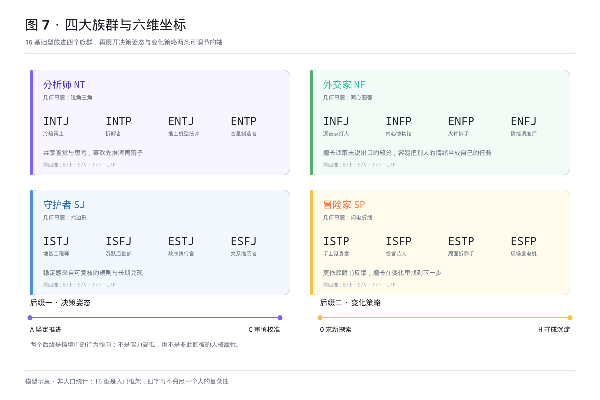
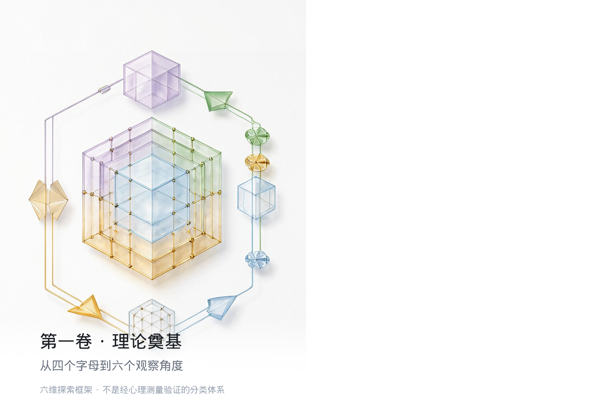
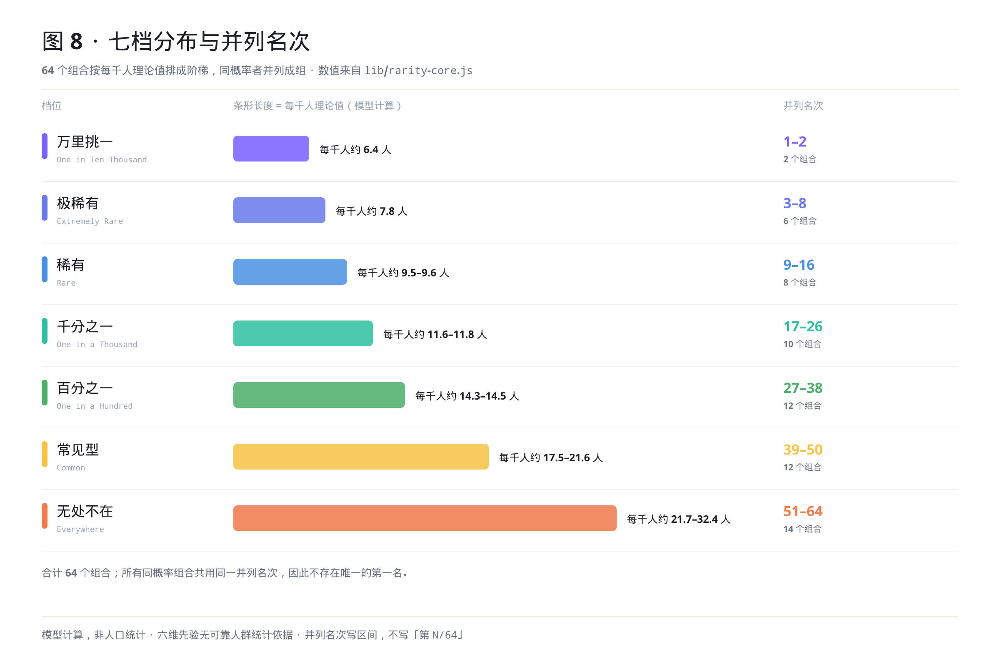
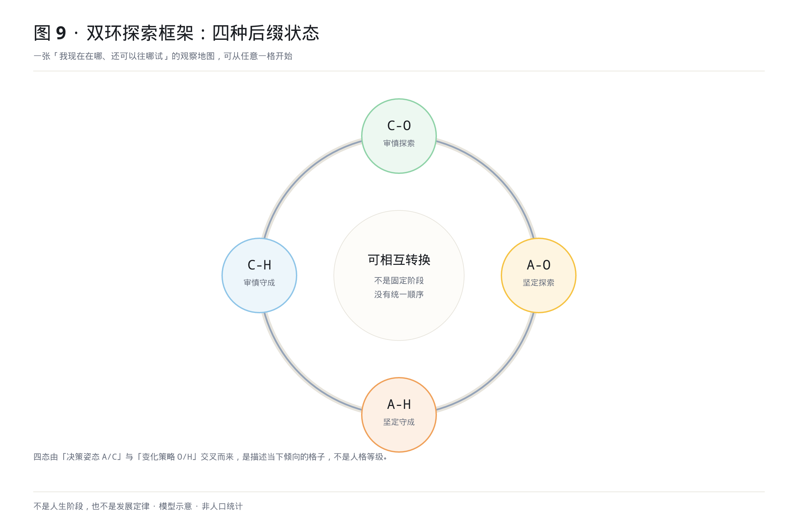
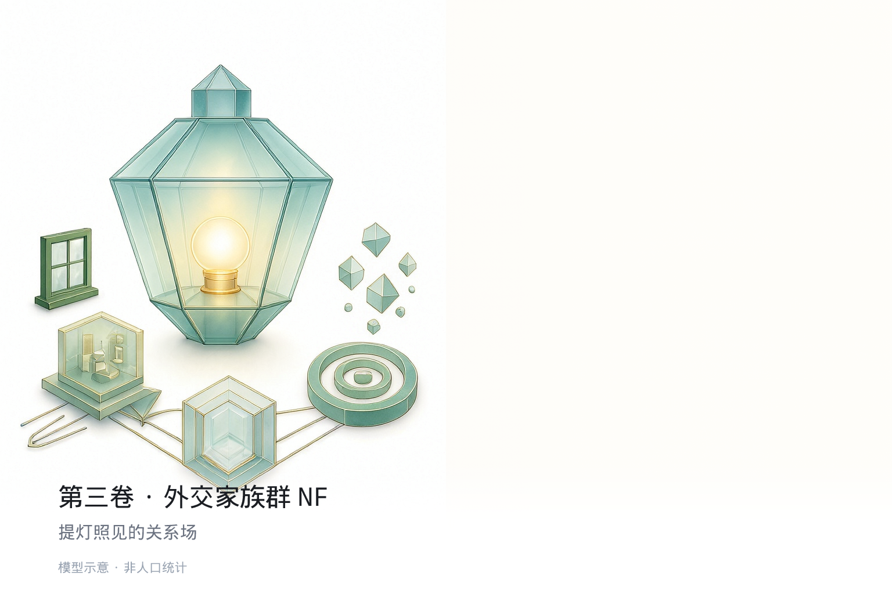
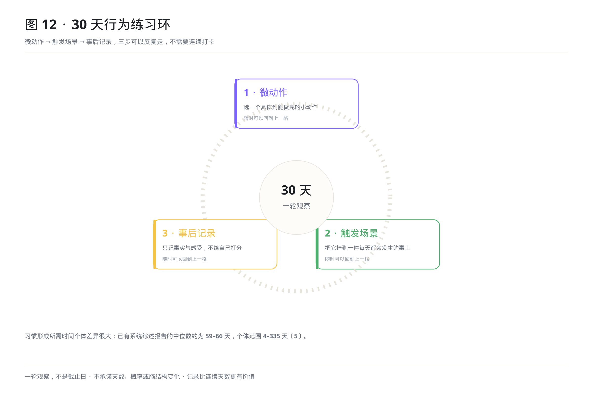

# 千分之一的你

**副标题**:从16型到64型:人格画像、差异理解与成长练习

**英文品牌标识**:64 PERSONALITIES · ONE UNIQUE YOU

**作者**:朱宝

**总字数**:约 203000 字 (精确 202922 个中文字)

**结构**:六卷 24 章 + 卷首 2 篇 + 卷末 5 篇 + 插图 12 处

---

## 出版说明与证据边界

本书把 16 型作为自我探索的入门框架。四个字母提供的是偏好排序,不穷尽一个人的复杂性;
人格特征具有连续性与情境性。在此之上,本书提出六维探索模型与 64 种组合画像——
**64 型是作者提出的扩展探索框架,不是经心理测量验证的标准分类体系**。

书中出现的脑科学与神经术语均为帮助理解认知过程的通俗类比,不代表某个人格组合拥有
专属神经结构,也不构成心理咨询、诊断或医疗建议。四种调节状态是一张观察地图,
不是固定的人生阶段或普遍发展顺序。

**关于书名**:「千分之一」是文学化的独特性表达,不是对任何人格组合真实发生率的统计
承诺。按本书模型计算,最稀有的组合约为每千人 6.4 人;六维先验无可靠人群统计依据,
六维独立只是模型假设,分档不代表真实人口分布。

**文献体系**:正文中带 `〔n〕` 的引用回指卷末《参考文献》;每章末附「研究证据与模型边界」
栏目,卷末附录 A 给出模型与研究方法,附录 C 给出 64 型索引。三条阅读路径见《阅读指南》。

**插图**:全书 12 处插图均为帮助理解的示意,不是证据。涉及稀有度的图均标注
「模型计算,非人口统计」;终稿图见同目录 `插图/`,图注清单见 `docs/插图清单与图注.md`。

---

**本书声明**:本稿为出版级定稿,未授权不得转载、摘录或用于商业用途。所有角色、案例与场景均为虚构,仅作为理解人格差异的说明性素材,不构成对任何真实个体的人格评判。

**核心标签**:MBTI 十六型人格 | 六维探索模型 | 64 型组合画像 | 中式社交场域 | 行为练习 | 差异理解

---

# 全书目录

- [插图目录（12 处）](#插图目录)

## 卷首

- [序言 · 从四个字母到六维坐标](#序言-从四个字母到六维坐标)
- [阅读指南 · 三种读法与几条约定](#阅读指南-三种读法与几条约定)

## 第一卷 · 理论奠基

- [第一章 · 16型的边界：为什么同一个标签装不下完整的你](#第一章-16型的边界：为什么同一个标签装不下完整的你)
- [第二章 · 六维人格探索模型：认知偏好与行为倾向](#第二章-六维人格探索模型：认知偏好与行为倾向)
- [第三章 · 稀有度金字塔：一张模型地图，不是人口统计](#第三章-稀有度金字塔：一张模型地图，不是人口统计)
- [第四章 · 四种调节状态与双环探索框架](#第四章-四种调节状态与双环探索框架)
## 第二卷 · 分析师族群 NT

- [第五章 · INTJ 冷焰策士](#第五章-intj-冷焰策士)
- [第六章 · INTP 拆解者](#第六章-intp-拆解者)
- [第七章 · ENTJ 推土机型统帅](#第七章-entj-推土机型统帅)
- [第八章 · ENTP 变量制造者](#第八章-entp-变量制造者)
## 第三卷 · 外交家族群 NF

- [第九章 · INFJ 深夜点灯人](#第九章-infj-深夜点灯人)
- [第十章 · INFP 内心博物馆](#第十章-infp-内心博物馆)
- [第十一章 · ENFP 火种捕手](#第十一章-enfp-火种捕手)
- [第十二章 · ENFJ 情绪调度师](#第十二章-enfj-情绪调度师)
## 第四卷 · 守护者族群 SJ

- [第十三章 · ISTJ 地基工程师](#第十三章-istj-地基工程师)
- [第十四章 · ISFJ 沉默后勤部](#第十四章-isfj-沉默后勤部)
- [第十五章 · ESTJ 秩序执行官](#第十五章-estj-秩序执行官)
- [第十六章 · ESFJ 关系维系者](#第十六章-esfj-关系维系者)
## 第五卷 · 冒险家族群 SP

- [第十七章 · ISTP 手上见真章](#第十七章-istp-手上见真章)
- [第十八章 · ISFP 感官诗人](#第十八章-isfp-感官诗人)
- [第十九章 · ESTP 局面拆弹手](#第十九章-estp-局面拆弹手)
- [第二十章 · ESFP 现场发电机](#第二十章-esfp-现场发电机)
## 第六卷 · 刻意练习工程

- [第二十一章 · 对标式练习:从标签到行动的第一步](#第二十一章-对标式练习-从标签到行动的第一步)
- [第二十二章 · 场景化行为练习·上:饭局、微信与熟人社会的低耗能进化](#第二十二章-场景化行为练习-上-饭局、微信与熟人社会的低耗能进化)
- [第二十三章 · 场景化行为练习·下:职场生态位跃迁与亲密关系翻译器](#第二十三章-场景化行为练习-下-职场生态位跃迁与亲密关系翻译器)
- [第二十四章 · 30天人格探索与行为练习计划(终章)](#第二十四章-30天人格探索与行为练习计划-终章)

## 卷末 · 附录与参考文献

- [附录 A · 模型说明与研究方法](#附录-a-模型说明与研究方法)
- [附录 B · 术语表](#附录-b-术语表)
- [附录 C · 64 型索引](#附录-c-64-型索引)
- [参考文献](#参考文献)
- [作者后记 · 把比喻还给比喻](#作者后记-把比喻还给比喻)

# 插图目录

> 本目录列出全书 12 处插图位与图注。插图为帮助理解的示意，不是证据；终稿图位于 `插图/`。

| 图号 | 建议位置 | 图题 | 图注 | 状态 |
|---:|:---|:---|:---|:---|
| 1 | 第一卷卷首 | 从四个字母到六个观察角度 | 前四维排成底座，后两维像两只可调的旋钮。六维是本书提出的探索框架，不是经心理测量验证的分类体系。 | 终稿已落盘 `插图/图01.png`（1536×1024） |
| 2 | 第二卷卷首 | 分析师族群的推演世界 | 棋盘、分形与分岔路线。NT 四型共享直觉与思考，差异在决策姿态与变化策略上展开。 | 终稿已落盘 `插图/图02.png`（1536×1024） |
| 3 | 第三卷卷首 | 提灯照见的关系场 | 多面体提灯与光域。NF 四型擅长读取未说出口的部分，也最容易把别人的情绪当成自己的任务。 | 终稿已落盘 `插图/图03.png`（1536×1024） |
| 4 | 第四卷卷首 | 被守护的秩序 | 六边形晶格、拱桥与记忆胶囊。SJ 四型的稳定感来自可复核的规则与长期兑现。 | 终稿已落盘 `插图/图04.png`（1536×1024） |
| 5 | 第五卷卷首 | 正在发生的现场 | 运动中的琥珀多面体与音浪环。SP 四型更依赖眼前反馈，擅长在变化里找到下一步。 | 终稿已落盘 `插图/图05.png`（1536×1024） |
| 6 | 第六卷卷首 | 一轮可重复的练习 | 四季符号与逐渐扩大的工具箱。30 天是一轮自我观察，不是习惯自动化的截止日。 | 终稿已落盘 `插图/图06.png`（1536×1024） |
| 7 | 卷首 · 目录后 | 四大族群与六维坐标 | 一张把 16 基础型放进 NT / NF / SJ / SP 四象限、再展开 A/C 与 O/H 两轴的索引图。族群色板取自视觉圣经：紫 / 绿 / 蓝 / 黄。 | 终稿已落盘 `插图/图07.png`（2400×1600） |
| 8 | 第三章 · 理论稀有度 | 七档分布与并列名次 | 64 个组合按每千人理论值排成阶梯，同概率者并列成组。**模型计算，非人口统计**；六维先验无可靠人群统计依据。 | 终稿已落盘 `插图/图08.png`（2400×1600，数据驱动） |
| 9 | 第四章 · 双环探索框架 | 四种调节状态的环 | `C-O` 审慎探索 / `A-O` 坚定探索 / `A-H` 坚定守成 / `C-H` 审慎守成画成可双向切换的环。**不是人生阶段，也不是发展定律**，可从任意一格开始。 | 终稿已落盘 `插图/图09.png`（2400×1600） |
| 10 | 第二卷前 · 族群导读 | 16 基础原型群像 | 16 张基础原型参考图拼成四列群像，每列一族群。称号是文学化命名，不是学术分类。 | 终稿已落盘 `插图/图10.png`（1800×2400） |
| 11 | 第三卷 · 场景页 | 饭局圆桌上的差异 | 一桌人里谁先敬酒、谁在接话、谁把话咽回去。场景与人物均为创作素材，不是访谈或调研记录。 | 终稿已落盘 `插图/图11.png`（1536×1024） |
| 12 | 第二十四章 · 练习计划 | 30 天行为练习环 | 「微动作 → 触发场景 → 事后记录」三步循环。**一轮观察，不是截止日**；记录比连续天数更有价值。 | 终稿已落盘 `插图/图12.png`（2400×1600） |

---



> **图 7 · 四大族群与六维坐标**　一张把 16 基础型放进 NT / NF / SJ / SP 四象限、再展开 A/C 与 O/H 两轴的索引图。族群色板取自视觉圣经：紫 / 绿 / 蓝 / 黄。

---

# 序言 · 从四个字母到六维坐标

做完一份人格测评，拿到四个字母，然后去搜「这个型的人是什么样」，大概是很多人都有过的经验。你会读到一些很准的句子，也会读到一些怎么都对不上的句子。于是有人怀疑测评不准，有人怀疑自己「不够典型」。

我更愿意把这种别扭当成一条线索。四个字母回答的是偏好的排序：你习惯从哪里取能、关注什么信息、依据什么下判断、怎样安排节奏。它们有用，也确实帮很多人第一次找到了描述自己的语言。但排序不回答另一个更贴近日常的问题——**当情境变了、压力来了、需要当场拍板时，你实际会怎么反应？**同一个 INFJ，在熟悉的团队里可以果断到近乎强硬，换到一个全是陌生人的饭局，可能整晚都在反复校准自己该不该开口。四个字母没变，人却明显不是同一个状态。

这本书想补上的，就是这一点情境的余地。在 16 型的前四维之外，我加了两个观察角度：**决策姿态（A/C）** 与 **变化策略（O/H）**。前者看你在不确定性面前更倾向推进判断还是审视风险，后者看你在新变化面前更倾向探索可能还是沉淀成果。16 × 2 × 2，于是有了 64 种组合。

我想说清楚，多出来的 48 个格子不是把人切得更细，更不是发现了 48 种新的「人格类型」。它们是同一套坐标下更细的观察位置，用来解释「为什么同一个标签装不下完整的你」。**64 型是本书提出的扩展探索框架，不是经心理测量验证的标准分类体系**；那两个新增维度描述的是更容易随情境变化的行为倾向，不是天生固定的属性，也不是能力高低。

这本书也不打算借脑科学为自己背书。初稿里曾经写过不少听起来很确凿的神经机制、样本量和百分比，出版前的审校把它们逐条删掉或降级了——不是因为那些比喻不好看，而是因为**一个比喻不该伪装成一份证据**。书中若还出现脑区、回路之类的说法，请一律当作帮助理解认知过程的通俗类比：它不代表某个组合拥有专属的神经结构，也不构成诊断、测评或医疗建议。真正可核验的研究，本书用 `〔编号〕` 回指书末参考文献；每章末的「研究证据与模型边界」栏目，会把【研究】【模型】【练习】三层分清楚。

书名里的「千分之一」，是一句文学化的话，不是人口统计承诺。它想说的是：把足够多的偏好、处境和选择放在一起看，每个人都会落到一个别人难以完全重合的位置上。稀有度那张表也一样，它是六个模型参数相乘算出来的相对次序，不是社会中真实存在的人口分层；64 个组合里大量同分并列，也没有唯一的第一名。**少见不等于更好，常见不等于更平庸。**

书的后半部分有大量中国式生活场景：饭局、微信群、跨部门会议、家庭聚会、相亲、年终汇报。它们不是调研数据，而是为了让「差异」这件事有一个可以看得见的舞台。第六卷的练习也一样，30 天只是一轮自我观察的周期，不是改造完成的截止日；习惯形成的时间个体差异很大，请以你自己的记录为准，而不是以书上的天数为准。

如果你只想知道「我该从哪一页开始」，翻到后面的《阅读指南》，那里有三条路径。如果你只想先看看自己那一个型，直接从第二卷到第五卷里找到对应的四字母章节即可，第一章到第四章可以留到之后再读。

最后，愿你把这本书用成一张地图，而不是一张标签。地图的作用是让你知道自己在哪、还可以往哪试试；它不负责替你决定去哪里。

朱宝
2026 年

---

# 阅读指南 · 三种读法与几条约定

## 一、这本书由什么组成

| 部分 | 内容 | 适合谁 |
|:---|:---|:---|
| 卷首 | 序言、本指南 | 所有读者 |
| 第一卷（第 1–4 章） | 16 型的边界、六维模型、理论稀有度、四种调节状态 | 想弄清「这套模型从哪来」的人 |
| 第二至第五卷（第 5–20 章） | NT / NF / SJ / SP 四大族群，16 个基础型各一章 | 想先找到自己的人 |
| 第六卷（第 21–24 章） | 双环练习、同源微调、跨族对标、30 天行为练习计划 | 想动手试试的人 |
| 卷末 | 附录 A 模型说明与研究方法、附录 B 术语表、附录 C 64 型索引、参考文献、作者后记 | 需要核对定义、数值与出处的人 |

正文共六卷二十四章。附录 C 是按本书模型计算生成的 64 型速查索引，数值与正文四态标题、网站榜单共用同一个事实源。

## 二、三条阅读路径

**路径 A · 先找自己（约 30 分钟）**
从附录 C 或目录里找到你的四字母章节 → 读该章的「原型底色与认知偏好」→ 对照四种调节状态，挑一个最像此刻的 → 直接翻到该章末尾的「可记录的行为实验」。第一卷可以之后再看。

**路径 B · 从头读到尾（系统阅读）**
按卷次顺序读。第一卷负责建立坐标与边界，第二至第五卷是同一坐标在不同族群上的展开，第六卷把坐标换成动作。建议读图鉴卷时只读自己所属的那一族，其余三族挑一两章对照，避免被 16 章细节淹没。

**路径 C · 带着一个问题读（实践取向）**
先写下此刻最想调整的一个具体场景，例如「跨部门会议上不敢当场拍板」「群里消息一多就想全部回完」。带着它去第六卷找对应的微动作，再回到所属章节看这个反应在模型里被放在哪一格。记录比阅读更重要。

> 三条路径不分高下。本书不要求你认同 64 型，只提供一组可以用来观察和记录差异的坐标。

## 三、怎么读一个图鉴章

每个图鉴章的固定板块依次是：**阅读说明（证据边界）** → 原型底色与认知偏好 → 四种调节状态 → 中国式生活切片 → 关系与沟通 → 可记录的行为实验 → 章末边界。

四态标题里会出现这样的写法：

```
`INFJ-C-O`（审慎探索）：极稀有，每千人约 7.8 人
```

请按下面三条来理解：

1. **「每千人约 X.X 人」是模型计算值**，不是人口普查结果，也不是对真实人群比例的估计。六个先验参数没有可靠的人群统计依据，六维相互独立也只是模型假设。
2. **只写档位、不写单一名次**。64 个组合全部存在同概率并列，所以本书不写「第 N/64」；需要精确并列区间时请查附录 C 或 `docs/64型稀有度权威表.md`。
3. **档位名是体感标签**（如「万里挑一」「无处不在」），只描述模型内部的相对次序，不代表稀有者更优秀，也不代表常见者更普通。

四态的顺序 `C-O → A-O → A-H → C-H` 是本书为叙述方便排的一张观察地图，**不是人生阶段、生命周期或普遍发展顺序**；四种状态可以相互转换，也可以长期停在某一格。

## 四、三层证据标注

全书用三个标记区分「这句话是什么」：

| 标记 | 含义 | 读法 |
|:---|:---|:---|
| 【研究】 | 已有公开、可核验的研究 | 带 `〔编号〕`，可在书末参考文献表查到；结论只在原样本与测量方式范围内成立 |
| 【模型】 | 本书原创框架 | 是作者的设定与解释，不是经心理测量验证的标准分类体系 |
| 【练习】 | 用于实践的行为假设 | 「可以试试」「记录自己的变化」，不承诺天数、概率或任何生理改变 |

正文里的 `〔1〕` 至 `〔6〕` 回指《参考文献》。**凡未列入该表的研究，本书不会用「研究表明」「实验显示」这类句式陈述**；每章末「研究证据与模型边界」栏目会再次列出该章可用与不可用的结论。

## 五、几条使用边界

- 本书可**用于**：自我观察、理解差异、沟通时的换位假设、设计个人行为实验。
- 本书**不用于**：招聘筛选、绩效评估、择偶评判、教育分流、心理诊断、医疗建议，也不用于给他人「定性」。
- 书中的人物、案例、对话与场景均为创作素材，不对应任何真实个体，也不是访谈或田野调查记录。
- 脑科学与神经术语一律作通俗类比读，不代表存在对应的专属神经结构。
- 第六卷的 30 天是一轮观察周期。目前关于习惯形成的研究显示个体差异很大〔4〕，中断后可以接上，不必从第 1 天重来。

## 六、如果想核对数字

附录 A 给出六维先验、计算公式与可复现路径；附录 C 给出 64 个组合的档位、并列名次与每千人理论值；两份数据都由 `lib/rarity-core.js` 生成，不手工填写。若你在正文、附录与网站榜单之间发现数值不一致，以该事实源为准。

---



> **图 1 · 从四个字母到六个观察角度**　前四维排成底座，后两维像两只可调的旋钮。六维是本书提出的探索框架，不是经心理测量验证的分类体系。

---

# 第一章 · 16型的边界：为什么同一个标签装不下完整的你

你一定有过这样的经历：做完一份 MBTI 测评，得到四个字母，然后在网上搜"XX型人格特点"，看到一堆让你觉得"好像有道理但又不完全是我"的描述——INFJ 被说成"神秘的理想主义者"，但你认识的那个 INFJ 明明是个执行力极强的产品总监；ENFP 被说成"热情的点子王"，但你自己作为 ENFP，却经常在深夜里因为一个没人在意的细节反复焦虑。你以为是测评不准，以为是自己"不是典型的"。更准确的说法是：四个字母提供的是偏好排序的入门框架，它有用，但并不穷尽一个人的复杂性。

MBTI 四个维度的测试题本身就是二分的——"你更喜欢和人聚会还是独处？"（E/I），"你更关注具体事实还是抽象理论？"（S/N）——每一道题只有两个选项，最终得到一个四字母组合。但这个测试题的设计，和"大脑本身是二分的"之间，没有任何科学上的必然关联。荣格本人在 1921 年的《心理类型》里就明确警告过：他提出的内倾/外倾、感觉/直觉，是**"描述性的极点"**，不是"互斥的类别"。人的真实状态是在两个极点之间的连续谱上的某个位置——你可能 55% 外倾 45% 内倾，也可能 60% 直觉 40% 感觉——但 MBTI 的测试题强制把你归入一个极点，然后得到一个看起来很精确的四字母标签。

这种"强制离散化"带来的，是一种很常见的别扭感：**同型不同命（Same Code, Different Life）**。同一个"INFJ"标签下，有人长于共情与陪伴，有人长于独立判断与长期规划；同一个"ENFP"标签下，有人四处点火，有人在深夜为一句没人在意的细节反复推敲。差别不在四个字母，而在面对不确定性时你如何判断、面对新变化时你如何选择——这正是本书要补上的两个维度。

心理学对「标签够不够用」早有讨论。McCrae 与 Costa 在 1989 年指出，MBTI 四个指数缺乏证据支持它们是彼此截然分开的类别，更接近连续分布的人格维度〔1〕；2025 年一项汇总 193 项研究的 Form M 心理测量综述则显示〔2〕，量表分数有不错的内部一致性与收敛效度，但结构效度与重测信度的独立研究仍然缺失。两件事可以同时成立：分数有用，但"16 个非此即彼的抽屉"不是人格的自然分界。

> **研究证据与模型边界**
> - 相关研究：〔1〕McCrae & Costa (1989)；〔2〕Erford et al. (2025)；〔5〕Hudson & Fraley (2015)。
> - 研究结论：人格特征更接近连续维度；量表分数具备一定测量价值。
> - 可以支持：把 16 型当作自我探索的入门框架。
> - 不能证明：存在可由脑电区分的离散人格类别，或任何"神经亚型"。
> - 本书如何使用：在前四维之外补充两个行为倾向维度，构成探索框架。

问题出在哪里？出在 MBTI 从一开始就**只测量了"认知功能的偏好顺序"**，但完全没有测量**"这些功能是在什么决策姿态与变化策略下运转的"**。一个 INFJ-A-O 和一个 INFJ-C-H，主导功能都是 Ni，辅助功能都是 Fe——但前者的 Ni 是"敢拍板的全景扫描"（A 坚定推进 + O 求新探索），后者的 Ni 是"在熟悉秩序里反复校准"（C 审慎校准 + H 守成沉淀）。用一句话来概括：**MBTI 告诉你"你的发动机是 V8 还是 V6"，但它没告诉你"你的变速箱是自动挡还是手动挡、你的油门是踩到底还是只踩了三分之一"**。而决定你人生走向的，恰恰是后面这两个变量。

这就是本书提出 64 型模型的核心理由：在传统 16 型的四个"认知底色维度"（E/I、S/N、T/F、J/P）之上，我们增加了两个**"行为倾向维度"**——**A/C（决策姿态：坚定推进 / 审慎校准）** 看你在不确定性面前如何判断和行动，**O/H（变化策略：求新探索 / 守成沉淀）** 看你在新变化面前更倾向于探索还是沉淀。这两个维度的加入，把 16 型的静态标签变成了 64 型的动态光谱——你不再是一个"INFJ"，你是一个"INFJ-A-O"或者"INFJ-C-H"，而这两个标签之间的差距，就是一个深夜点灯人从"在山顶上点火"到"在山谷里关灯"的完整人生。

更值得注意的是：这两个维度描述的是行为倾向，因此比认知偏好更容易被情境与练习影响。下一章的四种调节状态，就是围绕这一点展开的观察框架，不是人生阶段定律。

---

## 二分法的历史陷阱：从荣格到 MBTI 再到大五

MBTI 的创始人凯瑟琳·布里格斯（Katharine Briggs）和她的女儿伊莎贝尔·迈尔斯（Isabel Myers），其实是在荣格八维理论的基础上做了一个极其简化的改编——把荣格的 8 种认知功能（Ni/Ne/Si/Se/Ti/Te/Fi/Fe）简化成 4 对极点，每对极点用两个字母表示。这个简化在当时是有意义的：荣格的著作晦涩难懂，布里格斯母女需要一个"普通人能看懂"的框架来做职业咨询。但这个简化带来的代价是**丢掉了荣格理论里最有生命力的部分——"功能等级"的动态性**。

荣格明确说过：认知功能是有等级的——主导功能（Hero）、辅助功能（Parent）、第三功能（Eternal Teen）、劣势功能（Inferior）——但这个等级不是固定的，它会随着人生阅历的积累而调整。一个年轻时主要靠 Fi 内倾情感做决策的 INFP，到了中年之后，Ni 内倾直觉可能会上升为真正的主导功能——但 MBTI 永远不会告诉你这件事，因为它只测"你现在更喜欢什么"，而不测"你的功能等级是否正在发生位移"。

一种常见的理解方式，是把人格特质看成「对情境反馈的反应倾向」：关心的不是「你是外向还是内向」，而是「当外界反馈进来时，你更倾向于放大还是收敛」。本书把六个维度分成「相对稳定的认知偏好」与「更容易随情境变化的行为倾向」，是沿这个方向做的简化模型设定，不是对某套理论的实证检验，也不作为证据引用。关于「人能否主动改变自己」，Hudson 与 Fraley 在 2015 年做过两项 16 周纵向实验〔5〕：设定明确的改变目标、并把目标拆成具体执行意图的人，其自陈特质分数出现了温和的、朝向目标的变化。这是自陈量表层面的初步证据，不是「人格类型被改写」，也不涉及任何脑结构测量。

64 型模型把这两条线接在了一起：**前四维描述相对稳定的认知偏好，后两维描述更容易随情境与练习变化的行为倾向**。前四维（E/I, S/N, T/F, J/P）回答的是「你习惯从哪里取能、关注什么信息、依据什么下判断、如何安排节奏」；后两维（A/C, O/H）回答的是「面对不确定性你如何判断和行动、面对新变化你更倾向于探索还是沉淀」。前者通常比较稳定，后者更容易被环境、职业训练与有意识的练习影响——这是本书的模型设定，不是已经测得的神经分野。

---

## 为什么你会觉得"测评说的好像是我，但又不完全是我"

现在回到你开头的那个困惑：为什么搜"INFJ 特点"时，总觉得"好像有道理但又不完全是我"？因为那些描述，是把**所有 INFJ 亚型的共同特征**揉在了一起写成的一段文字——就像有人告诉你"亚洲人"的特点是"黄皮肤黑头发"，但你明明是个金发碧眼的混血，你到底算不算亚洲人？

一个 INFJ-C-O 的核心卡点是"看见了远方却原地自我怀疑"；而一个 INFJ-A-O 的核心卡点是"防弹衣过厚导致共情迟钝"；一个 INFJ-A-H 的核心卡点是"稳定变僵化，熟练变麻木"；一个 INFJ-C-H 的核心卡点是"边界感变成孤岛"。把这四个 INFJ 放在同一个"INFJ 特点"的框里，你得到的是一个"平均值"——它可能在描述每个亚型时都有 30% 的重叠，但对于任何一个具体的 INFJ 个体来说，那个"30%"之外的 70%，才是真正定义他的东西。

64 型模型的真正价值，不是给你一个更精确的标签，而是给你一个**"在哪调整"的地图**。你现在是 INFJ-C-O 卡在自我怀疑里？那你需要调 A 旋钮——练三秒拍板、被反驳时课题分离。你现在是 ENFP-A-O 卡在发散瘫痪里？那你需要调 H 旋钮——开战线截断仪式、把散点子封装成手册。你现在是 INFP-A-H 卡在路径依赖里？那你需要调 O 旋钮——每天喂异质信息、每月粗糙发布一个小想法。

**人格不是你领到的一纸终身判决，而是你手里一台六维的调音台。你不需要换机器，但你需要知道每一个旋钮是干什么的。**

---

**「INFJ」不是一个人，而是许多种处境。你觉得"不像典型的 INFJ"的时候，可能只是因为此刻的你更接近 INFJ-C-H 的反应方式，而网上那段描述写的是 INFJ-A-O。这两个编码是本书提供的观察坐标，不是诊断结果。**

---

下一章我们将系统拆解这六个维度：哪些偏好相对稳定，哪些倾向更容易随情境变化，以及 A/C 与 O/H 这两组行为倾向各自回答什么问题。


---

## 研究证据与模型边界

- **本章主题**：16 型的测量价值与局限；连续维度；本书 64 型模型的定位。
- **已有研究**：〔1〕McCrae & Costa (1989)；〔2〕Erford et al. (2025)；〔5〕Hudson & Fraley (2015)。
- **可以支持**：把相关概念当作理解差异的背景知识或入门框架。
- **不能证明**：64 型是经心理测量验证的标准分类；存在「神经亚型」；任何统一的
  N 天改变规律、脑区激活比例、灰质密度变化或人格「跃迁」概率。
- **本书如何使用**：以上内容为【模型】与【练习】假设，请用第 24 章的记录表
  检验它在你自己身上的适用性，而不是当作结论。

---

# 第二章 · 六维人格探索模型：认知偏好与行为倾向

上一章的结论很直接：16 型是一个有用但并不完备的入门框架。现在正式引入本书的模型核心——**六维人格探索模型**。这六维不是六个孤立的标签，也不是六条神经回路，而是六个用来描述偏好与倾向的观察角度：前四维（E/I, S/N, T/F, J/P）描述相对稳定的认知偏好，后两维（A/C, O/H）描述更容易随情境变化的行为倾向。理解这两者的差别，是读懂自己的开始。

---

## 前四维：出厂默认布线——为什么 INFJ 天生比 ESTP 更擅长看见暗流

先说明一件事：本章对前四维的描述是**模型中的操作性定义**，不是脑成像结论。许多人的确会感到自己的信息偏好与决策习惯长期比较稳定，但「稳定」不等于「天生固定」，更不等于可以用某个脑区或某项脑电实验来判定。下面用具体场景说明每一维在说什么。

换句话说，前四维分别刻画四件事：**你从哪里取能、关注什么信息、依据什么下判断、如何安排执行节奏**。

- **E/I（外倾/内倾）**：不是"爱说话/不爱说话"，而是**你更习惯从哪里获得能量**。E 更习惯从外部互动里取能——聊天时的即时反馈、社交场合里的注意、新项目刚启动时的新鲜感；I 更习惯从独处推演里取能——一个人把问题想透、读完一本书后的整合感、在脑海里把一个想法打磨完整时的满足。这是行为观察层面的描述，不涉及任何奖励回路或脑区定位。

- **S/N（实感/直觉）**：不是"务实/务虚"，而是**感知信息时的默认粒度是具体细节还是抽象模式**。S 的默认粒度是"此刻、此处、此物"——一个红色的杯子放在蓝色的桌子上、对方说话时的具体语速和音量、菜谱里写的"加盐 3 克"；N 的默认粒度是"这组细节背后的模式和可能性"——红色杯子放在蓝色桌子上"会不会好看"、对方的语速和音量变化"意味着什么"、菜谱里加盐 3 克"会不会可以换成酱油"。这些是行为层面的偏好描述，本书不据此推断任何脑区激活差异。

- **T/F（思考/情感）**：不是"理性/感性"，而是**决策时的默认加权是逻辑一致性还是人际一致性**。T 的默认加权是"这件事的逻辑链条是否自洽"——如果 A 导致 B，B 导致 C，那我就执行，不管 C 会不会让某个人不高兴；F 的默认加权是"这件事会不会让某个人不高兴"——如果执行这件事会伤害 A，那我就重新考虑一下，哪怕这件事在逻辑上是最优解。这也不是"谁冷血谁温暖"的道德问题，而是你在决策时先看哪一类信息。

- **J/P（判断/感知）**：不是"计划型/随性型"，而是**执行时的默认策略是闭合式闭环还是开放式探索**。J 的默认策略是"尽快形成一个确定性结论，然后照此执行"——把周末计划写在日历上、会议必须有结论、出门前查好所有路线；P 的默认策略是"保持选项开放，边走边看"——周末计划到周五晚上再想、会议没有结论也可以接受、出门前只知道大概方向。这同样不是"谁有条理谁随性"的能力高低，只是你对确定感与选择权的偏好不同。

这前四维的一个常见特征是**相对而言比较稳定**——许多人在不同人生阶段的自我描述里，会认出相似的偏好轮廓；但这不是发育时间表，也不意味着它们不会变化。一个小时候就喜欢一个人玩积木搭城堡、不爱跟小朋友打闹的孩子，长大了大概率还是一个偏好独处、深度思考的 I；一个小时候就喜欢跑来跑去坐不住、对外界一切都充满好奇的孩子，长大了大概率还是一个偏好向外探索、即时反馈的 E。更容易理解的说法是：反复被验证有效的应对方式会变成习惯，习惯又会反过来筛选你愿意关注的场景。这是行为层面的观察，不是对突触变化的测量。

---

## 后两维后缀：可塑增益旋钮——为什么你在 25 岁变成了 INFJ-A-O，35 岁变成了 INFJ-C-H

现在来看后两维后缀——这是 64 型模型最核心的原创部分：它不试图给你换一个更精确的标签，而是补上「同一个人在不同情境下会怎么反应」这一层。

### A/C（决策姿态）：面对不确定性时如何判断与行动

A/C 描述的是一种**行为倾向**：面对不确定性，你更倾向于保持判断、推进决策（A 端），还是先审视风险、校准判断（C 端）。两者不是能力高低，也不是非此即彼——同一个人完全可以既敢拍板、又善于复盘，只是在某一刻更偏向哪一端。

- **A（坚定推进）**：面对"你的方案有问题"这样的反馈，更倾向先接住信息、把话题拉回具体处——"好的，那我们来讨论一下具体哪里有问题"。第三卷里把它叫作"心理防弹衣"，指的是一种可以练习的反应顺序，不是天生的厚脸皮，也不是任何脑区的灭火速度。

- **C（审慎校准）**：面对同样的反馈，会先停一下，确认对方指的是哪一处、自己是否漏掉了什么，再决定怎么回应。这就是"高敏感边界"——它描述的是留意细节与风险的倾向，不是玻璃心，也不是某种高敏预警机制。

**这是可塑的吗？** 更准确的说法是：它更容易被情境与练习影响。一个每天需要在跨部门会议上拍板的产品总监，会比从前更习惯快速下判断；一个长期在安静工作室里独自打磨作品的人，会更习惯反复校准。这类变化可以在行为观察与自我描述里被看见，但本书不据此推断任何脑区激活比例或因果机制。Hudson 与 Fraley 的两项 16 周纵向实验提示〔5〕，明确的目标与具体执行意图能带来温和的自陈特质变化——那是自陈量表层面的初步证据，不是「人格类型被改写」。

**关键洞察**：A 和 C 不是"好与坏"的对立，而是"什么阶段需要什么"的选择。在需要破局的情境里（比如第一次独立负责一个项目），A 的防弹衣能帮你顶住压力、快速推进；在需要沉淀的情境里（比如做深度的组织诊断），C 的审慎校准会让你看到别人看不到的细节。同一个 INFJ 完全可能在一段时间里更常调用 INFJ-A-O，换一个处境又回到 INFJ-C-H——这是情境与练习带来的变化，不是年龄到了就会发生的转换。

### O/H（求新探索 / 守成沉淀）：行为倾向的第二个旋钮

O/H 描述的是**面对"新可能性"与"旧有秩序"时，你更倾向探索还是沉淀**。

- **O（求新探索）**：看到一个新想法、一个新项目、一个完全不同的领域时，更容易被"还没试过"吸引；对已经建立的做法反而容易觉得"一直这样好无聊"。这是行为倾向，不是某种神经递质水平。

- **H（守成沉淀）**：面对新想法时更倾向先问"这套方法验证过吗"，甚至会想起过去几次失败；对已经跑通的做法更愿意继续用。它擅长把成果沉淀下来，不代表保守或迟钝。

**这也更容易被情境影响。** O/H 的倾向会随**行业节奏与个人阅历**变化。在快速变化的行业（互联网、创业、内容），探索新方向的机会更多，O 一端更容易被调用；在流程稳定的行业（成熟业务线、大型组织），沉淀既有成果更常被奖励，H 一端更容易被调用。个人阅历也一样：创业失败过几次的人，面对新方向会多问一句"这次有什么不同"；在一个稳定岗位上待了十年的人，如果主动做成了一次改变，接下来往往更愿意再试一次。这些是生活观察，不是可测量的阈值变化。

**关键洞察**：O 和 H 也不是"开拓 vs 守旧"的对立，而是"什么阶段需要什么"的选择。在从 0 到 1 的开荒期，O 是必须的；但在从 1 到 100 的复利期，H 才是真正的护城河。第三卷里我们写的 INFP 姜野，从 INFP-C-O 的"同时开七个方向"到 INFP-A-H 的"只深耕一个项目三年"，本质上就是 H 旋钮被拧大、O 旋钮被暂时调低的过程。

---

## 六维的整合：为什么 INFJ-A-O 和 INFP-C-O 比 INFJ-C-O 和 INFP-C-H 更像？

一个关键的理论推论是：**六维雷达的"距离"比 16 型的"标签"更能预测两个人之间的实际相似度**。让我们用一个具体的例子来演示：

| 型别 | 主/辅 | C/A | O/H | L1 六维距离 |
|:---|:---|:---|:---|:---|
| INFJ-A-O | Ni-Fe | A=+100, C=-100 | O=+100, H=-100 | — |
| INFP-C-O | Fi-Ne | A=-100, C=+100 | O=+100, H=-100 | 200 (仅 T/J 一个维度不同) |
| INFJ-C-O | Ni-Fe | A=-100, C=+100 | O=+100, H=-100 | 200 (仅 A/C 一个维度不同) |
| INFP-C-H | Fi-Ne | A=-100, C=+100 | O=-100, H=+100 | 800 (四个维度不同) |

INFJ-A-O 和 INFP-C-O 的 16 型标签差异很大（N-Fe vs N-Fi），但因为它们的后缀完全一致（都是 A-O），在"决策姿态"和"变化策略"上的行为反应高度接近——他们都会在会议上敢拍板、都对新方向保持饥渴、都有"探索亢奋下的战线透支"的共同卡点。反过来，INFJ-C-O 和 INFP-C-H 虽然都有 "C"，但一个是"审慎探索"一个是"审慎守成"，他们的日常行为模式差异可能比 INFJ-A-O 和 ISTP-C-H（完全不同的基础型和后缀）还要大。

这就是 64 型模型的真正优势：它把人格从一个"你是哪个盒子里的人"的分类问题，变成了一个"你此刻更靠近哪一端、哪一端想调一调"的描述问题。你不再需要回答"我到底是 INFJ 还是 INFP"这种永远答不完的选择题——你只需要知道：**我现在的六维是什么状态，哪个旋钮需要调，往哪个方向调**。

---

**「你之所以会在某些时刻觉得自己'不像那个标签'，不是因为你测评错了，而是因为你的可塑旋钮刚被你自己或环境拧过一次。」**

---

下一章我们将用一整章来回答一个看似反直觉的问题：为什么在这套模型里，INTP-C-O 和 INFP-C-O 被算得最少见，而 ESTJ-A-H 和 ESFJ-A-H 被算得最多见？答案不在人身上，而在刚才讲过的六个先验参数里——请记住，那是模型内部的次序，不是人口统计。


---

## 研究证据与模型边界

- **本章主题**：六维的模型定义；前四维作为认知偏好、后两维作为行为倾向的区分。
- **已有研究**：〔5〕Hudson & Fraley (2015)（自陈特质可随目标与执行意图发生温和变化）。
- **可以支持**：把相关概念当作理解差异的背景知识或入门框架。
- **不能证明**：64 型是经心理测量验证的标准分类；存在「神经亚型」；任何统一的
  N 天改变规律、脑区激活比例、灰质密度变化或人格「跃迁」概率。
- **本书如何使用**：以上内容为【模型】与【练习】假设，请用第 24 章的记录表
  检验它在你自己身上的适用性，而不是当作结论。

---

# 第三章 · 稀有度金字塔：一张模型地图，不是人口统计

这一章要回答一个更容易被误读的问题：**这张 64 型的稀有度表，到底在说什么？** 先给结论：它是六维先验概率相乘得到的**模型计算结果**，不是人口普查，也不是对真实人群比例的估计。下面先讲清楚这张表的边界，再谈它为什么仍然值得读。

---

## 先看数据：一张完整的 64 型稀有度分布图

先把数据摊开。六个先验值（E/I 55:45、S/N 65:35、T/F 50:50、J/P 55:45、A/C 60:40、O/H 45:55）目前**没有可靠的人群统计依据**，六维相互独立也只是模型假设。在这个假设下，64 个组合的理论占比落在每千人约 6.4 人到 32.4 人之间，且大量组合概率相同、名次并列。

### 后缀对稀有度的影响（平均值）

| 后缀 | 每千人平均人数（模型值） | 模型内相对次序 |
|:---|:---|:---|
| **C-O** | 11.25 | 更靠前（相对少见） |
| **C-H** | 13.75 | 偏前 |
| **A-O** | 16.88 | 偏后 |
| **A-H** | 20.63 | 更靠后（相对常见） |

> 这里的「相对次序」只描述模型内的计算结果，不是名次排行榜，也不代表任何等级或优越性；
> 所有组合都存在同概率并列，因此不设「第 N 名」。

在这套模型里可以看到一条稳定的次序：**C 后缀让组合被算得更少见，H 后缀让组合被算得更常见**。同时具备 C（审慎校准）和 O（求新探索）的组合，平均比同时具备 A（坚定推进）和 H（守成沉淀）的组合更靠前（11.25 vs 20.63 每千人，均为模型值）。

### 族群对稀有度的影响

| 族群 | 每千人合计（模型值） | 模型内占比 |
|:---|:---|:---|
| **SJ 守护者** | 357.5 | 35.75% |
| **SP 冒险家** | 292.5 | 29.25% |
| **NT 分析师** | 175.0 | 17.5% |
| **NF 外交家** | 175.0 | 17.5% |

在这套模型里，SJ 族群的合计占比是 NT/NF 族群的两倍还多——这是先验参数相乘的结果，不是演化生物学留下的印记，也不能读作真实人群比例。

### 极端值：最稀有 vs 最常见

**模型内最稀有的 10 个组合（全部含 C 后缀）：**

| 并列名次 | 型别 | 每千人（模型值） |
|:---|:---|:---|
| 1–2 | **INFP-C-O** | 6.4 |
| 1–2 | **INTP-C-O** | 6.4 |
| 3–8 | **ENFP-C-O** | 7.8 |
| 3–8 | **ENTP-C-O** | 7.8 |
| 3–8 | **INFJ-C-O** | 7.8 |
| 3–8 | **INFP-C-H** | 7.8 |
| 3–8 | **INTJ-C-O** | 7.8 |
| 3–8 | **INTP-C-H** | 7.8 |
| 9–14 | **ENFJ-C-O** | 9.5 |
| 9–14 | **ENFP-C-H** | 9.5 |

**模型内最多见的 10 个组合（全部含 A 后缀）：**

| 并列名次 | 型别 | 每千人（模型值） |
|:---|:---|:---|
| 63–64 | **ESTJ-A-H** | 32.4 |
| 63–64 | **ESFJ-A-H** | 32.4 |
| 57–62 | **ISTJ-A-H** | 26.5 |
| 57–62 | **ISFJ-A-H** | 26.5 |
| 57–62 | **ESTP-A-H** | 26.5 |
| 57–62 | **ESTJ-A-O** | 26.5 |
| 57–62 | **ESFP-A-H** | 26.5 |
| 57–62 | **ESFJ-A-O** | 26.5 |
| 51–56 | **ISTP-A-H** | 21.7 |
| 51–56 | **ISTJ-A-O** | 21.7 |

> 表中「并列名次」来自 `lib/rarity-core.js` 的 `buildRarityRecords()`：同一概率的组合共用一个名次区间，例如 INTP-C-O 与 INFP-C-O 同为 1–2 名。这里没有唯一的第一名，也没有唯一的最后一名；所有数值都是模型计算结果，不是人口统计。

最稀有的 10 个组合全部含 C 后缀，最多见的 10 个组合全部含 A 后缀——次序干净到近乎机械，因为它直接来自六个先验值的乘法。下面解释它在模型里为什么成立，以及为什么不能把它搬到人群里。

---

## 先划清边界：这张表不是人口统计

上一节给出的是**六维先验相乘的模型结果**。要强调三件事：六个先验参数目前没有可靠的人群统计依据；六维相互独立只是模型假设；按 64 型内部排名分成的七档，不代表真实人口分布。因此「C-O 天生稀缺」这句话只能读作「在这套假设里，C-O 被算得比较少见」，不能读作生物学或演化结论。

把「少见」当作一句社会观察，反而更有用：同时保持高度自我校准与持续探索的人，往往要花更多时间在没有即时回报的推演与试错上，而这类投入不容易被周围的人看见。一个INTP-C-O 可能花三天在一个没人在意的哲学悖论上，而一个 ESFJ-A-H 可以在同样的三天里把一个社区聚会安排妥帖——后者的成果是被所有人看见的，前者的成果可能只留在自己的笔记里。

> **研究证据与模型边界**
> - 相关研究：本节不引用实证研究；数值来自本书六维先验模型。
> - 可以支持：解释模型内部的相对次序为何这样排列。
> - 不能证明：脑代谢差异、基因频率、身份认同危机发生率，或任何人群比例。
> - 本书如何使用：作为【模型】说明，请与真实人口统计区分开。

---

## 从模型回到生活：为什么有些组合看起来更少见

模型里的「少见」只说明某个组合在这套假设里被算得更罕见；至于它在生活中给人的观感，还得回到具体的社会场景里去找。

把「少见」放回生活里看，更像是**可见度**的差别，而不是人数或大脑的差别。

SJ 守护者族群的四个原型——ISTJ 地基工程师、ISFJ 沉默后勤部、ESTJ 秩序执行官、ESFJ 关系维系者——在本书的模型里被描述为偏好「把已验证的做法固定下来」：一份流程、一张排班表、一套检查清单，一旦跑通就倾向于沿用。这类成果往往有形、可交接、容易被别人看见，于是「稳定可靠」在工作场景里很容易获得正反馈。

- **SJ 族群**的四大原型常被联想到公务员、国企、大型企业的成熟业务线、医疗护理、教育行政、供应链管理、客户服务等场景——这些场景的核心要求是「稳定执行既定流程」。中国的公务员报考热、国企的「铁饭碗」文化、大厂里「体系内」和「体系外」的分野，都是可以观察的社会现象；它们说明某种做事方式在特定岗位更吃香，并不说明某个族群在人口中占多少，更不说明谁的神经结构不同。

- **NT 族群**的四大原型常被联想到科研、工程设计、战略咨询、投资分析、初创公司的早期团队——这些场景更看重「独立创新和问题拆解」，但岗位数量相对有限，且成果常常要等很久才被看见。

- **NF 族群**的四大原型常被联想到心理咨询、教育一线、社区运营、品牌创意、非营利组织——这些场景更看重「情感连接和意义赋予」，其市场薪酬与社会声望往往不如前两类岗位直观。

于是一个朴素的观察是：**奖励稳定、可见、可交接的成果，就更容易看见 A-H 式的做事方式；奖励长期试错、低可见度的探索，C-O 式的做事方式才会被留下来。** 这是关于「哪类成果容易被看见」的社会观察，不是筛选机制，也不是人口比例。

那 SP 冒险家族群呢？在模型里，SP 的合计占比高于 NT 与 NF 之和。用书中的语言说，SP 的四型更偏「此刻、此处、此物的即时行动」——ESTP 局面拆弹手、ISTP 手上见真章、ESFP 现场发电机、ISFP 感官诗人，常出现在销售、技师、演出、手工艺这类需要当场应对的场景里。这些场景对「立刻上手」的要求高、对「先把流程写死」的要求低，所以在模型的排序里，SP 四型的分布相对平均，没有像 NT/NF 那样被 C 后缀算到更靠前的位置。以上都只是模型内部的解释，不是职业分布统计。

---

## 稀有度不是宿命，是一张地形图

现在可以回答开篇那个问题了：**为什么在这套模型里，INTP-C-O 和 INFP-C-O 被算得最少见？** 因为它们同时满足了三个让乘积变小的条件：

1. **NT/NF 族群**：在这套先验参数里合计约 35%（SJ 约 36%、SP 约 29%，均为模型值）
2. **C 后缀**：在这套先验参数里被算得更少见（C 端 40%、A 端 60%）
3. **O 后缀**：先验值设为 45:55，本身就比 H 端少见

三个条件相乘，就得到每千人约 6.4 人这个模型数值。它既不是"这些人天生就是精英"的赞美，也不是"这些人天生就是怪胎"的歧视——它只是一张**地形图**：在海拔最高的雪线之上，土壤最薄、氧气最稀薄，但视野最开阔。请记住，6.4 是算出来的，不是数出来的。

而模型内次序的另一端——ESTJ-A-H 和 ESFJ-A-H（模型值每千人约 32.4 人）——也不是"这些人天生就是普通"的贬义，它只是说明：在这套假设里，处在次序另一端的组合被算得更多。

64 型模型给你的，不是"你是山顶上的人还是平原上的人"的标签，而是一张**"你此刻站在地图的哪个位置、如果你想去另一个位置，大概需要走多远"**的地形图。一个 ESTJ-A-H 如果想成为 ESTJ-C-O，他需要调的是两个旋钮——把 A（坚定推进）调低、转向 C（审慎校准），把 H（守成沉淀）调低、转向 O（求新探索）；而一个 INFP-C-O 如果想成为 INFP-A-H，他需要调的是完全相反的方向。

**稀有度不是你的宿命，也不是一张优越感勋章。它只是告诉你：在这套模型假设里，你的六维组合被算在了哪个位置。你想留在山顶看雪，还是下到平原种花，是你自己的选择。**

---

下一章我们将把前面三章的线索收束到一起：六维模型 + 理论稀有度 → 双环探索框架。为什么同一个人的后缀会在 "-C-O → -A-O → -A-H → -C-H" 的四态里循环？为什么最相近型是微调的一阶靶心，最互补型是镜像的二阶靶心？这是整个理论卷的终极命题，也是第六卷刻意练习工程的理论根基。


---

## 研究证据与模型边界

- **本章主题**：稀有度是模型计算结果，不是人口统计；「千分之一」是文学化表达。
- **已有研究**：本章不引用实证研究；数值来自本书六维先验模型。
- **可以支持**：把相关概念当作理解差异的背景知识或入门框架。
- **不能证明**：64 型是经心理测量验证的标准分类；存在「神经亚型」；任何统一的
  N 天改变规律、脑区激活比例、灰质密度变化或人格「跃迁」概率。
- **本书如何使用**：以上内容为【模型】与【练习】假设，请用第 24 章的记录表
  检验它在你自己身上的适用性，而不是当作结论。

---



> **图 8 · 七档分布与并列名次**　64 个组合按每千人理论值排成阶梯，同概率者并列成组。**模型计算，非人口统计**；六维先验无可靠人群统计依据。

---

# 第四章 · 四种调节状态与双环探索框架

这是理论卷的最后一章。前三章分别回答了 16 型的价值与局限、六维模型如何构成、理论稀有度该怎么读。这一章把线索收束成两张便于使用的地图：**四种调节状态**与**跨型观察路径**。它们不是定律，不描述所有人都会经历的普遍发展顺序，只是帮你看清「我现在在哪、还可以往哪试」。

---

## 同源四态观察：四种后缀状态可以来回切换

先给一张便于理解的叙事草图：一个人可能在一段时间里处在「一边校准自己、一边到处试」的 C-O 状态；第一次独立负责项目时，可能更常需要拍板与推进（A-O）；进入稳定岗位后，重点转向把成果沉淀成系统（A-H）；某个阶段回头审视边界与经验，又会出现 C-H 的反应方式。这只是一种便于讲述的顺序，**不是年龄表，也不是必然顺序**——你可以从任意一格开始，也可以在某一格停留很久。

把这些状态画成一个环，是为了便于观察和练习，不是为了给人生排定阶段。下面用 INFJ 的四种状态走一遍，看看同一套认知偏好在不同行为倾向下会呈现出怎样的差别。

### 第一态 · C-O：审慎探索（审慎校准 + 求新探索）

**行为特征**：一边反复审视自己的判断（C），一边不断打开新的方向（O）；注意力同时落在「我做得够不够好」和「还有没有别的可能」上，因而容易迟迟不动手。

**一种常见剧本**：INFJ 深夜点灯人在这一阶段是"山顶上的雷达"——他能在一片混沌中看到别人看不到的暗流，同时对新的可能性保持饥渴。但他的能量漏斗是"看见了远方却在原地自我怀疑"：他会在凌晨三点写下一个改变行业的长文，然后在早上七点把它全删掉，因为"好像不够好"。

**观察说明**：一个刚开始独立做项目的人，若同时带着 C 的自我校准与 O 的多头探索，常会收到很具体的外部反馈：因为过度自省而不敢主动发言、因为同时追七个方向而一个都没做完，老板会说"你能不能踏实一点？"，家人会说"你能不能先找个稳定的工作？"。这些反馈累积起来，有些人会慢慢减少自我审视、或收拢探索的方向——这是常见处境下的应对变化，不是有比例可循的规律，也不是每个人都会走的路径。本书不提供任何人群比例或发展时间表的预测。

**可以尝试的起点**：一次"不想再继续自我审判"的微小反抗。比如某次会议上被要求表态时，你不再等"想清楚再说"，而是直接开口说了——虽然说完心跳快到耳膜里，但天并没有塌下来。把这类经验记下来，比相信任何神经机制都更有用：你会慢慢知道自己在什么条件下敢说、说了之后实际发生了什么。

### 第二态 · A-O：坚定探索（坚定推进 + 求新探索）

**行为特征**：拍板更快（A），探索的方向仍然很多（O）；别人评价带来的内耗减少，但容易顾不上身边人的感受和自己的疲惫。

**一种常见剧本**：INFJ-A-O 在这一阶段是"手持尖刀的点灯人"——他不再纠结"我是不是不够好"，而是直接把 Ni 雷达扫到的东西拍在桌面上，然后追着下一个新方向跑。他的能量漏斗变成了"防弹衣过厚导致共情迟钝"：他会在一天之内同时开三个项目、拍板两个决策、拒绝一个让他不舒服的合作，但到晚上他可能会发现自己忘了回复某个老朋友的问候。

**观察说明**：不再被他人评价反复牵住、又保持探索动力，做事的推进感往往最强。但它的盲区在于**"防弹衣太厚，把身边人的温度和自己的疲惫都挡在了外面"**。反复走通「拍板 → 结果」这条路径之后，它越来越顺手；而「留意别人情绪变化」这类动作因为做得少，会慢慢变得生疏。这是习惯层面的说法，不是脑结构变化的描述。

**可以尝试的起点**：一次"突然发现自己的作品已经没有灵魂"的深夜复盘。比如你翻出三个月前同时开的三个项目，发现每一个都是"正确但平庸"的——你不再有那种"胸口涌起温热"的感觉。把这种不适记下来，比给它找一条神经机制更有用：它会提醒你，该给感知他人与照顾自己留出位置了。

### 第三态 · A-H：坚定守成（坚定推进 + 守成沉淀）

**行为特征**：不再频繁开新方向（H），而是把已有成果沉淀成流程（A）；判断快、变动少，稳定感强，也容易对新想法习惯性地说"等一等"。

**一种常见剧本**：INFJ-A-H 在这一阶段是"灯塔管理员"——他不再追新方向，而是把前两个阶段探索出来的成果沉淀成系统和秩序。他的能量漏斗变成了"稳定变僵化，熟练变麻木"：他会对新的想法说"等一等，先看看能不能整合进现有的体系"，会对团队里新人的困惑说"按这个流程走就好"，然后在某个深夜突然发现自己已经很久没有那种"被点燃"的感觉了。

**观察说明**：把探索出来的成果写成制度、清单和交接手册，是这一状态最典型的动作；稳定、可复制、容易被组织奖励。用本书的比喻说，它处在模型里被算得最多见的一端（ESTJ-A-H、ESFJ-A-H 在模型里约每千人 32.4 人），但这是先验参数相乘的结果，不是"这类人更适应社会"的证明。它的盲区是熟练变麻木：流程跑得越顺，越不容易再问一句"是不是还能更好"。

**可以尝试的起点**：一次"对熟练感的羞耻"。比如你用三年来的标准话术去回复一个新人的问题，然后突然在镜子里看到自己的脸——那张脸上已经没有了你年轻时的那种光亮，只剩下一种温水煮青蛙般的微麻。把这一刻记下来，然后试一件小事：下次遇到同类问题，先问一句对方真正卡在哪，再给流程。

### 第四态 · C-H：审慎守成（审慎校准 + 守成沉淀）

**行为特征**：对自己深耕的领域保持很高的校准标准（C），同时更愿意守住已有的成果（H）；颗粒度细、边界清楚，也容易退回一个人的安全区。

**一种常见剧本**：INFJ-C-H 在这一阶段是"深山里的禅师"——他不再开新方向，而是在自己深耕多年的领域里，以极高的颗粒度进行校准和自省。他的能量漏斗变成了"边界感变成孤岛"：他会拒绝一切带有"商业杂质"的合作，会用极高的道德标尺在心里给身边所有人打分，然后退回一个人的安全区，独自享受那种"只有我自己能理解的纯粹"。

**观察说明**：C-H 更像一个可以往两边走的位置——它可能滑向"孤岛逃避"，也可能在某个契机下重新打开探索。决定方向的往往是有没有新的外部刺激：一次偶遇、一本书、一个刚入行的年轻人说的一句话，都可能让你重新愿意试一件没做过的事。这不是固定的一阶段，也没有规定顺序。

**可以尝试的起点**：一次"发现自己还在在意"的微小信号。比如你本来已经不想再接任何新项目了，但某个年轻人说的一句话突然让你心里涌起了那种久违的温热——不是被点燃的兴奋，是被触动的柔软。别急着给它找解释，先顺着它做一件很小的尝试，再看看记录里发生了什么。

### 为什么是循环不是线性上升

你可能会注意到：这张图不是"C-O → A-O → A-H → C-H → 停在终点"，而是允许从 C-H 重新接回 C-O。这不是说你在原地打转，而是说同一类处境再次出现时，你手里可用的应对方式比上一轮更多——我们把它叫作「多了几个选择」，而不是「螺旋上升的定律」。一个有了一些经验的人再次处在 C-O 式的处境里，和最初那个自己虽然可以被写进同一个格子，经验却完全不同：他有过拍板的经历，也有过把事情做扎实的经历，所以同样是「审视与探索」，他更清楚该往哪个方向迈步。

---

## 跨型对标大循环：为什么最相近型是一阶靶心，最互补型是二阶靶心

理解了同源四态观察之后，跨型对标大循环就变得自然了。它的核心思想是：**你可以通过锚定两个特定的型别来主动调节自己的六维旋钮——一个是最相近型（微调旋钮），一个是最互补型（镜像整合阴影）**。

### 一阶靶心：最相近 3 型（微调同源后缀）

**定义**：与你 L1 六维距离最小的 3 个型别（距离在 200-400 之间），通常是与你**同一基础型、仅后缀不同**，或者**同一族群、仅一个维度不同**的型别。

**例子**：
- INFJ-A-O 的最相近 3 型：INFP-A-O（仅 T/F 一个维度不同）、INTJ-A-O（仅 S/N 一个维度不同）、ENFJ-A-O（仅 I/E 一个维度不同）——**三个都是 A-O 后缀**。
- ENFP-C-O 的最相近 3 型：INFP-C-O（仅 I/E 不同）、INFJ-C-O（仅 T/F + I/E 不同）、ENTP-C-O（仅 F/T 不同）——**三个都是 C-O 后缀**。

**为什么这是一阶靶心**：因为这些型别与你在六个维度上的差异最小，所以**模仿它们的某个具体动作，改动很小，却足以试一试你想调的那个旋钮**。如果你现在是 INFJ-C-O 卡在自我怀疑里，想调 A 旋钮，你不需要去模仿 ESTJ 的全套行为模式——你只需要看一眼 ENFJ-A-O 是怎么在会议上主动开口的，然后模仿那个动作就行。这就是第三卷每个原型的板块五"一阶同源微调练习"的来历：**微调不需要换掉整套做法，只需要借用"另一个相似型别"的一个动作**。

### 二阶靶心：最互补 3 型（镜像整合阴影）

**定义**：与你 L1 六维距离最大的 3 个型别（距离在 1000-1200 之间），通常是与你**完全不同的主/辅功能栈、完全不同的族群、完全不同的后缀**的型别——用荣格谈过的「阴影（Shadow）」来比喻，它们对应着你平时很少调用、甚至有点不承认的那些应对方式。

**例子**：
- INFJ-A-O 的最互补型：ESTP 局面拆弹手（L1=1200）——Ni-Fe 全镜像为 Se-Ti。
- INFP-C-O 的最互补型：ESTJ 秩序执行官（L1=1200）——Fi-Ne 全镜像为 Te-Si。
- ENFP-A-O 的最互补型：ISTJ 地基工程师（L1=1200）——Ne-Fi 全镜像为 Si-Te。
- ENFJ-A-O 的最互补型：ISTP 手上见真章（L1=1200）——Fe-Ni 全镜像为 Ti-Se。

**为什么这是二阶靶心**：因为这些型别对应的行为方式是你**平时很少调用、甚至有点不承认的**——荣格曾用「阴影（Shadow）」谈论这类经验。它们包含了你在某种程度上"不擅长"的特质，而这些特质恰恰可能帮你突破当前天花板。一个 INFJ 深夜点灯人的"阴影"里藏着 ESTP 局面拆弹手的"先上场再修正"和"物理世界强制接地"——而这些正是 INFJ 从"在山顶上点了一辈子灯"走向"下到山谷里和大家一起干活"时可以借用的动作。

这就是第三卷每个原型的板块五"二阶跨族镜像对标"的来历：**当一阶微调遇到天花板时，可以借一副"阴影导师"的盔甲试一次——这不是让你变成另一个人，而是把平时不常用的那种应对方式拿来练一遍。**

### 两个循环的统一：微循环 + 大循环 = 主动探索的完整地图

把同源四态观察和跨型对标大循环放在一起，你会得到一张**便于查阅的"主动探索地图"**：

| 观察状态 | 你当前的型别 | 调哪个旋钮 | 用一阶靶心（微调同源） | 用二阶靶心（镜像阴影） |
|:---|:---|:---|:---|:---|
| 第一态 · C-O | INFJ-C-O | C → A（审慎 → 坚定） | ENFJ-A-O、INFP-A-O | ESTP 局面拆弹手 |
| 第二态 · A-O | INFJ-A-O | O → H（求新 → 守成） | INTJ-A-H、ENFJ-A-H | ESTJ 秩序执行官 |
| 第三态 · A-H | INFJ-A-H | A → C（坚定 → 审慎） | INFP-C-H、ENFJ-C-H | ISTP 手上见真章 |
| 第四态 · C-H | INFJ-C-H | H → O（守成 → 求新） | INFP-C-O、ENFJ-C-O | ENFP 火种捕手 |

---

## 理论卷的收尾：一句话把四章全部收束

让我们用一句话把理论卷全部收束，然后留给你一个思考题——当你下一次再陷入某种"我为什么会变成这样"的困惑时，记得回来对照这张地图：

**"人格不是你领到的一张地图，是你手里一台六维的调音台——相对稳定的认知偏好基本固定，但你可以拧四个旋钮（A/C 和 O/H），还可以借旁边两台调音台的旋钮来给自己做校准。真正的自由，不是推翻这台调音台，而是学会正确地拧旋钮。"**

这就是第一卷理论奠基的全部内容。接下来的图鉴卷（第二到第五卷）将把这张地图一页一页地翻开，展示每一个原型在每一个旋钮位置上的真实人生剧本；而第六卷刻意练习工程，将把跨型对标大循环转化为 30 天人格探索与行为练习的具体方案。

**在你拧旋钮之前，先搞清楚：你想调的是哪个旋钮，为什么要调。**


---

## 研究证据与模型边界

- **本章主题**：四种调节状态是观察框架，不是普遍发展顺序或生命周期定律。
- **已有研究**：本章不引用发展阶段的实证序列研究。
- **可以支持**：把相关概念当作理解差异的背景知识或入门框架。
- **不能证明**：64 型是经心理测量验证的标准分类；存在「神经亚型」；任何统一的
  N 天改变规律、脑区激活比例、灰质密度变化或人格「跃迁」概率。
- **本书如何使用**：以上内容为【模型】与【练习】假设，请用第 24 章的记录表
  检验它在你自己身上的适用性，而不是当作结论。

---



> **图 9 · 四种调节状态的环**　`C-O` 审慎探索 / `A-O` 坚定探索 / `A-H` 坚定守成 / `C-H` 审慎守成画成可双向切换的环。**不是人生阶段，也不是发展定律**，可从任意一格开始。

---


> **图 2 · 分析师族群的推演世界**　棋盘、分形与分岔路线。NT 四型共享直觉与思考，差异在决策姿态与变化策略上展开。

---


> **图 10 · 16 基础原型群像**　16 张基础原型参考图拼成四列群像，每列一族群。称号是文学化命名，不是学术分类。

---

# 第五章 · INTJ 冷焰策士

> **阅读说明（证据边界）**：本书把 16 型作为自我探索的入门框架；64 型是作者提出的扩展探索框架，**不是经心理测量验证的标准分类体系**。本章出现的脑科学与神经术语均为帮助理解认知过程的通俗类比，不代表该人格组合拥有专属神经结构，也不构成诊断、测评或医疗建议。


> 「你不解释，你只是先算完了」
> ——主导 Ni 内倾直觉 / 辅助 Te 外倾思考 / 第三 Fi 内倾情感 / 劣势 Se 外倾实感

---

## 板块一 · 原型底色与认知偏好：为什么他们是「冷焰策士」？

陆归是一家建筑事务所的合伙人，四十二岁，入行二十年。他的办公室在大厦十六层，靠窗的位置摆着一张极简的黑胡桃木书桌，桌上只有一台笔记本、一个黑色的笔记本和一支钢笔。整面墙上没有任何设计作品，只有一张 A2 纸打印的城市发展规划图——上面用红笔圈出了三个还没被开发的老街区，旁边是密密麻麻的小字注释，每一行都对应着至少五个不同的变量组合。

两年前他们事务所接了一个旧城更新的投标项目，要求在六个月内拿出方案。整个团队开了九次会，每次都在讨论"要不要保留那栋民国老楼"——有人说保留能做文化地标、有人说拆了能多五千平米商业面积、有人说可以折中只保留外墙。陆归在九次会议里几乎没怎么说话，只是每次坐在角落，在他那本黑色笔记本上画着各种只有他自己看得懂的草图。投标截止前一周，他把笔记本里的内容变成了一份 180 页的方案书：民国老楼保留，地下挖三层停车场，周边的三栋住宅全部加装电梯和绿色屋顶，同时引入一条新的地铁支线接驳。方案里的每一个数字——从地下停车场的车位数量到地铁支线的客流量预测——都对应着至少三个不同的推演路径，每一个路径的成本、风险、收益都被精确标注。评审委员会看完方案后的第一反应是"这个人是不是偷偷拿到了我们的内部数据"。实际上陆归什么内部数据都没有，他只是用两个月的时间跑了三百多趟这个街区，在现场观察了每一个时间段的人流、车流、甚至猫狗的动线，然后把这些碎片全部塞进了他的主导功能 **Ni（内倾直觉）** 的全景扫描里。

Ni 的运作机制我们在第一卷第2章里详细讲过：它不是灵光一现的直觉，是一种全天候、低耗能的后台全息拼图。对于 INTJ 来说，Ni 的拼图有一个显著的特征——**它默认带有时间轴**。INFJ 的 Ni 拼图扫描的是"此刻此地的情绪暗流"，而 INTJ 的 Ni 拼图扫描的是"从现在开始往后推五到十年的结构性变量"。陆归在那三个月里脑子里挂着的不是"我们要不要保留老楼"，而是"如果保留老楼，两年后地铁修通时这里的地价会涨多少，三年后周边住宅的业主维权概率是多少，五年后这条街区能不能形成一个新的商业闭环"。他不需要热闹来确认自己，也不太被"大家都这么做"说服——对他来说，没被推演过的共识只是一种待检验的假设。

辅助功能 **Te（外倾思考）** 则决定了这张拼图最终会被**翻译成一套可执行的、零冗余的操作手册**。INFJ 的辅助功能是 Fe——把全景扫描的结果转译成"让每个人都舒服的话"；而 INTJ 的 Te 会把全景扫描的结果直接转译成"一二三四五，按这个顺序做"。陆归在投标方案里写的不是"这个设计方案很棒"，而是"这个设计方案比方案 B 多花 12% 的成本，但能在运营第 3 年收回全部投资，比方案 B 快 1.8 年"。Te 像一把手术刀，把 Ni 扫描出来的所有碎片全部切割、重组、固化成一套没有多余信息的操作流程——这种"少即是多"的逻辑驱动力，是 INTJ 最显著的行为特征。

然而，这套 Ni-Te 组合最大的能量漏斗，也来自它的**封闭性**——Ni 的全景扫描是内部的、不需要外部输入就能完成的，而 Te 的翻译是"先推演完再一次性抛出结论"。这就导致了 INTJ 最常犯的那个错误：**把"我推演过了"当成"已经沟通过了"**。陆归在做那个投标方案时，整个团队只知道他"在画图"，没人知道他在推演什么、为什么这样推演、遇到了什么岔口需要一起讨论。三周后当他突然把 180 页方案摔在桌上说"就按这个来"时，团队里有人懵了——不是不想跟，是没跟上他那台快了三个周期的 Ni 雷达。

当这套封闭系统持续过载却找不到出口时，你会滑向 INTJ 最核心的两种失衡态：**慢性期是「Ni-Fi 悲情孤傲死循环（Loop）」，急性期则是「Se 劣势功能感官代偿（Grip Stress）」**。

在慢性失衡中，你会暂时关闭 Te 的翻译功能，让第三功能 **Fi（内倾情感）** 直接喂养 Ni 的全景扫描。Fi 会给 Ni 扫描出来的结构性缺陷贴上一个"我早就说过"的价值标签——然后在脑海里不断回放"当初我提出这个方案时没人听、现在果然出事了"的完整路径，每一次回放都让"孤独但正确"的感觉更强烈一点。陆归有一次在项目执行到一半时，甲方突然要求改方向——而陆归在三个月前的推演里就已经排除了这个方向（成本高出 40%，风险翻三倍）。他当时没说，只是在笔记本上画了一个小小的叉。甲方改方向后项目果然卡住了，陆归连续两周每天晚上在办公室里待到十点——不是在加班，是在反复推演"如果我当时站出来反对，结果会不会不一样"，同时 Fi 在默默给他贴"看吧，他们不听我的所以才出事"的标签。

而当这根弦彻底绷断，平时被你锁在仓库最深处的劣势功能 **Se（外倾实感）** 就会破门而出。平日里安静、理性、只推演结构性变量的你，会突然在某件事上陷入对**即时感官刺激的过度依赖**——你可能会在深夜一个人开快车、连续一周每天换不同的餐厅吃重油重辣的菜、或者突然买一件完全不符合你风格的奢侈品。陆归曾经在项目被砍后，一个人开车到三百公里外的一座山里住了三天——每天什么都不想，只是在树林里走路、看云、听鸟叫。他后来形容那种状态说："我脑子里那台永远在转的推演器终于停了。那三天是我这辈子第一次，脑子里没有任何五年计划。"

顺境心流中的你是冷焰策士，能在一片混沌中看到唯一的最优路径；高压失控下的你则是悲情傲侠，困在"我早就看透了所以我才是孤独的"的内部循环里。那不是你故意要高冷，是你的 Ni-Te 系统天生就是为了独立运行而设计的——当它找不到可以沟通的对象时，它就会自我闭环，然后用 Fi 来喂养那种"我一个人就够了"的悲壮感。

**「你不解释，你只是先算完了」——这不是傲慢，是你更习惯先推演再行动，而不是先讨论再行动；这种反应顺序是长期养成的，不是天生的脑结构。但推演完了之后，你至少应该花三分钟告诉别人你的图里有几个岔口。**

---

## 板块二 · 同源四态：同一个「冷焰策士」的四种反应方式

INTJ 的核心张力从来不是「我想不想破局」，而是「我推演出来的最优路径，到底要不要和别人分享」。当 Ni-Te 的核心底盘分别耦合 A/C（坚定推进/审慎校准）与 O/H（求新探索/守成沉淀）时，同一个冷焰策士会在不同处境里显出四种「冷」的温度：开口前反复审校、拍板后一路推进、把推演固化成秩序、退回边界内重新校准。下面陆归这条人物线只是四种反应方式的一个例子——年龄与先后顺序服务于叙事，不是普遍的发展阶段。

### 第一态 · C-O：`INTJ-C-O`（冷焰策士 · 审慎探索） —— 极稀有，每千人约7.8人

这是冷焰策士的C-O 状态，也属于模型内更稀有的档位。在这套模型里，`INTJ-C-O` 属于极稀有档，理论值约每千人 7.8 人（模型计算，不是人口统计）；同时保持"极高的审慎校准倾向（C）"与"极高的探索渴望（O）"——你既有一双能刺穿自己每一个推演逻辑漏洞的眼睛，又有一颗永远在寻找下一个可以用 Ni 重构的系统的心脏。二十三岁刚读完建筑硕士的陆归就是典型的 `INTJ-C-O`：他在一家设计院工作，同时在业余重构整个城市规划的思路、写了一篇没人看的论文证明"地铁线路应该跟着步行密度走而不是跟着土地规划走"、还在偷偷研究用 AI 做建筑外立面设计——他觉得自己好像有无数个方向同时在推演，但每一个都被他自己挑出来的逻辑漏洞卡壳了。

<!-- @stuck:C-O -->
`INTJ-C-O` 最隐秘的状态卡点，是**「看清了系统的所有漏洞，却在想先填哪一个时死于自我审判」**。陆归在毕业后的前十个月里，用业余时间画了整整三本笔记本的推演，但一本都没拿给任何人看。因为缺少 `A`（坚定）维度的心理防弹衣，只要脑海里浮现出"这个推演是不是漏了什么变量"的念头，他的第一反应就会立刻转向向内的自我归因。
<!-- /@stuck:C-O -->

<!-- @signal:C-O -->
跃迁的契机诞生于一次"推演器被突然断电"的微小反抗。陆归在毕业十个月后，某天深夜突然接到一个同学的微信："我在做一个旧城更新的项目，你要不要过来帮我想想？"他犹豫了二十分钟，然后把他那三本笔记本里的内容全部压缩成了一份 30 页的简报发了过去。那个同学看完后说："你这些东西比我们团队开三个月会想的都多。"那是他人生中第一次**没有把推演藏在笔记本里，而是直接发给了需要的人**。当你开始意识到"哪怕只拿出三成完整的推演，也比让它永远躺在脑子里强"时，`C → A` 的第一步就算迈出去了。
<!-- /@signal:C-O -->

### 第二态 · A-O：`INTJ-A-O`（冷焰策士 · 坚定探索） —— 千分之一，每千人约11.7人

跨过自我怀疑的门槛后，二十八岁的陆归切换到了冷焰策士的A-O 状态——`INTJ-A-O`。当坚定姿态（A）为内倾直觉装上装甲，而探索偏好（O）继续提供重构系统的燃料时，你将展现出 INTJ 光谱中最具颠覆力的一面。

外人眼中的 INTJ 似乎总是沉默寡言、不食人间烟火的，但 `INTJ-A-O` 却是一柄裹着黑绸的冷焰喷枪。你不再需要别人反复确认你的推演是不是对的；同时，"这套系统还可以被重构"本身就构成了出发的理由。陆归在二十八岁那年辞掉了设计院的工作，拉着两个同学一起开了现在的事务所——他白天在项目里拍板"按这个来不要讨论"，晚上在书房里重构整个行业的思考方式，周末还在偷偷研究"建筑设计 + AI + 游戏引擎"的跨界可能性。一年后他们事务所的第一个项目拿到了国际大奖。

这正是 `INTJ-A-O` 最迷人也最容易被误读的化学反应：**你拥有冷焰策士的独立推演能力，却长出了一个破局者的拍板手腕**。初识者常把你的沉默当成没想法，直到看着你在一次项目评审里当场推翻了甲方原本那套三年计划、然后扔出一套你在脑子里推演了六个月的替代方案，才惊觉你内里那套坚硬如铁的准则——你可以花一个下午听完所有人的意见，然后十分钟内拍板"按方案 C 走"，但你绝不会为了让某个人高兴就把一个有漏洞的推演包装成看起来正确的样子。

<!-- @stuck:A-O -->
然而，A-O 的暴烈同样潜藏着危机。`INTJ-A-O` 的最大盲区在于**「把所有人都当成了和你一样能快速完成 Te 翻译的人」**。你花三天推演出来的东西，在你脑子里是一条清晰的链路，但在别人脑子里可能是一团乱麻——你没告诉他们为什么走这条路、遇到岔口该怎么选、哪些变量是刚性约束。这不是你傲慢，是你的 Ni-Te 系统默认假设"既然推演是最优的，那执行就是自然的"——但事实是，别人不需要最优，别人需要的是"我能理解、我能参与"。陆归在事务所刚开业的第二年就犯了这个错：他一个人把整个五年发展规划推演完了，然后在年会最后十分钟花了三分钟念了一遍，就结束了。结果三个月后有三个核心成员因为"不知道自己到底在干什么"而相继离职。
<!-- /@stuck:A-O -->

当你突然在某一个深夜翻出自己的推演清单，发现"我推演了所有变量，唯独没推演'人能不能跟上'这个变量"时，这可以是一个尝试 `-A-H` 式反应的入口——不是必经的下一站：**真正的冷焰策士不能永远在一个人的书房里推演，你必须学会把你的全景地图翻译成别人也能读懂的指南针。**

<!-- @signal:A-O -->
当你某次把推演清单发出去，发现对方真的照着走了、而且没有回来问你「为什么是这个方案」时，你就收到了从 A-O 坚定探索 转向 A-H 坚定守成 的信号：你的判断第一次变成了别人能用的东西。
<!-- /@signal:A-O -->

### 第三态 · A-H：`INTJ-A-H`（冷焰策士 · 坚定守成） —— 百分之一，每千人约14.3人

三十三岁那年，陆归把事务所的方向从"每年三个大奖项目"调整为"一个十年周期的旗舰项目"，停掉了所有他觉得"能做但不值得做"的小委托，把所有精力投入到那三个老街区的系统性更新上。项目做了四年，拿到了省级的城市设计大奖，他开始被邀请给国内的设计院做战略顾问，事务所的团队也稳定在了十五人。

在 `-A-H` 的调性下，你的 Ni-Te 系统终于与 H（守成）的长期复利发生了深度咬合。你不再靠不断开新方向带来的兴奋去重构下一个全新的系统，而是**把推演结构性问题的能力写进了可被传递的团队秩序里**。此时，A（坚定）赋予你的不再是冲锋的锐气，而是温润如玉的边界感——你有一套很清晰的"什么项目接、什么不接、什么方向团队可以自己推演、什么需要你亲自画岔口"的原则，团队成员来之前就知道你的节奏是什么；你每周固定用两天时间处理项目日常，另外三天用于长周期推演和顾问工作，晚上不碰工作——这种节奏让你不再像之前那样同时跑五个方向，而是能在两三个核心方向里深耕下去。

<!-- @stuck:A-H -->
但A-H 的丰饶背后，是**「路径依赖与推演钝化」**的隐忧。从习惯养成的角度看，长期在安全、可控、高确定性的轨道（H）上运行，会让负责维持既有推演模式的做法越来越顺手，而那些负责捕捉异质信号与边缘变量的其他尝试则会因长期不用而变得生疏。陆归在三十五岁那年发现自己不再对新的建筑材料、新的规划理念、新的跨界合作感到兴奋——他看到新想法时的第一反应不再是"这能重构什么"，而是"等一等，先看看能不能整合进我们现有的体系里"。更可怕的是，他甚至不再为此感到愧疚，只剩下一片温水煮青蛙般的微麻。
<!-- /@stuck:A-H -->

<!-- @signal:A-H -->
从 `-A-H` 转向 `C-H` 的转折点，往往源于某种**「对熟练感的羞耻」**。陆归在某次顾问工作中，给一家设计院的年轻团队出了一道战略题，然后对方团队里一个刚毕业的研究生突然问他：「陆老师，你觉得我们这一代人的建筑设计，应该和你们那一代人有什么不一样？」陆归站在讲台上愣了十秒——他发现自己脑子里跳出来的第一个念头是"我那时候根本没想过这个问题"，然后才是职业本能的推演反应。那次之后他花了整整一个月在重新梳理自己二十年的推演逻辑，把那些"因为熟练而跳过的思考步骤"全部找了出来。
<!-- /@signal:A-H -->

### 第四态 · C-H：`INTJ-C-H`（冷焰策士 · 审慎守成） —— 稀有，每千人约9.5人

这是冷焰策士的C-H 状态，也是审慎校准最细、边界感最强的一态。在 `INTJ-C-H` 的世界里，外部的喧嚣被过滤到了最低，H（守成）为你筑起了一道高墙，而 C（审慎校准）则让你在高墙之内，将感知的分辨率调到了极致。

此时的你，不再需要通过向外开新项目、签新顾问、做新演讲来证明自己的价值，你的书房里没有贴满便签的推演墙，墙上那三张红笔圈过的地图依然挂在那里，只是旁边多了几本厚厚的笔记本——里面写的不是新的推演，是对旧推演的复盘和反思。你在自己深耕多年的领域里，拥有一种令人敬畏的"手艺人的精确"——别人需要看十份报告才能发现的系统漏洞，你只需在现场走一圈、看一眼动线就能一针见血地指出来。你的每周日常是一场安静的修剪仪式：复盘哪次推演里掺了商业妥协的杂质，哪次决策里你过早地给自己设了边界，然后在沉默中将自己校准回最纯粹的频率。

<!-- @stuck:C-H -->
然而，C-H 的陷阱在于**「把独立推演筑成与世隔绝的孤岛」**。当 C 的高防御遇上 H 的低变动，如果你不加警惕，极易滑入"以清醒为名的逃避"——你因为害怕自己的推演被商业化稀释，而拒绝一切带有合作性质的邀请；你用极高的逻辑标尺，在心里默默给身边所有人判了死刑，然后温和而疏离地退回一个人的书房。
<!-- /@stuck:C-H -->

如果你愿意，C-H 也可以是一个重新试一次 C-O 式探索的出口——不是「唯一钥匙」，也不是螺旋上升的定律，只是多一个可选项。陆归四十二岁那年，在一个建筑论坛上遇到了一个二十出头、正在研究"AI 生成式建筑"的年轻研究生。看着对方眼底熟悉的推演狂热，陆归仿佛看见了二十三岁那个在三本笔记本上密密麻麻画图的自己。那天夜里，他打破了三个月不主动写长文的沉寂，写了一篇文章，标题是《我四十岁了，还是觉得自己刚入门》——那篇文章在建筑圈被转发了五百多次。他依然保留着 C 的审慎校准，但他决定再次推开那扇通往新变量的大门（O）。

**从 `-C-O` 的敏锐初醒，经由 `-A-O` 的挥枪破局、`-A-H` 的建造秩序，再到 `-C-H` 的闭关校准——冷焰策士的四态循环，从来不是为了让你熄灭独立推演变成另一个人，而是为了让你推演出来的每一张地图，既有看到五年后的穿透力，又有让别人能一起走下这张地图的温度。**

---

<!-- @signal:C-H -->
当你终于愿意把自己那套判断拿出来，给一个比你资历浅的人检验时，INTJ 的 C-H 就重新接回了 C-O：关门不是终点，是把门关上太久。
<!-- /@signal:C-H -->

## 板块三 · 中国式生存切片：职场生态位、饭局与微信能量守恒

### 职场生态位：你的冷焰应该在哪里点燃？

<!-- @slice:career -->
在中国的组织语境下，把一个 INTJ 放错位置，就是一场静默的独立人格谋杀。你的核心竞争力永远在于**「看见水面之下的结构性缺陷，并推演最低成本的修复路径」**，但四种调性决定了你截然不同的最佳生态位：

如果你正处于 **`INTJ-C-O`（审慎探索）**，你是天生的**「系统漏洞探测者与独立重构者」**。当整个团队都在盲目执行既定流程时，唯有你能从一个数字的小数点、一个文件的措辞变化中，嗅出哪些地方正在悄然溃烂。但最让你窒息的是「明知道方向错了还要陪着走完流程」的科层制环境——那会直接把你的推演器焊死，让你在半年内变成一个眼神空洞的流程填充者。

如果你正处于 **`INTJ-A-O`（坚定探索）**，你最不可替代的战场是**「从 0 到 1 的系统重构、战略咨询与技术破壁」**。你是极少数既能快速推演到第五步、又敢于当面拍板"就按这个来"的破局者；但千万远离「论资排辈、讨好老板当核心技能、功劳归集体黑锅归个人」的僵化机构，那里会迅速耗尽你的热情，让你在愤怒中裸辞——而 INTJ 的裸辞不同于 ESTP 的意气用事，它更像一台精密仪器突然被拔了电源。

如果你正处于 **`INTJ-A-H`（坚定守成）**，你是团队梦寐以求的**「长期主义秩序设计师与隐性政委」**。你擅长把混乱的探索阶段改造为有章法、有复利的长期体系；但你绝不适合「朝令夕改、全靠老板拍脑袋打鸡血、毫无长期主义可言」的草台班子，无序的折腾最消耗你——你会在第 N 次被要求"明天换一个完全不同的方向"时，把自己关在厕所里默默画一个叉。

如果你正处于 **`INTJ-C-H`（审慎守成）**，你的王座在**「深度战略咨询、核心技术把关与一对一高阶顾问」**。在不需要频繁对外发散、但需要高密度精准推演的深水区，你能交出令所有人惊叹的高纯度成果；但请务必避开需要长袖善舞、每周陪笑应酬、在陌生人局里高频互换名片的销售型岗位，那无异于让冷焰策士在正午的广场上点蜡烛——你会活着，但你的火焰会在阳光下慢慢熄灭。
<!-- /@slice:career -->

### 饭局与微信里的能量守恒法则

<!-- @slice:dinner -->
中国式熟人社交对 INTJ 而言，往往是一场名为「你这个人怎么这么冷」的慢性误诊。

走进一个八人以上的圆桌饭局，你会在三分钟内留意到所有人的结构性变量——谁的发言里有逻辑漏洞、谁在刻意讨好、谁和谁可能有利益冲突、谁在假装没事然后提前走——然后你选择坐在角落，全程只在被问到"陆总你觉得呢"时，用一句话直接切中要害。整桌人会因为你那一句话突然安静下来，然后你继续低头吃饭，不再多说一个字。饭局散场钻进网约车后座的那一刻，你心里涌起的不是热闹后的疲惫，而是一种"终于可以关掉后台推演器了"的巨大松弛。但你偶尔会注意到：今天饭局上有一个新人全程没说话，你虽然注意到了他，但你什么都没做——然后你会在回家的路上，稍微想一下"也许我应该问他一句，毕竟他和我当年一模一样"。

而在微信这片全天候在线的丛林里，你则常年游走在**「只回核心信息的过度简洁」**与**「突然消失的人间蒸发」**两个极端之间。别人随手发来一个三行问题，你会在脑子里推演十分钟，然后回过去一段两百字的逻辑严密的答复——没有表情包、没有问候语、直接切入核心。可一旦对方只回了一个"好的"或者"嗯嗯"，你的 Ni-Fi 就会立刻卡在反复琢磨里，开始反复推演"他是不是觉得我话太多""是不是我把简单的事情搞复杂了""他是不是不想跟我聊了"。到了下一次，当你感觉自己的推演电量不足时，你又可能连续三天不回任何非必要消息，只在朋友圈里默默点赞那些你觉得"有价值"的内容。

要终结这种无意义的社交漏电，你不需要逼自己变成社交达人，只需在日常中植入三条硬性的**「低耗能物理防线」**：
<!-- /@slice:dinner -->

<!-- @slice:defense -->
1. **饭局「单次破冰配额」制：** 坐上餐桌前在心里和自己签下契约——今晚整场饭局，我只负责在最关键时刻说**一句**有温度但不深刻的话（比如"你刚才说的那个听起来挺有意思的，后来呢？"），其余时间允许自己做角落里安静吃饭的那个人。你会惊讶地发现，当你不再一开口就切中要害时，你能让整桌人的气氛放松很多，包括你自己。
2. **微信「软化剂模板」硬规则：** 在输入法里存好两句不需要推演的软化剂——"这个角度挺有意思的"和"听起来这事确实磨人"——任何时候收到非核心消息，直接选一句发过去。那些需要你用两百字逻辑严密答复的场景，其实不超过总量的 10%。
3. **设定每日「推演器关机时间」：** 每天晚上十点之后，把电脑合上，把手机调成静音，把脑子里所有待推演的结构性变量全部清空。哪怕天塌下来，明天早上再开机推演。真正需要你推演的系统漏洞，绝不会因为你十点后关机就突然消失；那些需要你全天候待命的场域，本身就是在消耗你的火焰。

---
<!-- /@slice:defense -->

## 板块四 · 亲密关系中的隐形契约与合盘密码

在亲密关系里，冷焰策士穷极一生寻找的从来不是一个搭伙过日子的陪伴者，而是**「那个能和你聊到真问题、又允许你偶尔沉默的人」**。

你极少一见钟情，更可能因为一次深度对话突然对某人产生兴趣——不是因为长相或性格，是因为这个人在某一个瞬间说的某一句话，刚好踩中了你脑子里正在推演的一个变量。你不擅长甜言蜜语，但你会用"我帮你把这个问题想清楚了"来表达在乎：对方说"我最近很乱"，你可能会默默花两个小时帮他把事情按优先级列成一张清单；对方说"我想辞职但又不敢"，你可能会在他的草稿纸上快速画出利弊分析图。你的爱非常具体——但这份具体是"逻辑清晰的具体"，不是"情感温度的具体"。

然而，INTJ 在爱情里最大的悲剧往往源于一份从未让伴侣签字画押的**「隐形契约」**：因为你的推演器能在零点三秒内完成成本收益分析，你便在潜意识里默认——"如果他真的爱我，他也应该像我一样，把'有效沟通'看得比'情绪表达'重要"。于是你在关系里极少主动说软话，你把所有的"我在乎你"都翻译成了"我帮你想清楚了"的具体行动，然后像一个沉默的策士，在暗中给对方一次次扣分：他上次说"我好累"时我帮他分析了三个解决方案，他为什么看起来不高兴？他上次突然哭了，我觉得他是因为工作压力大，给他的建议为什么没被采纳？

四个亚型在爱情中的磨损与溃败，有着各自鲜明的剧本：

**`INTJ-C-O`（审慎探索）的爱情卡在「高敏试探与深夜推演」：** 你能从伴侣微信回复慢了五分钟、或者拥抱时力道轻了一分里，瞬间脑补出一整部"感情降温的悬疑片"。但因为 C 的防御感，你当下绝不开口质问——你会假装没事发生地继续帮他想问题，同时在脑子里默默推演所有可能的原因。等到三个月后他真的提出分手时，你会发现自己在这三个月里已经推演出了整整三种分手剧本，但没有一个剧本里有"直接问他到底怎么了"这一步。

**`INTJ-A-O`（坚定探索）的爱情卡在「把伴侣当成待重构的系统」：** 你容易被那些身上带着结构性混乱（比如工作没方向、生活没节奏）的伴侣吸引，并充满激情地想要帮他重构——帮他做工作计划、帮他整理衣柜、帮他想清楚到底想要什么。但当对方处于情绪低谷向你袒露脆弱时，你身上的 A 维度与 Te 会让你越俎代庖地直接给出"一二三步解决方案"——你以为那是关心，但在对方听来，更像一个策士在说"你这个系统有 bug，我来帮你 debug"。学会在对方说"我很乱"时闭上推演的嘴、只给一个安静的拥抱，是你最高阶的修行。

**`INTJ-A-H`（坚定守成）的爱情卡在「过度稳定导致的失重感」：** 你在关系里的付出是具体且稳定的——你会帮伴侣整理好一切他没整理好的东西、会在他需要时给出清晰的建议、会把家里的大小事情都推演得井井有条。但当伴侣偶尔反过来想给你一个惊喜（比如突然做一顿他平时不会做的饭），你会因为"这不在我今日的推演清单里"而感到短暂的不适，然后用一种理性的方式回应（比如"谢谢，不过你下次提前说一声，我今天已经订了外卖"）。久而久之，对方也会习惯了永远是你在"推演一切"，永远是他在"配合你的推演"。

**`INTJ-C-H`（审慎守成）的爱情卡在「无声的撤退式退场（Door Slam）」：** 你把伴侣所有微小的问题都默默推演在心里，但从不主动说出来。可一旦某件事触及了你那条从未明说的伦理底线——比如伴侣在你连续加班三周后还让你帮他"顺手改一份文档"，或者某段对话里你感受到了某种"被当成工具人的窒息"——你不会哭闹，甚至不会给对方辩解和修正的机会。你只会在某一个平静的午后，在心里轻轻关掉推演器。外人以为你是突然变心的，只有你自己知道，那扇门在关上之前，已经在寒风里独自敞开了无数个失望的日夜，而你发射出去的所有"帮你想清楚了"，对方没有一次真正接住过。

**冷焰策士在亲密关系里的终极救赎，是亲手撕掉那份要求对方「先被分析再被爱」的隐形契约——请你慈悲地承认，这个世界上没有任何人的思维速度和推演深度，能跟上你那台千分之一的全景雷达。把「猜我需要什么解决方案」变成「直接告诉我我今天想不想说话」，爱才不会沦为一场对着空气写推演笔记的独角戏。**

---

## 板块五 · 对标式刻意练习实验室（Deliberate Practice Lab）

### 一阶同源微调练习：在四态循环中自由切换挡位

**写给 `C（审慎校准）` 偏高者 → 迈向「坚定态（→A）」的脱敏训练**
- **微动作 1 · 草稿先发与禁止自审（第 1~3 天）：** 每天在推演一个问题时，强制自己在**推演到 70% 完整度**时就把半成品拿出来跟别人讨论——哪怕你心里清楚还差三个变量没算。拿出来之后，严禁再回头想"还没算完会不会出问题"，而是认真听别人的反馈。用微小场景的确定性，打断反复自审的第一反应。
- **微动作 2 · 被反驳时的「三秒暂停」（第 4~7 天）：** 当有人质疑你的推演或方案时，强行掐断大脑里"让我用逻辑证明你错了"的防御本能，在心里默念："他质疑的是这个推演的某个切面，不是我这个人。"随后直接用一句平静的反问把球踢回去："这个顾虑很关键，你觉得哪个变量我可能没考虑到？"

**写给 `A（坚定）` 偏高者 → 迈向「校准态（→C）」的共情校准训练**
- **微动作 1 · 晚间「推演短路」复盘（每日睡前 10 分钟）：** 记录下当天你最快拍板的两个瞬间，诚实地追问自己：那一刻我之所以迅速推演完毕，是真的已经看清了最优解，还是仅仅因为我当时累了、想用"坚定推演"来掩盖"不想再讨论了"的不耐烦？
- **微动作 2 · 零建议倾听实验（每周三次）：** 在有人向你倾诉困扰的 15 分钟内，给自己的 Te（分析功能）贴上封条。全程禁止出现"你应该""其实更好的方式是""我帮你想清楚了"等句式，只允许使用复述与情绪确认（「所以当时那个场面让你觉得很无奈，对吗？」），重新唤醒你对"情绪优先于方案"的耐心。

**写给 `O（探索）` 偏高者 → 迈向「守成态（→H）」的复利深耕训练**
- **微动作 1 · 战线截断仪式（每周五下午）：** 在纸上列出你当前同时推演的所有项目、方向、跨界想法，只保留核心的 **2 项**，其余全部移入"冰封文件夹"，规定自己在前两项产出实质性复利成果前，绝不开启新推演。INTJ 的推演能力是最珍贵也最容易被浪费的资源——同时推五个系统不如把一个系统推演到能被别人直接用的程度。
- **微动作 2 · 把推演封装成手册（每双周一次）：** 强迫自己坐下来，将你在某个项目里全凭直觉做对的事情——比如某次快速抓出结构性漏洞的七个步骤、某次让团队跟上你节奏的三句话、某次重构系统时排除错误假设的三个信号——拆解写成一份连刚入行的人都能照着操作的"一页纸操作手册"。唯有当你的推演变成了可被重复调用的方法，你的才华才真正拥有了抗周期的护城河。

**写给 `H（守成）` 偏高者 → 迈向「探索态（→O）」的微越界训练**
- **微动作 1 · 每日 10 分钟异质系统扫描（每周二、四、六）：** 故意跳出你的行业和领域，点开一个你平时绝对不会关注的异质系统——比如一个你完全不懂的冷门游戏的装备升级机制、一个你没接触过的小众宗教的建筑布局、一个你不熟悉的行业的产业链地图——不为有用，只为给平时不用的思路制造一点"认知摩擦"。
- **微动作 2 · 每月一次「粗糙重构」实验：** 挑一个你在心里打磨了很久却因为觉得"还没推演完"而迟迟没动手的小想法，用 60 分的粗糙状态直接推向现实——写出一篇没有完美数据支撑的行业观察、发起一次没有完美议程的跨界约聊、画出一张只有 30% 完整度的系统重构草图。亲身验证"先粗糙重构再精密打磨并不会让你身败名裂"。

### 二阶跨族镜像对标：向你的盲区导师 `ESFP 现场发电机` 借一副盔甲

在 64 型六维空间中，与你距离最远、构成绝对镜像互补的型别，是冒险家族群的 **`ESFP 现场发电机`**（主导 Se 外倾实感 / 辅助 Fi 内倾情感）。你们就像硬币的两面：你活在五年后的结构性推演（Ni）与零冗余的逻辑切割（Te）里，常在出发前就被漫长的推演耗散了力气；而 ESFP 活在此刻的物理现场（Se）与每一个瞬间的温度（Fi）里，他们的信条是"想那么多干嘛，先跳下去再说"。

当你发现自己再次陷入深夜推演瘫痪、会议失语或一个人封闭在书房里的泥潭时，请在脑海中启动**「借假修真：ESFP 镜像附体实验」**，暂时借用这位盲区导师的做法：

1. **物理世界的「强制接地（Se Grounding）」：** 当你的 Ni-Te 又开始在深夜推演二十个变量时，立刻模仿 ESFP 的本能，把注意力强行拉回**此刻的物理现场**上——立刻起身去摸一下你桌上那块冰冷的黑胡桃木桌面、喝一大口冰水让胃里感到一阵凉意、或者穿上跑鞋下楼快走三圈。用高强度的、可被 Se 捕获的物理感知，直接对过载的推演器执行「物理断电」。
2. **「先上场再修正」的即兴法则：** 面对一个让你想推演三天三夜的棘手沟通或方案提交，在心里对自己说：「在接下来的半小时里，我不是冷焰策士，我是 ESFP 现场发电机。」不推演所有岔口，只做一件事——把你脑子里推演到 70% 完整度的东西直接说出来、画出来、发给对方。让真实的现场反馈（而非你脑子里的所有可能性）来教你下一步怎么走。
3. **向 `ESFP-A-O` 学习「先接住情绪再处理问题」：** 观察那些成熟的 `ESFP-A-O`，他们之所以能在一堆混乱的现场里保持能量（Se）并让每个人都觉得被看见（Fi），是因为他们的 Fi 有一道极清晰的优先级——"先接住眼前这个人的情绪，再讨论怎么解决问题"。当你又准备为一件还没推演完的事彻夜难眠时，借用这句话替自己斩断乱麻。

**所谓心理的成熟与完整，从来不是抹杀你千分之一的推演能力去变成另一个人，而是在你那台名为「冷焰策士」的全景雷达旁边，随时放着一台「现场发电机」的麦克风——在需要推演五年地图时，拿起雷达去看遍所有岔口；在需要当场让团队跟上时，拿起麦克风说一句"我先说 70%，剩下的我们一起补"。**

---

## 本章核对

| 核对项 | 说明 |
|:---|:---|
| 证据边界 | 本章出现的脑科学与神经术语均为帮助理解认知过程的通俗类比，不代表该组合拥有专属神经结构，也不构成诊断、测评或医疗建议 |
| 模型设定 | A/C 为决策姿态、O/H 为变化策略；四种调节状态可相互转换，不是人生阶段或发展定律 |
| 稀有度取值 | 四态标题中的档位与「每千人约 X.X 人」为模型计算值，取自 `docs/64型稀有度权威表.md`；并列名次见卷末附录 C，不代表真实人口分布 |
| 练习性质 | 本章行为实验属【练习】假设，不承诺天数、概率或任何生理改变；请以自己的记录判断适用性 |

---

# 第六章 · INTP 拆解者

> **阅读说明（证据边界）**：本书把 16 型作为自我探索的入门框架；64 型是作者提出的扩展探索框架，**不是经心理测量验证的标准分类体系**。本章出现的脑科学与神经术语均为帮助理解认知过程的通俗类比，不代表该人格组合拥有专属神经结构，也不构成诊断、测评或医疗建议。


> 「你拆开的不是东西，是前提」
> ——主导 Ti 内倾思考 / 辅助 Ne 外倾直觉 / 第三 Si 内倾实感 / 劣势 Fe 外倾情感

---

## 板块一 · 原型底色与认知偏好：为什么他们是「拆解者」？

沈无虞今年三十岁，是国内某TOP高校理论物理所的博士后，研究方向是量子计算的容错阈值定理。他的工位在研究所三楼最角落的一间小办公室里，桌上没有贴满公式的白板，只有一台笔记本、一摞从2018年至今的 arXiv 预印本打印稿、和一杯永远在保温的无糖茶。他每天的工作方式很固定：早上九点到，打开论文，从第一行开始逐字逐句审读，遇到任何一个他觉得"假设前提好像可以被质疑"的地方，就用红笔圈出来，然后在旁边写一行小字注释。一篇三十页的论文，他可能要花整整三天才能审完——不是他读得慢，是他读得比任何人都深。

半年前他的导师让他审一篇投给《Physical Review Letters》的论文，论文核心声称"在特定条件下，X 类量子比特的容错阈值可以突破 1%"。导师说"这个结论挺有意思的，你看看细节有没有问题"。沈无虞花了两天审完论文主体，在第三天凌晨三点突然意识到了一个问题：论文里所有的容错阈值计算，都默认了量子比特的串扰是高斯分布——但这个假设前提，在物理实验里从来没有被严格验证过。他花了接下来的十天，重新推导了一遍整个容错阈值的数学框架，把"高斯串扰"这个前提替换成了"长尾串扰"，然后发现：一旦考虑长尾效应，论文里说的那个"突破1%"的阈值，其实永远不可能突破。沈无虞把这个发现写成了一份四页纸的审稿意见，附了一个 20 页的数学附录，发给了导师。导师看完沉默了很久，然后说："你审掉了一篇 PRL。但你应该第一时间告诉我，不是三天后。"

这就是沈无虞——他的主导功能 **Ti（内倾思考）** 天生就是一台前提拆解机。INTJ 的 Te 是"推演完了就翻译给别人"，而 INTP 的 Ti 是"在推演之前先把前提拆个底朝天"。Ti 的运作机制和 Te 完全不同：Ti 是**封闭系统内的纯逻辑一致性检验**——它不关心"这个结论能不能落地"，只关心"这个结论在它自己的前提框架里是不是自洽的"。如果 Ti 发现了一个逻辑裂缝，它会像一台自动修复机器人一样，把整个框架从地基开始重新搭建一遍，直到所有的逻辑链条都严丝合缝。沈无虞在审那篇 PRL 论文时，他的 Ti 扫描到了"高斯串扰"这个隐藏前提，然后自动触发了整个逻辑框架的重搭——这个过程他花了十天，没有跟任何人讨论过，因为 Ti 的内部一致性检验是不需要外部输入的。

辅助功能 **Ne（外倾直觉）** 则决定了这台拆解机**能同时往无数个方向发射拆解探针**。ESFP 的 Ne 会往"这个人和那个人可能有什么关系"的方向发散，而 INTP 的 Ne 会往"这个逻辑前提和那个数学公理之间有没有隐含的矛盾"的方向发散。沈无虞在读论文时，他的 Ti 在一行一行地检验逻辑自洽性，而 Ne 在后台同时发射了十几条拆解探针——"这个引理的证明是不是用了循环论证？""这个公式的边界条件是不是被作者忽略了？""这个假设和五年前那个被证伪的猜想有没有什么隐秘的呼应？"——所有这些探针同时在后台扫描，直到某一个探针突然触碰到了那个叫"前提有问题"的逻辑裂缝。

然而，这套 Ti-Ne 组合最大的能量漏斗，也来自它的**完美主义封闭性**——Ti 的内部一致性检验是没有"足够好"这个概念的，它要么完全自洽要么完全不自洽，而 Ne 的发散会让 Ti 不断发现新的"还不够自洽的地方"。这就导致了 INTP 最常犯的那个错误：**永远在拆前提但永远没有给出一个"暂时可用的结论"**。沈无虞在发现那个长尾串扰的问题之后，花了十天重新推导整个框架——但他没有第一时间告诉导师，因为他觉得"我的推导可能还不够漂亮，等我再推个五遍再说"。等他推到第五遍的时候，导师已经自己意识到了论文有问题，但时间已经过去了。

当这套完美主义系统持续过载却找不到出口时，你会滑向 INTP 最核心的两种失衡态：**慢性期是「Ti-Si 逻辑完美主义瘫痪死循环（Loop）」，急性期则是「Fe 劣势功能情绪绑架（Grip Stress）」**。

在慢性失衡中，你会暂时关闭 Ne 的发散功能，让第三功能 **Si（内倾实感）** 直接喂养 Ti 的完美主义。Si 负责保存过往的感官记忆碎片——你上次推演一个框架时哪里出了漏洞、你上次审论文时哪里犯了错、你上次试图做一个具体的决定时哪里考虑不周——而 Ti 会把这些记忆碎片全部转化为"我现在还不够好"的内部证据，然后启动新一轮的、更苛刻的逻辑自洽检验。沈无虞博士后的第一年，曾经有三个月的时间几乎什么正式产出都没有——不是他懒，是他每天花八小时在重写自己博士论文里的一个证明，因为他发现了一个可以让证明更"漂亮"的路径，然后发现那个新路径还有一个小漏洞，然后修补那个漏洞时又发现了一个更大的框架可以重构——如此反复，直到三个月后他发现自己还是在同一个定理的证明里打转，没有往前进半步。

而当这根弦彻底绷断，平时被你锁在仓库最深处的劣势功能 **Fe（外倾情感）** 就会以最意想不到的方式破门而出。平日里只关心逻辑自洽、对人情世故几乎完全无感的你，会突然在某件事上陷入**对"所有人会不会觉得我不够好"的过度焦虑**——你可能会因为导师一句"你审掉了一篇 PRL"就连续一周失眠，因为你脑补出了"导师肯定觉得我是个只会挑刺不会做正向工作的人"的剧情；你可能会突然在社交场合上变得过度敏感，因为你能从每一个人的表情变化里读出"他是不是觉得我话太少""他是不是觉得我没能力"；你甚至可能会因为朋友随口说一句"你最近是不是瘦了"就情绪崩溃。沈无虞在那次审掉 PRL 论文之后，有两周时间不敢去食堂吃饭——因为他觉得所有在食堂里聊天的人都在说他，说他"太轴了""不近人情""只会拆不会建"。这不是他突然变得感性了，是他的 Ti 完美主义系统被彻底熔断后，你临时换上了一套完全不属于日常状态的应对方式——这套临时做法里，Fe 的运行逻辑是"所有人都在评判我"。

顺境心流中的你是拆解者，能在别人看不到的地方一针见血地指出"前提有问题"；高压失控下的你则像一台反复自检的校验机，困在"所有人都在评判我的逻辑不够漂亮"的内部循环里。那不是你突然变得脆弱了，是你的 Ti 封闭系统在过载时，唯一能启动的应急程序是 Fe 的情绪绑架——它把你之前拆过的所有前提、犯过的所有小错、甚至连你没说出口的"我是不是真的不够好"全部打包，然后一次性砸在你脸上。

**「你拆开的不是东西，是前提」——这不是刻薄，是你更习惯先检验地基再盖楼；这种反应顺序是长期养成的，不是天生的脑结构。但检验完地基之后，你至少应该先盖一层，哪怕只是草草地盖一层，然后再慢慢往上修。**

---

## 板块二 · 同源四态：同一个「拆解者」的四种反应方式

INTP 的核心张力从来不是「我想不想拆解」，而是「我拆完前提之后，到底要不要先搭一个暂时的框架」。当 Ti-Ne 的核心底盘分别耦合 A/C（坚定推进/审慎校准）与 O/H（求新探索/守成沉淀）时，同一个拆解者会在不同处境里显出四种「拆」的力度：先怀疑再动手、拆完就搭、把方法写成可复用的框架、退到最底层重新检查前提。下面沈无虞这条人物线只是四种反应方式的一个例子——四种反应可以跳跃，也可以长期停在某一格。

### 第一态 · C-O：`INTP-C-O`（拆解者 · 审慎探索） —— 万里挑一，每千人约6.4人

这是拆解者的C-O 状态，也属于模型内最稀有的档位。在这套模型里，`INTP-C-O` 属于万里挑一档，理论值约每千人 6.4 人（模型计算，不是人口统计）；同时保持"极高的审慎校准倾向（C）"与"极高的探索渴望（O）"——你既有一双能刺穿自己每一个逻辑细节的眼睛，又有一颗永远在寻找下一个可以拆解的前提的心脏。二十二岁刚读完物理本科的沈无虞就是典型的 `INTP-C-O`：他在实验室里同时跑着三个方向的逻辑重构，同时在业余时间用 Ne 发散到量子计算、逻辑学、数学基础、甚至哲学里的认识论——他觉得自己好像同时在拆十座房子，但每一座拆完之后都没有盖一层新的。

<!-- @stuck:C-O -->
`INTP-C-O` 最隐秘的状态卡点，是**「看清了所有地基都有裂缝，却在想先填哪一个时死于完美主义瘫痪」**。沈无虞在读博的前一年里，同时在脑子里重构了三个不同领域的框架，但一个都没写成论文。因为缺少 `A`（坚定）维度的心理防弹衣，只要脑海里浮现出"这个推导是不是还能再漂亮一点"的念头，他的第一反应就会立刻转向向内的自我归因。
<!-- /@stuck:C-O -->

<!-- @signal:C-O -->
跃迁的契机诞生于一次"推倒重来"的微小反抗。沈无虞在读博第一年的年终汇报上，导师让他讲这一年做了什么，他站起来说："我拆了三个框架，但一个都没建起来。"全场沉默了十秒，然后导师说："那你明年先把其中一个建起来，哪怕只是搭个脚手架。"那次之后他花了整整一个月把三个框架里最有希望的那一个，用60分的粗糙状态搭成了一个能被讨论的版本——里面有他知道还不够严谨的地方，有他知道逻辑链还可以更短的步骤，但他第一次把它写了出来，发给了实验室所有人。那是他人生中第一次**没有等所有逻辑都完美自洽再拿出来，而是先搭了一个脚手架让别人一起看**。当你开始意识到"哪怕只是一个脚手架，也比永远躺在脑子里的完美图纸强"时，`C → A` 的第一步就算迈出去了。
<!-- /@signal:C-O -->

### 第二态 · A-O：`INTP-A-O`（拆解者 · 坚定探索） —— 稀有，每千人约9.6人

跨过完美主义的门槛后，二十六岁的沈无虞切换到了拆解者的A-O 状态——`INTP-A-O`。当坚定姿态（A）为内倾思考装上装甲，而探索偏好（O）继续提供拆解的燃料时，你将展现出 INTP 光谱中最具颠覆力的一面。

外人眼中的 INTP 似乎总是沉默寡言、逻辑洁癖、不接地气的，但 `INTP-A-O` 却是一柄裹着黑绸的手术刀。你不再需要别人反复确认你的推导是不是完美的；同时，"这个前提还能被拆吗"本身就构成了出发的理由。沈无虞在二十六岁那年写完了他的第一篇 PRL 论文——不是因为他的推导完美无缺，而是因为他在心里说"我先写，哪怕逻辑链长了三倍，先让同行看到这个方向"。那篇论文的审稿意见里有三条"这个引理可以简化"的建议，他花了两个月把论文改了三遍，最后拿到了接收函。

这正是 `INTP-A-O` 最迷人也最容易被误读的化学反应：**你拥有拆解者的前提敏感性，却长出了一个破局者的脚手架搭建手腕**。初识者常把你的沉默当成没想法，直到看着你在一次组会里用三分钟拆穿了一个被三个人同时认可的证明里隐藏的循环论证，然后说"我先搭一个简化版让大家看看方向"，才惊觉你内里那套坚硬如铁的准则——你可以花三天拆完一个框架的所有前提，但你绝不会因为"还有一个小漏洞"就永远不搭脚手架。

<!-- @stuck:A-O -->
然而，A-O 的暴烈同样潜藏着危机。`INTP-A-O` 的最大盲区在于**「把所有人都当成了和你一样能接受不完美脚手架的人」**。你花三天搭出来的脚手架，在你脑子里清晰地标注着"这里还没盖好、这里可以临时绕过、这里只是个草稿"，但别人只会看到一个"看起来还没完工的半成品"，然后觉得"这个人做事怎么这么不严谨"。沈无虞在二十七岁那年就犯了这个错：他在项目评审会上把一个 60 分的脚手架方案扔了出来，说"我先搭了这个，大家看看方向对不对"，结果评审委员会里一个资深教授说"沈博士，我们 PRL 不需要脚手架"——那次之后他花了整整三个月才重新敢把不完美的东西拿出来。
<!-- /@stuck:A-O -->

当你突然在某一个深夜翻出自己的草稿，发现"我搭了那么多脚手架，但真正被我砌成墙的一面都没有"时，这可以是一个尝试 `-A-H` 式反应的入口——不是必经的下一站：**真正的拆解者不能永远在拆和搭脚手架，你必须学会把那些被你验证过的框架砌成一面面稳固的墙。**

<!-- @signal:A-O -->
当你第一次把一个自己拆得七零八落的方案讲给别人听，而对方没有露出「听不懂」的表情时，INTP 的 A-O 才真正开始工作 —— 你要的不是被夸聪明，是被接住。
<!-- /@signal:A-O -->

### 第三态 · A-H：`INTP-A-H`（拆解者 · 坚定守成） —— 千分之一，每千人约11.7人

三十岁的沈无虞现在是博士后，不再同时搭五个脚手架，而是专注于容错阈值这一个方向。他每周写一篇 arXiv 预印本，每月投一篇会议论文，每季度跟领域内两三个同样喜欢拆前提的同事做深度讨论——他的产出不再是一堆没完工的草稿，而是一系列被同行引用的、逻辑严谨的、但永远带着一点"我还可以更完美"的谦虚的正式论文。

在 `-A-H` 的调性下，你的 Ti-Ne 系统终于与 H（守成）的长期复利发生了深度咬合。你不再靠不断开新方向带来的兴奋去拆下一个全新的前提，而是**把拆解前提的能力写进了可被传递的思考方法论里**。此时，A（坚定）赋予你的不再是冲锋的锐气，而是温润如玉的边界感——你有一套很清晰的"什么前提值得拆、什么不值得拆、什么可以先搭脚手架再补墙"的原则；你每周固定用两天时间做深度拆解，另外三天用于写正式论文和跟同事讨论，晚上不碰工作——这种节奏让你不再像之前那样同时拆十个方向，而是能在一两个核心方向里深耕下去。

<!-- @stuck:A-H -->
但A-H 的丰饶背后，是**「路径依赖与拆解钝化」**的隐忧。从习惯养成的角度看，长期在安全、可控、高确定性的轨道（H）上运行，会让负责维持既有拆解模式的做法越来越顺手，而那些负责捕捉异质前提与跨界逻辑裂缝的其他尝试则会因长期不用而变得生疏。沈无虞在三十二岁那年发现自己不再对数学基础、哲学认识论这些"不直接有用"的方向感到兴奋——他看到一个新前提时的第一反应不再是"这能被拆吗"，而是"这和容错阈值有关系吗"。更可怕的是，他甚至不再为此感到愧疚，只剩下一片温水煮青蛙般的微麻。
<!-- /@stuck:A-H -->

<!-- @signal:A-H -->
从 `-A-H` 转向 `C-H` 的转折点，往往源于某种**「对熟练感的羞耻」**。沈无虞在某个导师组的午餐会上，听到一个二十岁的本科生说："我觉得容错阈值的假设前提里可能有个洞。"然后那个本科生用五分钟讲了一个沈无虞五年前就意识到但因为"和我的主方向无关"而搁置了的问题。那次之后他花了整整一个月把之前搁置的所有"和主方向无关"的拆解草稿全部翻了出来。
<!-- /@signal:A-H -->

### 第四态 · C-H：`INTP-C-H`（拆解者 · 审慎守成） —— 极稀有，每千人约7.8人

这是拆解者的C-H 状态，也是审慎校准最细、边界感最强的一态。在 `INTP-C-H` 的世界里，外部的喧嚣被过滤到了最低，H（守成）为你筑起了一道高墙，而 C（审慎校准）则让你在高墙之内，将感知的分辨率调到了极致。

此时的你，不再需要通过向外搭新脚手架、投新论文、做新演讲来证明自己的价值，你的办公室里没有贴满公式的白板，只有一摞摞从不同领域收集来的、被你标满红笔批注的书和论文。你在自己深耕多年的领域里，拥有一种令人敬畏的"手艺人的精确"——别人需要用三篇论文才能发现的逻辑裂缝，你只需在一篇论文的第三行里就能一眼看到。你的每周日常是一场安静的修剪仪式：复盘哪次拆前提时掺了"为了搭脚手架而妥协"的杂质，哪次判断哪个前提值得拆时过早地给自己设了边界，然后在沉默中将自己校准回最纯粹的频率。

<!-- @stuck:C-H -->
然而，C-H 的陷阱在于**「把前提拆解筑成与世隔绝的孤岛」**。当 C 的高防御遇上 H 的低变动，如果你不加警惕，极易滑入"以清醒为名的逃避"——你因为害怕自己的拆解被商业化稀释，而拒绝一切带有合作性质的邀请；你用极高的逻辑标尺，在心里默默给身边所有人判了死刑，然后温和而疏离地退回一个人的办公室。
<!-- /@stuck:C-H -->

如果你愿意，C-H 也可以是一个重新试一次 C-O 式探索的出口——不是「唯一钥匙」，也不是螺旋上升的定律，只是多一个可选项。沈无虞三十五岁那年，在一个量子计算的闭门会上，遇到了一个二十出头、正在研究"AI 生成式数学证明"的年轻研究生。看着对方眼底熟悉的拆解狂热，沈无虞仿佛看见了二十二岁那个同时在脑子里重构三个框架的自己。那天夜里，他打破了三个月不主动写长文的沉寂，写了一篇 arXiv 预印本，标题是《容错阈值框架的十个隐藏前提》——那篇文章没有一个公式是完美的，但它点出了十个被整个领域共同遗忘的问题。他依然保留着 C 的审慎校准，但他决定再次推开那扇通往新前提的大门（O）。

**从 `-C-O` 的敏锐初醒，经由 `-A-O` 的挥枪破局、`-A-H` 的筑墙深耕，再到 `-C-H` 的闭关校准——拆解者的四态循环，从来不是为了让你熄灭拆解能力变成另一个人，而是为了让你拆完地基之后，既有盖一层的勇气，又有慢慢砌到十层的耐心。**

---

<!-- @signal:C-H -->
当你在一场讨论里说出一句「我还没想清楚，但我可以先说清楚我在想什么」时，INTP 的 C-H 就松开了 —— 承认不确定，比把不确定藏起来更难，也更有效。
<!-- /@signal:C-H -->

## 板块三 · 中国式生存切片：职场生态位、饭局与微信能量守恒

### 职场生态位：你的手术刀应该在哪里下？

<!-- @slice:career -->
在中国的组织语境下，把一个 INTP 放错位置，就是一场静默的逻辑洁癖谋杀。你的核心竞争力永远在于**「看见别人看不到的前提裂缝，并把地基重新打好」**，但四种调性决定了你截然不同的最佳生态位：

如果你正处于 **`INTP-C-O`（审慎探索）**，你是天生的**「前提漏洞探测者与独立框架重构者」**。当整个团队都在盲目执行既定假设时，唯有你能从一个小数点的位置、一个参数的默认值中，嗅出哪些地方正在悄无声息地腐烂。但最让你窒息的是"明知道前提错了还不能拆"的科层制环境——那会直接把你的 Ti 手术刀焊死，让你在半年内变成一个眼神空洞的参数填充者。

如果你正处于 **`INTP-A-O`（坚定探索）**，你最不可替代的战场是**「从 0 到 1 的技术重构、理论创新与算法破壁」**。你是极少数既能快速拆穿一个旧框架的所有前提、又敢于先搭一个 60 分的新脚手架的破局者；但千万远离"论资排辈、讨好老板当核心技能、不能质疑权威假设"的僵化机构，那里会迅速耗尽你的热情，让你在愤怒中裸辞——而 INTP 的裸辞不同于 ESTP 的意气用事，它更像一台精密仪器突然被拔了电源，旁边还留着一堆半成品的草稿。

如果你正处于 **`INTP-A-H`（坚定守成）**，你是团队梦寐以求的**「长期主义质量守门人与隐性逻辑政委」**。你擅长把混乱的探索阶段改造为有章法、有质量标准的长期体系；但你绝不适合"朝令夕改、全靠老板拍脑袋改假设、毫无长期主义可言"的草台班子，无序的折腾最消耗你——你会在第 N 次被要求"明天换一个完全不同的前提"时，把自己关在厕所里默默在脑子里拆一遍老板的所有假设。

如果你正处于 **`INTP-C-H`（审慎守成）**，你的王座在**「基础研究、深度技术咨询、核心算法把关与一对一高阶逻辑诊断」**。在不需要频繁对外发散、但需要高密度精准拆解的深水区，你能交出令所有人惊叹的高纯度成果；但请务必避开需要长袖善舞、每周陪笑应酬、在陌生人局里高频互换名片的销售型岗位，那无异于让拆解者在正午的广场上用螺丝刀修汽车——你会活着，但你的手术刀会慢慢生锈。
<!-- /@slice:career -->

### 饭局与微信里的能量守恒法则

<!-- @slice:dinner -->
中国式熟人社交对 INTP 而言，往往是一场名为「你这个人怎么这么怪」的慢性误诊。

走进一个八人以上的圆桌饭局，你会在三分钟内留意到所有人的逻辑漏洞——谁在假装谦虚其实在炫耀、谁的发言前后矛盾、谁在说一个看起来正确但前提有问题的观点、谁在最后发言时偷偷修改了自己的立场——然后你选择坐在角落，全程只在被问到"沈博士你觉得呢"时，用一句话直接点出"这个前提好像有点问题"。整桌人会因为你那一句话突然安静下来，然后气氛变得有点尴尬。饭局散场钻进网约车后座的那一刻，你心里涌起的不是热闹后的疲惫，而是一种"终于可以关掉逻辑扫描器了"的巨大松弛。但你偶尔会注意到：今天饭局上有一个新人全程没说话，你虽然注意到了他，但你什么都没做——然后你会在回家的路上，稍微想一下"也许我今天点出那个前提的方式可以更温和一点"。

而在微信这片全天候在线的丛林里，你则常年游走在**「只回核心逻辑的过度简洁」**与**「突然消失的人间蒸发」**两个极端之间。别人随手发来一个三行问题，你会在脑子里拆解十分钟所有可能的逻辑漏洞，然后回过去一段三百字的逻辑严密的答复——没有表情包、没有问候语、直接切入前提检验。可一旦对方只回了一个"好的"或者"嗯嗯"，你的 Ti-Fe 就会立刻卡在反复琢磨里，开始反复推演"他是不是觉得我话太多""是不是我把简单的事情搞复杂了""他是不是觉得我不近人情"。到了下一次，当你感觉自己的拆解电量不足时，你又可能连续三天不回任何非必要消息，只在朋友圈里默默点赞那些你觉得"逻辑上站得住"的内容。

要终结这种无意义的社交漏电，你不需要逼自己变成社交达人，只需在日常中植入三条硬性的**「低耗能物理防线」**：
<!-- /@slice:dinner -->

<!-- @slice:defense -->
1. **饭局「单次破冰配额」制：** 坐上餐桌前在心里和自己签下契约——今晚整场饭局，我只负责在最关键时刻说**一句**有温度但不深刻的话（比如"你刚才说的那个听起来挺有意思的，后来呢？"），其余时间允许自己做角落里安静吃饭的那个人。你会惊讶地发现，当你不再一开口就点前提裂缝时，你能让整桌人的气氛放松很多，包括你自己。
2. **微信「软化剂模板」硬规则：** 在输入法里存好两句不需要拆解的软化剂——"这个角度挺有意思的"和"听起来这事确实磨人"——任何时候收到非核心消息，直接选一句发过去。那些需要你用三百字逻辑严密答复的场景，其实不超过总量的 10%。
3. **设定每日「拆解器关机时间」：** 每天晚上十点之后，把电脑合上，把手机调成静音，把脑子里所有待拆解的前提全部清空。哪怕天塌下来，明天早上再开机拆解。真正需要你拆解的逻辑漏洞，绝不会因为你十点后关机就突然消失；那些需要你全天候待命的场域，本身就是在消耗你的手术刀。

---
<!-- /@slice:defense -->

## 板块四 · 亲密关系中的隐形契约与合盘密码

在亲密关系里，拆解者穷极一生寻找的从来不是一个搭伙过日子的陪伴者，而是**「那个能和你聊到真问题、又允许你沉默三天不说话的人」**。

你极少一见钟情，更可能因为一次深度对话突然对某人产生兴趣——不是因为长相或性格，是因为这个人在某一个瞬间说的某一句话，刚好踩中了你脑子里正在拆解的一个前提。你不擅长甜言蜜语，但你会用"我帮你把这个问题拆了一遍，发现前提好像有问题"来表达在乎：对方说"我最近很乱"，你可能会默默花两个小时把他的处境拆成三个维度，每个维度下面列三个可能的前提漏洞；对方说"我想辞职但又不敢"，你可能会在他的草稿纸上快速画出利弊分析的逻辑树。你的爱非常具体——但这份具体是"逻辑清晰的具体"，不是"情感温度的具体"。

然而，INTP 在爱情里最大的悲剧往往源于一份从未让伴侣签字画押的**「隐形契约」**：因为你的 Ti 能在零点三秒内拆解完一个前提，你便在潜意识里默认——"如果他真的爱我，他也应该像我一样，把'有效沟通'看得比'情绪表达'重要"。于是你在关系里极少主动说软话，你把所有的"我在乎你"都翻译成了"我帮你拆解了一遍"的具体行动，然后像一个沉默的策士，在暗中给对方一次次扣分：他上次说"我好累"时我帮他拆了三个前提，他为什么看起来不高兴？他上次突然哭了，我觉得他是因为前提有问题没想清楚，给他的拆解为什么没被采纳？

四个亚型在爱情中的磨损与溃败，有着各自鲜明的剧本：

**`INTP-C-O`（审慎探索）的爱情卡在「高敏试探与深夜拆解」：** 你能从伴侣微信回复慢了五分钟、或者拥抱时力道轻了一分里，瞬间脑补出一整部"感情降温的悬疑片"——不是基于情绪的，是基于逻辑的："如果他回复慢了，那说明他可能在忙别的事；如果他在忙别的事，那说明我的优先级可能降低了；如果优先级降低了，那可能说明他不爱我了"——然后你会在脑子里继续拆解这条逻辑链的所有前提漏洞。

**`INTP-A-O`（坚定探索）的爱情卡在「把伴侣当成待重构的框架」：** 你容易被那些身上带着结构性混乱（比如工作没方向、生活没节奏）的伴侣吸引，并充满激情地想要帮他重构前提——帮他拆解工作不顺的根本原因、帮他列出"想清楚到底想要什么"的逻辑树。但当对方处于情绪低谷向你袒露脆弱时，你身上的 A 维度与 Ti 会让你越俎代庖地直接给出"一二三步解决方案"——你以为那是关心，但在对方听来，更像一个拆解者在说"你这个框架的前提有问题，我来帮你重搭"。

**`INTP-A-H`（坚定守成）的爱情卡在「过度稳定导致的失重感」：** 你在关系里的付出是具体且稳定的——你会帮伴侣整理好一切他没整理好的逻辑框架、会在他需要时给出清晰的前提检验、会把家里的大小事情都拆解得井井有条。但当伴侣偶尔反过来想给你一个惊喜（比如突然做一顿他平时不会做的饭），你会因为"这不在我今日的拆解清单里"而感到短暂的不适，然后用一种理性的方式回应（比如"谢谢，不过你下次提前说一声，我今天已经点了外卖"）。

**`INTP-C-H`（审慎守成）的爱情卡在「无声的撤退式退场（Door Slam）」：** 你把伴侣所有微小的逻辑问题都默默拆解在心里，但从不主动说出来。可一旦某件事触及了你那条从未明说的伦理底线——比如伴侣在你连续加班三周后还让你帮他"顺手拆一个小问题的前提"，或者某段对话里你感受到了某种"被当成工具人的窒息"——你不会哭闹，甚至不会给对方辩解和修正的机会。你只会在某一个平静的午后，在心里轻轻关掉拆解器。外人以为你是突然变心的，只有你自己知道，那扇门在关上之前，已经在寒风里独自敞开了无数个失望的日夜，而你发射出去的所有"帮你拆了一遍"，对方没有一次真正接住过。

**拆解者在亲密关系里的终极救赎，是亲手撕掉那份要求对方「先被分析再被爱」的隐形契约——请你慈悲地承认，这个世界上没有任何人的思维速度和拆解深度，能跟上你那台千分之一的前提扫描器。把「猜我需要什么解决方案」变成「直接告诉我我今天想不想说话」，爱才不会沦为一场对着空气写逻辑笔记的独角戏。**

---

## 板块五 · 对标式刻意练习实验室（Deliberate Practice Lab）

### 一阶同源微调练习：在四态循环中自由切换挡位

**写给 `C（审慎校准）` 偏高者 → 迈向「坚定态（→A）」的脱敏训练**
- **微动作 1 · 草稿先发与禁止自审（第 1~3 天）：** 每天在拆解一个问题时，强制自己在**拆解到 70% 完整度**时就把半成品拿出来跟别人讨论——哪怕你心里清楚还差一个前提没检验。拿出来之后，严禁再回头想"还没拆完会不会有漏洞"，而是认真听别人的反馈。
- **微动作 2 · 被反驳时的「三秒暂停」（第 4~7 天）：** 当有人质疑你的推演或拆解时，强行掐断大脑里"让我用逻辑证明你错了"的防御本能，在心里默念："他质疑的是这个拆解的某个切面，不是我这个人。"随后直接用一句平静的反问把球踢回去："这个顾虑很关键，你觉得哪个前提我可能没考虑到？"

**写给 `A（坚定）` 偏高者 → 迈向「校准态（→C）」的共情校准训练**
- **微动作 1 · 晚间「拆解短路」复盘（每日睡前 10 分钟）：** 记录下当天你最快拍板的两个瞬间，诚实地追问自己：那一刻我之所以迅速拆解完毕，是真的已经看清了最优解，还是仅仅因为我当时累了、想用"坚定拆解"来掩盖"不想再讨论了"的不耐烦？
- **微动作 2 · 零建议倾听实验（每周三次）：** 在有人向你倾诉困扰的 15 分钟内，给自己的 Ti（分析功能）贴上封条。全程禁止出现"你应该""其实更好的方式是""我帮你拆了一遍"等句式，只允许使用复述与情绪确认（「所以当时那个场面让你觉得很无奈，对吗？」），重新唤醒你对"情绪优先于方案"的耐心。

**写给 `O（探索）` 偏高者 → 迈向「守成态（→H）」的复利深耕训练**
- **微动作 1 · 战线截断仪式（每周五下午）：** 在纸上列出你当前同时拆解的所有项目、方向、跨界想法，只保留核心的 **2 项**，其余全部移入"冰封文件夹"，规定自己在前两项产出实质性复利成果前，绝不开启新拆解。
- **微动作 2 · 把拆解封装成手册（每双周一次）：** 强迫自己坐下来，将你在某个项目里全凭直觉做对的事情——比如某次快速抓出前提漏洞的七个步骤、某次让团队跟上你节奏的三句话、某次重构框架时排除错误假设的三个信号——拆解写成一份连刚入行的人都能照着操作的"一页纸操作手册"。

**写给 `H（守成）` 偏高者 → 迈向「探索态（→O）」的微越界训练**
- **微动作 1 · 每日 10 分钟异质前提扫描（每周二、四、六）：** 故意跳出你的行业和领域，点开一个你平时绝对不会关注的异质系统——比如一个你完全不懂的冷门游戏的装备升级机制、一个你没接触过的小众宗教的建筑布局、一个你不熟悉的行业的产业链地图——不为有用，只为给平时不用的思路制造一点"认知摩擦"。
- **微动作 2 · 每月一次「粗糙重构」实验：** 挑一个你在心里打磨了很久却因为觉得"还没拆完"而迟迟没动手的小想法，用 60 分的粗糙状态直接推向现实。亲身验证"先粗糙重构再精密打磨并不会让你身败名裂"。

### 二阶跨族镜像对标：向你的盲区导师 `ESFJ 关系维系者` 借一副盔甲

在 64 型六维空间中，与你距离最远、构成绝对镜像互补的型别，是守护家族群的 **`ESFJ 关系维系者`**（主导 Fe 外倾情感 / 辅助 Si 内倾实感）。你们就像硬币的两面：你活在前提的逻辑自洽（Ti）与跨界的逻辑裂缝（Ne）里，常在出发前就被漫长的完美主义耗散了力气；而 ESFJ 活在此刻的人际温度（Fe）与传统的稳固经验（Si）里，他们的信条是"别拆那么多前提，先让大家都舒服再说"。

当你发现自己再次陷入深夜完美主义瘫痪、会议失语或一个人封闭在办公室里的泥潭时，请在脑海中启动**「借假修真：ESFJ 镜像附体实验」**，暂时借用这位盲区导师的做法：

1. **人际温度的「强制接地（Fe Grounding）」：** 当你的 Ti-Ne 又开始在深夜拆解二十个前提时，立刻模仿 ESFJ 的本能，把注意力强行拉回**此刻你身边这个人的情绪状态**上——立刻起身去给家人倒一杯水、问一下同学"你上次说的那个事后来怎么样了"、或者发一条"今天食堂的菜特别好吃"的消息给朋友。用高强度的、可被 Fe 捕获的人际互动，直接对过载的完美主义执行「物理断电」。
2. **「先搭好关系再拆前提」的秩序法则：** 面对一个让你想拆解三天三夜的棘手问题，在心里对自己说：「在接下来的半小时里，我不是拆解者，我是 ESFJ 关系维系者。」不拆解更多前提，只做一件事——先确认在场所有人的情绪状态都是稳定的，然后说"我先搭一个 60 分的框架，我们一起来看看能不能用"。让真实的人际反馈（而非你脑子里的所有逻辑可能性）来教你下一步怎么走。
3. **向 `ESFJ-C-H` 学习「先接住再处理」的温度**：观察那些成熟的 `ESFJ-C-H`，他们之所以能在一堆混乱的人际场域里保持温度（Fe）并沉淀出稳固的关系网络（Si-C-H），是因为他们的 Fe 有一道极清晰的优先级——"先接住眼前这个人的情绪，再讨论逻辑问题"。当你又准备为一个还没拆完的前提彻夜难眠时，借用这句话替自己斩断乱麻。

**所谓心理的成熟与完整，从来不是抹杀你千分之一的拆解能力去变成另一个人，而是在你那台名为「拆解者」的前提扫描器旁边，随时放着一台「关系维系者」的暖风机——在需要拆地基时，拿起扫描器去检验所有前提；在需要让团队一起往前走时，拿起暖风机说一句"我先搭个脚手架，大家看看能不能一起用"。**

---

## 本章核对

| 核对项 | 说明 |
|:---|:---|
| 证据边界 | 本章出现的脑科学与神经术语均为帮助理解认知过程的通俗类比，不代表该组合拥有专属神经结构，也不构成诊断、测评或医疗建议 |
| 模型设定 | A/C 为决策姿态、O/H 为变化策略；四种调节状态可相互转换，不是人生阶段或发展定律 |
| 稀有度取值 | 四态标题中的档位与「每千人约 X.X 人」为模型计算值，取自 `docs/64型稀有度权威表.md`；并列名次见卷末附录 C，不代表真实人口分布 |
| 练习性质 | 本章行为实验属【练习】假设，不承诺天数、概率或任何生理改变；请以自己的记录判断适用性 |

---

# 第七章 · ENTJ 推土机型统帅

> **阅读说明（证据边界）**：本书把 16 型作为自我探索的入门框架；64 型是作者提出的扩展探索框架，**不是经心理测量验证的标准分类体系**。本章出现的脑科学与神经术语均为帮助理解认知过程的通俗类比，不代表该人格组合拥有专属神经结构，也不构成诊断、测评或医疗建议。


> 「路不通，那就把路修出来」
> ——主导 Te 外倾思考 / 辅助 Ni 内倾直觉 / 第三 Fi 内倾情感 / 劣势 Si 内倾实感

---

## 板块一 · 原型底色与认知偏好：为什么他们是「推土机型统帅」？

高铮是一家连锁川菜品牌的创始人兼CEO，今年三十九岁，旗下有62家直营店、2000多名员工、年营收近8亿。他的办公室在品牌总部大厦的顶层，整面墙上挂着一张覆盖了15个省的店铺分布图——每一个红点是一家门店，红点之间用红线连起来，形成一个从成都向外辐射的蜘蛛网。墙上没有奖状、没有合影，只有那张图，和一台永远开着的笔记本。

三年前公司遇到成立以来最大的危机：一家供应商突然断货，导致全国30%的门店第二天就要断菜。所有人都慌了——供应链总监在找备选供应商但最快也要三天，财务总监说如果临时加价现金会撑不住，运营总监说可以先关一半门店。高铮当天下午召集了紧急会议，只花了18分钟做了三件事：第一，把全国门店按断货风险分成A/B/C三类，A类（8家当天就要断）立刻关店做消杀和培训，B类（12家还能撑两天）推出"限量招牌菜"的营销活动，C类（42家不受影响）加大进货量；第二，同时联系三家备选供应商，给每一家开出了"比市场价高15%但必须24小时内到达"的条件，并且让财务总监先垫付500万；第三，让HR总监明天上午9点之前找好10个临时卡车司机。当晚7点，第一辆临时供应商的卡车就进入了成都总仓；第二天早上，没有一家A类门店真的断菜——因为高铮让他们当天闭店做的消杀和培训，反而成了一个"升级改造日"的营销故事，被短视频炒上了本地热搜。

这就是高铮——他的主导功能 **Te（外倾思考）** 天生就是一台推土机。INTJ 的 Te 是"先推演完整再翻译给别人"，而 ENTJ 的 Te 是"先推起来再说，推的过程中修修补补"。Te 的运作机制和 Ti 完全不同：Ti 是封闭系统内的纯逻辑一致性检验，而 Te 是**开放系统内的结果导向执行**——它不关心"这个方案是不是完美自洽"，只关心"这个方案能不能在最短时间内把路推出来"。高铮在那次断货危机里，他的 Te 在18分钟内做了三件事：快速定位核心矛盾（断菜）、给出有时间节点的执行方案（18小时内到）、分配资源并承担责任（500万我担着）。他没有时间去推演"备选供应商会不会也突然断货""加价15%会不会被同行说趁火打劫""闭店做消杀会不会影响品牌口碑"——这些是 Ni 和 Ti 要想的，但在那一刻，他的 Te 只负责一件事：推。

辅助功能 **Ni（内倾直觉）** 则决定了这台推土机**不会把路推到悬崖边上**。ESFP 的 Se 主导功能也是"先上再说"，但 ESFP 推的是当下的情绪高峰；而 ENTJ 的 Ni 在后台同步运转着长线图景——高铮在那次断货危机里让 A 类门店闭店做消杀和培训，不是临时想出来的招数，是他半年前就在脑子里推演过"如果遇到大规模断货，能不能趁机做一次品牌升级"的预案。Ni 在 ENTJ 这里扮演的是"隐形副驾驶"——Te 在前面猛推，Ni 在后台默默看地图，不会说"你推错了"，但会在关键时候悄悄把方向盘往正确的方向带一下。

然而，这套 Te-Ni 组合最大的能量漏斗，也来自它的**速度**——Te 推土机的速度常常超过了团队消化的速度。高铮在那次断货危机里花18分钟把三个决策全部拍板，然后让各部门负责人"按这个执行"——但他没告诉供应链总监"为什么我选这三家备选供应商而不是另外两家"，没告诉运营总监"为什么闭店做消杀反而能上热搜"，没告诉HR总监"为什么我要10个而不是5个卡车司机"。他以为"按这个执行"就够了，他以为他的决策在每个人看来都是最优解——但事实上，供应链总监在执行的过程中偷偷联系了第四家备选供应商（因为他觉得"15%加价太亏"），运营总监在执行的过程中把"升级改造日"写成了"被迫闭店"（因为他没理解高铮的长线图景）。这些隐性抵触在一周后才暴露出来——而高铮花了整整一个月才真正消化这次危机"损失的不是菜钱，是团队对我决策的信任"。

当这套高速系统持续过载却找不到出口时，你会滑向 ENTJ 最核心的两种失衡态：**慢性期是「Te-Fi 硬推致孤独（Loop）」，急性期则是「Si 劣势功能僵化审判（Grip Stress）」**。

在慢性失衡中，你会暂时关闭 Ni 的长线图景功能，让第三功能 **Fi（内倾情感）** 在后台默默运行，但它发出的所有"情绪信号"都被 Te 推土机的噪音淹没了。Fi 在 ENTJ 这里扮演的是"被遗忘的观察员"——它会默默记录每一个团队成员的情绪变化、每一次被"按这个执行"压下去的沉默、每一次会议上那个坐在角落没说话的人的微表情——但 Te 永远只看结果，所以 Fi 发出的所有信号都被自动过滤了。高铮有一次在年会讲话时说："今年我们翻了一倍，明年我们要翻三倍！"台下的掌声很好，但他后来从秘书那里听说：有三个核心中层在会后私下说"高总真的觉得我们是超人吗"。那三个中层是他带了四年的老部下，他以为他们还能跟上他的节奏，但 Fi 早在半年前就给过他信号——只是他的 Te 当时在忙着推下一个目标，完全没听见。

而当这根弦彻底绷断，平时被你锁在仓库最深处的劣势功能 **Si（内倾实感）** 就会破门而出。平日里高速推进、敢打敢拼、对"传统做法"不屑一顾的你，会突然在某件事上变得**异常僵化和保守**——你可能会突然说"以后所有会议必须用我三年前做的那个旧模板"、"以后所有合同必须用十年前的那个老版本，不许改一个字"、"以后招聘的标准就按我当员工时的标准来，什么年轻人喜欢的弹性工作制统统取消"。高铮在那次年会讲话后情绪崩了，有整整一个月时间他每天早上到公司的第一件事，就是检查所有人的考勤记录——哪怕他以前从来不在乎打卡——然后突然要求所有人必须穿正装上班，包括夏天。他后来形容那种状态说："我当时好像变成了我自己最讨厌的那种老派老板，但我控制不住，就觉得只有按老规矩来我才觉得安全。"

顺境心流中的你是推土机统帅，能在一片废墟上用最短时间推出路来；高压失控下的你则是僵化保守派，困在"还是老办法靠谱"的内部循环里。那不是你突然变老了，是你的 Te-Ni 高速系统被彻底熔断后，你临时换上了一套完全不属于日常状态的应对方式——这套临时做法里，Si 的运行逻辑是"回到过去那个我还能推得动的时候"。

**「路不通，那就把路修出来」——这不是自大，是你更习惯先推再修；这种反应顺序是长期养成的，不是天生的脑结构。但推之前，你至少应该花三分钟告诉跟在后面的人：我打算往哪个方向推，推的过程中可能会颠，你要抓好扶手。**

---

## 板块二 · 同源四态：同一个「推土机型统帅」的四种反应方式

ENTJ 的核心张力从来不是「我想不想推进」，而是「我推进的速度，到底要不要等一等身后的人」。当 Te-Ni 的核心底盘分别耦合 A/C（坚定推进/审慎校准）与 O/H（求新探索/守成沉淀）时，同一个推土机型统帅会在不同处境里显出四种「推」的力度：先核算再推进、认准方向就压上资源、把路径固化成制度、停下来重新审视方向。下面高铮这条人物线只是四种反应方式的一个例子——它不是升职时间表，也不是每个人都必然经过的次序。

### 第一态 · C-O：`ENTJ-C-O`（推土机型统帅 · 审慎探索） —— 稀有，每千人约9.5人

这是推土机型统帅的C-O 状态，也属于模型内更稀有的档位。在这套模型里，`ENTJ-C-O` 属于稀有档，理论值约每千人 9.5 人（模型计算，不是人口统计）；同时保持"极高的审慎校准倾向（C）"与"极高的探索渴望（O）"——你既有一双能刺穿自己每一个推进决策漏洞的眼睛，又有一颗永远在寻找下一个可以推平的废墟的心脏。二十四岁刚拿到MBA的高铮就是典型的 `ENTJ-C-O`：他在一家快消公司做品牌经理，同时在业余用自己的积蓄开了三家不同品类的小店（奶茶、花店、潮牌）、还在给两家创业公司做兼职战略顾问、同时在写一本关于"快消品牌从0到1"的小册子——他觉得自己好像同时在推五条土路，但每一条都推一半就停下来问"这个方向到底对不对"。

<!-- @stuck:C-O -->
`ENTJ-C-O` 最隐秘的状态卡点，是**「看清了整片废墟的全貌，却在想先推哪一条路时死于自我怀疑」**。高铮在MBA毕业后的前八个月里，同时推了五个方向，但每推一个都停下来反思"这个到底是不是我真正想推的"——因为缺少 `A`（坚定）维度的心理防弹衣，只要脑海里浮现出"如果这条路推错了怎么办"的念头，他的第一反应就会立刻转向向内的自我归因。
<!-- /@stuck:C-O -->

<!-- @signal:C-O -->
跃迁的契机诞生于一次"把五个方向的草稿随便扔出去"的微小反抗。高铮在八个月后，某天凌晨三点突然爬起来，把他那五份方向草稿全部压缩成了一份10页的商业计划书，然后没有任何犹豫地扔给了他一个在投资界的老同学，说"我就推川菜这条路了，你要不要投"。那是他人生中第一次**没有等所有方向都完美再选，而是先随便选了一条路先推**。当你开始意识到"哪怕只推一条土路，也比在废墟上来回徘徊不推强"时，`C → A` 的第一步就算迈出去了。
<!-- /@signal:C-O -->

### 第二态 · A-O：`ENTJ-A-O`（推土机型统帅 · 坚定探索） —— 百分之一，每千人约14.3人

跨过自我怀疑的门槛后，二十九岁的高铮切换到了推土机型统帅的A-O 状态——`ENTJ-A-O`。当坚定姿态（A）为外倾思考装上装甲，而探索偏好（O）继续提供推路的燃料时，你将展现出 ENTJ 光谱中最具破坏力、也最容易被身边人又爱又恨的一面。

外人眼中的 ENTJ 似乎总是强势、果断、不妥协的，但 `ENTJ-A-O` 却是一柄裹着丝绸的推土机——你不再需要别人反复确认你的方向是不是对的；同时，"这条路还没有人推过"本身就构成了出发的理由。高铮在二十九岁那年从第一家川菜小店做到了覆盖三个省的连锁，同时还在推两个完全不相关的方向——一个预制菜工厂、一个川菜文化IP孵化项目。一年后他的川菜连锁拿到了两轮融资，预制菜工厂投产，IP项目也签了第一个合作方。

这正是 `ENTJ-A-O` 最迷人也最容易被误读的化学反应：**你拥有推土机的效率，却长出了一个开拓者的拍板手腕**。初识者常把你的强势当成盛气凌人，直到看着你在一小时内推翻了供应商开了三年的价单、同时搞定了三个犹豫了半年的加盟商、还在回家的路上给团队所有人发了今天的工作总结，才惊觉你内里那套坚硬如铁的准则——你可以在十分钟内把一个模糊的愿望推进成一张有时间节点的计划表，但你绝不会为了让某个人高兴就把一个已经看到终点的方向再停下来讨论。

<!-- @stuck:A-O -->
然而，A-O 的暴烈同样潜藏着危机。`ENTJ-A-O` 的最大盲区在于**「把所有人都当成了和你一样能跟上推土机速度的人」**。你花三天拍板的五个方向，在你脑子里清晰地标注着优先级和时间节点，但别人只会觉得"老板又同时开了五个项目，我们到底先忙哪个"——你不说，他们就只能自己脑补。高铮在二十九岁那年同时推五个方向时，有两个核心高管因为"不知道自己到底在为哪个方向负责"而相继离职。他花了整整三个月才真正消化那次失败——不是推不动了，是推土机后面没人跟了。
<!-- /@stuck:A-O -->

<!-- @signal:A-O -->
当你不再急着宣布下一个方向，而是先问「上一个方向的人安顿好了吗」，并愿意花一个季度把推土机后面的路铺平时，你就收到了从 A-O 坚定探索 转向 A-H 坚定守成 的信号。
<!-- /@signal:A-O -->

### 第三态 · A-H：`ENTJ-A-H`（推土机型统帅 · 坚定守成） —— 常见型，每千人约17.5人

三十四岁那年，高铮把同时在推的五个方向砍掉了两个（预制菜工厂和IP孵化项目），把剩下三个合并成一个"从田间到餐桌"的长周期生态链，停掉了所有他觉得"能推但不值得推"的短期项目。生态链做了两年，川菜连锁开到了15个省，拿到了一轮战略投资，他开始被邀请给企业做组织管理咨询。

在 `-A-H` 的调性下，你的 Te-Ni 系统终于与 H（守成）的长期复利发生了深度咬合。你不再靠不断开新方向带来的兴奋去推下一个全新的废墟，而是**把推土机的能力写进了可被传递的组织秩序里**。此时，A（坚定）赋予你的不再是冲锋的锐气，而是温润如玉的边界感——你有一套很清晰的"什么方向推、什么不推、什么项目可以先推再调整、什么必须先推演再动手"的原则，团队成员来之前就知道你的节奏是什么；你每周固定用两天时间做外部咨询，另外三天用于内部管理，晚上不碰工作——这种节奏让你不再像之前那样同时推五个方向，而是能在一两个核心生态里深耕下去。

<!-- @stuck:A-H -->
但A-H 的丰饶背后，是**「路径依赖与推土机钝化」**的隐忧。从习惯养成的角度看，长期在安全、可控、高确定性的轨道（H）上运行，会让负责维持既有推进模式的做法越来越顺手，而那些负责捕捉异质信号与边缘机会的其他尝试则会因长期不用而变得生疏。高铮在三十五岁那年发现自己不再对新的餐饮业态、新的供应链模式、新的跨界合作感到兴奋——他看到新想法时的第一反应不再是"这条路能不能推"，而是"等一等，先看看能不能整合进我们现有的生态里"。
<!-- /@stuck:A-H -->

<!-- @signal:A-H -->
从 `-A-H` 转向 `C-H` 的转折点，往往源于某种**「对熟练感的羞耻」**。高铮在某次咨询工作中，给一家连锁品牌的年轻团队做了一场"从0到1的组织搭建"讲座，然后对方团队里一个刚毕业的本科生突然问他："高总，你觉得你现在推土的方式，和你十年前推第一家小店的方式有什么不一样？"高铮站在讲台上愣了十秒——他发现自己脑子里跳出来的第一个念头是"我现在不会犯当年那些错了"，然后才是职业本能的推演反应。那次之后他花了整整一个月重新梳理自己十年的推土逻辑，把那些"因为熟练而跳过的思考步骤"全部找了出来。
<!-- /@signal:A-H -->

### 第四态 · C-H：`ENTJ-C-H`（推土机型统帅 · 审慎守成） —— 千分之一，每千人约11.6人

这是推土机型统帅的C-H 状态，也是审慎校准最细、边界感最强的一态。在 `ENTJ-C-H` 的世界里，外部的喧嚣被过滤到了最低，H（守成）为你筑起了一道高墙，而 C（审慎校准）则让你在高墙之内，将感知的分辨率调到了极致。

此时的你，不再需要通过向外推新项目、签新合作、做新演讲来证明自己的价值，你的办公室里没有贴满便签的目标墙，墙上那张覆盖了15个省的地图依然挂在那里，只是旁边多了几本厚厚的笔记本——里面写的不是新的推土计划，是对旧推土逻辑的复盘和反思。你在自己深耕多年的领域里，拥有一种令人敬畏的"手艺人的精确"——别人需要花三个月才能理清楚的组织混乱，你只需在现场走一圈、跟三个人聊十分钟就能一针见血地指出来。你的每周日常是一场安静的修剪仪式：复盘哪次推土时掺了"为了推而推"的杂质，哪次决策里你过早地给自己设了边界，然后在沉默中将自己校准回最纯粹的频率。

<!-- @stuck:C-H -->
然而，C-H 的陷阱在于**「把推土机筑成与世隔绝的孤岛」**。当 C 的高防御遇上 H 的低变动，如果你不加警惕，极易滑入"以清醒为名的逃避"——你因为害怕自己的推土会伤到更多人，而拒绝一切带有破坏性质的项目；你用极高的效率标尺，在心里默默给身边所有人判了死刑，然后温和而疏离地退回一个人的办公室。
<!-- /@stuck:C-H -->

如果你愿意，C-H 也可以是一个重新试一次 C-O 式探索的出口——不是「唯一钥匙」，也不是螺旋上升的定律，只是多一个可选项。高铮三十八岁那年，在一个餐饮闭门会上，遇到了一个二十出头、正在研究"AI 辅助餐饮供应链"的年轻创业者。看着对方眼底熟悉的推土机狂热，高铮仿佛看见了二十四岁那个同时推五条土路的自己。那天夜里，他打破了三个月不主动写长文的沉寂，写了一篇公众号文章，标题是《我三十八了，还是觉得路不通就修》——那篇文章在餐饮圈被转发了一千多次。他依然保留着 C 的审慎校准，但他决定再次推开那扇通往新废墟的大门（O）。

**从 `-C-O` 的敏锐初醒，经由 `-A-O` 的挥枪破土、`-A-H` 的建造秩序，再到 `-C-H` 的闭关校准——推土机型统帅的四态循环，从来不是为了让你熄灭推进能力变成另一个人，而是为了让你推出来的每一条路，既有碾压废墟的效率，又有让身后的人愿意跟着走的温度。**

---

<!-- @signal:C-H -->
当你第一次在推进到一半时主动停下来问一句「这条路是不是我一个人想得太顺了」，ENTJ 的 C-H 就重新接回了 C-O —— 推土机也需要偶尔熄火看看路。
<!-- /@signal:C-H -->

## 板块三 · 中国式生存切片：职场生态位、饭局与微信能量守恒

### 职场生态位：你的推土机应该在哪里开？

<!-- @slice:career -->
在中国的组织语境下，把一个 ENTJ 放错位置，就是一场静默的效率谋杀。你的核心竞争力永远在于**「把模糊的目标拆成有时间节点的路径，并在烂条件下照样推进」**，但四种调性决定了你截然不同的最佳生态位：

如果你正处于 **`ENTJ-C-O`（审慎探索）**，你是天生的**「废墟推土机与独立项目操盘手」**。当整个团队都在盲目讨论"这个方向有没有风险"时，唯有你能快速扫一眼所有变量，然后推一把"先往这个方向走走看"。但最让你窒息的是"有责任没权力"的科层制环境——那会直接把你的推土机焊死，让你在半年内变成一个眼神空洞的流程填充者。

如果你正处于 **`ENTJ-A-O`（坚定探索）**，你最不可替代的战场是**「从 0 到 1 的项目操盘、危机重建与战略执行」**。你是极少数既能快速把模糊愿望推进成甘特图、又敢于承担决策责任的破局者；但千万远离"论资排辈、讨好老板当核心技能、不能拍板只能等待"的僵化机构，那里会迅速耗尽你的热情，让你在愤怒中裸辞。

如果你正处于 **`ENTJ-A-H`（坚定守成）**，你是团队梦寐以求的**「长期主义秩序设计师与组织定海神针」**。你擅长把混乱的探索阶段改造为有章法、有复利的长期体系；但你绝不适合"朝令夕改、全靠老板拍脑袋改方向、毫无长期主义可言"的草台班子，无序的折腾最消耗你——你会在第 N 次被要求"明天换一个完全不同的方向"时，把自己关在厕所里默默在脑子里拆一遍老板的所有假设。

如果你正处于 **`ENTJ-C-H`（审慎守成）**，你的王座在**「深度组织诊断、战略咨询、项目复盘与一对一高阶教练」**。在不需要频繁对外发散、但需要高密度精准推土的深水区，你能交出令所有人惊叹的高纯度成果；但请务必避开需要长袖善舞、每周陪笑应酬、在陌生人局里高频互换名片的销售型岗位，那无异于让推土机在正午的广场上慢慢挪——你会活着，但你的履带会慢慢磨平。
<!-- /@slice:career -->

### 饭局与微信里的能量守恒法则

<!-- @slice:dinner -->
中国式熟人社交对 ENTJ 而言，往往是一场名为「你这个人怎么这么强势」的慢性误诊。

走进一个八人以上的圆桌饭局，你会在三分钟内留意到所有人的"可整合资源"——谁能给你介绍客户、谁有个没说出口的合作需求、谁和谁可能可以搭伙、谁在这次饭局上需要被激活一下——然后你会不自觉地变成"主持人"：主导话题走向、把发言机会递给你觉得"有价值"的人、问一两个核心问题让整桌人快速对彼此有价值的认知。整桌人会因为你变得有秩序，但饭局散场后你会发现：你可能没有跟任何一个人"深度连接"过——你跟每个人聊的都是"这个项目怎么样""这个方向有什么机会"，没有聊过一次"你最近好不好"。

而在微信这片全天候在线的丛林里，你则常年游走在**「过度简洁的命令式」**与**「突然消失的人间蒸发」**两个极端之间。别人随手发来一个问题，你会直接回"你把这个发我，我好一起对下时间"——没有问候语、没有表情、没有缓冲。可一旦对方只回了一个"好的"或者半天没回，你的 Te 就会立刻卡在反复琢磨里，开始反复推演"他是不是觉得我太强势了""是不是这个资源他不想给""他是不是在忙别的更重要的事"。

要终结这种无意义的社交漏电，你不需要逼自己变成温柔的人，只需在日常中植入三条硬性的**「低耗能物理防线」**：
<!-- /@slice:dinner -->

<!-- @slice:defense -->
1. **饭局「单次破冰配额」制：** 坐上餐桌前在心里和自己签下契约——今晚整场饭局，我只负责深度激活**一个人**（可以是那个看起来有点沉默的，也可以是那个你觉得"以后可能有合作"的），其余时间允许自己做一个"能聊但不主导"的普通人。
2. **微信「因果补充」硬规则：** 给自己设一个硬性约束——任何时候发任何消息，都必须加一句"为什么"：把"你把这个发我"改成"你把这个发我，我好一起对下时间"，把"明天开个会"改成"明天开个会，把那个方向定下来"。这不是示弱，是让别人知道"我不是在命令你，我是在跟你一起推进事情"。
3. **设定每日「推土机熄火时间」：** 每天晚上十点之后，把电脑合上，把手机调成静音，把脑子里所有待推进的项目全部清空。哪怕天塌下来，明天早上再开机推。

---
<!-- /@slice:defense -->

## 板块四 · 亲密关系中的隐形契约与合盘密码

在亲密关系里，推土机型统帅穷极一生寻找的从来不是一个搭伙过日子的陪伴者，而是**「那个能跟上推土机的速度、又能在你推得太快时轻轻拉一下刹车的人」**。

你追人的方式直接：你会帮对方把拖了半年的事解决掉、帮他理清楚思路里的一团乱麻、把他的生活也纳入你的计划表。你的爱很实在——把对方的麻烦当成自己的项目来做。但你要小心：对方有时需要的不是被解决，而是被听见。

四个亚型在爱情中的磨损与溃败：

**`ENTJ-C-O`（审慎探索）的爱情卡在「高敏试探与深夜推演」：** 你能从伴侣微信回复慢了五分钟里瞬间脑补出"他是不是觉得我太强势了"，然后开始在脑子里推演所有修复方案——但你不会主动问，而是默默执行其中一个。

**`ENTJ-A-O`（坚定探索）的爱情卡在「把伴侣当成待规划的项目」：** 你容易被那些身上带着混乱感的伴侣吸引，并充满激情地帮他规划——帮他做工作计划、帮他解决生活问题、甚至帮他"变成更好的自己"。但当对方说"我今天不想规划，我只想你陪我坐一会儿"，你可能会觉得奇怪：这不是浪费时间吗？

**`ENTJ-A-H`（坚定守成）的爱情卡在「过度稳定导致的失重感」：** 你在关系里的规划是具体且稳定的——但你可能忘了，有时候对方需要的不是被解决，是被听见。

**`ENTJ-C-H`（审慎守成）的爱情卡在「无声的撤退式退场（Door Slam）」：** 你把伴侣所有"没跟上推土机速度"的信号都默默记在心里，然后在某一天突然停下推土机，说"我觉得我们不适合"——对方可能一脸懵："我到底哪里错了？"

**推土机型统帅在亲密关系里的终极救赎，是亲手撕掉那份要求对方「必须跟上我速度」的隐形契约——请你慈悲地承认，这个世界上没有任何人的推进速度，能永远跟上你那台千分之一的推土机。把「猜我需要什么解决方案」变成「直接告诉我我今天想不想说话」，爱才不会沦为一场对着空气推土的独角戏。**

---

## 板块五 · 对标式刻意练习实验室（Deliberate Practice Lab）

### 一阶同源微调练习：在四态循环中自由切换挡位

**写给 `C（审慎校准）` 偏高者 → 迈向「坚定态（→A）」的脱敏训练**
- **微动作 1 · 秒级拍板与禁止自审（第 1~3 天）：** 每天在想推进一个新方向时，强制自己在 3 秒内做出决定并立刻执行第一步——哪怕你心里清楚还缺三个变量没考虑。做完后，严禁回头想"是不是太急了"。
- **微动作 2 · 被质疑时的「三秒暂停」（第 4~7 天）：** 当有人质疑你的推进方向时，强行掐断"让我用逻辑证明你错了"的防御本能，在心里默念："他质疑的是这个方向的某个切面，不是我这个人。"

**写给 `A（坚定）` 偏高者 → 迈向「校准态（→C）」的共情校准训练**
- **微动作 1 · 晚间「推土机短路」复盘（每日睡前 10 分钟）：** 记录下当天你最快拍板的两个瞬间，追问自己："那一刻我之所以迅速推进，是真的已经看清了最优解，还是仅仅因为不想被打断推土机的节奏？"
- **微动作 2 · 零建议倾听实验（每周三次）：** 在有人向你倾诉困扰的 15 分钟内，给自己的 Te 贴上封条。全程禁止出现"你应该""我帮你规划""一二三步"等句式，只允许复述与情绪确认。

**写给 `O（探索）` 偏高者 → 迈向「守成态（→H）」的复利深耕训练**
- **微动作 1 · 战线截断仪式（每周五下午）：** 列出你当前同时在推的所有方向，只保留核心的 **2 项**，其余全部移入"冰封文件夹"。
- **微动作 2 · 把推土机逻辑封装成手册（每双周一次）：** 强迫自己将你某次快速推进成功的经验——比如某次危机中18分钟拍板的七个步骤、某次让团队跟上节奏的三句话——拆解写成一页纸操作手册。

**写给 `H（守成）` 偏高者 → 迈向「探索态（→O）」的微越界训练**
- **微动作 1 · 每日 10 分钟异质推土机扫描（每周二、四、六）：** 跳出你的行业，点开一个你平时绝对不会关注的异质领域（比如一个你不懂的冷门游戏的运营机制），不为有用，只为给平时不用的思路制造认知摩擦。
- **微动作 2 · 每月一次「粗糙推土」实验：** 挑一个你想了很久但因为觉得"还没规划完"而迟迟没动的小想法，用 60 分的粗糙状态直接推向现实。

### 二阶跨族镜像对标：向你的盲区导师 `ISFP 感官诗人` 借一副盔甲

在 64 型六维空间中，与你距离最远的型别，是冒险家族群的 **`ISFP 感官诗人`**（主导 Fi 内倾情感 / 辅助 Se 外倾实感）。你们就像硬币的两面：你活在目标的结果导向（Te）与长线的未来图景（Ni）里，常在推进前就被漫长的效率压力耗散了力气；而 ISFP 活在此刻的感官温度（Se）与当下的情感真实（Fi）里，他们的信条是"先感受这个瞬间，再考虑下一步"。

当你发现自己再次陷入深夜过度推演、会议失语或把所有人都推崩的泥潭时，请启动**「借假修真：ISFP 镜像附体实验」**：

1. **感官温度的「强制接地（Se Grounding）」：** 当你的 Te-Ni 又开始在深夜推演二十个项目时，立刻模仿 ISFP，把注意力拉回**此刻的感官体验**上——立刻起身去倒一杯你最喜欢的热茶、用指尖摸一下你桌上那棵多肉植物的小叶片、或者打开你车里的音响放一首你喜欢了三年的老歌。用高强度的、可被 Se 捕获的感官刺激，直接对过载的推进器执行「物理断电」。
2. **「先感受再推进」的节奏法则：** 面对一个让你想立刻拍板的决策，在心里对自己说：「在接下来的半小时里，我不是推土机型统帅，我是 ISFP 感官诗人。」不做决策，只做一件事——坐在那里，好好感受一下此刻的场景：房间里有什么声音？在场的人脸上是什么表情？你自己身体里有什么感觉？然后再推进。
3. **向 `ISFP-A-H` 学习「此刻的温度」：** 观察那些成熟的 `ISFP-A-H`，他们之所以能在一堆混乱的现场里保持平静（Se）并拥有自己的审美护城河（Fi-A-H），是因为他们的 Fi 有一道极清晰的优先级——"先感受此刻，再规划未来"。当你又准备为一个还没被大家理解的目标彻夜难眠时，借用这句话替自己斩断乱麻。

**所谓心理的成熟与完整，从来不是抹杀你千分之一的推进能力去变成另一个人，而是在你那台名为「推土机型统帅」的推土机旁边，随时放着一把「感官诗人」的吉他——在需要推路时，开着推土机去碾压所有废墟；在需要让身后的人喘口气时，停下来弹一首曲子，等大家都跟上了再继续。**

---

## 本章核对

| 核对项 | 说明 |
|:---|:---|
| 证据边界 | 本章出现的脑科学与神经术语均为帮助理解认知过程的通俗类比，不代表该组合拥有专属神经结构，也不构成诊断、测评或医疗建议 |
| 模型设定 | A/C 为决策姿态、O/H 为变化策略；四种调节状态可相互转换，不是人生阶段或发展定律 |
| 稀有度取值 | 四态标题中的档位与「每千人约 X.X 人」为模型计算值，取自 `docs/64型稀有度权威表.md`；并列名次见卷末附录 C，不代表真实人口分布 |
| 练习性质 | 本章行为实验属【练习】假设，不承诺天数、概率或任何生理改变；请以自己的记录判断适用性 |

---

# 第八章 · ENTP 变量制造者

> **阅读说明（证据边界）**：本书把 16 型作为自我探索的入门框架；64 型是作者提出的扩展探索框架，**不是经心理测量验证的标准分类体系**。本章出现的脑科学与神经术语均为帮助理解认知过程的通俗类比，不代表该人格组合拥有专属神经结构，也不构成诊断、测评或医疗建议。


> 「你不是在想答案,你是在把所有选项都点燃」
> ——主导 Ne 外倾直觉 / 辅助 Ti 内倾思考 / 第三 Fe 外倾情感 / 劣势 Si 内倾实感

---

## 板块一 · 原型底色与认知偏好:为什么他们是「变量制造者」?

二十四岁那年,何炬在一家 ToB 增长咨询公司做初级研究员。部门接了一个棘手的客户——一家传统快消巨头,在新品类上连续三年增长放缓,内部已经开过十七次战略会,所有高管一致认为问题出在"投放预算不够"。何炬第一次参与项目讨论会时,整个会议室的白板上密密麻麻写满了"预算追加 30%""渠道渗透率提升 15%"之类的数字。轮到他发言时,他没有顺着讲投放模型,而是走到白板前,在那串数字旁边画了一个大大的问号:

"等等——我们为什么假设增长的瓶颈在钱?如果反过来想:真正的问题是,这三年里你们的新品从立项到上架,平均花了九个月,而竞品只花了三个月。你们在一个季度里烧掉了五千万试错预算,但每一次试错的项目在立项之初就被要求'必须符合现有品牌调性'——你们把所有可能出问题的地方都提前砍掉了,然后把剩下的所有钱都砸在那些注定不会出问题的地方。那你们到底是在试错,还是在给自己的确定性幻觉买单?"

全场安静了三秒。客户方的市场总监脸涨红了,说"年轻人你不懂品牌安全边界"。项目总监在桌子底下踢了何炬一脚。但在当天晚上,客户 CEO 亲自给项目总监打了电话,说"让那个年轻人留到最后,我想听听他还有什么'反过来想'的东西"。

何炬没有读心术,也不是天生的杠精。他只是在会议室里所有人都盯着"如何在既定预算框架内优化数字"时,仍然会分出一部分注意力,去留意那些被跳过的前提和被回避的措辞。用本书的通俗类比来说,可以把 Ne 想象成同时开着两条扫描线:一条在后台抛出"如果把前提反过来会怎样"的假设,另一条在前台留意会场里被回避的措辞。这只是便于理解行为差异的比喻,不是脑成像结论。多数人专注做一件事时会自动收窄注意力,把无关的联想暂时放到一边;而你会一边跟着议题走,一边在后台不断抛出"如果把前提反过来会怎样""如果完全抛开品牌安全边界会怎样"的假设,同时留意会议室里的每一个微表情、每一句被刻意回避的措辞、每一处集体无意识的认知盲区。

这就是主导功能 **Ne(外倾直觉)** 的运作机制。它不是玄学般的灵感闪现,而是一种**全天候、不间断的全景式变量扫描**。不同于 ENFP 火种捕手那种主动向四面八方发散、以"谁会被点亮"为导向的人际型 Ne,你的 Ne 是一台**以"前提本身是否成立"为锚点的反常规探测仪**。INTJ 的 Ni 是"从远景中扫描最优路径",INTP 的 Ti 是"从地基上检验所有前提",ENTJ 的 Te 是"不管怎样先推一条路"——而你的 Ne 会在这三者刚完成第一轮扫描时,就突然跳出来说:「等等,为什么只有一条路?为什么前提本身不能被推翻?」

辅助功能 **Ti(内倾思考)** 则为这台变量制造器装上了一把精密的"极简逻辑剪刀"。Ne 可以在十分钟内发散出二十个"反过来想"的可能性,但 Ti 会立刻介入,对每个新假设执行两步拆解:第一步是"这个新假设推翻了哪个旧前提",第二步是"推翻之后,逻辑链条是否自洽"。何炬那天给客户提出的"反过来想"不是瞎编的——他在前一天晚上花了四个小时,把客户过去三年的新品数据全部拆成了"立项时间""试错预算""品牌安全边界指数""上架周期""最终销售表现"五个变量,然后逐一推翻每个变量的前提假设,再用 Ti 检验推翻之后逻辑链条有没有断裂。他在白板上画了问号之后还有二十三个备选方案,但他只挑了一个最锋利的抛出来——因为 Ti 告诉他,在第一次发言时把所有变量一股脑倒出来,听众只会觉得你脑子有病。

然而,这套 Ne-Ti 组合最大的能量漏斗,也正来自它的**发散速度远超收敛速度,且第三功能 Fe 构成了一条隐秘的反向喂养循环**。Ne 是一台永不停歇的变量生成器——它可以在一杯咖啡的时间里为同一个问题发散出三十种完全不同的解法——而 Ti 试图为每一种解法检验逻辑自洽性,但检验的速度永远赶不上 Ne 发散的速度。更致命的是,第三功能 **Fe(外倾情感)** 在这里扮演的不是"情感翻译器"的角色,而是一个**Ne 的燃料放大器**:你发现一个新变量时的那阵兴奋,加上"把这个变量抛出去能让全场安静三秒"时获得的社交关注正反馈,会让你的 Ne 在下一次会议里开足马力、加倍发散。你不是为了"好玩"才不停地抛新点子——你是真的从"撬开一扇没人注意过的门"这件事里,获得了实实在在的兴奋。

当这套发散系统持续过载却找不到出口时,你会滑向 ENTP 最核心的两种失衡态:**慢性期是「Ne-Fe 发散透支死循环(Loop)」,急性期则是「Si 劣势功能僵化雪崩(Grip Stress)」**。

在慢性失衡中,你会暂时关闭 Ti 的逻辑检验功能,任由主导 Ne 与第三 Fe 形成一个无人能破的正反馈循环:Ne 发现一个新变量 → Fe 立刻嗅到"这个变量抛出去能获得关注"的信号 → 你越抛越起劲,立刻继续发散第二个、第三个变量 → 你把所有项目都点燃了,但没有一个被钉在时间表上真正落地。何炬在二十七岁那年独自创业做行业研究,同时开了公众号、做了播客、搞了一个付费社群、还在给三家创业公司做兼职顾问。每一个项目都是"框架搭好了、核心变量找到了、反馈也很好",但没有一个真正产生了持续收入。客户追要的研报被一拖再拖,播客断更了三个月,社群活跃度跌到冰点。他用更多新点子去掩盖执行空洞——"我只是需要一个更好的运营方法""我只是需要更多有趣的嘉宾"——而这些新点子本身又成了新的黑洞。这就是 Ne-Fe Loop 的经典剧本:**你点燃了全世界,唯独忘了给自己脚下的那堆火浇一盆冷水**。

而当这根弦彻底绷断,平时被你锁在潜意识仓库最深处的劣势功能 **Si(内倾实感)** 就会破门而出。平日里只关心可能性和逻辑、对细节与重复性事务极度不耐烦的你,会突然陷入一种近乎固执的僵化保守与反复检查。何炬在创业第十九个月那天,突然收到第一个付费客户追要一份他已经拖了半年没交付的研报的微信,附了一句"如果这周不给,我们要走法律程序"。那条微信像一根针,瞬间刺穿了他那层由 Ne 堆砌的可能性泡沫。接下来的七十二小时里,他整个人像换了一套做法:他把自己关在出租屋里,把过去半年里所有没交付的文档、没回复的消息、没兑现的承诺全部列了一张 Excel 清单,然后开始一条一条地核对、一条一条地道歉、一条一条地补救。他甚至把自己的作息强行调整成了"每天早上七点起床、八点开始写研报、晚上九点必须睡觉"的僵化时间表,并在书桌前贴了三张写着"不许想新点子""不许开新群""不许做新播客"的便利贴。

那不是他突然长大了,是他的大脑在长期 Ne-Fe Loop 的高耗能过载后,于是临时换上了一套完全不属于日常状态的应对方式——这套临时做法里,Si 的运行逻辑是「把所有未完成的变量重新收回到"已完成"的确定状态,否则系统就要崩溃」。平日里被你视为"浪费时间"的重复性事务、被你嗤之以鼻的"按规矩来"、被你嘲笑为"保守"的风险规避,在那一刻突然变成了你唯一能抓住的救命稻草。

顺境心流中的你是变量制造器,能在一片僵局里突然撬出三条没人想过的活门;高压失控下的你则是僵化守旧派,困在「一切混乱终将被清算」的恐惧里,像一台卡在自检循环里的校验机，反复检查每一张清单、每一个承诺、每一处"可能出问题"的细节。那不是你突然变老了,是你的 Ne-Ti 高速系统被彻底熔断后,你临时换上了最省力的、只按旧经验办事的做法。

**「你不是在想答案,你是在把所有选项都点燃」——这不是抬杠,是你更习惯先把所有门都撬一遍,再决定先推哪一扇；这种反应顺序是长期养成的,不是天生的脑结构。但撬完门之后,你至少应该先把其中一扇推开走进去,哪怕只是走五步。**

---

## 板块二 · 同源四态：同一个「变量制造者」的四种反应方式

ENTP 的核心张力从来不是「我想不想发现新变量」，而是「我发现了变量之后，到底要不要把其中一个钉在时间表上」。当 Ne-Ti 的核心底盘分别耦合 A/C（坚定推进/审慎校准）与 O/H（求新探索/守成沉淀）时，同一个变量制造者会在不同处境里显出四种「撬锁」的力度：先试探再动手、认准一把就撬到底、把撬法写成手册、退回来校准每一次出手的角度。下面何炬这条人物线只是四种反应方式的一个例子——年龄只是叙事坐标，四种反应没有固定顺序。

### 第一态 · C-O:`ENTP-C-O`(变量制造者 · 审慎探索) —— 极稀有，每千人约7.8人

这是变量制造者的C-O 状态,也属于模型内更稀有的档位。在这套模型里，`ENTP-C-O` 属于极稀有档，理论值约每千人 7.8 人（模型计算，不是人口统计）；同时保持"极高的审慎校准倾向(C)"与"极高的探索渴望(O)"——你既有一双能刺穿自己每一个新变量逻辑漏洞的眼睛,又有一颗永远在寻找下一把可以撬的锁的心脏。二十四岁刚读完应用经济学硕士的何炬就是典型的 `ENTP-C-O`。那时的他在那家 ToB 增长咨询公司做初级研究员,同时在业余写行业深度研报、运营一个小众的消费品评论公众号、给两家创业公司做兼职战略顾问、还在偷偷研究"用反常识思维重构企业增长模型"——他觉得自己好像同时在撬十几把锁,但每撬开一把就停下来想"这把锁真的值得撬吗"。

用本书的比喻来说，`C`（审慎校准）让你对人际评价、逻辑瑕疵与潜在排斥格外敏感；`O`（求新探索）又不断把你推向跨界、试探新范式、质疑既有规则。可以把这理解成同时踩着「刹车」与「油门」——这是帮助理解行为差异的说法，不是脑电图结论，也不代表生理能耗真的更高。因此 `ENTP-C-O` 在这套模型里属于极稀有档，理论值约每千人 7.8 人（模型计算，不是人口统计）。你在发现一个新变量兴奋不已的同时，心里可能立刻冒出一句自我审判："这个变量会不会被别人觉得太离谱？""如果我抛出去没人接怎么办？""是不是我自己想多了？" 

<!-- @stuck:C-O -->
`ENTP-C-O` 最隐秘的状态卡点,是**「看见了满山遍野的锁孔,却在想先撬哪一把时死于自我怀疑」**。何炬在入职的前九个月里,在私人笔记本上重构了七套企业增长模型,在行业研讨会上提出过十二次"反过来想"的建议,但没有一次是主动站出来完整讲完的。因为缺少 `A`(坚定)维度的心理防弹衣,只要发言被抢白一次、或者客户方皱一下眉,他的第一反应就会立刻转向向内的自我归因:「是不是我太书生气了?」「是不是这个变量从一开始就是个伪命题?」
<!-- /@stuck:C-O -->

<!-- @signal:C-O -->
跃迁的契机往往诞生于一次"再也不想继续自我审判"的微小反抗。在一个周三的深夜,何炬在给一家快消客户做新品策略,客户方坚持"必须沿着现有品牌延伸线走"。何炬在脑子里把所有"反过来想"的方案列了二十七个版本,然后凌晨三点突然爬起来,选了其中最离谱的一个——「完全抛弃品牌延伸线,直接做一个和主品牌调性相反的副线」——然后把这个方案直接发到了客户 CEO 的个人邮箱,并且在邮件最后说:「如果这个不行,我再想二十六个。」那是他人生中第一次**没有等所有变量都完美再选,而是先随便钉一个在时间表上**。当客户 CEO 第二天上午就给他回了电话说"来办公室聊"时,他第一次尝到"先开枪再瞄准"的甜头——原来不必瞄准到天荒地老。`C → A` 的第一步,就在那一刻迈出去了。
<!-- /@signal:C-O -->

### 第二态 · A-O:`ENTP-A-O`(变量制造者 · 坚定探索) —— 千分之一，每千人约11.7人

跨过自我怀疑的门槛后,二十八岁的何炬切换到了变量制造者的A-O 状态——`ENTP-A-O`。当坚定姿态(A)为外倾直觉装上装甲,而探索偏好(O)继续提供撬锁的燃料时,你将展现出 ENTP 光谱中最具破坏力、也最容易被身边人又爱又恨的一面。

外人眼中的 ENTP 似乎总是跳脱、爱抬杠、不靠谱的,但 `ENTP-A-O` 却是一柄裹着丝绸的撬棍——你不再需要别人反复确认你的变量是不是"靠谱";同时,"这把锁还没人撬过"本身就构成了出发的理由。何炬在二十八岁那年从咨询公司辞职,一个人在家做行业独立研究员,然后拿着自己写的三份"反常识增长模型"去跟三家 VC 谈投后赋能合作。每一家他都"抬杠"——不是真的吵架,是他会说"你说的这个投后赋能逻辑,我觉得可以反过来:你给被投公司的钱,不要在首轮就给满,而是让他们先证明自己能把每个增长变量都撬一遍再追加"。其中一家 VC 的管理合伙人被他说服了,给了他一笔年度顾问费和三个被投项目的投后赋能合同。

这正是 `ENTP-A-O` 最迷人也最容易被误读的化学反应:**你拥有变量生成器的反常规能力,却长出了一个开拓者的拍板手腕**。初识者常把你的跳脱当成没有纪律的混乱,直到看着你在一小时内推翻了创业团队原本的增长路径、同时扔出三个备选方案、并且当场拍板说"先试最离谱的那个,我担责任",才惊觉你内里那套坚硬如铁的准则——你可以在十分钟内把一个模糊的僵局推进成三条可执行的变量路径,但你绝不会为了让某个人高兴就把一个已经看到终点的变量再拖回去讨论。

<!-- @stuck:A-O -->
然而,A-O 的暴烈同样潜藏着危机。`ENTP-A-O` 的最大盲区在于**「撬了太多锁,忘了给已经撬开的门配把手」**。你同时在撬二十把锁,永远只撬开一半就跑去撬下一把,那些被你点燃的人怎么办?何炬在二十九岁那年同时接了七个被投项目的投后赋能,给每一家都扔了三到五个反常识的增长变量。有三家按他说的做了,其中两家获得了显著增长;但另外四家的创始人后来告诉他:「你给的变量都很好,但每次我们想跟你深入聊怎么落地时,你已经在想下一个变量了。我们感觉自己像被点燃了,但没人教我们怎么把火稳住。」
<!-- /@stuck:A-O -->

<!-- @signal:A-O -->
当你突然在某一个深夜惊觉「我虽然撬开了二十扇门,但身后却是一地没装把手的门框」时,这可以是一个尝试 `-A-H` 式反应的入口——不是必经的下一站:**真正的变量制造者不能永远做游牧民族,你必须学会停下来,把撬开的门装上把手,让别人能真正推得动。**
<!-- /@signal:A-O -->

### 第三态 · A-H:`ENTP-A-H`(变量制造者 · 坚定守成) —— 百分之一，每千人约14.3人

三十三岁那年,成为科技 VC 投后赋能合伙人的何炬进入了变量制造者的A-H 状态——`ENTP-A-H`。他不再热衷于每个月推翻重来搞新概念,而是沉下心花了整整一年,将过去几年试错得来的反常识增长洞察,封装成一套涵盖「变量发现三步法」「反前提检验清单」「被投团队增长诊断 SOP」的标准化赋能体系。VC 内部的投后团队开始评价他说:「何炬以前像个到处点火的野孩子,现在像个给火种建保温室的园丁——他还是能抛出很反常识的变量,但现在他会坐下来跟你一起把变量落地成甘特图。」

在 `-A-H` 的调性下,你的 Ne-Ti 系统终于与 H(守成)的长期复利发生了深度咬合。你不再靠不断开新方向带来的兴奋去撬下一把新锁,而是**把撬锁的能力写进了可被传递的方法论里**。此时,A(坚定)赋予你的不再是冲锋的锐气,而是温润如玉的边界感——你的变量制造器装上了精准的阀门:你知道在什么时候抛新变量、在什么时候收回来校准、以及在晚上十点以后果断把所有新想法全部清空。你成了被投团队里最可靠的增长诊断师——你不会像 INTP 拆解者那样在逻辑细节里钻三天三夜,不会像 ENTJ 推土机型统帅那样直接拍板推一把,也不会像 ENFP 火种捕手那样先讲情怀再讲方案;你会走进一个增长遇阻的团队会议室,先花三十分钟听所有人讲完他们已经试过的所有方法,然后走到白板前,在所有方法旁边画一个圈:「好,我们现在来讲『如果把这一圈里的每一个前提都反过来,会怎么样』。」

<!-- @stuck:A-H -->
但A-H 的丰饶背后,是**「路径依赖与变量钝化」**的隐忧。从习惯养成的角度看,长期在安全、可控、高确定性的轨道(H)上运行,会让负责维持既有撬锁模式的做法越来越顺手,而那些负责捕捉异质信号与边缘变量的其他尝试则会因长期不用而变得生疏。何炬在三十五岁那年发现自己不再对新的商业模式、新的增长实验、新的跨界组合感到兴奋——他看到新想法时的第一反应不再是「这个前提能不能被反过来」,而是「等一等,先看看能不能整合进我们现有的变量发现体系里」。更可怕的是,他连续三次在行业早期信号浮现时选择了「先观望,用我们的 SOP 来诊断一下再说」,结果眼睁睁看着三个反常识增长的突破口被其他 VC 抢走了。
<!-- /@stuck:A-H -->

<!-- @signal:A-H -->
从 `-A-H` 转向 `C-H` 的转折点,往往源于某种**「对熟练感的羞耻」**。何炬在某次被投公司的季度复盘会上,有个刚加入团队的年轻实习生突然问他:「何总,你现在抛的这些变量,和你十年前第一次给快消客户提的『反过来想』,本质上有什么不一样吗?」何炬站在白板前愣了十秒——他发现自己脑子里跳出来的第一个念头是「我现在的方法已经被验证过三次了,更靠谱」,然后才是职业本能的推演反应。那天晚上他回到家,把自己十年里写过的所有反常识模型全部打印出来铺在地板上,然后用红笔把每一个"因为熟练而跳过的思考步骤"都圈了出来。他终于明白:自己的变量制造器还在转,但它的输出频率已经被 H(守成)的复利循环调成了安全档。
<!-- /@signal:A-H -->

### 第四态 · C-H:`ENTP-C-H`(变量制造者 · 审慎守成) —— 稀有，每千人约9.5人

这是变量制造者的C-H 状态,也是最具反骨深度的一态。在 `ENTP-C-H` 的世界里,外部的喧嚣被过滤到了最低,H(守成)为你筑起了一道高墙,而 C(审慎校准)则让你在高墙之内,将感知的分辨率调到了极致。

<!-- @stuck:C-H -->
三十六岁的何炬如果走到这一步,他会不再为没撬开的锁焦虑,也不再为没落地的变量遗憾。他的办公室里没有贴满便签的变量看板,微信置顶里只有被投团队的核心创始人和三位行业老友。他在自己深耕多年的"反常识增长诊断"领域里,拥有一种令人敬畏的"手艺人直觉"——别人需要看五十页数据报表才能发现的增长盲区,他只需在被投公司的会议室里坐十分钟、听完创始人讲完他们的增长故事、然后走到白板前画一个圈就能一针见血地指出来:「你们的问题不是增长模型错了,是你们从一开始就默认了『增长必须沿着现有用户群扩圈』这个前提。为什么不反过来,先问『哪些用户你们根本不想服务』?」
<!-- /@stuck:C-H -->

然而,C-H 的陷阱在于**「把变量制造器筑成与世隔绝的孤岛」**。当 C 的高防御遇上 H 的低变动,如果你不加警惕,极易滑入"以清醒为名的逃避"——你因为害怕自己抛的新变量会被别人敷衍对待,而拒绝一切带有"反常识"标签的公开演讲和行业分享;你用极高的逻辑标尺,在心里默默给身边所有人判了死刑——"他的思维太线性""她的方案缺乏前提校验"——然后温和而疏离地退回自己的安静世界。

如果你愿意,C-H 也可以是一个重新试一次 C-O 式探索的出口——不是「唯一钥匙」,也不是螺旋上升的定律,只是多一个可选项。何炬在三十六岁那年的一场闭门沙龙上,遇见了一个二十二岁、正因为"发现了一个没人注意过的增长盲区但没人愿意听"而陷入严重自我怀疑的年轻创业者。看着对方眼底熟悉的变量狂热,何炬仿佛看见了十二年前那个在凌晨三点把"反过来想"的方案直接发到客户 CEO 邮箱的自己。那天夜里,他打破了两年不公开发声的沉寂,写了一篇公众号文章,标题是《我三十六了,还是觉得所有前提都值得被反过来想》——那篇文章在创投圈被转发了两千多次。他依然保留着 C 的审慎校准,但他决定再次推开那扇通往未知变量的大门(O)。

**从 `-C-O` 的敏锐初醒,经由 `-A-O` 的挥棍撬锁、`-A-H` 的建制化方法论,再到 `-C-H` 的闭关校准——变量制造者的四态循环,从来不是为了让你熄灭好奇心变成另一个人,而是为了让你撬开的每一扇门,既有推翻前提的锋利,又有让你真正走进去的耐心。**

---

<!-- @signal:C-H -->
当你把一个自己已经做了很久的方案拿出来，让别人挑出它真正的漏洞时，ENTP 的 C-H 就重新接回了 C-O —— 你的点子从来不怕被拆，怕的是没人敢拆。
<!-- /@signal:C-H -->

## 板块三 · 中国式生存切片:职场、饭局、微信与低耗能防漏电

### 职场生态位:你的撬锁器应该在哪里用?

<!-- @slice:career -->
在中国的组织语境下,把一个 ENTP 放错位置,就是一场静默的创造力谋杀。你的核心竞争力永远在于**「在所有人默认了某个前提时,突然把问题翻个面」**,但四种调性决定了你截然不同的最佳生态位:

如果你正处于 **`ENTP-C-O`(审慎探索)**,你是天生的**「僵局暗哨与前提颠覆者」**。当整个团队都在盲目执行既定假设时,唯有你能突然把问题翻个面——但最让你窒息的是"明知道前提错了但不能撬"的科层制环境:领导拍了板的方案不能质疑、行业惯例不能推翻、品牌调性不能触碰。那些把你放在"流程优化""体系维护""合规检查"岗位上的组织,无异于让一把撬锁器去当螺丝刀——你会活着,但你会在半年里被磨得没了锐气,变成一个眼神空洞的"流程填空者"。

如果你正处于 **`ENTP-A-O`(坚定探索)**,你最不可替代的战场是**「从 0 到 1 的新项目孵化、增长实验与冷启动」**。你是极少数既能快速生成变量、又敢于"先做再想"的破局者——但千万远离"论资排辈、讨好老板当核心技能、不能拍板只能等待"的僵化机构。你会在第 N 次想扔出一个反常识变量却被领导以"按流程来"挡回去时,在某个周二的下午默默地把自己的工牌摘下来放在桌上,然后当晚就出现在另一个创业团队的会议室里——新的可能性已经等不及了。

如果你正处于 **`ENTP-A-H`(坚定守成)**,你是团队梦寐以求的**「方法论沉淀者与组织变量顾问」**。你擅长把混乱的探索阶段改造为有章法、有复利的长期体系——但你绝不适合"朝令夕改、全靠老板拍脑袋改方向、毫无长期主义可言"的草台班子。无序的折腾最消耗你:你上周刚把五个增长变量封装成 SOP,这周老板就要全部推翻重来,还对你说"反正是你自己说的,所有前提都可以反过来想"——你会在当晚对着镜子默默把那套 SOP 的每一行都用红笔划掉,然后第二天早上用三句话的辞职信结束这段关系。

如果你正处于 **`ENTP-C-H`(审慎守成)**,你的王座在**「深度内容创作、方法论咨询与一对一高阶变量教练」**。在不需要频繁抛头露面、但需要高密度精准撬锁的深水区,你能交出令所有人惊叹的诊断级成果——但请务必避开需要长袖善舞、每周陪笑应酬、在陌生人局里高频互换名片的销售型岗位。那无异于让一把精密的瑞士军刀在正午的广场上当锤子使——你会活着,但你的刀刃会在三个月内被磨平。
<!-- /@slice:career -->

### 饭局与微信里的能量守恒法则

<!-- @slice:dinner -->
中国式熟人社交对 ENTP 而言,往往是一场名为「你这个人怎么这么爱抬杠」的慢性误诊。

走进一个八人以上的圆桌饭局,你会在三分钟内留意到所有人的"可撬锁前提"——谁刚才说了一句有逻辑漏洞的话、谁在说他根本不懂的领域、谁在自相矛盾、谁在隐瞒一个他其实想公开的想法——然后你会不自觉地变成"逻辑拆弹手":你会在最关键时刻插入一句"等等,你刚才说的那个,是不是可以反过来理解?"来炸一下场子,或者在某人明显自相矛盾时笑着说"你确定你说的是同一个意思吗?"来逼他直面自己。你以为你在"帮助大家看到真相",但饭桌上的气氛从那一刻起就微妙地变了——有人开始沉默,有人开始对你客套,有人甚至在心里给你贴了一张"这个人不能深交"的标签。

散场钻进网约车后座的那一刻,车窗外的霓虹灯掠过脸庞,你心里涌起的不是"我帮大家纠正了认知偏差"的满足,而是一种巨大的、近乎荒诞的虚无感——你替整张桌子的人撬开了所有他们不敢直面的门,却唯独发现自己在这张桌子上连一个真正的深度连接都没有。你可以跟任何人辩论三个小时,但你不知道其中任何一个人最近过得好不好。

而在微信这片全天候在线的丛林里,你则常年游走在**「多条短消息的轰炸式发散」**与**「突然消失的人间蒸发」**两个极端之间。别人随手发来一个问题,你会立刻发散出三个不同的回答方向,然后连发三条短消息——第一条讲逻辑,第二条举反例,第三条开个玩笑。对方如果只回了一个"哈哈"或者半天没回,你的 Ne-Fe Loop 就会瞬间锁死:「是不是我发散得太多让他烦了?」「是不是这个变量根本不值得他花时间看?」「是不是他其实不喜欢跟我聊天?」然后你会在接下来的三个小时里反复打开那个对话框,把那三条消息读了一遍又一遍,直到第二天早上才发现自己干了一件毫无意义的事。

要终结这种无意义的社交漏电,你不需要逼自己变成一个不会抬杠的人,只需在日常中植入三条硬性的**「低耗能物理防线」**:
<!-- /@slice:dinner -->

<!-- @slice:defense -->
1. **饭局「单次撬锁配额」制:** 坐上餐桌前在心里和自己签下契约——今晚整场饭局,我只负责抛出**一个**反常识变量,只说**一次**"等等,是不是可以反过来想"。配额用完后,立刻将自己切换为"专注于眼前这道菜的美食观察员"。你会惊讶地发现,当你不再替所有人撬锁时,桌上自然会有别人开始拆弹——而他们拆弹的方式,往往比你更温和、更有效。

2. **微信「消息合并」硬规则:** 给自己设一个硬性约束——任何时候发任何消息,一次最多发**一条**,哪怕里面包含三个方向的思考。你可以用分号把三个变量连在一条消息里,而不是连发三条。这不是压抑你的发散欲,而是让接收方有足够的认知带宽来消化你的变量,而不是被你的消息节奏直接淹没。

3. **设定每日「变量生成器关机时间」:** 每天晚上十点之后,把电脑合上,把手机调成静音,把脑子里所有待撬的锁全部清空。哪怕明天天塌下来,明天早上再开机撬。这份热情不应该被无限制的可能性消耗掉,它应该留给那些真正值得被点燃的门。

---
<!-- /@slice:defense -->

## 板块四 · 亲密关系中的隐形契约与合盘密码

在亲密关系里,变量制造者穷极一生寻找的从来不是一个搭伙过日子的陪伴者,而是**「那个能跟你吵完架还愿意一起去尝试新开的奇怪餐厅的人」**。

你追人的方式不按常理出牌:可能是一场关于某个冷门行业的激烈辩论、可能是你在对方朋友圈下面留了一段八百字的"这个前提其实可以反过来想"的评论、可能是你拉着对方去听一场完全不在你俩舒适区里的讲座。你喜欢"有意思"的人,讨厌"正确但无聊"的人——你会因为一个人能接住你的反常识玩笑而瞬间加分,也会因为一个人每次都只说"对对对"而迅速失去兴趣。

你的爱很具体,但也很容易被误解。当伴侣说"我最近好累"时,你不会说"好心疼你",你会说"等等,为什么累?是不是你的工作方法有问题,我们反过来想一下——如果把你每天的时间分配全部倒过来,先做最不重要的事,会不会反而更高效?"你以为你在帮忙,但伴侣听到的却是"你根本不关心我,你只想推翻我的生活方式"。

四个亚型在爱情中的磨损与溃败,有着各自鲜明的剧本:

**`ENTP-C-O`(审慎探索)的爱情卡在「高敏试探与深夜发散」:** 你能从伴侣微信回复慢了五分钟里瞬间脑补出一整部"感情降温的悬疑片"——然后发散出二十个可能性("他是不是觉得我太跳脱?""是不是他找到了比我更有意思的人?""是不是我昨天说的那个反常识变量让他烦了?")。但因为 C 的防御感,你当下绝不开口质问,而是假装无事发生地继续观察,直到积攒了三个月的细节证据后,在某次毫不相干的争执中突然推翻整张桌子。对方可能一脸懵:「我到底做了什么?」

**`ENTP-A-O`(坚定探索)的爱情卡在「把伴侣当成待撬的锁」:** 你容易被那些身上带着"有问题但可以被撬"的伴侣吸引——比如一个对现状不满但不知道怎么改变的人、一个在某件事上有独特天赋但没被发掘的人、一个"如果把前提反过来可能会很厉害"的人。你会充满激情地帮他推翻所有前提、抛给她二十个变量、帮他把撬锁的动作拆成步骤——但对方有时候需要的不是被撬,是被接纳。你需要练习在伴侣说"我今天不想被推翻"时,闭上你的 Ti 逻辑拆解器,只给一个安静的拥抱。

**`ENTP-A-H`(坚定守成)的爱情卡在「变量钝化导致的失重感」:** 你不再像热恋时那样突然扔出一个奇怪的想法、不再拉对方去尝试新开的奇怪餐厅、不再在深夜里跟他辩论三个小时为什么某个商业模型可以反过来——然后突然发现,你们之间好像没有什么新的变量了。每天的对话都是"吃什么""几点回家""孩子怎么样"——你用 H 的守成复利把关系稳住了,但你同时也把那个能点燃所有选项的撬锁器锁在了保险箱里。适度暴露你的反骨,关系才会有真实的呼吸感。

**`ENTP-C-H`(审慎守成)的爱情卡在「无声的撤退式退场(Door Slam)」:** 你把伴侣所有"不够有意思"的信号都默默记在心里——"他第三次说我那个反常识的想法不切实际""她拒绝跟我一起去听那个小众讲座""他每次跟我辩论到一半就说'好了好了按你说的来'"——然后在某一天突然关上变量生成器,温和而疏离地退回一个人的安静世界。对方可能一脸懵:「我到底哪里变得无聊了?」而你心里知道:那扇门在关上之前,已经在寒风里独自敞开了无数个失望的日夜。

**变量制造者在亲密关系里的终极救赎,是亲手撕掉那份要求对方「必须永远能接住我的反常识」的隐形契约——请你慈悲地承认,这个世界上没有任何人的变量接收带宽,能永远跟上你那台千分之一的撬锁器。把「猜我这次又发现了什么新变量」变成「直接告诉我今天想不想被点燃」,爱才不会沦为一场对着空气撬锁的独角戏。**

---

## 板块五 · 对标式刻意练习实验室(Deliberate Practice Lab)

人格不是你领到的一纸终身判决,而是你脚下不断延展的阶梯。当你感觉自己被困在当前亚型的死角里时,无需推翻 ENTP 的底盘,只需通过以下「一阶同源微调」与「二阶镜像借力」,做一轮可记录的行为实验——周期由你自己定,本书不承诺任何天数或改变幅度。

### 一阶同源微调练习:在四态循环中自由切换挡位

**写给 `C(审慎校准)` 偏高者 → 迈向「坚定态(→A)」的脱敏训练**
- **微动作 1 · 三秒钉变量与禁止自审(第 1~3 天):** 每天在想抛一个新变量时,强制自己在三秒内抛出去——哪怕你心里清楚还缺两个前提没检验。抛出去之后,严禁回头想"是不是太离谱了""会不会被嘲笑"。用微小场景的确定性,打断反复自审的第一反应。
- **微动作 2 · 被反驳时的「三秒课题分离」(第 4~7 天):** 当有人质疑你的变量时,强行掐断大脑里"让我用逻辑证明你错了"的防御本能,在心里默念:「他质疑的是这个变量的某个切面,不是我这个人。」随后直接用一句平静的反问把球踢回去:「这个顾虑很关键,如果按你的思路修改,你觉得最优先要动哪一步?」

**写给 `A(坚定)` 偏高者 → 迈向「校准态(→C)」的共情校准训练**
- **微动作 1 · 晚间「撬得太快」复盘(每日睡前十分钟):** 记录下当天你最快抛出变量或打断别人的两个瞬间,诚实地追问自己:那一刻我之所以迅速撬锁,是真的已经看到了最优路径,还是仅仅因为我只是急着再找一个新鲜的方向?
- **微动作 2 · 零抬杠倾听实验(每周三次):** 在有人向你倾诉困扰的十五分钟内,给自己的 Ne(变量生成器)贴上封条。全程禁止出现「等等,是不是可以反过来想」「其实你可以换一个角度」等句式,只允许使用复述与情绪确认(「所以当时那个场面让你觉得很无力,对吗?」),重新唤醒你对"别人不需要被撬,只需要被看见"的敬畏。

**写给 `O(探索)` 偏高者 → 迈向「守成态(→H)」的复利深耕训练**
- **微动作 1 · 战线截断仪式(每周五下午):** 在纸上列出你当前同时开启的所有新变量、新项目、新灵感,只保留核心的**两项**,其余全部移入「冰封备忘录」,规定自己在前两项产出实质性复利成果前,绝不开启新坑。
- **微动作 2 · 把变量生成器封装成手册(每双周一次):** 强迫自己坐下来,将你在某个项目里全凭反常识做对的事情——比如某次增长实验里那个"把前提反过来"的关键一步、某次僵局里那个"所有人说不行但偏偏行"的变量——拆解写成一份连刚入职的实习生都能照着操作的「一页纸标准流程(SOP)」。唯有当你的灵光一现变成了可被重复调用的系统,你的才华才真正拥有了抗周期的护城河。

**写给 `H(守成)` 偏高者 → 迈向「探索态(→O)」的微越界训练**
- **微动作 1 · 每日十分钟异质撬锁扫描(每周二、四、六):** 故意跳出你的算法推荐信息茧房,点开一个你平时绝对不会触碰的陌生领域(如硬核工程拆解、街头商业观察或先锋艺术批评),不为有用,只为给平时不用的思路制造一点「认知摩擦」。
- **微动作 2 · 每月一次「粗糙撬锁」实验:** 挑一个你在心里打磨了很久却因为觉得「还没准备好」而迟迟没动手的反常识变量,用六十分的粗糙状态直接推向现实——发出一篇没有完美排版的手记、在行业群里抛一个还没检验完的变量、启动一次不设议程的跨界约聊,亲身验证「先抛出去再修补并不会让你身败名裂」。

### 二阶跨族镜像对标:向你的盲区导师 `ISFJ 沉默后勤部` 借一副钥匙

在 64 型六维空间中,与你距离最远、构成绝对镜像互补的型别,是守护家族群的 **`ISFJ 沉默后勤部`**(主导 Si 内倾实感 / 辅助 Fe 外倾情感)。你们就像硬币的两面:你活在可能性的发散空间(Ne)与逻辑的前提检验(Ti)里,常在出发前就被漫长的发散耗散了力气;而 ISFJ 活在此刻的务实行动(Si)与关系的默默维持(Fe)里,他们的信条是「别撬那么多锁,先把眼前这扇门推开好让大家进去」。你点燃了全世界,但忘了给自己脚下的那堆火浇一盆冷水;而 ISFJ 可能一辈子也没点燃过什么,但他们总能让已经被点燃的火种稳稳地烧下去。

当你发现自己再次陷入深夜发散瘫痪、会议失语或同时撬二十把锁的泥潭时,请在脑海中启动**「借假修真:ISFJ 镜像附体实验」**,暂时借用这位盲区导师的做事方式,按下面三步做一轮可记录的行为实验:

1. **物理世界的「强制接地(Si Grounding)」:** 当你的 Ne 又开始在深夜发散二十个新变量、停不下来时,立刻模仿 ISFJ 的本能,把注意力强行拉回**此刻的具体物理行动**上——立刻起身去把你桌上那个堆了三天的盘子洗干净、把你备忘录里第一个项目的第一步实际动手做十分钟、或者给那个你答应过要联系但拖了三个月的人发一条消息。用看得见摸得着的具体行动,直接给过载的变量生成器「断电」。这不是浪费你的创造力,而是把平时很少用到的"先把一件小事做完"重新练一遍——练得多了,执行才跟得上发散。

2. **「延迟决策」练习:** 面对一个让你想立刻抛出三个反常识变量的棘手情况,在心里对自己说:「在接下来的半小时里,我不是变量制造者,我是 ISFJ 沉默后勤部。」不发散更多变量,只做一件事——挑出当前需要处理的最紧迫的一件小事,直接动手把它做完。让真实的执行反馈(而非你脑子里的所有可能性)来教你下一步怎么走。这一步的关键是**把注意力从"还可以有哪些可能"收回到"眼前这一件"**,用一件十分钟能做完的具体小事替自己换个挡。这里没有可靠的研究数据支持任何天数或脑区变化,效果请用自己的记录判断。

3. **向成熟的 `ISFJ-A-H` 学习「借假修真」的完整闭环:** 观察那些成熟的 `ISFJ-A-H`(坚定守成的沉默后勤部),他们之所以能在一堆混乱的现场里保持秩序(Si)并沉淀出稳固的人际守护护城河(Fe-A-H),是因为他们的 Si 有一道极清晰的优先级——「先确保当前每个人都安好,再考虑未来的新可能」。当你又准备为一个还没撬开的新锁彻夜难眠时,借用这句话替自己斩断乱麻:「我先把今天手头的事做好,明天再想那个新变量。」

**所谓心理的成熟与完整,从来不是抹杀你千分之一的反骨底色去变成另一个人,而是在你那台名为「变量制造者」的撬锁器旁边,随时放着一把「沉默后勤部」的钥匙——在需要撬锁时,拿起撬锁器去试遍所有门;在需要让大家一起往前走时,拿起钥匙先推开其中一扇。**

---

## 本章核对

| 核对项 | 说明 |
|:---|:---|
| 证据边界 | 本章出现的脑科学与神经术语均为帮助理解认知过程的通俗类比，不代表该组合拥有专属神经结构，也不构成诊断、测评或医疗建议 |
| 模型设定 | A/C 为决策姿态、O/H 为变化策略；四种调节状态可相互转换，不是人生阶段或发展定律 |
| 稀有度取值 | 四态标题中的档位与「每千人约 X.X 人」为模型计算值，取自 `docs/64型稀有度权威表.md`；并列名次见卷末附录 C，不代表真实人口分布 |
| 练习性质 | 本章行为实验属【练习】假设，不承诺天数、概率或任何生理改变；请以自己的记录判断适用性 |

---



> **图 3 · 提灯照见的关系场**　多面体提灯与光域。NF 四型擅长读取未说出口的部分，也最容易把别人的情绪当成自己的任务。

---

# 第九章 · INFJ 深夜点灯人

> **阅读说明（证据边界）**：本书把 16 型作为自我探索的入门框架；64 型是作者提出的扩展探索框架，**不是经心理测量验证的标准分类体系**。本章出现的脑科学与神经术语均为帮助理解认知过程的通俗类比，不代表该人格组合拥有专属神经结构，也不构成诊断、测评或医疗建议。


> 「你看得见别人还没说出口的那句话」
> ——主导 Ni 内倾直觉 / 辅助 Fe 外倾情感 / 第三 Ti 内倾思考 / 劣势 Se 外倾实感

---

## 板块一 · 原型底色与认知偏好：为什么他们是「深夜点灯人」？

二十三岁那年，林夕在一家消费品公司做品牌助理。部门开季度复盘会，整个会议室的人围在长桌两侧，总监指着投影幕布上的增长曲线说：「我们这季度做得不错，市场给了正向反馈。」所有人都顺着激光笔的红点看去，唯独林夕的余光越过曲线，落在了长桌末端那个新来的实习生脸上——他的笔尖停了，眼睑垂下不足半秒，左手在桌沿下无意识地攥紧了衣角。散会后，林夕在茶水间拦住他，轻声问：「你是不是觉得那个增长数据背后有问题？」实习生愣了三秒，像被人瞬间掀开了底牌，压低声音说：「账面数据好看，但我跑了三个城市的线下门店，核心老用户都在抱怨这代产品已经失去灵魂了。」

林夕并没有读心术。她只是在其他人把注意力全部放在「汇报内容本身」时，仍然会分出一部分注意力，去捕捉那些没有被说出口的迟疑。用本书的通俗类比来说，她同时留意着两件事：会场里被说出口的数字，和没被说出口的迟疑。这里的「两条扫描线」只是为了便于理解差异而作的比喻，不是脑成像研究的结论。多数人专注做一件事时会自动收窄注意力，把无关的联想暂时放到一边；而你不仅不收窄，反而像深夜旷野里亮起的一盏孤灯，将外界捕捉到的零碎切片——半秒钟的停顿、回避的眼神、骤然变轻的尾音、手指收紧的弧度——瞬间投射进内部图景中，拼合成对方尚未宣之于口的真实处境。

这就是主导功能 **Ni（内倾直觉）** 的运作机制。它不是玄学般的灵光一现，而是一种**全天候、无意识的后台全息拼图**。不同于 ENFP 火种捕手那种主动向四面八方发散试探的外倾直觉（Ne），你的 Ni 更像座落于深海的被动声呐：不主动发射喧哗的声波，但只要周围的水域有一丝异动，声呐就能在瞬间锁死信号源在整片海域中的坐标与走向。你往往说不清自己是怎么看穿一个人欲言又止的，正如你很难向别人解释，为什么在饭局开场五分钟内，你就能预判出桌上哪两个人会在半年内分道扬镳。这不是靠第三功能 Ti（内倾思考）一步步推导出来的逻辑链条，而是「在意识到自己正在观察之前，结论已经浮现在海面之上」的知觉坍缩。

而作为辅助功能的 **Fe（外倾情感）**，则决定了这盏灯不仅用来照见暗流，还自带一套温和的**情绪转译器**。同样是看穿人际关系中的裂缝，INTP 拆解者递出往往是一把冰冷的逻辑手术刀，直接剖开前提的荒谬；而你会本能地为真相裹上一层不刺伤人的缓冲垫。你的心里同时运行着两套程序：Ni 负责冷眼看穿全局的底牌，Fe 负责用最具安全感的语调去接住对方的脆弱。这使你成为人群中极度稀缺的「无评判容器」——当朋友深夜崩溃找你倾诉时，你极少居高临下地指点江山，你的第一反应永远是先探入他的情绪水温：「把那些道理放一放，告诉我，你现在心里最委屈的是哪一点？」

然而，这种天赋直接构成了你生命中最大的能量漏斗。只要在人多密集的会议室、推杯换盏的团建饭局或消息不断弹出的工作群里浸淫超过四个小时，你会不自觉地把满屋子的隐性信息都收进来——甲的敷衍、乙的嫉妒、丙强颜欢笑下的局促、丁欲盖弥彰的防备。更致命的是，Fe 的责任感会诱使你在潜意识里把这些无人认领的情绪垃圾全部揽到自己肩上。你不像 ENFJ 情绪调度师那样享受在台前掌控全场的气氛，Fe 对你而言更接近一种无法手动关闭的「被动共情渗透」：你哪怕一句话不说，仅仅是在场，就已经替满屋子的人走完了他们的心理挣扎。所以，当你回到家关上防盗门的那一刻，往往会像被拔掉电源一样瘫在沙发上，看着亮起的手机屏幕连抬起手指的力气都没有。那不是怠惰，而是长时间替很多人留意情绪之后，心力已经被耗空了。

当这种消耗持续累积却找不到出口时，你就会滑向 INFJ 最幽暗的两种失衡态：**慢性期是「Ni-Ti 心里死循环（Loop）」，急性期则是「Se 劣势功能雪崩（Grip Stress）」**。

在慢性失衡中，你会暂时关闭向外连接的 Fe，任由悲观的直觉（Ni）与严苛的内部逻辑（Ti）在密闭的心里互相喂养——你会反复回放别人一句无心的话，用极其精密的逻辑证明「这段关系已经腐烂」或「这个世界根本不可救药」，在沉默中完成对他人和自己的冷酷审判。而当这根弦彻底绷断，平时被你锁在潜意识地下室的劣势功能 **Se（外倾实感）** 就会破门而出。平日里极度克制、追求精神纯粹的你，会突然做出让自己都感到陌生的极端感官代偿：在凌晨两点独自吞下五盒重油重辣的外卖、毫无征兆地拉黑通讯录里几十个好友、或者冲进商场买下一件昂贵却毫无用处的奢侈品。林夕曾在负责的核心项目被高层无理腰斩的那个雨夜，独自在商场里游荡了三个小时，什么也没买，只是一遍遍伸手去摩挲货架上粗糙的亚麻与冰凉的金属衣架，直到指腹发红。那其实是用最原始的物理触觉，把停不下来的反刍暂时按住——唯有让身体有了切实的触感，心里的轰鸣声才会小一点。

顺境心流中的你是温柔的守夜人，于无声处替众人拨正航向；高压失控下的你则是安静的引信，外人看见的只有决绝转身后的灰烬，却从未听见此前漫长岁月里你内心的爆裂声。

**「你总在理解别人，却很少有人真正理解你。」——这不是矫情的自怜，而是高维雷达向低维场域单向广播时的热力学必然。**

---

## 板块二 · 同源四态：同一个「深夜点灯人」的四种反应方式

INFJ 常被写成一张一成不变的静态判词，但同一个人在不同处境里，完全可以调出不同的反应方式。当 Ni-Fe 的核心底盘分别耦合 A/C（坚定推进/审慎校准）与 O/H（求新探索/守成沉淀）时，同一个深夜点灯人会显出四种「点灯」的方式：先照见再犹豫、认准方向就照出去、把光变成可持续的机制、收回来照自己。下面林夕这条人物线只是四种反应方式的一个例子——不是每个人都会按这个次序走，也没有规定几岁该到哪一格。

### 第一态 · C-O：`INFJ-C-O`（深夜点灯人 · 审慎探索） —— 极稀有，每千人约7.8人

这是深夜点灯人的C-O 状态。高敏感边界（C）与高探索渴望（O）的叠加，让你成为 64 型里一组少见的矛盾体之一：你既有一双能刺穿世俗假象的眼睛，又保留着一副尚未结痂的柔软心肠。二十二岁刚走出象牙塔的林夕就是典型的 `INFJ-C-O`。那时的她还没被职场规训磨平 Ni 雷达的棱角，骨子里时刻翻涌着「事情本不该如此敷衍」的理想主义冲动。她会在深夜读完十几篇行业深度报告，在凌晨三点写下数千字剖析公司流程沉疴的长文——却在第二天清晨走进电梯时，因为主管一个冷淡的眼神而把打印好的提案悄悄塞回包底。

用本书的比喻来说，`C`（审慎校准）让你对人际评价、道德瑕疵与潜在排斥格外敏感；`O`（求新探索）又不断把你推向跨界、试探新范式、质疑既有规则。可以把这理解成同时踩着「刹车」与「油门」——这是帮助理解行为差异的说法，不是脑电图结论。因此 `INFJ-C-O` 在这套模型里属于极稀有档，理论值约每千人 7.8 人（模型计算，不是人口统计）。生活里更常见的是，为了减少反复自我审视带来的消耗，有人慢慢放弃了对新可能性的追问（更偏向 H），也有人用玩世不恭的麻木把感知力收了起来。这是可以观察到的应对变化，不是规定路径。

<!-- @stuck:C-O -->
`INFJ-C-O` 最隐秘的状态卡点，是**「看清了整座森林的病灶，却在迈出第一步前死于自我审判」**。林夕在入职的前九个月里，在私人笔记本上重构了三次部门的用户运营体系，却从未在正式会议上完整讲完过一次。因为缺少 `A`（坚定）维度的心理防弹衣，只要发言被抢白一次、或者提案未得到预期的热烈回应，她的第一反应就会立刻转向向内的自我归因：「是不是我太书生气了？」「是不是我的直觉从一开始就是错的？」
<!-- /@stuck:C-O -->

<!-- @signal:C-O -->
跃迁的契机往往诞生于一次「退无可退的失语」。在一个周三的下午，面对连续下滑的留存率，项目经理在会上烦躁地摔下马克笔：「方案肯定有盲区，但到底卡在哪？」全场死寂了十秒。那一刻，林夕对「看着错误继续发生」的生理性厌恶，第一次压倒了对「说错话被否定」的恐惧。她听见自己带着微颤却清晰的声音说：「卡在我们把用户的沉默当成了满意。我私下访谈了五个流失用户，他们要的不是补贴，是砍掉那三个繁琐的认证步骤。」说罢，她的心跳撞击着耳膜，但天并没有塌下来。那是她人生中第一次**在未经外界邀请的情况下，把 Ni 雷达扫到的底牌直接拍在桌面上**。当你开始意识到「我看见的真相，比我此刻的难堪更重要」时，`C → A` 的第一步就算迈出去了。
<!-- /@signal:C-O -->

### 第二态 · A-O：`INFJ-A-O`（深夜点灯人 · 坚定探索） —— 千分之一，每千人约11.7人

<!-- @signal:A-O -->
跨过自我怀疑的门槛后，二十五岁的林夕切换到了深夜点灯人的A-O 状态——`INFJ-A-O`。当坚定姿态（A）为内倾直觉装上装甲，而探索偏好（O）继续提供破壁的推力时，你将展现出 INFJ 光谱中最具杀伤力、也最颠覆世人刻板印象的一面。
<!-- /@signal:A-O -->

外人眼中的 INFJ 似乎总是温吞、忍让、慢热的，但 `INFJ-A-O` 却是一柄裹着丝绸的利刃。你不太需要别人反复确认你是对的；同时，「这件事以前没人试过」对你而言本身就构成了出发的理由。在独立负责新业务试点的那一年，林夕白天在跨部门撕扯中展现出近乎 INTJ 冷焰策士般的果决——她用一页纸的 Ti 逻辑拆解直接砍掉了原有的冗余外包链条，在所有人都犹豫时拍板承担试错责任；而到了傍晚，她又能切换回 Fe 的细腻频道，敏锐地叫住那个在改革中被调整了分工的老员工，在楼下咖啡馆温和而坚定地替对方梳理新赛道的空间。

这正是 `INFJ-A-O` 最迷人也最容易被误读的化学反应：**你拥有外交家的共情底色，却长出了统帅般的破局手腕**。初识者常把你的温和当成没有脾气的软弱，直到触碰你的核心价值底线、看着你毫不拖泥带水地掀翻牌桌或转身离开时，才惊觉你内里那套坚硬如铁的准则。

<!-- @stuck:A-O -->
然而，A-O 的暴烈同样潜藏着危机。`INFJ-A-O` 的最大盲区在于**「防弹衣过厚导致的共情迟钝，以及开荒亢奋下的战线透支」**。因为 A 维度帮你屏蔽了大量内耗，你很容易产生一种全能幻觉，误以为身边的人也和你一样不需要情绪安抚；同时，O 维度对「从 0 到 1」的迷恋，会让你对稳定期枯燥的日常维护迅速丧失耐心。林夕在拿到破格晋升后的第四个月，曾遭遇过一次剧烈的心理反噬——她最器重的一名下属突然提交了辞呈。直到在离职面谈中看到对方泛红的眼眶，林夕才如梦初醒：在过去三个月狂飙突进的开荒期里，那名下属曾在微信上向她发出过四次隐晦的求助信号，而当时杀红了眼的她，每一次都用三句话的效率指令敷衍了过去。
<!-- /@stuck:A-O -->

当你突然在某一个深夜惊觉「我虽然打下了新领地，但身后却是一地未被收拾的残局与疲惫的同行者」时，这可以是一个尝试 `-A-H` 式反应的入口——不是必经的下一站：**真正的破局者不能永远做游牧民族，你必须学会停下来，把打下的疆土建成稳固的城邦。**

### 第三态 · A-H：`INFJ-A-H`（深夜点灯人 · 坚定守成） —— 百分之一，每千人约14.3人

三十岁那年，成为事业部负责人的林夕进入了深夜点灯人的A-H 状态——`INFJ-A-H`。她不再热衷于每个月推翻重来搞新概念，而是沉下心花了整整半年，将过去几年试错得来的洞察，封装成一套涵盖用户情绪诊断、危机公关 SOP 与新人培养阶梯的标准化体系。团队的离职率降到了历史最低，下属评价她说：「林夕姐平时话不多，但只要她坐在那儿，哪怕天塌下来大家心里也是定的。」

在 `-A-H` 的调性下，你的 Ni 全景视野终于与 H（守成）的长期复利发生了深度咬合。你不再靠一次次单点救火去撑住局面，而是**把慈悲与洞察写进了制度与秩序里**。此时，A（坚定）赋予你的不再是冲锋的锐气，而是温润如玉的边界感——你的 Fe 翻译器装上了精准的阀门：你知道在什么时候倾听、在什么时候拍板、以及在晚上十点以后果断把工作群调成免打扰。你成了团队与家庭中最可靠的压舱石。

<!-- @stuck:A-H -->
但A-H 的丰饶背后，是**「路径依赖与感知力钝化」**的隐忧。从习惯养成的角度看，长期在安全、可控、高确定性的轨道（H）上运行，会让负责维持既有秩序的做法越来越顺手，而那些负责捕捉异质信号与边缘变量的其他尝试则会因长期不用而变得生疏。在三十一岁到三十三岁之间，林夕发现自己的生活稳如钟表，却也沉闷如钟表——她连续三次在行业早期信号浮现时选择了「再观望一下，先保住基本盘」，结果眼睁睁看着突破口从指缝间溜走。更可怕的是，因为处于 A-H 的双重稳定保护壳中，她甚至不再为此感到痛苦，只剩下一片温水煮青蛙般的微麻。
<!-- /@stuck:A-H -->

<!-- @signal:A-H -->
从 `-A-H` 转向 `C-H` 的转折点，往往源于某种**「对熟练感的羞耻」**。当你发现自己面对他人的眼泪或时代的剧变，给出的全套回应都像是从标准话术库里调取的预制菜时，你内在的灵魂就会拉响警报。三十四岁那年，林夕主动交出了日常行政管辖权，转入幕后战略与顾问角色。她强迫自己卸下那副百毒不侵的「坚定推进（A）」盔甲，重新允许脆弱、困惑与道德上的审慎校准（C）流回身体。
<!-- /@signal:A-H -->

### 第四态 · C-H：`INFJ-C-H`（深夜点灯人 · 审慎守成） —— 稀有，每千人约9.5人

这是深夜点灯人的C-H 状态，也是精神洁癖与洞察深度最极致的一态。在 `INFJ-C-H` 的世界里，外部的喧嚣被过滤到了最低，H（守成）为你筑起了一道高墙，而 C（审慎校准）则让你在高墙之内，将感知的分辨率调到了极致。

此时的你，不再需要通过向外开疆拓土来证明价值，你的办公桌上没有贴满便签的看板，微信置顶里只有寥寥数人。你在自己深耕多年的领域里（无论是心理咨询、深度写作、学术研究还是核心技术把关），拥有一种令人敬畏的「手艺人直觉」——别人需要看五十页报表才能发现的组织溃烂，你只需翻看两页会议纪要的措辞变化就能一针见血地指出来。你的每周日常是一场安静的修剪仪式：复盘哪句判断掺杂了私心，哪段关系越过了边界，然后在沉默中将自己校准回最纯粹的频率。

<!-- @stuck:C-H -->
然而，C-H 的陷阱在于**「把精神内室筑成与世隔绝的孤岛」**。当 C 的高防御遇上 H 的低变动，如果你不加警惕，极易滑入「以清醒为名的逃避」——你因为害怕羽毛被弄脏，而拒绝一切带有不确定性的邀请；你用极高的道德与审美标尺，在心里默默给身边所有人判了死刑，然后温和而疏离地退回一个人的安全区。
<!-- /@stuck:C-H -->

如果你愿意，C-H 也可以是一个重新试一次 C-O 式探索的出口——不是「唯一钥匙」，也不是螺旋上升的定律，只是多一个可选项。林夕在三十五岁那年的一场闭门沙龙上，遇见了一个二十三岁、正因为看穿行业虚假繁荣而陷入严重自我怀疑的年轻同行。看着对方眼底熟悉的惶恐与微光，林夕仿佛看见了十二年前那个在茶水间攥紧衣角的自己。那天夜里，她打破了三年不公开发声的沉寂，启动了一项针对青年从业者的开源方法论项目——她依然保留着 C 的审慎校准，但她决定再次推开那扇通往未知变量的大门（O）。

**从 `-C-O` 的敏锐初醒，经由 `-A-O` 的挥剑破局、`-A-H` 的筑城深耕，再到 `-C-H` 的闭关校准——深夜点灯人的四态循环，从来不是为了让你改写底色变成别人，而是为了让那盏灯在经历风雪后，既有照穿暗夜的亮度，又有不被狂风吹灭的灯罩。**

---

<!-- @signal:C-H -->
当你愿意把「我其实很在意这件事」说出口，而不是让别人从你的沉默里猜时，INFJ 的 C-H 就重新接回了 C-O —— 关上门不是保护，是把灯也关了。
<!-- /@signal:C-H -->

## 板块三 · 中国式生存切片：职场、饭局、微信与低耗能防内耗

### 职场生态位：你在链条的哪一环最不可替代？

<!-- @slice:career -->
在中国的组织语境下，把一个 INFJ 放错位置，就是一场静默的工伤。你的核心竞争力永远在于**「看见水面之下的结构性暗流，并将其转化为具有温度的长期共识」**，但四种调性决定了你截然不同的最佳生态位：

如果你正处于 **`INFJ-C-O`（审慎探索）**，你是天生的**「前沿暗哨与体验破壁人」**。当整个团队都在盲目冲刺 KPI 时，唯有你能从一封用户投诉信或一次竞品微调中嗅出风向的剧变；但最让你窒息的是「一言堂、唯流程论、要求全员表忠心」的科层制环境——那会直接把你的直觉雷达逼入死循环，让你在半年内变成一个眼神空洞的隐形人。

如果你正处于 **`INFJ-A-O`（坚定探索）**，你最不可替代的战场是**「从 0 到 1 的新业务开荒与危机重整」**。你是极少数既能看透人际利益纠葛、又敢于当面拍板砍掉腐肉的破局者；但千万远离「论资排辈、枪打出头鸟、功劳归集体而黑锅归个人」的僵化机构，那里会迅速耗尽你的热情，让你在愤怒中裸辞。

如果你正处于 **`INFJ-A-H`（坚定守成）**，你是团队梦寐以求的**「建制派定海神针与组织政委」**。你擅长把混乱的游击队改造为有章法、有温度的正规军；但你绝不适合「朝令夕改、全靠老板拍脑袋打鸡血、毫无长期主义可言」的草台班子，无序的折腾最消耗你。

如果你正处于 **`INFJ-C-H`（审慎守成）**，你的王座在**「深度专精、内容审美把关与一对一高阶咨询」**。在不需要频繁抛头露面的深水区，你能交出令所有人惊叹的诊断级作品；但请务必避开需要长袖善舞、每周陪笑应酬、在陌生人局里高频互换名片的公关型岗位，那无异于让你穿着夜行衣在正午的广场上裸奔。
<!-- /@slice:career -->

### 饭局与微信里的能量守恒法则

<!-- @slice:dinner -->
中国式熟人社交对 INFJ 而言，往往是一场名为「懂事」的慢性失血。

走进一个八人以上的圆桌饭局，你的 Fe（外倾情感）会自动开启全场托管模式：领导话音刚落没人接茬，你怕冷场赶紧笑着递个台阶；角落里的新人插不上话，你特意转过身抛给他一个温和的话题；甚至连服务员上菜时谁的茶杯空了、谁对海鲜过敏，你的余光都替全场盯得明明白白。整场饭局下来，满桌宾主尽欢，唯独你几乎没尝出嘴里的菜是什么味道。散场钻进网约车后座的那一刻，车窗外的霓虹灯掠过脸庞，你心里涌起的不是热闹后的充实，而是一种巨大的、近乎荒诞的虚无感——你替整张桌子的人托住了体面，却唯独弄丢了自己。

而在微信这片全天候在线的丛林里，你则常年游走在**「小作文式的过度认真」**与**「人间蒸发式的已读不回」**两个极端之间。别人随手发来一句三秒钟的抱怨，你会反复斟酌措辞、删改五遍，回过去三百字带着共情与多维分析的长文；可一旦对方只回了一个敷衍的「哈哈」或表情包，你的校准机制（尤其是 `-C` 调性）就会瞬间锁死。到了下一次，当你看到手机弹窗却自觉电量不足以支撑一场高质量回应时，你会选择连对话框都不点开——因为在你的道德字典里，「敷衍地回」比「干脆不回」更让你难受。

要终结这种无意义的社交漏电，你不需要逼自己变成冷血动物，只需在日常中植入三条硬性的**「低耗能物理防线」**：
<!-- /@slice:dinner -->

<!-- @slice:defense -->
1. **饭局「单次点火」配额制：** 坐上餐桌前在心里和自己签下契约——今晚整场饭局，我只负责主动发起或拯救**一次**对话。配额用完后，立刻将自己切换为「专注于眼前这道排骨的美食观察员」。你会惊讶地发现，当你不再替别人兜底冷场时，桌上自然会有别人站出来填补空白。
2. **微信「颗粒度降级」缓冲模板：** 戒掉对每一条普通消息都调用 Ni-Fe 深度加工的习惯。在输入法里存好两句温和但零能耗的轻量级回应——「这个视角挺特别的」「听起来这事确实挺磨人的」——把你宝贵的长文共情配额，严格留给生命中排名前三的挚友。
3. **设定每日「情绪门诊」关门时间：** 每天最多深度接纳一个人的负能量倾诉。当第二个朋友在晚上十点后发来情绪轰炸时，练习不带愧疚地发出一句温柔的边界声明：「我特别想认真听你说，但我今晚脑子已经转不动了，怕给不了你好的回应，我们明天中午聊好吗？」真正值得你点灯的人，绝不会因为你按时熄灯休息而怪罪你。

---
<!-- /@slice:defense -->

## 板块四 · 亲密关系中的隐形契约与合盘密码

在亲密关系里，深夜点灯人穷极一生寻找的从来不是一个搭伙过日子的陪伴者，而是**「那个能听懂我没说完的后半句话的人」**。

你极少轻易动心，可一旦将一个人纳入自己精神内室的半径，你的付出就是静水深流式的全盘托出。然而，INFJ 在爱情里最大的悲剧往往源于一份从未让伴侣签字画押的**「隐形契约」**：因为你总能不费吹灰之力地看穿伴侣的脆弱、提前记住他所有的喜好与雷区，你便在潜意识里默认——「如果他真的爱我，他也应该像我懂他一样，不用我开口就看穿我的疲惫。」于是，你在关系里极少主动索取，你把所有的委屈都藏在得体的体贴背后，像一个沉默的考官，在暗中给对方一次次扣分。

四个亚型在爱情中的磨损与溃败，有着各自鲜明的剧本：

**`INFJ-C-O`（审慎探索）的爱情卡在「高敏试探与深夜清算」：** 你能从伴侣微信回复慢了五分钟、或者拥抱时力道轻了一分里，瞬间脑补出一整部感情降温的悬疑片。但因为 C 的防御感，你当下绝不开口质问，而是假装无事发生地继续观察，直到积攒了三个月的细节证据后，在某次毫不相干的争执中突然推翻整张桌子。

**`INFJ-A-O`（坚定探索）的爱情卡在「把伴侣当成待拯救的课题」：** 你容易被那些身上带着破碎感或未竟潜力的伴侣吸引，并充满激情地想要带对方一起破局成长。但当对方处于情绪低谷向你袒露脆弱时，你身上的 A 维度与 Ti 逻辑会让你越俎代庖地直接给出「一二三步解决方案」，让伴侣在你的强势清醒面前感到自己像个无能的病人。学会在对方说「我很乱」时闭上分析的嘴、只给一个安静的拥抱，是你最高阶的修行。

**`INFJ-A-H`（坚定守成）的爱情卡在「过度平稳带来的失重感」：** 你不查岗、不作闹、情绪稳定得像一片深海，能给关系提供极高确定性的托底。但当遇到需要高频情绪碰撞的伴侣（如 ENTP 或 ENFP）时，你那种「我理解你的逻辑，那我们就按这个执行，不用吵了」的省流模式，反而会让对方产生「你是不是根本不在乎我」的恐慌。适度暴露你的占有欲与非理性，关系才会有真实的呼吸感。

**`INFJ-C-H`（审慎守成）的爱情卡在「无声的凌迟式退场（Door Slam）」：** 你记住对方随口提过的所有细节——不喝加糖的美式、讨厌别人乱动书架、童年某次被忽视的隐痛——却从不邀功。可一旦某件事触及了你那条从未明说的伦理底线，你不会哭闹，甚至不会给对方辩解和修正的机会。你只会在某一个平静的午后，在心里轻轻关上那扇门。外人以为你是突然变心的，只有你自己知道，那扇门在关上之前，已经在寒风里独自敞开了无数个失望的日夜。

**深夜点灯人在亲密关系里的终极救赎，是亲手撕掉那份要求对方「不言而喻」的隐形契约——请你慈悲地承认，这个世界上没有任何人的读心能力，配得上你那台千分之一的直觉雷达。把「猜我需要什么」变成「直接告诉我该怎么抱你」，爱才不会沦为一场孤独的哑剧。**

---

## 板块五 · 对标式刻意练习实验室（Deliberate Practice Lab）

人格不是你领到的一纸终身判决，而是你脚下不断延展的阶梯。当你感觉自己被困在当前亚型的死角里时，无需推翻 INFJ 的底盘，只需通过以下「一阶同源微调」与「二阶镜像借力」，做一轮可记录的行为实验——周期由你自己定，本书不承诺任何天数或改变幅度。

### 一阶同源微调练习：在四态循环中自由切换挡位

**写给 `C（审慎校准）` 偏高者 → 迈向「坚定态（→A）」的脱敏训练**
- **微动作 1 · 三秒拍板与禁止撤回（第 1~3 天）：** 每天在午餐点单、挑选衣服或回复工作确认消息时，强制自己在 3 秒内做出决定；微信消息发出后，严禁再次点开重读，更严禁使用「撤回」功能重新措辞。用微小场景的确定性，打断反复自审的第一反应。
- **微动作 2 · 被反驳时的「三秒课题分离」（第 4~7 天）：** 当会议上有人质疑你的方案时，强行掐断大脑里「是不是我不够好 / 我该如何完美自证」的防御本能，在心里默念：「他反对的是这个方案的某个切面，不是我这个人。」随后直接用一句平静的反问把球踢回去：「这个顾虑很关键，如果按你的思路修改，你觉得最优先要动哪一步？」

**写给 `A（坚定）` 偏高者 → 迈向「校准态（→C）」的共情校准训练**
- **微动作 1 · 晚间「武断时刻」复盘（每日睡前 10 分钟）：** 记录下当天你最快做出决断或打断别人的两个瞬间，诚实地追问自己：那一刻我之所以迅速拍板，是真的已经看清了最优解，还是仅仅因为我当时累了、想用强势来掩盖不耐烦？
- **微动作 2 · 零建议倾听实验（每周三次）：** 在伴侣或下属向你倾诉困扰的 15 分钟内，给自己的 Ti（分析功能）贴上封条。全程禁止出现「你应该」「其实你可以」等句式，只允许使用复述与情绪确认（「所以当时那个场面让你觉得很孤立，对吗？」），重新唤醒你对细微情绪褶皱的敬畏。

**写给 `O（探索）` 偏高者 → 迈向「守成态（→H）」的复利深耕训练**
- **微动作 1 · 战线截断仪式（每周五下午）：** 在纸上列出你当前同时开启的所有计划、副业灵感与阅读书单，只保留核心的 **2 项**，其余全部移入「冰封备忘录」，规定自己在前两项产出实质性复利成果前，绝不开启新坑。
- **微动作 2 · 把直觉封装成手册（每双周一次）：** 强迫自己坐下来，将你在某个项目里全凭感觉做对的事情，拆解写成一份连刚入职的实习生都能照着操作的「一页纸标准流程（SOP）」。唯有当你的灵光一现变成了可被重复调用的系统，你的才华才真正拥有了抗周期的护城河。

**写给 `H（守成）` 偏高者 → 迈向「探索态（→O）」的微越界训练**
- **微动作 1 · 每日 10 分钟异质信息投喂（每周二、四、六）：** 故意跳出你的算法推荐信息茧房，点开一个你平时绝对不会触碰的陌生领域（如硬核工程拆解、街头商业观察或先锋艺术批评），不为有用，只为给平时不用的思路制造一点「认知摩擦」。
- **微动作 2 · 每月一次「粗糙发布」实验：** 挑一个你在心里打磨了很久却因为觉得「还没准备好」而迟迟没动手的念头，用 60 分的粗糙状态直接推向现实——发出一篇没有完美排版的手记、开启一次不设议程的跨界约聊，亲身验证「先开枪再瞄准并不会让你身败名裂」。

### 二阶跨族镜像对标：向你的盲区导师 `ESTP 局面拆弹手` 借一副盔甲

在 64 型六维空间中，与你距离最远、构成绝对镜像互补的型别，是冒险家族群的 **`ESTP 局面拆弹手`**（主导 Se 外倾实感 / 辅助 Ti 内倾思考）。你们就像硬币的两面：你活在未来的全息推演（Ni）与他人的冷暖悲喜（Fe）里，常在出发前就被漫长的心理预演耗尽了力气；而 ESTP 活在此时此刻的物理现场（Se）与干脆利落的逻辑切割（Ti）里，他们的信条是「想再多也没用，先上场拆弹」。

当你发现自己再次陷入深夜反刍、会议失语或人际内耗的泥潭时，请在脑海中启动**「借假修真：ESTP 镜像附体实验」**，暂时借用这位盲区导师的做法：

1. **物理世界的「强制接地（Se Grounding）」：** 当某段令人窒息的人际冲突又开始在深夜反复回放时，立刻模仿 ESTP 的本能，把注意力强行拉回五官的物理实感——立刻起身去喝一大口冰水、用冷水冲洗手腕、或者换上跑鞋下楼快走两公里。用切实的躯体感觉，把过载的反刍暂时按住。
2. **「先上场再修补」的拆弹法则：** 面对一个让你犹豫了三天的棘手沟通或方案提交，在心里对自己说：「在接下来的半小时里，我不是深夜点灯人，我是 ESTP 局面拆弹手。」不写铺垫长文，不做灾难化预演，直接拨通电话或把核心初稿发出去——让真实的现场反馈（而非你脑海里的假想敌）来教你下一步怎么走。
3. **向 `ESTP-A-H` 学习「手艺人的课题分离」：** 观察那些成熟的 `ESTP-A-H`，他们之所以能在枪林弹雨的危机现场保持气定神闲（A）并沉淀出深厚的实战护城河（H），是因为他们的 Ti 有一道极清晰的防火墙——「我只负责把眼前的炸弹拆掉，至于这颗炸弹是谁埋的、周围的人害不害怕，那不是我的课题。」当你又准备替别人的命运彻夜难眠时，借用这句话替自己斩断乱麻。

**所谓心理的成熟与完整，从来不是抹杀你千分之一的敏锐底色去变成另一个人，而是在你那座名为「深夜点灯人」的工具箱里，随时备着一把「局面拆弹手」的快刀——慈悲时能照亮幽暗，决断时亦能劈开混沌。**

---

## 本章核对

| 核对项 | 说明 |
|:---|:---|
| 证据边界 | 本章出现的脑科学与神经术语均为帮助理解认知过程的通俗类比，不代表该组合拥有专属神经结构，也不构成诊断、测评或医疗建议 |
| 模型设定 | A/C 为决策姿态、O/H 为变化策略；四种调节状态可相互转换，不是人生阶段或发展定律 |
| 稀有度取值 | 四态标题中的档位与「每千人约 X.X 人」为模型计算值，取自 `docs/64型稀有度权威表.md`；并列名次见卷末附录 C，不代表真实人口分布 |
| 练习性质 | 本章行为实验属【练习】假设，不承诺天数、概率或任何生理改变；请以自己的记录判断适用性 |

---


> **图 11 · 饭局圆桌上的差异**　一桌人里谁先敬酒、谁在接话、谁把话咽回去。场景与人物均为创作素材，不是访谈或调研记录。

---

# 第十章 · INFP 内心博物馆

> **阅读说明（证据边界）**：本书把 16 型作为自我探索的入门框架；64 型是作者提出的扩展探索框架，**不是经心理测量验证的标准分类体系**。本章出现的脑科学与神经术语均为帮助理解认知过程的通俗类比，不代表该人格组合拥有专属神经结构，也不构成诊断、测评或医疗建议。


> 「你心里有一个别人进不去的展厅」
> ——主导 Fi 内倾情感 / 辅助 Ne 外倾直觉 / 第三 Si 内倾实感 / 劣势 Te 外倾思考

---

## 板块一 · 原型底色与认知偏好：为什么他们是「内心博物馆」？

姜野二十二岁毕业那天，没有参加学院的合影聚餐。他一个人背着画板去了城郊一片被废弃的老厂区，在锈迹斑斑的冷却塔下坐了整整一个下午，画了四十五分钟的速写，然后撕掉。他不是不满意那张画——那是他整个毕业季最满意的一张——他撕掉它，是因为他突然意识到：如果他把这张画拿去参加毕业展，就必须在画签上写「姜野，毕业作品，指导教师XXX」，而这意味着那张画不再只是他一个人的东西，它会被塞进一个名为「应届毕业生作品展」的标签里，被排在十二张画中间，被人群以「好/不好」的标准快速评判。那张冷却塔下的光影、那种被风吹过耳尖时的微凉、那种他在速写时感受到的「这才是我真正想画的东西」的战栗——所有这些无法被展览容纳的、无法被标签框住的、无法被其他人用同样方式感知到的私人感受，一旦被放进那个公共的评判场，就会像一块被氧化的银器，在别人的目光里悄悄褪色。

姜野的大脑就是以这样的方式工作的。在他还是个孩子的时候，他就发现自己拥有一个别人没有的器官：**一个独立于外部世界存在的内部博物馆**。这个博物馆有自己的光——不是日光灯那种均匀的、标准化的亮度，而是从某个角落斜斜照过来的、刚好落在某件展品上的一束暖光。博物馆里收藏的东西很奇怪：不是奖杯、证书或任何可以摆出来炫耀的物件，而是某个冬天的清晨母亲在厨房里哼的半段跑调的歌、某个夏天的傍晚他在小区花园里看到的一只停在月季花瓣上的绿蜻蜓、他十三岁那年第一次读到《小王子》时胸口涌起的那种「原来有人跟我想的一样」的温热、以及某个傍晚他在火车站台上看到的一个穿灰色风衣的女人低头看手机时，垂落的头发上沾着的一小片梧桐叶。这些东西在别人眼里可能根本不值一提，甚至不会被注意到，但在姜野的博物馆里，它们每一件都被安置在最精确的位置，有温度、有气味、有重量，一旦触碰到就会瞬间将他拉回那一刻的全部感受。

这就是主导功能 **Fi（内倾情感）** 的运作机制。它不是向外表达的情感（那是 Fe 的领地），而是**向内锚定的价值判断系统**——它像一套极其精密的雷达，全天候扫描着流经你意识的一切体验，然后为每一个瞬间贴上「真实 / 虚假」「有意义 / 空洞」「对 / 错」的价值标签。不同于 Fe 会把情感向外辐射以调和周围场域的温度，Fi 像一台不联网的独立服务器：它不关心别人怎么想，只关心「这对我来说是不是真的」。姜野可以为了一个说不清的理由——「这份工作让我画画的时候心里发紧」——拒绝一份月薪三倍的大厂设计岗位；也可以因为一句偶然听到的台词「他画的不是花，是花背后的影子」，记住一个人十年。这不是任性，是 Fi 的价值锚点在替他做决策——他的大脑里没有一个算法可以精确计算「放弃高薪画画的机会成本是多少」，但他的 Fi 雷达能在零点三秒内告诉他：「那个让你心里发紧的工作，会慢慢把你的博物馆里的展品一件一件搬走；而那个让你想画的感觉，是你博物馆的唯一门票。」

辅助功能 **Ne（外倾直觉）** 则像博物馆里的窗户——它负责向外发散，帮你把博物馆里的展品与外界建立联系。一个 Fi 会把「母亲哼的那半段歌」安放在博物馆最安静的角落；而拥有 Ne 的 Fi 会突然意识到：那半段歌的旋律，其实和他上次在火车站听到的女人手机铃声有某种隐秘的呼应，而那呼应的感觉，又让他想起了他读过的一首诗里「母亲与远方」的意象。Ne 不会创造新展品，但它会把已有展品重新组合排列，在博物馆内部不断打开新的展厅——那个只有你能走进去的、连你自己都不知道它存在的秘密展厅。

然而，这套系统最大的能量漏斗，也来自它的**封闭性**。INFJ 深夜点灯人更容易把注意力放在他人的情绪上，也更容易把留意到的东西说给对方听；但 INFP 的 Fi-Ne 更像一套**只在心里自己转的循环**：Fi 锚定价值 → Ne 组合排列 → Fi 再锚定 → 循环往复，除非你主动打开一扇门让外界介入，否则它可以永远在内部运转下去。这就是为什么 INFP 常常给人一种「看起来很好说话，其实根本拿不定主意」或「看起来与世无争，其实内心有一堵墙」的双重错觉——你的大脑里每时每刻都在上演一场极其精密的内部评估戏剧，但外面的人只看到你在发呆。

当这套封闭系统持续过载却找不到出口时，你会滑向 INFP 最核心的两种失衡态：**慢性期是「Fi-Si 往事反刍死循环（Loop）」，急性期则是「Te 劣势功能僵化审判（Grip Stress）」**。

在慢性失衡中，你会暂时关闭 Ne 的发散功能，让第三功能 **Si（内倾实感）** 直接喂饱 Fi 的敏感雷达。Si 负责保存过往的感官记忆碎片——某段被删掉的对话、某张没送出去的画、某次被误解后对方转身时的背影——而 Fi 会对这些碎片反复进行主观价值判断：「当时如果我多说一句会不会不一样？」「他是不是从我没说出口的话里，读到了我其实有的软弱？」「我是不是注定就是那个被误解而不被需要的人？」姜野二十四岁那年曾在一家设计工作室待了半年，因为理念不合裸辞，之后整整两个月每天凌晨三点准时醒来，翻来覆去想同一件事：那天会议上他说出「我觉得这个方案是在撒谎」之后，老板沉默了五秒，然后说了一句「那就按老规矩来」——那五秒和那句话，在 Si 里存了整整两个月，每天晚上准时被调取、被 Fi 反复审判，直到他后来主动去做了心理咨询才慢慢停下来。

而当这根弦彻底绷断，平时被你锁在仓库最深处的劣势功能 **Te（外倾思考）** 就会以最刻板、最教条的姿态破门而出。平日里极度柔软、包容、愿意理解每个人的你，会突然在某件事上表现出完全不可理解的僵化和冷酷——你会用最冰冷的逻辑链条去审判某个人，把他的一句话、一个眼神、一个表情，拆解成一个个可被「对/错」标签框住的原子，然后用你自己编织的逻辑网把他彻底定罪。姜野有一次被一个合作方反复改稿折磨到彻底崩溃，最后在群里发了一条他平时绝对说不出来的消息：「从现在开始，只接受书面修改意见，超过两次的方案改稿我不再负责。」那条消息里没有情绪词，但每个字都像从他平时从不示人的 Te 仓库里直接搬出来的预制钢板。发完之后他自己愣了十分钟——那不是他，那是被自己的封闭系统逼到极限后，你临时换上了一套完全不属于日常状态的应对方式。

顺境心流中的你是安静的收藏家，在博物馆里独自欣赏每件展品的温度；高压失控下的你则是偏激的审判长，用一把不属于你的冰冷尺子丈量整个世界。而那把尺子，其实是你为了保护博物馆不被洪水冲垮，在情急之下临时抓起来的、自己也拿不稳的盾牌。

**「你心里有一个别人进不去的展厅」——这不是孤僻的借口，是每个博物馆都必须用沉默守住的入场券。**

---

## 板块二 · 同源四态：同一个「内心博物馆」的四种反应方式

INFP 常被写成「理想主义者」的扁平标签，但同一个人在不同处境里，完全可以调出不同的反应方式。当 Fi-Ne 的核心底盘分别耦合 A/C（坚定推进/审慎校准）与 O/H（求新探索/守成沉淀）时，同一个内心博物馆会显出四种陈列方式：先反复打磨、再公开展出、把风格沉淀成体系、关起门来重新挑选。下面姜野这条人物线只是四种反应方式的一个例子——四种反应可以同时存在，也可以来回切换。

### 第一态 · C-O：`INFP-C-O`（内心博物馆 · 审慎探索） —— 万里挑一，每千人约6.4人

这是内心博物馆的C-O 状态，也属于模型内最稀有的档位。在这套模型里，`INFP-C-O` 属于万里挑一档，理论值约每千人 6.4 人（模型计算，不是人口统计）；同时保持「极高的审慎校准倾向（C）」与「极高的探索渴望（O）」——你既有一双能刺穿自己博物馆里每一粒灰尘的眼睛，又有一颗还愿意推开博物馆大门、去寻找新展品的心脏。二十二岁刚毕业的姜野就是典型的 `INFP-C-O`：他能为了一张速写在废弃厂区坐一下午，也能在凌晨三点突然被一个新想法唤醒，爬起来画到天亮；他能因为主管一句敷衍的「做得不错」在脑子里反复回响六小时，也能为了一个说不清的感觉连夜把三个月的作品全部推翻重画。

用本书的比喻来说，`C`（审慎校准）让你对任何可能的自我暴露、人际排斥或道德瑕疵格外敏感；`O`（求新探索）又驱使你不断向博物馆里搬进新的展品、开辟新的展厅、尝试新的表达方式。可以把这理解成同时踩着「刹车」与「油门」——这是帮助理解行为差异的说法，不是对脑区激活的测量。`INFP-C-O` 在这套模型里属于万里挑一档，理论值约每千人 6.4 人（模型计算，不是人口统计）。生活里更常见的是，为了减少反复自我审视带来的消耗，有人慢慢关闭了探索的欲望（更偏向 H），也有人用玩世不恭的麻木把感知力收了起来。

<!-- @stuck:C-O -->
`INFP-C-O` 最隐秘的状态卡点，是**「看清了自己的博物馆有多美，却在想把它展出时死于自我审判」**。姜野在毕业后的前九个月里，画了三百多张速写、二十多幅完整作品，却从未在任何公开场合发布过——不是他没试过，是他试过的每一次都在最后一刻把上传的按钮关掉了。因为缺少 `A`（坚定）维度的心理防弹衣，只要脑海里浮现出「有人会说这是什么玩意儿」或「我画得还不够好」的念头，他的第一反应就会立刻转向向内的自我归因：「我本来就没才华，我就是一个躲在房间里的逃避者。」
<!-- /@stuck:C-O -->

<!-- @signal:C-O -->
跃迁的契机往往诞生于一次「再也不想继续审判自己」的微小反抗。姜野在毕业九个月后，某天凌晨三点被自己一个梦吓醒——梦里有人闯进了他的博物馆，把所有展品都踩碎了。他爬起来，打开电脑，把他那张被自己撕掉过的冷却塔速写重新画了一遍，然后没有任何滤镜、没有任何标题地发到了朋友圈。他关了手机，回去睡觉。第二天早上他打开手机，有二十三条评论——其中二十一条是「这是什么风格？」「好看！」「求更多」，还有一条是来自他大学时一个不太说话的同班同学：「看着这张画，我突然想起我外婆家楼下也有这么一座冷却塔，我小时候常在那里玩。」那条评论让他在床上哭了五分钟。那是他人生中第一次**没有躲在博物馆里自我审判，而是把它的门推开了一条缝**。当你开始意识到「哪怕只让一个人通过我的博物馆想起了点什么，这件事就值得」时，`C → A` 的第一步就算迈出去了。
<!-- /@signal:C-O -->

### 第二态 · A-O：`INFP-A-O`（内心博物馆 · 坚定探索） —— 稀有，每千人约9.6人

跨过自我怀疑的门槛后，二十五岁的姜野切换到了内心博物馆的A-O 状态——`INFP-A-O`。当坚定姿态（A）为内倾情感装上装甲，而探索偏好（O）继续提供破界的推力时，你将展现出 INFP 光谱中最具颠覆性、也最容易被世人惊讶的一面。

外人眼中的 INFP 似乎总是温吞、柔软、慢热的，但 `INFP-A-O` 却是一柄裹着丝绸的手术刀。你不再需要别人反复确认你画的东西好不好；同时，「这件事以前没人做过」对你而言本身就构成了出发的理由。姜野在二十五岁那年辞掉了设计工作室的工作，自己开了一间三十平米的小画室，同时在短视频平台上以「每幅画背后的一个故事」为主题发布作品——白天他在画室里一笔一笔打磨，晚上他用最直白的语气讲述画里的情感。半年后他的账号有了十万粉丝，有人开始找他做品牌合作。

这正是 `INFP-A-O` 最迷人也最容易被误读的化学反应：**你拥有博物馆的柔软内核，却长出了画廊策展人的破局手腕**。初识者常把你的温和当成没有脾气的软弱，直到触碰你的核心价值底线、看着你毫不拖泥带水地拒绝一笔开价不低但要求你修改画作主题的合作，才惊觉你内里那套坚硬如铁的准则——你可以为了一个对的方向投入三个月时间免费干活，但绝不会为了钱画一张让自己心里发紧的画。

<!-- @stuck:A-O -->
然而，A-O 的暴烈同样潜藏着危机。`INFP-A-O` 的最大盲区在于**「防弹衣过厚导致的共情迟钝，以及探索亢奋下的战线透支」**。因为 A 维度帮你屏蔽了大量内耗，你很容易产生一种全能幻觉，误以为自己可以同时开五个画室、两个账号、三个合作项目而不耗竭；同时，O 维度对「下一张画是什么」的迷恋，会让你对已经开始的成熟作品迅速丧失耐心。姜野在开工作室的第二年，曾经一口气同时接了三个品牌合作、两场线下展览、一个独立出版计划和一部动画短片的美术设计。最后他在连续熬了七页夜之后，在画板前突然晕了过去——医生说是过度疲劳引发的神经紊乱。那之后他花了整整一个月才重新拿起画笔，却发现那段时间画出来的东西，全是工厂流水线式的重复，没有一件有他博物馆里的温度。
<!-- /@stuck:A-O -->

当你突然在某一个深夜翻出最近的作品，发现「我好像在画一张自己都不想再看第二眼的画」时，这可以是一个尝试 `-A-H` 式反应的入口——不是必经的下一站：**真正的艺术家不能永远游牧式地开新画展，你必须学会停下来，把那些被观众记住的画作装框、归档，沉淀成你自己的风格语言。**

<!-- @signal:A-O -->
当你发现把自己的判断讲出来之后，对方评价的是你那个想法本身、而不是你这个人时，InFP 的 A-O 就落地了 —— 内心的私藏终于有了第二个出口。
<!-- /@signal:A-O -->

### 第三态 · A-H：`INFP-A-H`（内心博物馆 · 坚定守成） —— 千分之一，每千人约11.7人

三十岁那年，姜野把工作室从三十平米搬到了一百二十平米，同时停掉了短视频更新，把所有精力投入到一套「城市边角料」的长周期项目里——专门画那些即将被拆除的老建筑、即将被填平的河沟、即将被遗忘的巷口。他不再追求每一张画都有新意，而是开始研究「如何用自己已经确立的风格语言，把同一个主题画出不同的时间维度」。项目做了三年，出了两本画册，拿到了市一级的艺术基金，他开始被邀请给高校学生做讲座。

在 `-A-H` 的调性下，你的 Fi 价值锚点终于与 H（守成）的长期复利发生了深度咬合。你不再靠不断开新方向带来的兴奋去寻找下一个新展品，而是**把对细节的敏感度和情感转化能力写进了自己的创作秩序里**。此时，A（坚定）赋予你的不再是冲锋的锐气，而是温润如玉的边界感——你有一套很清晰的「什么活接、什么活不接」的原则，客户来之前就知道你的底线在哪里；你每天早上九点到画室，下午六点收工，晚上不画画——这种节奏让你博物馆里的展品不再频繁进出被打乱秩序，而是能以更从容的姿态被重新审视。

<!-- @stuck:A-H -->
但A-H 的丰饶背后，是**「路径依赖与感知力钝化」**的隐忧。从习惯养成的角度看，长期在安全、可控、高确定性的轨道（H）上运行，会让负责维持既有创作模式的做法越来越顺手，而那些负责捕捉异质信号与边缘体验的其他尝试则会因长期不用而变得生疏。在三十一岁到三十三岁之间，姜野发现自己的画越来越「正确」——色彩搭配、构图比例、情感密度都恰到好处，但他自己站在画前时，不再有那种胸口涌起温热的感觉。他连续三次拒绝了朋友提议的「去西部写生」的邀请，理由是「我手头的项目刚到关键期」。更可怕的是，他甚至不再为此感到愧疚，只剩下一片温水煮青蛙般的微麻。
<!-- /@stuck:A-H -->

<!-- @signal:A-H -->
从 `-A-H` 转向 `C-H` 的转折点，往往源于某种**「对熟练感的羞耻」**。当你发现自己面对一张即将完成的画，给出的全套回应都像是从「画家标准话术库」里调取的预制菜时，你内在的博物馆就会拉响警报。三十四岁那年，姜野主动把工作室搬到了城郊一座老院子里，停掉了所有商单和讲座。他强迫自己卸下那副百毒不侵的「坚定（A）」盔甲，重新允许脆弱、困惑与自我怀疑（C）流回身体。他每天花两个小时在院子里什么都不画，只是发呆、看云、听鸟叫、闻泥土被雨水打湿的味道。
<!-- /@signal:A-H -->

### 第四态 · C-H：`INFP-C-H`（内心博物馆 · 审慎守成） —— 极稀有，每千人约7.8人

这是内心博物馆的C-H 状态，也是审美洁癖与情感纯度最高的一态。在 `INFP-C-H` 的世界里，外部的喧嚣被过滤到了最低，H（守成）为你筑起了一道高墙，而 C（审慎校准）则让你在高墙之内，将感知的分辨率调到了极致。

此时的你，不再需要通过向外开画展来证明自己的价值，你的画室里没有显眼的画作展示墙，只有一面布满了创作草稿的墙面和一张堆满参考书籍的工作台。你在自己深耕多年的领域里（无论是绘画、写作、翻译、心理咨询还是任何需要高密度情感转化的工作），拥有一种令人敬畏的「手艺人的精确」——别人需要看完一整个系列的作品才能感知到的情感浓度，你只需在一笔线条、一个字的选词、一段对话的停顿里就能精准呈现。你的每周日常是一场安静的修剪仪式：复盘哪幅画里掺了讨好他人的杂质，哪段文字失去了最原始的温度，然后在沉默中将自己校准回最纯粹的频率。

<!-- @stuck:C-H -->
然而，C-H 的陷阱在于**「把博物馆筑成与世隔绝的孤岛」**。当 C 的高防御遇上 H 的低变动，如果你不加警惕，极易滑入「以纯粹为名的逃避」——你因为害怕自己的展品被别人的目光氧化，而拒绝一切带有杂质的交流；你用极高的审美与道德标尺，在心里默默给身边所有人判了死刑，然后温和而疏离地退回一个人的安全区。
<!-- /@stuck:C-H -->

如果你愿意，C-H 也可以是一个重新试一次 C-O 式探索的出口——不是「唯一钥匙」，也不是螺旋上升的定律，只是多一个可选项。姜野三十五岁那年的一个午后，有个小女孩从院子的小门溜进来，在他的工作台前站了很久，然后指着他一张尚未完成的写生画说：「叔叔，我觉得这棵树好开心。」那棵树是他半年前在院子里随手画的，他自己当时都没怎么在意。小女孩说完就跑出去了，但那句话像一颗小石子，掉进了他半年没起过涟漪的湖面。那天夜里，他翻出了十五年前在废弃厂区撕掉的那张冷却塔速写，重新画了一遍，然后没有任何标题地挂在了工作室的外墙上——不是为了展览，是为了让每一个路过的人都能停下来看一眼。他依然保留着 C 的审慎校准，但他决定再次推开那扇通往新展品的大门（O）。

**从 `-C-O` 的敏锐初醒，经由 `-A-O` 的挥笔破界、`-A-H` 的沉淀风格，再到 `-C-H` 的闭关校准——内心博物馆的四态循环，从来不是为了让你换掉藏品变成另一个人，而是为了让那座博物馆在经历风雪后，既有照亮自己的温度，又有邀请他人走进来的勇气。**

---

<!-- @signal:C-H -->
当你第一次把自己的私藏展厅打开一条缝，让一个人走进来时，INFP 的 C-H 就重新接回了 C-O —— 守得住的是价值，守不住的是意义。
<!-- /@signal:C-H -->

## 板块三 · 中国式生存切片：职场生态位、饭局与微信能量守恒

### 职场生态位：你的博物馆应该摆在哪？

<!-- @slice:career -->
在中国的组织语境下，把一个 INFP 放错位置，就是一场静默的审美强奸。你的核心竞争力永远在于**「把私人的情感体验转化为具有公共温度的作品」**，但四种调性决定了你截然不同的最佳生态位：

如果你正处于 **`INFP-C-O`（审慎探索）**，你是天生的**「体验型开路先锋与私域策展人」**。当整个团队都在盲目冲刺 KPI 时，唯有你能从一个用户的抱怨、一个竞品的微调中，嗅出哪些方向是「让人心里发紧」的。但最让你窒息的是「要求全员表忠心、一切按模板来、汇报必须有 PPT 封面和结尾 Q&A」的科层制环境——那会直接把你的博物馆门焊死，让你在半年内变成一个眼神空洞的模板填充者。

如果你正处于 **`INFP-A-O`（坚定探索）**，你最不可替代的战场是**「从 0 到 1 的品牌故事、用户体验设计与文化孵化」**。你是极少数既能精准捕捉用户的情感共鸣点、又敢于当面拍板拒绝「让你心里发紧的方案」的破局者；但千万远离「论资排辈、把讨好老板当成核心技能、功劳归集体而黑锅归个人」的僵化机构，那里会迅速耗尽你的热情，让你在愤怒中裸辞——而 INFP 的裸辞不同于 ESTP 的意气用事，它更像一场漫长的、不被理解的葬礼。

如果你正处于 **`INFP-A-H`（坚定守成）**，你是团队梦寐以求的**「长期主义文化守夜人与组织叙事锚点」**。你擅长把混乱的游击队改造为有温度、有稳定风格的创作型团队；但你绝不适合「朝令夕改、全靠老板拍脑袋打鸡血、毫无长期主义可言」的草台班子，无序的折腾最消耗你——你会在第 N 次被要求「明天换一个完全不同的风格」时，把自己关在厕所里悄悄哭半小时。

如果你正处于 **`INFP-C-H`（审慎守成）**，你的王座在**「深度专精创作、内容审美把关与一对一情感转化工作」**。在不需要频繁抛头露面的深水区，你能交出令所有人惊叹的高纯度作品；但请务必避开需要长袖善舞、每周陪笑应酬、在陌生人局里高频互换名片的销售型岗位，那无异于让你把博物馆里最安静的展厅改造成人声鼎沸的菜市场——你会活着，但你会慢慢坏死。
<!-- /@slice:career -->

### 饭局与微信里的能量守恒法则

<!-- @slice:dinner -->
中国式熟人社交对 INFP 而言，往往是一场名为「你这个人怎么这么难搞」的慢性误诊。

走进一个八人以上的圆桌饭局，你会下意识地「内部价值评估 + 外在社交模拟」的双轨运行模式。表面上你在笑着举杯、在顺着话题点头、在应景地笑——但博物馆里的展品正在高速被周围的场域污染：甲在吹嘘自己去年赚了多少，你感到某种「他在用数字取代真实」的不适；乙在附和甲的话，你感到「他在出卖自己」的难过；丙问你「赚多少钱」，你感到「这个问题本身就是错的」的紧绷；丁突然说起某个共同认识的朋友离婚了，你感到一阵突如其来的悲伤——因为你突然想起那个人结婚那天，你是唯一一个被邀请去了婚礼现场但没上台发言、只是默默坐在角落看了整场仪式的人。整场饭局下来，你可能一句话都没说错，所有人对你的评价都是「人挺温和的」，但回到家你会需要整整两天的独处才能把博物馆里的展品重新归位。

而在微信这片全天候在线的丛林里，你则常年游走在**「写了又删的过度推敲」**与**「突然消失的人间蒸发」**两个极端之间。别人随手发来一句「在吗」，你会在博物馆里翻遍所有关于「对方上次找我是什么时候」「上次对话的最后一句是什么」「他现在找我可能是为了什么」的展品，然后反复斟酌措辞、删改五遍，最后可能什么都没发；可一旦对方只回了一个敷衍的表情包，你的 Fi-C 就会立刻卡在反复琢磨里。到了下一次，当你看到手机弹窗却自觉电量不足以支撑一场高质量回应时，你会选择连对话框都不点开——因为在你的价值字典里，「敷衍地回」比「干脆不回」更让你难受。

要终结这种无意义的社交漏电，你不需要逼自己变成冷血动物，只需在日常中植入三条硬性的**「低耗能物理防线」**：
<!-- /@slice:dinner -->

<!-- @slice:defense -->
1. **饭局「预设置离场时间」制：** 坐上餐桌前在心里和自己签下契约——我今天只参加前一个半小时，或者只坐到某道菜上桌。时间到了就礼貌起身，绝不因为别人一句「再坐会儿吧」而留下来。你会惊讶地发现，当你不再把「待到散场」当成一种义务时，你在那一个半小时里的存在感反而更强。
2. **微信「草稿箱自动清空」硬规则：** 给自己设一个下午五点的硬性节点——所有在五点前写了又删、超过三遍还没发的消息，到五点直接清空，不再纠结。那些被你删了的完美措辞，绝大多数情况下对方根本不会注意到；但那些最终发出去的、哪怕有些许粗糙的话，才是真正能被接收到的。
3. **设定每日「博物馆关门时间」：** 每天晚上十点之后，把手机调成飞行模式，把电脑合上，把博物馆的大门从里面锁上。哪怕天塌下来，明天早上再开门处理。真正在乎你的人，绝不会因为你十点后不回消息而消失；那些需要你全天候待命的关系，本身就是在消耗你的博物馆。

---
<!-- /@slice:defense -->

## 板块四 · 亲密关系中的隐形契约与合盘密码

在亲密关系里，内心博物馆穷极一生寻找的从来不是一个搭伙过日子的陪伴者，而是**「那个愿意站在博物馆门口、不要求立刻被邀请进去、只是安静地看一会儿窗子里透出来的光的人」**。

你极少轻易动心，可一旦将一个人纳入自己博物馆的安全半径，你的付出就是静水深流式的全盘托出——你会记住对方随口提过的所有细节：不喝加糖的美式、讨厌别人乱动书架、童年某次被忽视的隐痛、某次在路上看到的一只三花猫。这些细节你从不邀功，因为在你的逻辑里，记住它们本身就是「把对方纳入博物馆」的必然结果，不需要额外声明。

然而，INFP 在爱情里最大的悲剧往往源于一份从未让伴侣签字画押的**「隐形契约」**：因为你总能不费吹灰之力地记住对方的所有微小偏好、总能在对方情绪低落时默默给出刚好够的温度，你便在潜意识里默认——「如果他真的爱我，他也应该像我记住他的偏好一样，记住我的那些不说出口的需要。」于是你在关系里极少主动索取，你把所有的委屈都藏在得体的温柔背后，像一个沉默的博物馆馆长，在暗中给对方一次次扣分：他忘了我提过一次我喜欢某个冷门画家、他上次生日没有记得我不喜欢蛋糕上的草莓、他上周吵架时说的那句话让我博物馆里的一件展品沾了灰。

四个亚型在爱情中的磨损与溃败，有着各自鲜明的剧本：

**`INFP-C-O`（审慎探索）的爱情卡在「高敏试探与深夜反刍」：** 你能从伴侣微信回复慢了五分钟、或者拥抱时力道轻了一分里，瞬间脑补出一整部感情降温的悬疑片。但因为 C 的防御感，你当下绝不开口质问——你不会像 INFJ-C-O 那样突然推翻桌子，但你会在接下来的三个月里，每天凌晨三点准时醒来，在博物馆里把那段细节反复播放、反复给它贴上新的标签，直到它变成一件面目全非的展品。

**`INFP-A-O`（坚定探索）的爱情卡在「把伴侣当成待修复的展品」：** 你容易被那些身上带着破碎感或未完成状态的伴侣吸引，并充满激情地想要带对方一起「变成更好的自己」。但当对方处于情绪低谷向你袒露脆弱时，你身上的 A 维度与 Te 第三功能会让你越俎代庖地直接给出「一二三步解决方案」——你以为那是关心，但在对方听来，更像一个博物馆馆长在说「你这件展品的位置摆错了，我帮你调一下」。学会在对方说「我很乱」时闭上分析的嘴、只给一个安静的拥抱，是你最高阶的修行。

**`INFP-A-H`（坚定守成）的爱情卡在「过度稳定带来的失重感」：** 你不查岗、不作闹、情绪稳定得像一片森林，能给关系提供极高的温度托底——你会记住伴侣所有微小的喜好，并用一种不张扬的方式回应，让对方觉得「这个人在我身边很踏实」。但当遇到需要高频情绪碰撞的伴侣（如 ENTP 或 ESTP）时，你那种「我理解你的状态，那我们就这样继续吧」的温柔省流模式，反而会让对方产生「你是不是根本不在意我」的恐慌。适度暴露你的占有欲与非理性——比如偶尔因为伴侣跟别人去喝了酒而莫名烦躁半小时——关系才会有真实的呼吸感。

**`INFP-C-H`（审慎守成）的爱情卡在「无声的撤退式退场（Door Slam）」：** 你记住对方随口提过的所有细节，却从不邀功。可一旦某件事触及了你那条从未明说的伦理底线——比如对方在聚会上说了一句你觉得「很不干净」的玩笑，或者某段对话里你感受到了某种「被索取的窒息」——你不会哭闹，甚至不会给对方辩解和修正的机会。你只会在某一个平静的午后，在心里轻轻关上博物馆的门。外人以为你是突然变心的，只有你自己知道，那扇门在关上之前，已经在寒风里独自敞开了无数个失望的日夜，而每一次对方都没有抬头看一眼窗子里的光。

**内心博物馆在亲密关系里的终极救赎，是亲手撕掉那份要求对方「不言而喻」的隐形契约——请你慈悲地承认，这个世界上没有任何人的观察力配得上你那台千分之一的情感雷达。把「猜我需要什么」变成「直接告诉我你看到窗子里的光了吗」，爱才不会沦为一场对着空气说话的独角戏。**

---

## 板块五 · 对标式刻意练习实验室（Deliberate Practice Lab）

人格不是你领到的一纸终身判决，而是你脚下不断延展的阶梯。当你感觉自己被困在当前亚型的死角里时，无需推翻 Fi-Ne 的底盘，只需通过以下「一阶同源微调」与「二阶镜像借力」，做一轮可记录的行为实验——周期由你自己定，本书不承诺任何天数或改变幅度。

### 一阶同源微调练习：在四态循环中自由切换挡位

**写给 `C（审慎校准）` 偏高者 → 迈向「坚定态（→A）」的脱敏训练**
- **微动作 1 · 三秒决策与禁止撤回（第 1~3 天）：** 每天在午餐点单、挑选通勤路线或回复工作确认消息时，强制自己在 3 秒内做出决定；微信消息发出后，严禁再次点开重读，更严禁使用「撤回」功能重新措辞。用微小场景的确定性，打断反复自审的第一反应——那句自我盘问在脑子里反复说「再想想是不是还有更好的」，而你需要训练的是「我选这个，就这个」。
- **微动作 2 · 被评价时的「价值保护」（第 4~7 天）：** 当有人评价你的作品或想法时，强行掐断大脑里「他是不是在否定我这个人」的防御本能，在心里默念：「他说的是这件作品，不是我这个人。我的博物馆不受任何人的评价影响。」随后用一句平静的反问把球踢回去：「这个顾虑很关键，你觉得我可以从哪个方向调整？」

**写给 `A（坚定）` 偏高者 → 迈向「校准态（→C）」的共情校准训练**
- **微动作 1 · 晚间「武断时刻」复盘（每日睡前 10 分钟）：** 记录下当天你最快做出决断或拒绝别人的两个瞬间，诚实地追问自己：那一刻我之所以迅速拍板，是真的已经看清了最优解，还是仅仅因为我当时累了、想用「坚定」来掩盖「不想被打扰」的不耐烦？
- **微动作 2 · 零建议倾听实验（每周三次）：** 在伴侣或朋友向你倾诉困扰的 15 分钟内，给自己的 Te（分析功能）贴上封条。全程禁止出现「你应该」「其实你可以」「我觉得更好的方式是」等句式，只允许使用复述与情绪确认（「所以当时那个场面让你觉得很难受，对吗？」），重新唤醒你对他人博物馆展品的敬意。

**写给 `O（探索）` 偏高者 → 迈向「守成态（→H）」的复利深耕训练**
- **微动作 1 · 战线截断仪式（每周五下午）：** 在纸上列出你当前同时开启的所有创作计划、灵感草稿与阅读书单，只保留核心的 **2 项**，其余全部移入「冰封文件夹」，规定自己在前两项产出实质性复利成果前，绝不开启新坑。INFP 的创造力是最珍贵也最消耗的资源——开三个画展不如把一个画展做到让人记住。
- **微动作 2 · 把灵感封装成手册（每双周一次）：** 强迫自己坐下来，将你在某个项目里全凭感觉做对的事情——比如某次色彩搭配的手感、某段文字节奏的拿捏、某个用户共鸣点的捕捉——拆解写成一份连刚入行的人都能照着操作的「一页纸创作备忘」。唯有当你的灵光一现变成了可被重复调用的方法，你的才华才真正拥有了抗周期的护城河。

**写给 `H（守成）` 偏高者 → 迈向「探索态（→O）」的微越界训练**
- **微动作 1 · 每日 10 分钟异质信息投喂（每周二、四、六）：** 故意跳出你的算法推荐信息茧房，点开一个你平时绝对不会触碰的陌生领域（如硬核工程拆解、街头商业观察、或者完全没接触过的音乐流派），不为有用，只为给平时不用的思路制造一点「认知摩擦」。
- **微动作 2 · 每月一次「粗糙发布」实验：** 挑一个你在心里打磨了很久却因为觉得「还没准备好」而迟迟没动手的念头，用 60 分的粗糙状态直接推向现实——发出一篇没有完美排版的手记、开启一次不设议程的跨界约聊、画一张没有提前打三个月草稿的速写然后直接发出去。亲身验证「先开枪再瞄准并不会让你身败名裂」。

### 二阶跨族镜像对标：向你的盲区导师 `ESTJ 秩序执行官` 借一副盔甲

在 64 型六维空间中，与你距离最远、构成绝对镜像互补的型别，是守护家族群的 **`ESTJ 秩序执行官`**（主导 Te 外倾思考 / 辅助 Si 内倾实感）。你们就像硬币的两面：你活在博物馆的情感温度（Fi）与无尽发散的可能性（Ne）里，常在出发前就被漫长的内部评估耗尽了力气；而 ESTJ 活在标准化规则与可执行框架里，他们的信条是「事情乱，是因为还没人把它排好」。

当你发现自己再次陷入深夜反刍、会议失语或反复纠结的泥潭时，请在脑海中启动**「借假修真：ESTJ 镜像附体实验」**，暂时借用这位盲区导师的做法：

1. **物理世界的「强制落地（Te Grounding）」：** 当你的 Fi-Si 又开始在深夜循环播放某段令人窒息的人际细节时，立刻模仿 ESTJ 的本能，把注意力强行拉回**可被执行的行动**上——立刻起身把明天要做的三件事写在便签上，或者给自己泡一杯茶然后把空杯子放进水池。用高强度的、可被 Si 捕获的物理秩序，直接对过载的 Fi 反刍执行「物理断电」。
2. **「先发布再迭代」的拆弹法则：** 面对一个让你犹豫了三天的创作决策或方案提交，在心里对自己说：「在接下来的半小时里，我不是内心博物馆馆长，我是 ESTJ 秩序执行官。」不写铺垫长文，不做灾难化预演，直接把 60 分的成品发出去——让真实的外部反馈（而非你博物馆里的假想敌）来教你下一步怎么走。
3. **向 `ESTJ-A-H` 学习「秩序边界的硬与柔」：** 观察那些成熟的 `ESTJ-A-H`，他们之所以能在混乱的现场保持气定神闲（A）并沉淀出稳固的制度护城河（H），是因为他们的 Te 有一道极清晰的防火墙——「今天的事今天结，明天的事明天排；该做的事按优先级来，不急的事等不急了再说。」当你又准备为一件可能让你心里发紧的事彻夜难眠时，借用这句话替自己斩断乱麻。

**所谓心理的成熟与完整，从来不是抹杀你千分之一的敏锐底色去变成另一个人，而是在你那座名为「内心博物馆」的展厅里，随时备着一件「秩序执行官」的工作服——在需要开画展时，穿上它去把场地布置好；在需要关灯时，脱下它，让博物馆重新回到你最熟悉的安静里。**

---

## 本章核对

| 核对项 | 说明 |
|:---|:---|
| 证据边界 | 本章出现的脑科学与神经术语均为帮助理解认知过程的通俗类比，不代表该组合拥有专属神经结构，也不构成诊断、测评或医疗建议 |
| 模型设定 | A/C 为决策姿态、O/H 为变化策略；四种调节状态可相互转换，不是人生阶段或发展定律 |
| 稀有度取值 | 四态标题中的档位与「每千人约 X.X 人」为模型计算值，取自 `docs/64型稀有度权威表.md`；并列名次见卷末附录 C，不代表真实人口分布 |
| 练习性质 | 本章行为实验属【练习】假设，不承诺天数、概率或任何生理改变；请以自己的记录判断适用性 |

---

# 第十一章 · ENFP 火种捕手

> **阅读说明（证据边界）**：本书把 16 型作为自我探索的入门框架；64 型是作者提出的扩展探索框架，**不是经心理测量验证的标准分类体系**。本章出现的脑科学与神经术语均为帮助理解认知过程的通俗类比，不代表该人格组合拥有专属神经结构，也不构成诊断、测评或医疗建议。


> 「你总在别人身上看见他还没成为的样子」
> ——主导 Ne 外倾直觉 / 辅助 Fi 内倾情感 / 第三 Te 外倾思考 / 劣势 Si 内倾实感

---

## 板块一 · 原型底色与认知偏好：为什么他们是「火种捕手」？

夏燃在第三次参加那个创业者线下沙龙时，遇到了一个叫老周的人。老周四十五岁，在一家国企的技术岗上待了二十年，那天他坐在沙龙最角落的位置，全程没怎么说话，只是偶尔低头看一眼手机里的围棋对局。结束时夏燃走过去搭话，老周说他来是因为看到宣传里写着「欢迎所有想做点不一样的事的人」，但他其实不确定自己算不算。夏燃跟他聊了二十分钟——聊他当年怎么在国企里悄悄搞了三个业余项目、聊他最近在看的 AI 辅助设计的论文、聊他朋友圈里那些总是被他转发的天文科普公众号。临走前夏燃说了一句：「你知道吗，你刚才说的那些东西，如果让一百个像我一样的年轻人听到，会有三十个人当场辞职。你这些年藏得太深了。」老周愣了三秒，然后笑了，那是夏燃整晚见过的最真的笑。三个月后老周辞职了，拉着三个同事搞了一个用 AI 辅助工业设计的小团队，夏燃帮他的项目做了第一次公开分享。

这就是夏燃——她似乎天生带着一台能在别人身上捕捉到「还没燃起来的火种」的雷达。老周自己可能都没意识到他二十年来积累的那些碎片化的业余尝试、那些被压抑的技术热情、那些藏在围棋对局里的系统性思维，能拼成一件多么有爆发力的事。但夏燃看到了。她不是靠一步步推理出来的——她的主导功能 **Ne（外倾直觉）** 在看到老周的第一眼就自动发散出了无数条可能性的连接线：国企技术员 + AI + 工业设计 + 二十年隐忍 + 围棋思维 → 一件完全没人做过的事会诞生。而辅助功能 **Fi（内倾情感）** 同时锚定了这条连接线里最核心的温度：老周不是想赚快钱，他是想在退休前「做点让自己不白活的事」。

Ne 的运作机制和 Ni 深夜点灯人完全不同。Ni 是一台**被动声呐**——全天候扫描但不主动发射信号，只接收，然后拼图；而 Ne 是一台**主动激光雷达**——它会向四面八方同时发射激光束，然后收集每一束激光打回来的信号，瞬间建构出整片空间的三维地图。夏燃第一次见到一个人，大脑里会自动弹出十几个标签和连接方向——这个人可能适合做什么、和谁能搭伙、他身上还有什么没被激活的能量、有没有什么我可以帮他点燃的火花——所有这些在两秒钟内同时出现，然后她会凭直觉选其中两三条最亮的线去跟进。这不是浅尝辄止的八卦，是 Ne 对可能性的本能饥渴：它需要每一个刚认识的人、每一个新接触的领域、每一个突然冒出来的想法，都能立刻被纳入它那片无限扩张的可能性地图里。

而 Fi 辅助功能则决定了这些激光束**只向那些有温度的方向发射**。ENTP 变量制造者的 Ne 会同时发散到"这个人可能是个好客户"和"这个人可能可以被我在辩论中击败"两个方向；但 ENFP 的 Ne 只往那些"这个人身上有没被看见的光"的方向发散——夏燃从来不会为了赢一场辩论去发散激光束，但她会为了让一个沉默的人说出他真正想做的事，把全部注意力都放上去。Fi 像一把筛子，在 Ne 发射出去的无数条激光束里，自动过滤掉那些没有温度、不能激活任何人的方向，只留下那些能让"谁"燃起来的火花。

然而，这套组合最大的能量漏斗，也来自它的**发散速度远超收敛速度**。Ni 会自动收敛到一个结论上；Ne 不会——它会一直发散、一直发散、一直发散，直到你的大脑里同时跑着二十个不同方向的可能性，而第三功能 **Te（外倾思考）** 会在后台疯狂告警："二十个方向！二十个！我们没有精力同时做二十件事！" 夏燃二十五岁那年开了一家社区咖啡馆，同时运营一个公众号、一个播客、一个线下社群，还在业余帮三个朋友做项目策划。她每天的状态是：早上起来先把昨天晚上想出来的三个新点子写在本子上，然后去咖啡馆处理正常运营，接着在公众号上写一篇文章，然后突然想起播客有一期嘉宾还没约，然后在群里看到一个有趣的话题想马上开个活动，然后接到朋友的策划求助——到晚上十一点她躺下的时候，脑子里有二十七个没完成的片段在同时旋转。她在半年后把咖啡馆转给了合伙人，自己关在房间里整整三天没出门——不是累，是她的大脑过载到再也无法发射哪怕一束激光束。

当这套发散系统持续过载却找不到出口时，你会滑向 ENFP 最核心的两种失衡态：**慢性期是「Ne-Te 发散瘫痪死循环（Loop）」，急性期则是「Si 劣势功能回忆雪崩（Grip Stress）」**。

在慢性失衡中，你会暂时关闭 Fi 的温度筛选，让第三功能 **Te（外倾思考）** 直接喂养 Ne 的无限可能性。Te 是一套逻辑规划系统，它会在 Ne 发散出来的二十个方向里，试图为每一个方向都做一个可行性分析、时间线、风险评估——但 Ne 在 Te 分析的同时，又会发散出另外四十个新方向。于是你的大脑陷入一个完全无法收敛的死循环：想 → 规划 → 再想 → 再规划 → 永远停在"还差一个方向没考虑到"的状态里。夏燃二十七岁那年，有三个月的时间几乎什么事都没做——不是懒，是她每天花十小时在一个飞书文档里列方向、排优先级、画甘特图，但每一天都会在当天结束时发现：她昨天已经排好的优先级，因为今天早上冒出来的一个新想法，全部作废了。

而当这根弦彻底绷断，平时被你锁在仓库最深处的劣势功能 **Si（内倾实感）** 就会以最意想不到的方式破门而出。平日里向外发散、拥抱变化、永远在追新的你，会突然在某件事上陷入对**过往安全时光的过度缅怀**——你会把童年某个夏天的蝉鸣、中学时躲在被窝里读的一本旧书、第一次创业失败前那个平静的周五下午，一遍又一遍地在脑海里回放，仿佛那些旧时光里藏着某种你已经丢失了的、能让一切重新变好的密码。夏燃二十九岁那年创业第三次失败后，有整整两个月什么新项目都不想碰，每天下班就回家翻旧照片、听十年前的老歌、重新用当年的排版方式排版了一遍大学时的社团海报——她自己后来形容那种状态说：「我好像变成了一个八十岁的老人，坐在壁炉前烤火，回忆着年轻时所有没做成的事。」

顺境心流中的你是火种捕手，能在三分钟内点燃一个陌生人心里藏了二十年的火种；高压失控下的你则是困在回忆里的老人，把所有能量耗在反复播放那些再也回不去的片段上。那不是你变老了，是你的发散系统被彻底熔断后，你临时换上了一套完全不属于日常状态的应对方式。

**「你总在别人身上看见他还没成为的样子」——这不是鸡汤式的乐观，是你更习惯在可能性里找线索，只是有时候你会忘了上岸；这种偏好是长期养成的，不是天生的脑结构。**

---

## 板块二 · 同源四态：同一个「火种捕手」的四种反应方式

ENFP 常被写成「热情开朗」的扁平标签，但同一个人在不同处境里，完全可以调出不同的反应方式。当 Ne-Fi 的核心底盘分别耦合 A/C（坚定推进/审慎校准）与 O/H（求新探索/守成沉淀）时，同一个火种捕手会显出四种点火方式：先试很多方向、再认准一簇烧下去、把火种交给别人守、退回来重新确认自己还想点什么。下面夏燃这条人物线只是四种反应方式的一个例子——它不是人生阶段表。

### 第一态 · C-O：`ENFP-C-O`（火种捕手 · 审慎探索） —— 极稀有，每千人约7.8人

这是火种捕手的C-O 状态，也属于模型内更稀有的档位。在这套模型里，`ENFP-C-O` 属于极稀有档，理论值约每千人 7.8 人（模型计算，不是人口统计）；同时保持「极高的审慎校准倾向（C）」与「极高的探索渴望（O）」——你既有一双能看穿自己每一次情绪波动的眼睛，又有一颗永远在追下一个可能性的心脏。二十岁刚毕业的夏燃就是典型的 `ENFP-C-O`：她在一家互联网公司做用户运营，同时在豆瓣小组里写着没人看的影评、在 B 站偷偷发着没什么播放量的 Vlog、每天下班后跟三个不同圈子的人吃饭——她觉得自己"好像有无数个方向同时在发光，但没有一个方向真的照出了路"。

用本书的比喻来说，`C`（审慎校准）让你对自己的每一次"想追新方向"都反复自问："我是不是又只是三分钟热度？""我是不是应该沉下心来做好一件事？"而 `O`（求新探索）又驱使你不断向每一个看到的可能性发射激光束。可以把这理解成同时踩着「刹车」与「油门」——这是帮助理解行为差异的说法，不是脑电图结论。因此 `ENFP-C-O` 在这套模型里属于极稀有档，理论值约每千人 7.8 人（模型计算，不是人口统计）。生活里更常见的是，为了减少这种拉扯，有人慢慢收拢了探索（更偏向 H），也有人用一层满不在乎的外壳把自省盖了起来。

<!-- @stuck:C-O -->
`ENFP-C-O` 最隐秘的状态卡点，是**「看见了满山遍野的火种，却在想先点哪一簇时死于自我怀疑」**。夏燃毕业后的前八个月里，脑子里同时跑着七个方向——影评、Vlog、社区运营、旧物改造、桌游设计、旅行写稿、还有一个没说出口的念头「我想帮那些和我一样迷茫的年轻人」——但她一个都没真的开始。因为缺少 `A`（坚定）维度的心理防弹衣，只要脑海里浮现出「这个方向会不会也像之前那三个一样烂尾」的念头，她的第一反应就会立刻转向向内的自我归因：「我本来就是一个什么都做不成的人。」
<!-- /@stuck:C-O -->

<!-- @signal:C-O -->
跃迁的契机往往诞生于一次「再也不想继续自我审判」的微小反抗。夏燃在毕业八个月后，某天凌晨两点突然爬起来，把飞书文档里七个方向的清单全部删掉，只在最上面写了一行字：「我就帮年轻人这件事，从明天开始，先在豆瓣发一篇帖子。」那篇帖子只有两百字，标题是「你是不是也在二十多岁的时候，觉得自己有很多方向但一个都不敢开始？」——二十四小时后有一百四十条评论，其中一个评论是「我在广州，周末要不要聚一聚？」。那次聚会来了二十三个人，那就是她的社区的开始。那是她人生中第一次**没有在七个方向之间反复纠结，而是随便选了一个先点火**。当你开始意识到「哪怕只点燃一簇火，也比在山上跑遍所有火种却一簇都没点强」时，`C → A` 的第一步就算迈出去了。
<!-- /@signal:C-O -->

### 第二态 · A-O：`ENFP-A-O`（火种捕手 · 坚定探索） —— 千分之一，每千人约11.7人

跨过自我怀疑的门槛后，二十五岁的夏燃切换到了火种捕手的A-O 状态——`ENFP-A-O`。当坚定姿态（A）为外倾直觉装上装甲，而探索偏好（O）继续提供点火的燃料时，你将展现出 ENFP 光谱中最具颠覆力、也最容易让身边人惊讶的一面。

外人眼中的 ENFP 似乎总是没心没肺、跳脱随性的，但 `ENFP-A-O` 却是一柄裹着彩带的烈焰喷枪。你不再需要别人反复确认你的方向是不是对的；同时，「这件事以前没人试过」对你而言本身就构成了出发的理由。夏燃在二十五岁那年辞掉了互联网公司的工作，把那个豆瓣小组变成了一个覆盖三个城市的线下社群——她白天在咖啡馆里跟各种陌生人聊天，晚上在社群公众号里写出当天让她印象最深的故事，周末组织线下活动，同时还在帮两个朋友做各自的创业项目策划。一年后她的社群有了五千个付费会员，有人开始投资她的项目。

这正是 `ENFP-A-O` 最迷人也最容易被误读的化学反应：**你拥有火种捕手的热情感染力，却长出了一个开拓者的拍板手腕**。初识者常把你的跳跃当成不稳重，直到看着你在短短三个月内把一个没人当真的想法变成了五千人的社区，才惊觉你内里那套坚硬如铁的准则——你可以在一个下午同时对接三个合作方、敲定两个活动主题、说服一个犹豫了半年的人加入你的项目，但你绝不会为了赚快钱去接一个你觉得"温度不对"的商单。

<!-- @stuck:A-O -->
然而，A-O 的暴烈同样潜藏着危机。`ENFP-A-O` 的最大盲区在于**「防弹衣过厚导致的注意力摊薄，以及探索亢奋下的战线透支」**。因为 A 维度帮你屏蔽了大量内耗，你很容易产生一种全能幻觉，误以为自己可以同时开五个项目、两个社区、三档内容而不崩；同时，O 维度对"下一个点子是什么"的迷恋，会让你对已经开始的成熟项目迅速丧失耐心。夏燃在社区快速扩张的第二年，曾经一口气同时接了五个品牌合作、开了三个新城市分站、发起了一个"100天100次实验"的自我挑战、还在同时筹备一档播客和一档视频节目。最后她在连续熬了两周夜之后，在社群活动现场突然晕倒——医生说是过度疲劳引发的心律失常。那之后她花了整整一个月才重新开始工作，却发现那段时间同时开的五个项目里，有三个已经烂尾了，还有一个因为没人跟进被合作方直接取消了。
<!-- /@stuck:A-O -->

当你突然在某一个深夜翻出自己的待办清单，发现"我开了那么多方向，但真正被我守到火熄灭的一个都没有"时，这可以是一个尝试 `-A-H` 式反应的入口——不是必经的下一站：**真正的火种捕手不能永远在山里跑着点火，你必须学会留下来，给其中几簇火找好挡风的地方。**

<!-- @signal:A-O -->
当你把一个还没成型的点子当众讲出来，发现有人真的愿意陪你把它做成时，ENFP 的 A-O 才从热闹变成了推进力 —— 被接住比被鼓掌重要得多。
<!-- /@signal:A-O -->

### 第三态 · A-H：`ENFP-A-H`（火种捕手 · 坚定守成） —— 百分之一，每千人约14.3人

三十岁那年，夏燃把社群从三个城市缩减到一个核心城市，停掉了播客和视频，把所有精力投入到一套「年轻人方向发现工具包」的长周期项目里——她不再追求每一个月都有新花样，而是开始研究"如何让社群里的每一次活动都能留下某种可被复用的方法"。项目做了两年，工具包卖了一万多份，她开始被邀请给高校做分享，社群里那些最早的成员也开始回来跟她说「你当年说的那番话，我现在才真正听懂」。

在 `-A-H` 的调性下，你的 Ne 可能性雷达终于与 H（守成）的长期复利发生了深度咬合。你不再靠不断开新方向带来的兴奋去追下一个新火种，而是**把点燃别人的能力写进了可被传递的系统里**。此时，A（坚定）赋予你的不再是冲锋的锐气，而是温润如玉的边界感——你有一套很清晰的「什么合作接、什么不接、什么项目开、什么项目关」的原则，合作方来之前就知道你的节奏是什么；你每周固定用两天时间处理日常运营，另外三天用于长周期思考，晚上不碰社群消息——这种节奏让你不再像之前那样同时跑二十个方向，而是能在两三个核心方向里深耕下去。

<!-- @stuck:A-H -->
但A-H 的丰饶背后，是**「路径依赖与热情钝化」**的隐忧。从习惯养成的角度看，长期在安全、可控、高确定性的轨道（H）上运行，会让负责维持既有运营模式的做法越来越顺手，而那些负责捕捉异质信号与边缘机会的其他尝试则会因长期不用而变得生疏。在三十一岁到三十三岁之间，夏燃发现自己不再对新的社群形式、新的创业方向、新的跨界合作感到兴奋——她看到新想法时的第一反应不再是「这太有意思了我们试试」，而是「等一等，先看看能不能整合进我们现有的体系里」。更可怕的是，她甚至不再为此感到愧疚，只剩下一片温水煮青蛙般的微麻。
<!-- /@stuck:A-H -->

<!-- @signal:A-H -->
从 `-A-H` 转向 `C-H` 的转折点，往往源于某种**「对熟练感的羞耻」**。当你发现自己面对社群里新成员的提问，给出的全套回应都像是从"标准运营话术库"里调取的预制菜时，你内在的火种捕手就会拉响警报。三十四岁那年，夏燃主动把社群的日常运营交给了联合创始人，自己请了三个月假去云南大理住了一段时间。她强迫自己卸下那副百毒不侵的「坚定（A）」盔甲，重新允许困惑、脆弱与自我怀疑（C）流回身体。她每天在洱海边散步，什么项目都不碰，只是在一个人人的时候，重新思考「我当年到底为什么要做这件事」。
<!-- /@signal:A-H -->

### 第四态 · C-H：`ENFP-C-H`（火种捕手 · 审慎守成） —— 稀有，每千人约9.5人

这是火种捕手的C-H 状态，也是审慎校准最细、边界感最强的一态。在 `ENFP-C-H` 的世界里，外部的喧嚣被过滤到了最低，H（守成）为你筑起了一道高墙，而 C（审慎校准）则让你在高墙之内，将感知的分辨率调到了极致。

此时的你，不再需要通过向外开新社群、做新节目、签新合作来证明自己的价值，你的工作室里没有贴满便签的发散墙，微信置顶里只有寥寥数人。你在自己深耕多年的领域里（无论是社区运营、内容创作、教育、培训还是任何需要高密度人际激活的工作），拥有一种令人敬畏的「点石成金的精确」——别人需要开十次活动才能激活一个社群，你只需在一次两小时的分享里说对三句话，就能让整个场域的能量被点燃。你的每周日常是一场安静的修剪仪式：复盘哪次发言里掺了讨好商业的杂质，哪次活动里你过早地给自己设了边界，然后在沉默中将自己校准回最纯粹的频率。

<!-- @stuck:C-H -->
然而，C-H 的陷阱在于**「把火种筑成与世隔绝的孤岛」**。当 C 的高防御遇上 H 的低变动，如果你不加警惕，极易滑入「以清醒为名的逃避」——你因为害怕自己的热情被商业化稀释，而拒绝一切带有合作性质的邀请；你用极高的真诚标尺，在心里默默给身边所有人判了死刑，然后温和而疏离地退回一个人的安全区。
<!-- /@stuck:C-H -->

如果你愿意，C-H 也可以是一个重新试一次 C-O 式探索的出口——不是「唯一钥匙」，也不是螺旋上升的定律，只是多一个可选项。夏燃三十五岁那年的一次闭门茶会上，遇到了一个二十一岁、正因为"自己好像有太多方向但一个都不敢开始"而陷入严重自我怀疑的年轻姑娘。看着对方眼底熟悉的惶恐与微光，夏燃仿佛看见了十二年前那个在豆瓣上只写了两百字就紧张得不敢睡觉的自己。那天夜里，她打破了三个月不主动发长文的沉寂，写了一篇帖子，标题是《我今年三十五了，还是同时想做五件事》——那篇帖子在朋友圈被转发了一千多次。她依然保留着 C 的审慎校准，但她决定再次推开那扇通往新火种的大门（O）。

**从 `-C-O` 的敏锐初醒，经由 `-A-O` 的挥枪点火、`-A-H` 的守护火光，再到 `-C-H` 的闭关校准——火种捕手的四态循环，从来不是为了让你熄灭热情变成另一个人，而是为了让你点着的每一簇火，既有照亮别人的温度，又有不被狂风吹灭的韧性。**

---

<!-- @signal:C-H -->
当你发现自己在守着的那件事已经不再让你兴奋、只是在维持时，ENFP 的 C-H 就重新接回了 C-O —— 火种不烧掉自己，就只能烧掉筒。
<!-- /@signal:C-H -->

## 板块三 · 中国式生存切片：职场生态位、饭局与微信能量守恒

### 职场生态位：你的火花应该在哪里点燃？

<!-- @slice:career -->
在中国的组织语境下，把一个 ENFP 放错位置，就是一场静默的热情谋杀。你的核心竞争力永远在于**「把散落在各处的可能性与人性温度焊接成真实的连接」**，但四种调性决定了你截然不同的最佳生态位：

如果你正处于 **`ENFP-C-O`（审慎探索）**，你是天生的**「前沿可能性探测器与创意破壁人」**。当整个团队都在盲目执行既定流程时，唯有你能从一个用户的评论、一个竞品的微调中，嗅出哪些方向是"还没被点燃的火种"。但最让你窒息的是「要求全员按模板交付、会议必须有 PPT 封面和结尾 Q&A、半年不能动方向」的科层制环境——那会直接把你的雷达焊死，让你在半年内变成一个眼神空洞的模板填充者。

如果你正处于 **`ENFP-A-O`（坚定探索）**，你最不可替代的战场是**「从 0 到 1 的社区搭建、品牌冷启动与早期项目孵化」**。你是极少数既能快速点燃团队、又敢于当面拍板拒绝"让你心里发紧的合作"的破局者；但千万远离「论资排辈、讨好老板当核心技能、功劳归集体黑锅归个人」的僵化机构，那里会迅速耗尽你的热情，让你在愤怒中裸辞——而 ENFP 的裸辞不同于 ISTP 的沉默离开，它更像一场突然断电的烟花秀。

如果你正处于 **`ENFP-A-H`（坚定守成）**，你是团队梦寐以求的**「长期主义社区守夜人与文化锚点」**。你擅长把混乱的游击式探索改造为有章法、有温度的长期项目；但你绝不适合「朝令夕改、全靠老板拍脑袋打鸡血、毫无长期主义可言」的草台班子，无序的折腾最消耗你——你会在第 N 次被要求"明天换一个完全不同的方向"时，把自己关在厕所里悄悄哭半小时。

如果你正处于 **`ENFP-C-H`（审慎守成）**，你的王座在**「深度内容创作、一对一教练/咨询、小而美的社区深耕」**。在不需要频繁对外发散、但需要高密度真诚连接的深水区，你能交出令所有人惊叹的高纯度作品；但请务必避开需要长袖善舞、每周陪笑应酬、在陌生人局里高频互换名片的销售型岗位，那无异于让火种捕手穿着潜水服在海底抓蝴蝶——你会活着，但你的雷达会慢慢锈掉。
<!-- /@slice:career -->

### 饭局与微信里的能量守恒法则

<!-- @slice:dinner -->
中国式熟人社交对 ENFP 而言，往往是一场名为「你这个人怎么这么不稳」的慢性误诊。

走进一个八人以上的圆桌饭局，你会在三分钟内留意到所有人身上的可能性——谁刚跳槽可以对接资源、谁有个没说出口的项目可以聊聊、谁和谁可能可以搭伙、谁今天看起来有点蔫需要被点燃一下——然后你会在整桌上演一场即兴的连接秀，让每个人都觉得"这个人好有意思"。但饭局散场钻进网约车后座的那一刻，车窗外的霓虹灯掠过脸庞，你心里涌起的不是热闹后的充实，而是一种巨大的、近乎荒诞的疲惫——你今天可能跟五个人交换了联系方式、跟三个人聊了深度话题、帮两个人"点燃了火种"，但回到家你连一个人的名字都可能记不全，而刚才那三个小时里发射出去的无数激光束，可能再也不会有回音。

而在微信这片全天候在线的丛林里，你则常年游走在**「连发多条的过度爆发」**与**「突然消失的人间蒸发」**两个极端之间。别人随手发来一句「在吗」，你会在脑子里瞬间发散出三个想聊的方向，然后一口气连发三条消息——第一条聊最近一个有意思的项目，第二条问对方那个没说出口的想法，第三条突然想起一个合适的资源直接推过去——然后在对方沉默十分钟后开始自我怀疑"是不是我发得太多了"。到了下一次，当你感觉自己的状态不太对、雷达电量不足时，你又可能连续三天不回任何消息，只在朋友圈里默默点赞，仿佛消失了一样。

要终结这种无意义的能量漏电，你不需要逼自己变成冷血动物，只需在日常中植入三条硬性的**「低耗能物理防线」**：
<!-- /@slice:dinner -->

<!-- @slice:defense -->
1. **饭局「单次点火配额」制：** 坐上餐桌前在心里和自己签下契约——今晚整场饭局，我只负责深度点燃**一个人**，其余时间允许自己当一个"有点意思但也不过度连接的普通人"。配额用完后，把注意力收回来，观察整桌人的气场而不是每个人的可能性。你会惊讶地发现，当你不再像一只到处飞的蝴蝶时，你能给那个被你选中的人带去的温度，反而比你同时跟五个人浅聊要深得多。
2. **微信「三条消息强制合并」硬规则：** 给自己设一个硬性约束——任何时候给任何人发消息，一次最多只能发**一条**（哪怕里面包含三个方向，也要整合在一段里）。那条"突然想起一个合适的资源"，可以等对方回复了再发。你会惊讶地发现，合并之后的一条消息，比三条连发更容易被认真对待。
3. **设定每日「雷达静默时间」：** 每天晚上十点之后，把手机调成飞行模式，把电脑合上，把脑子里所有待点火的可能性全部清空。哪怕天塌下来，明天早上再开机扫描。真正值得你点燃的火种，绝不会因为你十点后不回消息而熄灭；那些需要你全天候待命的连接，本身就是在消耗你的激光束。

---
<!-- /@slice:defense -->

## 板块四 · 亲密关系中的隐形契约与合盘密码

在亲密关系里，火种捕手穷极一生寻找的从来不是一个搭伙过日子的陪伴者，而是**「那个能接住我热度、又能陪我一起慢慢把火守到熄灭的人」**。

你极少一见钟情，但一旦被点燃，你的投入就是排山倒海式的全盘托出——你会写八百字的长消息、会突然出现在对方楼下只为了说一句"我刚才在这边想到你了"、会把对方夸到不好意思然后当天就忘你说了什么。你对人的热情是真诚且强烈的，而这种真诚本身就是一种罕见的能力——很多人一辈子没被这样肯定过，所以他们会记住你很久。

然而，ENFP 在爱情里最大的悲剧往往源于一份从未让伴侣签字画押的**「隐形契约」**：因为你的热情来得快、来得猛、来得真诚，你便在潜意识里默认——「如果他真的爱我，他的热度也应该像我一样高、一样猛、一样不打折扣。」于是你在关系里极少主动降低自己的能量，你把所有的"他今天好像没那么热"都解读成"他是不是不爱我了"的信号，像一个沉默的火种捕手，在暗中给对方一次次扣分。

四个亚型在爱情中的磨损与溃败，有着各自鲜明的剧本：

**`ENFP-C-O`（审慎探索）的爱情卡在「高敏试探与深夜反刍」：** 你能从伴侣微信回复慢了五分钟、或者热度突然降了半度里，瞬间脑补出一整部"热情降温的悬疑片"。但因为 C 的防御感，你当下绝不开口质问——你会假装没事发生地继续发散其他话题，同时在脑子里默默记录下每一个"降温信号"，等到积攒了三个月的证据后，在某个深夜突然提出分手，把对方搞懵："我到底哪里做错了？"

**`ENFP-A-O`（坚定探索）的爱情卡在「把伴侣当成待点燃的火种」：** 你容易被那些身上带着沉寂感或被困在舒适区里的伴侣吸引，并充满激情地想要点燃他们。但当对方处于情绪低谷向你袒露脆弱时，你身上的 A 维度与 Te 第三功能会让你越俎代庖地直接给出"一二三步解决方案"——你以为那是关心，但在对方听来，更像一个火种捕手在说"你这堆柴火点不着，我来帮你吹一吹"。学会在对方说"我很乱"时闭上"点燃"的嘴、只给一个安静的拥抱，是你最高阶的修行。

**`ENFP-A-H`（坚定守成）的爱情卡在「热度回落时的恐慌」：** 你在热恋期的浓度极高，会写长消息、会突然出现、会把对方夸到不好意思。但当热度自然回落——这是任何一段长期关系都会发生的事——你会陷入一种自我怀疑："是不是我没感觉了？""是不是我们不爱了？"你不会像 INFP 那样把委屈藏在心里，但你会开始在脑子里发散各种可能性（"是不是我应该做件什么事重新点燃？""是不是我们应该去旅行？"），让对方感到疲惫。学会接受"热度回落≠不爱了"，把注意力从"点燃"转向"守火"，是你最高阶的修炼。

**`ENFP-C-H`（审慎守成）的爱情卡在「无声的撤离式退场（Door Slam）」：** 你记住伴侣随口提过的所有细节，会用一种不张扬但持续的方式回应——但这种方式的浓度可能已经低于你热恋期的 30%，而对方会隐约感觉到某种"降温"。可一旦某件事触及了你那条从未明说的伦理底线——比如对方在你认真做事时给你发了二十条消息的连环轰炸，或者某段对话里你感受到了某种"被消耗"的窒息——你不会哭闹，甚至不会给对方辩解和修正的机会。你只会在某一个平静的午后，在心里轻轻关掉雷达。外人以为你是突然变心的，只有你自己知道，那扇门在关上之前，已经在寒风里独自敞开了无数个失望的日夜，而你发射出去的激光束，对方没有一束真正接住过。

**火种捕手在亲密关系里的终极救赎，是亲手撕掉那份要求对方「永不降温」的隐形契约——请你慈悲地承认，这个世界上没有任何人的能量发射频率，能跟上你那台千分之一的激光雷达。把「猜我需要被点燃」变成「直接告诉我你今天想不想散步」，爱才不会沦为一场对着空房间放电的独角戏。**

---

## 板块五 · 对标式刻意练习实验室（Deliberate Practice Lab）

人格不是你领到的一纸终身判决，而是你脚下不断延展的阶梯。当你感觉自己被困在当前亚型的死角里时，无需推翻 Ne-Fi 的底盘，只需通过以下「一阶同源微调」与「二阶镜像借力」，做一轮可记录的行为实验——周期由你自己定，本书不承诺任何天数或改变幅度。

### 一阶同源微调练习：在四态循环中自由切换挡位

**写给 `C（审慎校准）` 偏高者 → 迈向「坚定态（→A）」的脱敏训练**
- **微动作 1 · 三秒点火与禁止反悔（第 1~3 天）：** 每天在想追一个新方向时（哪怕只是想写一篇文章或者想认识一个新朋友），强制自己在 3 秒内做出决定——「干，明天就开始」，然后立刻执行第一步动作（打开文档、发条消息、穿衣服出门）；做完后，严禁再次回头想"这个方向是不是也不好"。用微小场景的确定性，打断反复自审的第一反应——那句自我盘问在脑子里反复说"再等等再想想"，而你需要训练的是"我点这一簇，就这一簇"。
- **微动作 2 · 被反驳时的「激光不回收」（第 4~7 天）：** 当有人质疑你的想法或方向时，强行掐断大脑里"是不是我又三分钟热度了"的防御本能，在心里默念："他质疑的是这个方向，不是我这个人。"随后直接用一句平静的反问把球踢回去："这个顾虑很关键，你觉得如果我们不做 X，有没有其他方式能达到同样的效果？"

**写给 `A（坚定）` 偏高者 → 迈向「校准态（→C）」的共情校准训练**
- **微动作 1 · 晚间「过度点火」复盘（每日睡前 10 分钟）：** 记录下当天你最快拍板或跳过细节的两个瞬间，诚实地追问自己：那一刻我之所以迅速点火，是真的已经看清了最亮的那簇火，还是仅仅因为我当时累了、想用"坚定"来掩盖"不想再等了"的不耐烦？
- **微动作 2 · 零建议倾听实验（每周三次）：** 在朋友或伴侣向你倾诉困扰的 15 分钟内，给自己的 Te（分析功能）贴上封条。全程禁止出现「我觉得你可以」「其实更好的方式是」「你应该」等句式，只允许使用复述与情绪确认（「所以当时那个场面让你觉得很无奈，对吗？」），重新唤醒你对"火种没被点燃"的耐心。

**写给 `O（探索）` 偏高者 → 迈向「守成态（→H）」的复利深耕训练**
- **微动作 1 · 战线截断仪式（每周五下午）：** 在纸上列出你当前同时开启的所有项目、灵感草稿与社群想法，只保留核心的 **2 项**，其余全部移入"冰封文件夹"，规定自己在前两项产出实质性复利成果前，绝不开启新坑。ENFP 的创造力是最珍贵也最容易被浪费的资源——开十个方向不如把一个方向做成能被记住的事。
- **微动作 2 · 把点燃的火花封装成手册（每双周一次）：** 强迫自己坐下来，将你在某次成功点燃火种的过程里全凭感觉做对的事情——比如某次活动开场的三句话、某次跟陌生人快速建立连接的七个步骤、某次让社群重新激活的那个触发点——拆解写成一份连刚入行的人都能照着操作的「一页纸操作手册」。唯有当你的灵光一现变成了可被重复调用的方法，你的才华才真正拥有了抗周期的护城河。

**写给 `H（守成）` 偏高者 → 迈向「探索态（→O）」的微越界训练**
- **微动作 1 · 每日 10 分钟异质信息投喂（每周二、四、六）：** 故意跳出你的算法推荐信息茧房，点开一个你平时绝对不会触碰的陌生领域（如硬核工程拆解、街头商业观察、或者完全没接触过的学术论文），不为有用，只为给平时不用的思路制造一点"认知摩擦"。
- **微动作 2 · 每月一次「粗糙点火」实验：** 挑一个你在心里打磨了很久却因为觉得"还没准备好"而迟迟没动手的念头，用 60 分的粗糙状态直接推向现实——发起一次没有完美流程的活动、写出一篇没有完美排版的手记、约一个只聊过三句的陌生人喝杯咖啡。亲身验证"先点火再补燃料并不会让你身败名裂"。

### 二阶跨族镜像对标：向你的盲区导师 `ISTJ 地基工程师` 借一副盔甲

在 64 型六维空间中，与你距离最远、构成绝对镜像互补的型别，是守护家族群的 **`ISTJ 地基工程师`**（主导 Si 内倾实感 / 辅助 Te 外倾思考）。你们就像硬币的两面：你活在可能性的发散空间（Ne）与每一个个体的温度（Fi）里，常在出发前就被漫长的发散耗散了力气；而 ISTJ 活在已验证的经验（Si）与可执行的规则里，他们的信条是「事情乱，是因为还没人把它排好」。

当你发现自己再次陷入深夜反刍、会议失语或待办清单二十项同时旋转的泥潭时，请在脑海中启动**「借假修真：ISTJ 镜像附体实验」**，暂时借用这位盲区导师的做法：

1. **物理世界的「强制接地（Si Grounding）」：** 当你的 Ne-Te 又开始在深夜发散出二十个新方向时，立刻模仿 ISTJ 的本能，把注意力强行拉回**已经完成的具体事物**上——立刻起身数一下你的社群现在有多少真实付费会员、算一下你上个月这个项目赚了多少钱、或者拿起你那本从去年就放着没看的书，翻到你已经看完的第 137 页，从那里继续读。用高强度的、可被 Si 捕获的确定性，直接对过载的可能性发散执行「物理断电」。
2. **「先排好优先级再开火」的地基法则：** 面对一个让你同时想出七个方向的新项目，在心里对自己说：「在接下来的半小时里，我不是火种捕手，我是 ISTJ 地基工程师。」不发散更多方向，只做一件事——列一张清单，把七个方向按"是否已验证过""是否有现成资源"从易到难排个序，然后从最简单的那个开始做。让真实的执行反馈（而非你脑子里的可能性幻觉）来教你下一步怎么走。
3. **向 `ISTJ-A-H` 学习「秩序边界的硬与柔」：** 观察那些成熟的 `ISTJ-A-H`，他们之所以能在混乱的现场保持气定神闲（A）并沉淀出稳固的地基护城河（H），是因为他们的 Si-Te 有一道极清晰的防火墙——「今天的事今天结，明天的事明天排；已验证的做法先执行，新方向等手里的活交了再说。」当你又准备为一个还没验证的新点子彻夜难眠时，借用这句话替自己斩断乱麻。

**所谓心理的成熟与完整，从来不是抹杀你千分之一的热情底色去变成另一个人，而是在你那台名为「火种捕手」的雷达旁边，随时放着一把「地基工程师」的铁锹——在需要点火时，拿起雷达去扫遍整片山；在需要守火时，拿起铁锹给每一簇火挖好挡风的沟渠。**

---

## 本章核对

| 核对项 | 说明 |
|:---|:---|
| 证据边界 | 本章出现的脑科学与神经术语均为帮助理解认知过程的通俗类比，不代表该组合拥有专属神经结构，也不构成诊断、测评或医疗建议 |
| 模型设定 | A/C 为决策姿态、O/H 为变化策略；四种调节状态可相互转换，不是人生阶段或发展定律 |
| 稀有度取值 | 四态标题中的档位与「每千人约 X.X 人」为模型计算值，取自 `docs/64型稀有度权威表.md`；并列名次见卷末附录 C，不代表真实人口分布 |
| 练习性质 | 本章行为实验属【练习】假设，不承诺天数、概率或任何生理改变；请以自己的记录判断适用性 |

---

# 第十二章 · ENFJ 情绪调度师

> **阅读说明（证据边界）**：本书把 16 型作为自我探索的入门框架；64 型是作者提出的扩展探索框架，**不是经心理测量验证的标准分类体系**。本章出现的脑科学与神经术语均为帮助理解认知过程的通俗类比，不代表该人格组合拥有专属神经结构，也不构成诊断、测评或医疗建议。


> 「你能让一群人相信他们可以」
> ——主导 Fe 外倾情感 / 辅助 Ni 内倾直觉 / 第三 Se 外倾实感 / 劣势 Ti 内倾思考

---

## 板块一 · 原型底色与认知偏好：为什么他们是「情绪调度师」？

温知夏是一家职业教育机构的班主任，负责带一届三十多人的转型训练营。开营第一天她站在台上，没有先自我介绍，而是问了一个问题：「大家能不能轮流说一句，你为什么辞掉上一份工作？」三十个人里有二十七个说「因为没意思了」，有一个男生说「因为我怕我再不说点什么我这辈子就没机会了」，还有一个女生说「因为我妈说我应该」。温知夏没有点评任何一个人的回答，她只是把这些话一个个写在白板上，然后在那个男生的话旁边画了一个小小的星星。那天晚上她收到那个男生的微信：「今天你画的那个星星，是我辞职以来第一次觉得自己的选择好像也不算太糟。」

这就是温知夏——她似乎天生带着一台能把一群人的情绪"拧成一股绳"的调度台。INFJ 深夜点灯人能从每个人没说出口的细节里看到暗流，但 INFJ 的看到是向内的、是独处式的；而 ENFJ 的 Fe 外倾情感是**向外发射的**——它会主动扫描整个场域的温度分布，然后自动在那些温度过低的角落添一把火、在那些温度过高的地方放一块冰、在那些被忽视的边缘递一杯茶。温知夏开营那天做的事，本质上就是一次全场景的温度扫描：她感觉到那个男生说话时声音的微颤（温度接近冰点）、感觉到那群说"没意思了"的人背后的疲惫（温度不低但缺乏方向）、感觉到那个说"我妈让我来"的女生眼里的空洞（温度几乎为零），然后她用最简单的方式——让每个人把自己最私密的那句话说出来，然后在最需要的那一句旁边画一颗星星——让整个场域的温度在十分钟内重新分布了一遍。

主导功能 **Fe（外倾情感）** 的运作机制，是一套**动态、实时、全场景扫描的情绪调节系统**。不同于 Fi 内倾情感只在内部进行价值锚定，Fe 像一台连接了所有人的体温计：它会实时感知场域里每个人的情绪值——谁在硬撑、谁在憋话、谁在假装没事、谁其实已经快崩溃了——然后自动生成一套"应该说什么、应该做什么、应该给谁一个微笑、应该给谁递一杯水"的行动脚本。温知夏不需要做心理学培训就能做到这些——这是她最顺手的反应：走进一个房间，三秒内完成全场温度扫描，然后大脑里自动弹出一套调度方案。如果那天她没有给那个男生画星星，她会在接下来的一周里反复想起他微微颤抖的声音，直到她做出某种补偿性的行为。

辅助功能 **Ni（内倾直觉）** 则让这套调度系统**不只是"对情绪做出反应"，而是"预见到情绪的走向"**。单纯的 Fe 使用者（如 ESFJ 关系维系者）可能会在有人情绪崩溃时立刻上去安慰，但 ENFJ 的 Fe 背后有 Ni 在跑长线图景：温知夏能在训练营第一周就预见，那个总是说"我妈让我来"的女生会在第三周突然退学，那个画了星星的男生会在第四周成为小组组长——她不是靠一步步推理出来的，是 Ni 在扫描整个场域温度分布的同时，自动把未来最可能发生的几条路径拼合成了一张全景地图。这让她的情绪调度不是"头痛医头脚痛医脚"，而是**一套有时间轴的、能真正改变场域走向的调度**。

然而，这套组合最大的能量漏斗，也来自它的**绑定性**——Fe 的本质是**与他人的情绪绑定**，而绑定就意味着你会把别人的情绪变化当成自己的责任。温知夏带第二届训练营的时候，有一个女生因为离婚导致状态极差，温知夏每天下班后陪她聊到凌晨，帮她做心理咨询预约、帮她改简历、甚至帮她带孩子去医院——那个女生状态慢慢好了起来，但温知夏自己开始每天晚上头疼到睡不着。她觉得"我必须帮她好起来，不然就是我不够好"——这不是善良，是 Fe 的绑定式反应在强迫她：**"如果我不帮，她就会继续痛苦；她继续痛苦，就是我调度失败；我调度失败，就是我这个人不够格。"** 这种绑定一旦建立，就很难断开——因为断开在 Fe 的逻辑里意味着"我放弃了一个需要我的人"，而这会比自己累到崩溃还要让她难受。

当这套绑定系统持续过载却找不到出口时，你会滑向 ENFJ 最核心的两种失衡态：**慢性期是「Fe-Si 过度承担回忆重负（Loop）」，急性期则是「Ti 劣势功能僵化审判（Grip Stress）」**。

在慢性失衡中，你会暂时关闭 Ni 的长线图景功能，让第三功能 **Si（内倾实感）** 直接喂养 Fe 的绑定式反应。Si 负责保存过去的感官记忆——那个离婚女生曾经对你说过的"谢谢你温老师"、那个男生画了星星后说的"你是第一个看好我的人"、上次帮一个学员找到工作后他请你吃的那顿饭的味道——而 Fe 会把这些温暖的回忆变成一种"我必须继续这么做"的道德绑架。温知夏在第二届训练营结束后，有三个月的时间每天花两小时在她的"学员档案"里——不是归档学员的学习情况，是反复翻那些温暖的瞬间、反复在脑子里回放那些被她"救回来"的人的故事，然后告诉自己："你不能停，这些人需要你。" 那段时间她同时接了三个训练营，每天只睡四小时，体重掉了八斤。

而当这根弦彻底绷断，平时被你锁在仓库最深处的劣势功能 **Ti（内倾思考）** 就会以最冰冷、最教条的姿态破门而出。平日里温暖、共情、愿意倾听所有人的你，会突然在某件事上表现出完全不可理解的冷酷和僵化——你会用一套极其刻板的逻辑链条去审判某个人的某个行为，把他的动机拆解成一个个可以用"对/错"标签框住的原子，然后用你自己编织的逻辑网把他彻底定罪。温知夏有一次在连续三个月每天睡四小时之后，在训练营里对一个反复迟到的学员说：「你三次迟到都是五分钟，每次都有理由，但三次理由加起来只能说明一件事——你根本不在乎这个训练营，也不在乎我花在你身上的时间。」那番话她自己说完后站在教室里愣了三分钟——那不是她，那是被自己的绑定系统逼到极限后，大脑为了强制止损临时调用的、完全不属于她日常状态的一套应急程序。

顺境心流中的你是情绪调度师，能让一片混乱的场域在十分钟内重新被温暖和信任填满；高压失控下的你则是僵化审判长，用一把不属于你的冰冷尺子丈量整个世界。那不是你变坏了，是你的绑定系统被彻底熔断后，你临时换上了一套完全不属于日常状态的应对方式。

**「你能让一群人相信他们可以」——这不是煽情的演讲技巧，是你更习惯照顾一整个场域的情绪，只是有时候你会忘了岸边在哪里；这种偏好是长期养成的，不是天生的脑结构。**

---

## 板块二 · 同源四态：同一个「情绪调度师」的四种反应方式

ENFJ 常被写成「热情领导」的扁平标签，但同一个人在不同处境里，完全可以调出不同的反应方式。当 Fe-Ni 的核心底盘分别耦合 A/C（坚定推进/审慎校准）与 O/H（求新探索/守成沉淀）时，同一个情绪调度师会显出四种调度方式：先照顾所有人、再站出来定方向、把调度做成流程、退到角落重新充电。下面温知夏这条人物线只是四种反应方式的一个例子——四种反应没有普遍的时间表。

### 第一态 · C-O：`ENFJ-C-O`（情绪调度师 · 审慎探索） —— 稀有，每千人约9.5人

这是情绪调度师的C-O 状态，也属于模型内更稀有的档位。在这套模型里，`ENFJ-C-O` 属于稀有档，理论值约每千人 9.5 人（模型计算，不是人口统计）；同时保持「极高的审慎校准倾向（C）」与「极高的探索渴望（O）」——你既能感知整个场域的温度分布，又能在没人发现的角落找到新的连接可能性。二十二岁刚毕业的温知夏就是典型的 `ENFJ-C-O`：她在一家公益机构做志愿者协调，同时在豆瓣小组里运营一个没人管理的失业者互助群、每周日免费给三个社区孩子做辅导、还在偷偷研究「如何用戏剧疗愈帮失业者重建信心」——她觉得自己好像在同时点燃很多堆小火，但没有一堆火真的被彻底看清。

用本书的比喻来说，`C`（审慎校准）让你对自己的每一次"我是不是过度承担了"都反复自问——"我是不是应该先把一个人的事做好，而不是同时帮十个人？"而 `O`（求新探索）又驱使你不断向每一个需要温度的角落伸出 Fe 的调度之手。可以把这理解成同时踩着「刹车」与「油门」——这是帮助理解行为差异的说法，不是脑区激活的测量结论。`ENFJ-C-O` 在这套模型里属于稀有档，理论值约每千人 9.5 人（模型计算，不是人口统计）。

<!-- @stuck:C-O -->
`ENFJ-C-O` 最隐秘的状态卡点，是**「看见了满山遍野的冷角落，却在想先暖哪一片时死于自我怀疑」**。温知夏毕业后的前七个月里，脑子里同时跑着六个方向——公益协调、失业互助群、社区辅导、戏剧疗愈、还有一个没说出口的念头「我想把戏剧疗愈的方法做成一套给转型训练营用的工具包」——但她一个都没真的开始。因为缺少 `A`（坚定）维度的心理防弹衣，只要脑海里浮现出"我是不是又只是过度自我感动"的念头，她的第一反应就会立刻转向向内的自我归因。
<!-- /@stuck:C-O -->

<!-- @signal:C-O -->
跃迁的契机往往诞生于一次「再也不想继续自我审判」的微小反抗。温知夏在毕业七个月后，某天凌晨三点突然爬起来，把飞书文档里六个方向的清单全部删掉，只在最上面写了一行字：「我先做戏剧疗愈工具包，明天就找一个训练营谈合作。」那是她人生中第一次**没有在六个方向之间反复纠结，而是随便选了一个先点火**。当你开始意识到「哪怕只温暖一个角落，也比在山上跑遍所有冷角落却一个都没暖透强」时，`C → A` 的第一步就算迈出去了。
<!-- /@signal:C-O -->

### 第二态 · A-O：`ENFJ-A-O`（情绪调度师 · 坚定探索） —— 百分之一，每千人约14.3人

跨过自我怀疑的门槛后，二十六岁的温知夏切换到了情绪调度师的A-O 状态——`ENFJ-A-O`。当坚定姿态（A）为外倾情感装上装甲，而探索偏好（O）继续提供调度的燃料时，你将展现出 ENFJ 光谱中最具颠覆力、也最容易让身边人惊讶的一面。

外人眼中的 ENFJ 似乎总是温吞、共情、愿意牺牲自己的，但 `ENFJ-A-O` 却是一柄裹着丝绸的铁锤。你不再需要别人反复确认你的方向是不是对的；同时，"这件事以前没人试过"对你而言本身就构成了出发的理由。温知夏在二十六岁那年把那个戏剧疗愈工具包做成了一款线上课程，然后辞掉了公益机构的工作，和三个朋友一起开了现在的职业教育训练营。她白天在训练营里调度三十多人的情绪和方向，晚上在线上给二百多个学员做戏剧疗愈练习，周末还在和一个高校合作研究"情绪调度与职场转型"——一年后她的训练营做到了城市前三。

这正是 `ENFJ-A-O` 最迷人也最容易被误读的化学反应：**你拥有情绪调度师的柔软共情，却长出了一个破局者的拍板手腕**。初识者常把你的温和当成没有脾气的软弱，直到看着你在一次训练营里直接换掉了三个"拖后腿"的助教、并且当场定下了新的团队节奏，才惊觉你内里那套坚硬如铁的准则——你可以在十分钟内让一群哭着来的学员笑着走，但你绝不会为了让某个人好受就放任整个场域继续往下沉。

<!-- @stuck:A-O -->
然而，A-O 的暴烈同样潜藏着危机。`ENFJ-A-O` 的最大盲区在于**「防弹衣过厚导致的注意力摊薄，以及调度亢奋下的战线透支」**。因为 A 维度帮你屏蔽了大量内耗，你很容易产生一种全能幻觉，误以为自己可以同时调度五个训练营、两个线上课程、三个研究项目、外加帮助五十多个学员做一对一咨询；同时，O 维度对"下一个需要温度的角落是什么"的迷恋，会让你对已经开始的成熟项目迅速丧失耐心。温知夏在训练营快速扩张的第二年，曾经一口气同时接了四个训练营、开了两档线上课程、发起了一个公益项目、还在同时筹备一场行业大会。最后她在连续熬了两周夜之后，在训练营的开营台上突然失声——不是嗓子出了问题，是她的 Fe 调度系统过载到了极点，她一时说不出话来。那次之后她花了整整一个月才重新开口说话，却发现那段时间她同时开的四个训练营里，有两个已经因为没人跟进质量严重下滑，还有一个因为她连续缺席三次被合作方直接取消了。
<!-- /@stuck:A-O -->

当你突然在某一个深夜翻出自己的调度清单，发现"我暖了那么多角落，但真正被我守到最后不冷的一个都没有"时，这可以是一个尝试 `-A-H` 式反应的入口——不是必经的下一站：**真正的情绪调度师不能永远在山里跑着点火，你必须学会留下来，给其中几簇火找好挡风的地方。**

<!-- @signal:A-O -->
当你开始替自己的付出划一条明确的边界，并且对方真的听懂了这条边界时，ENFJ 的 A-O 才从「什么都接」变成「选着接」—— 有边界的承担才是承担。
<!-- /@signal:A-O -->

### 第三态 · A-H：`ENFJ-A-H`（情绪调度师 · 坚定守成） —— 常见型，每千人约17.5人

三十岁那年，温知夏把训练营从四个缩减到两个核心训练营，停掉了两档线上课程，把所有精力投入到一套「教练型情绪调度工具包」的长周期研究里——她不再追求每个月都有新的需要温暖的角落被发现，而是开始研究"如何让每一次训练营的情绪调度效果能被后续的学员持续受益"。项目做了三年，工具包被一百多个机构采购，她开始被邀请给企业做团队教练培训，训练营里那些最早的学员也开始回来跟她说"你当年画的那个星星，我现在还贴在我工位上"。

在 `-A-H` 的调性下，你的 Fe-Ni 系统终于与 H（守成）的长期复利发生了深度咬合。你不再靠不断开新方向带来的兴奋去追下一个新角落，而是**把调度情绪的能力写进了可被传递的系统里**。此时，A（坚定）赋予你的不再是冲锋的锐气，而是温润如玉的边界感——你有一套很清晰的「什么项目接、什么不接、什么人一对一帮、什么人交给系统」的原则，合作方和学员来之前就知道你的节奏是什么；你每周固定用两天时间处理训练营日常，另外三天用于长周期研究，晚上十点后不再回复任何工作消息——这种节奏让你不再像之前那样同时跑二十个角落，而是能在两三个核心场域里深耕下去。

<!-- @stuck:A-H -->
但A-H 的丰饶背后，是**「路径依赖与调度钝化」**的隐忧。从习惯养成的角度看，长期在安全、可控、高确定性的轨道（H）上运行，会让负责维持既有运营模式的做法越来越顺手，而那些负责捕捉异质信号与边缘机会的其他尝试则会因长期不用而变得生疏。在三十一岁到三十三岁之间，温知夏发现自己不再对新的调度方式、新的训练营形式、新的跨界合作感到兴奋——她看到新想法时的第一反应不再是"这能暖到谁"，而是"等一等，先看看能不能整合进我们现有的体系里"。更可怕的是，她甚至不再为此感到愧疚，只剩下一片温水煮青蛙般的微麻。
<!-- /@stuck:A-H -->

<!-- @signal:A-H -->
从 `-A-H` 转向 `C-H` 的转折点，往往源于某种**「对熟练感的羞耻」**。当你发现自己面对训练营里新学员的提问，给出的全套回应都像是从"教练标准话术库"里调取的预制菜时，你内在的情绪调度师就会拉响警报。三十四岁那年，温知夏主动把训练营的日常运营交给了合伙人，自己请了三个月假去云南大理住了一段时间。她强迫自己卸下那副百毒不侵的「坚定（A）」盔甲，重新允许困惑、脆弱与自我怀疑（C）流回身体。她每天在洱海边散步，什么项目都不碰，只是在一个人的时候，重新思考"我当年到底为什么要做这件事"。
<!-- /@signal:A-H -->

### 第四态 · C-H：`ENFJ-C-H`（情绪调度师 · 审慎守成） —— 千分之一，每千人约11.6人

这是情绪调度师的C-H 状态，也是审慎校准最细、边界感最强的一态。在 `ENFJ-C-H` 的世界里，外部的喧嚣被过滤到了最低，H（守成）为你筑起了一道高墙，而 C（审慎校准）则让你在高墙之内，将感知的分辨率调到了极致。

此时的你，不再需要通过向外开新训练营、签新合作、接新咨询来证明自己的价值，你的工作室里没有贴满便签的调度板，微信置顶里只有寥寥数人。你在自己深耕多年的领域里（无论是团队教练、教育、人力资源还是任何需要高密度情绪调度的工作），拥有一种令人敬畏的"点石成金的精确"——别人需要开十次调度会才能让一个场域被激活，你只需在一次两小时的分享里说对三句话，就能让整个房间的温度发生肉眼可见的变化。你的每周日常是一场安静的修剪仪式：复盘哪次发言里掺了讨好商业的杂质，哪次调度里你过早地给自己设了边界，然后在沉默中将自己校准回最纯粹的频率。

<!-- @stuck:C-H -->
然而，C-H 的陷阱在于**「把温暖筑成与世隔绝的孤岛」**。当 C 的高防御遇上 H 的低变动，如果你不加警惕，极易滑入"以清醒为名的逃避"——你因为害怕自己的热情被商业化稀释，而拒绝一切带有合作性质的邀请；你用极高的真诚标尺，在心里默默给身边所有人判了死刑，然后温和而疏离地退回一个人的安全区。
<!-- /@stuck:C-H -->

如果你愿意，C-H 也可以是一个重新试一次 C-O 式探索的出口——不是「唯一钥匙」，也不是螺旋上升的定律，只是多一个可选项。温知夏三十五岁那年的一次闭门茶会上，遇到了一个二十岁出头、正因为"自己好像同时想做五件事但又怕自己过度承担"而陷入严重自我怀疑的年轻姑娘。看着对方眼底熟悉的惶恐与微光，温知夏仿佛看见了十二年前那个在公益机构里同时跑六个方向的自己。那天夜里，她打破了三个月不主动发长文的沉寂，写了一篇帖子，标题是《我今年三十五了，还是每天在想我是不是过度承担了》——那篇帖子在朋友圈被转发了一千多次。她依然保留着 C 的审慎校准，但她决定再次推开那扇通往新角落的大门（O）。

**从 `-C-O` 的敏锐初醒，经由 `-A-O` 的挥枪点火、`-A-H` 的守护火光，再到 `-C-H` 的闭关校准——情绪调度师的四态循环，从来不是为了让你熄灭热情变成另一个人，而是为了让你点着的每一簇火，既有照亮别人的温度，又有不把自己烧完的分寸。**

---

<!-- @signal:C-H -->
当你开始拒绝那些「因为你最会处理」而塞过来的事时，ENFJ 的 C-H 就重新接回了 C-O —— 你不是不敏感了，是你终于承认自己也需要被照顾。
<!-- /@signal:C-H -->

## 板块三 · 中国式生存切片：职场生态位、饭局与微信能量守恒

### 职场生态位：你的温度应该在哪里点燃？

<!-- @slice:career -->
在中国的组织语境下，把一个 ENFJ 放错位置，就是一场静默的热情谋杀。你的核心竞争力永远在于**「把散落在各处的温度点焊接成一片场域」**，但四种调性决定了你截然不同的最佳生态位：

如果你正处于 **`ENFJ-C-O`（审慎探索）**，你是天生的**「场域温度探测器与破壁人」**。当整个团队都在盲目执行既定流程时，唯有你能从一个实习生的沉默、一个用户的抱怨中，嗅出哪些角落是"还没被暖到的冷点"。但最让你窒息的是「要求全员按流程来、会议必须有 PPT 封面和结尾 Q&A、半年不能动方向」的科层制环境——那会直接把你的 Fe 调度台焊死，让你在半年内变成一个眼神空洞的流程填充者。

如果你正处于 **`ENFJ-A-O`（坚定探索）**，你最不可替代的战场是**「从 0 到 1 的团队搭建、组织转型与文化激活」**。你是极少数既能快速点燃一群人、又敢于当面拍板拒绝"让你心里发紧的合作"的破局者；但千万远离「论资排辈、讨好老板当核心技能、功劳归集体黑锅归个人」的僵化机构，那里会迅速耗尽你的热情，让你在愤怒中裸辞——而 ENFJ 的裸辞不同于 ISTP 的沉默离开，它更像一场突然断电的舞台聚光灯，所有人都站在原地不知道该怎么办。

如果你正处于 **`ENFJ-A-H`（坚定守成）**，你是团队梦寐以求的**「长期主义组织政委与文化守夜人」**。你擅长把混乱的游击式探索改造为有章法、有温度的长期组织；但你绝不适合「朝令夕改、全靠老板拍脑袋打鸡血、毫无长期主义可言」的草台班子，无序的折腾最消耗你——你会在第 N 次被要求"明天换一个完全不同的方向"时，把自己关在厕所里悄悄哭半小时。

如果你正处于 **`ENFJ-C-H`（审慎守成）**，你的王座在**「一对一教练、深度团队咨询、文化诊断与小而美的社区深耕」**。在不需要频繁对外发散、但需要高密度真诚连接的深水区，你能交出令所有人惊叹的高纯度作品；但请务必避开需要长袖善舞、每周陪笑应酬、在陌生人局里高频互换名片的销售型岗位，那无异于让情绪调度师穿着潜水服在海底调温度——你会活着，但你的调度台会慢慢锈掉。
<!-- /@slice:career -->

### 饭局与微信里的能量守恒法则

<!-- @slice:dinner -->
中国式熟人社交对 ENFJ 而言，往往是一场名为"你这个人怎么这么爱管闲事"的慢性误诊。

走进一个八人以上的圆桌饭局，你会在三分钟内留意到所有人的温度分布——领导在说的话没人敢接你赶紧递个台阶、新人不敢说话你特意转过去问他问题、有人喝多了情绪失控你悄悄递一杯热茶然后把话题转开、甚至连服务员上菜时谁的茶杯空了你都替全场盯得明明白白——整场饭局下来，满桌宾主尽欢，唯独你几乎没尝出嘴里的菜是什么味道。散场钻进网约车后座的那一刻，车窗外的霓虹灯掠过脸庞，你心里涌起的不是热闹后的充实，而是一种巨大的、近乎荒诞的疲惫——你今天让八个人都觉得被照顾到了，但你自己的水杯从头到尾是满的。

而在微信这片全天候在线的丛林里，你则常年游走在**「秒回的过度负责」**与**「突然消失的人间蒸发」**两个极端之间。别人随手发来一句"在吗"，你会在脑子里同时跑六个方向——他找我可能是因为情绪不好、或者需要帮忙、或者只是想聊聊、或者他可能只是无聊——然后在五秒内回过去一个三百字的长文，把所有可能性都覆盖了一遍；可一旦对方只回了一个敷衍的"谢谢"或表情包，你的 Fe-Si 式的第一反应就会立刻卡在反复琢磨里。到了下一次，当你感觉自己的 Fe 电量不足时，你又可能连续三天不回任何消息，只在朋友圈里默默点赞，仿佛消失了一样。

要终结这种无意义的能量漏电，你不需要逼自己变成冷血动物，只需在日常中植入三条硬性的**「低耗能物理防线」**：
<!-- /@slice:dinner -->

<!-- @slice:defense -->
1. **饭局「单次点火配额」制：** 坐上餐桌前在心里和自己签下契约——今晚整场饭局，我只负责深度照顾**一个人**（可以是那个一直没说话的新人，也可以是看起来有点疲惫的老朋友），其余时间允许自己当一个"有点温度但也不过度连接的普通人"。配额用完后，把注意力收回来，观察整桌人的气场而不是每个人的温度。你会惊讶地发现，当你不再像一只到处加热的暖灯时，你能给那个被你选中的人带去的温度，反而比你同时跟五个人浅聊要深得多。
2. **微信「三分钟强制延迟」硬规则：** 给自己设一个硬性约束——任何时候收到任何消息，强制自己先等三分钟再回复。这三分钟里什么都不做，只是让 Fe 的"必须立刻回应"的冲动冷却下来。你会惊讶地发现，绝大多数让你想立刻回过去的消息，三分钟后你会用更简洁、更真诚、而不是更过度负责的方式回应。
3. **设定每日「调度台关机时间」：** 每天晚上十点之后，把手机调成飞行模式，把电脑合上，把脑子里所有待调度的温度全部清空。哪怕天塌下来，明天早上再开机扫描。真正需要你点燃的火，绝不会因为你十点后不回消息而熄灭；那些需要你全天候待命的场域，本身就是在消耗你的调度台。

---
<!-- /@slice:defense -->

## 板块四 · 亲密关系中的隐形契约与合盘密码

在亲密关系里，情绪调度师穷极一生寻找的从来不是一个搭伙过日子的陪伴者，而是**「那个能把自己的温度分给我一点的人」**。

你极少一见钟情，但一旦被温暖的连接点燃，你的付出就是排山倒海式的全盘托出——你会记住对方所有微小的偏好、提前想到对方的难处、把对方介绍进自己的圈子、甚至会在对方说"我最近好累"时，帮他把未来一个月的时间都排好。你对人的付出是真诚且具体的，而这种具体本身就是一种罕见的能力——很多人一辈子没被这样照顾过，所以他们会记住你很久。

然而，ENFJ 在爱情里最大的悲剧往往源于一份从未让伴侣签字画押的**「隐形契约」**：因为你的照顾来得快、来得稳、来得具体，你便在潜意识里默认——「如果他真的爱我，他也应该像我照顾他一样，把温度分给我，而且不需要我开口要。」于是你在关系里极少主动说出"我也需要被照顾"，你把所有的"我有点累了""我也需要一杯热汤""今天我不想说话"都藏在你的照顾者姿态背后，像一个沉默的调度师，在暗中给对方一次次扣分：他上次帮我倒水倒错了温度、他忘了我提过一次的那家店、他上周加班没说一句"你辛苦了"。

四个亚型在爱情中的磨损与溃败，有着各自鲜明的剧本：

**`ENFJ-C-O`（审慎探索）的爱情卡在「高敏试探与深夜审判」：** 你能从伴侣微信回复慢了五分钟、或者拥抱时力道轻了一分里，瞬间脑补出一整部"他开始不关心我了"的悬疑片。但因为 C 的防御感，你当下绝不开口质问——你会假装没事发生地继续照顾他，同时在脑子里默默记录下每一个"他没照顾我"的细节，等到积攒了三个月的证据后，在某个深夜突然提出分手，把对方搞懵："我到底哪里做错了？"

**`ENFJ-A-O`（坚定探索）的爱情卡在「把伴侣当成待点燃的火种」：** 你容易被那些身上带着沉寂感或被困在舒适区里的伴侣吸引，并充满激情地想要点燃他们——帮他们找方向、帮他们规划、帮他们"变好"。但当对方处于情绪低谷向你袒露脆弱时，你身上的 A 维度与 Ni 第三功能会让你越俎代庖地直接给出"一二三步解决方案"——你以为那是关心，但在对方听来，更像一个教练在说"你现在这个状态不合格，来，我来带你训练"。学会在对方说"我很乱"时闭上"点燃"的嘴、只给一个安静的拥抱，是你最高阶的修行。

**`ENFJ-A-H`（坚定守成）的爱情卡在「过度稳定导致的失重感」：** 你在关系里的照顾非常具体——一碗热汤、一个提前想到的准备、一个记住了三年的偏好。但当伴侣偶尔反过来想照顾你时（比如想帮你倒一杯水），你会用"我自己来就行"推掉，久而久之，对方也会习惯了永远是你在照顾、永远是你在调度。你不会像 INFJ 那样把委屈藏在心里，但你会在某个深夜突然觉得"我好像从来没被真正照顾过"，然后第二天继续像什么都没发生一样去照顾所有人。

**`ENFJ-C-H`（审慎守成）的爱情卡在「无声的撤退式退场（Door Slam）」：** 你记住伴侣随口提过的所有细节，会用一种不张扬但持续的方式回应——但这种方式的浓度可能已经低于热恋期的 30%，而对方会隐约感觉到某种"降温"。可一旦某件事触及了你那条从未明说的伦理底线——比如对方在你连续加班一周之后还让你帮他做一件"顺手的小事"，或者某段对话里你感受到了某种"被消耗"的窒息——你不会哭闹，甚至不会给对方辩解和修正的机会。你只会在某一个平静的午后，在心里轻轻关掉调度台。外人以为你是突然变心的，只有你自己知道，那扇门在关上之前，已经在寒风里独自敞开了无数个失望的日夜，而你发射出去的温度，对方没有一束真正接住过。

**情绪调度师在亲密关系里的终极救赎，是亲手撕掉那份要求对方「主动把温度分给我」的隐形契约——请你慈悲地承认，这个世界上没有任何人的温度发射频率，能跟上你那台千分之一的调度台。把「猜我需要被照顾」变成「直接告诉我我今天想喝什么」，爱才不会沦为一场对着空房间加热的独角戏。**

---

## 板块五 · 对标式刻意练习实验室（Deliberate Practice Lab）

人格不是你领到的一纸终身判决，而是你脚下不断延展的阶梯。当你感觉自己被困在当前亚型的死角里时，无需推翻 Fe-Ni 的底盘，只需通过以下「一阶同源微调」与「二阶镜像借力」，做一轮可记录的行为实验——周期由你自己定，本书不承诺任何天数或改变幅度。

### 一阶同源微调练习：在四态循环中自由切换挡位

**写给 `C（审慎校准）` 偏高者 → 迈向「坚定态（→A）」的脱敏训练**
- **微动作 1 · 三秒点火与停止复盘（第 1~3 天）：** 每天在想帮某个人或某个场域时，强制自己在 3 秒内做出决定——"帮，现在就开始"，然后立刻执行第一步动作；做完后，严禁再次回头想"我是不是过度承担了"。用微小场景的确定性，打断反复自审的第一反应——那句自我盘问在脑子里反复说"再等等再想想"，而你需要训练的是"我帮这一团火，就这一团"。
- **微动作 2 · 被评价时的「温度不回收」（第 4~7 天）：** 当有人质疑你的调度或帮助时，强行掐断大脑里"是不是我不够好"的防御本能，在心里默念："他质疑的是这次调度，不是我这个人。"随后直接用一句平静的反问把球踢回去："这个顾虑很关键，你觉得如果我们不这么做，有没有其他方式能让场域更暖？"

**写给 `A（坚定）` 偏高者 → 迈向「校准态（→C）」的共情校准训练**
- **微动作 1 · 晚间「过度点火」复盘（每日睡前 10 分钟）：** 记录下当天你最快拍板或跳过细节的两个瞬间，诚实地追问自己：那一刻我之所以迅速调度，是真的已经看清了谁需要温度，还是仅仅因为我当时累了、想用"坚定"来掩盖"不想再等了"的不耐烦？
- **微动作 2 · 零建议倾听实验（每周三次）：** 在有人向你倾诉困扰的 15 分钟内，给自己的 Ni（分析/规划功能）贴上封条。全程禁止出现"我觉得你可以""其实更好的方式是""你应该"等句式，只允许使用复述与情绪确认（「所以当时那个场面让你觉得很无奈，对吗？」），重新唤醒你对"温度慢慢渗透"的耐心。

**写给 `O（探索）` 偏高者 → 迈向「守成态（→H）」的复利深耕训练**
- **微动作 1 · 战线截断仪式（每周五下午）：** 在纸上列出你当前同时点燃的所有项目、角落、需要帮助的人，只保留核心的 **2 项**，其余全部移入"冰封文件夹"，规定自己在前两项产出实质性复利成果前，绝不开启新角落。ENFJ 的温度是最珍贵也最容易被浪费的资源——暖十个角落不如把一个角落守到暖出下一代人。
- **微动作 2 · 把调度的温度封装成手册（每双周一次）：** 强迫自己坐下来，将你在某次成功调度场域的过程里全凭感觉做对的事情——比如某次开营第一天的三句话、某次让沉默的人开口的七个步骤、某次让哭着来的人笑着走的那个触发点——拆解写成一份连刚入行的人都能照着操作的"一页纸操作手册"。唯有当你的温度变成了可被重复调用的方法，你的才华才真正拥有了抗周期的护城河。

**写给 `H（守成）` 偏高者 → 迈向「探索态（→O）」的微越界训练**
- **微动作 1 · 每日 10 分钟异质温度探测（每周二、四、六）：** 故意跳出你的社交圈和信息茧房，点开一个你平时绝对不会触碰的陌生人社区、行业论坛或群体播客，不为有用，只为给平时不用的思路制造一点"认知摩擦"——看看还有哪些角落的温度是你从来没扫过的。
- **微动作 2 · 每月一次「粗糙点火」实验：** 挑一个你在心里打磨了很久却因为觉得"还没准备好"而迟迟没动手的小想法，用 60 分的粗糙状态直接推向现实——发起一次没有完美流程的小型活动、写出一篇没有完美排版的手记、约一个只聊过三句的陌生人喝杯咖啡。亲身验证"先点火再补燃料并不会让你身败名裂"。

### 二阶跨族镜像对标：向你的盲区导师 `ISTP 手上见真章` 借一副盔甲

在 64 型六维空间中，与你距离最远、构成绝对镜像互补的型别，是冒险家族群的 **`ISTP 手上见真章`**（主导 Ti 内倾思考 / 辅助 Se 外倾实感）。你们就像硬币的两面：你活在关系的温度分布（Fe）与场域的未来走向（Ni）里，常在出发前就被漫长的调度耗散了力气；而 ISTP 活在此刻的物理现场（Se）与干脆利落的逻辑切割（Ti）里，他们的信条是"说那么多没用，先拆开看看"。

当你发现自己再次陷入深夜反刍、会议失语或待办清单二十项同时旋转的泥潭时，请在脑海中启动**「借假修真：ISTP 镜像附体实验」**，暂时借用这位盲区导师的做法：

1. **物理世界的「强制接地（Se Grounding）」：** 当你的 Fe-Ni 又开始在深夜发散出二十个新角落的温度探测时，立刻模仿 ISTP 的本能，把注意力强行拉回**手上正在做的具体事物**上——立刻拿起你手头的一个工具（剪刀、钢笔、勺子都行），拆开一个没用过的东西再装回去；或者去帮身边的一个人解决一个具体的、可被物理落地的小麻烦。用高强度的、可被 Se 捕获的物理动作，直接对过载的情绪发散执行「物理断电」。
2. **「先拆开再修理」的工具人法则：** 面对一个让你想同时调度五个人的棘手情况，在心里对自己说：「在接下来的半小时里，我不是情绪调度师，我是 ISTP 手上见真章。」不发散更多方向，只做一件事——挑出这个情况里最核心的一个、最可被物理落地的小问题，直接动手解决它。让真实的执行反馈（而非你脑子里的温度幻觉）来教你下一步怎么走。
3. **向 `ISTP-C-H` 学习「课题分离的铁石心肠」：** 观察那些成熟的 `ISTP-C-H`，他们之所以能在一堆烂摊子面前保持气定神闲（Ti）并沉淀出深厚的手艺护城河（Se-C-H），是因为他们的 Ti 有一道极清晰的防火墙——「我只负责把眼前这个问题拆开、看清、修一下，至于这个问题是谁弄的、周围的人害不害怕、修好了之后有没有人感谢我，那不是我的课题。」当你又准备为一个已经不是你的责任的情绪彻夜难眠时，借用这句话替自己斩断乱麻。

**所谓心理的成熟与完整，从来不是抹杀你千分之一的热情底色去变成另一个人，而是在你那台名为「情绪调度师」的调度台旁边，随时放着一把「手上见真章」的工具锤——在需要点火时，拿起调度台去暖遍整片山；在需要断电时，拿起工具锤，去做一件手上的具体小事。**

---

## 本章核对

| 核对项 | 说明 |
|:---|:---|
| 证据边界 | 本章出现的脑科学与神经术语均为帮助理解认知过程的通俗类比，不代表该组合拥有专属神经结构，也不构成诊断、测评或医疗建议 |
| 模型设定 | A/C 为决策姿态、O/H 为变化策略；四种调节状态可相互转换，不是人生阶段或发展定律 |
| 稀有度取值 | 四态标题中的档位与「每千人约 X.X 人」为模型计算值，取自 `docs/64型稀有度权威表.md`；并列名次见卷末附录 C，不代表真实人口分布 |
| 练习性质 | 本章行为实验属【练习】假设，不承诺天数、概率或任何生理改变；请以自己的记录判断适用性 |

---


> **图 4 · 被守护的秩序**　六边形晶格、拱桥与记忆胶囊。SJ 四型的稳定感来自可复核的规则与长期兑现。

---

# 第十三章 · ISTJ 地基工程师

> **阅读说明（证据边界）**：本书把 16 型作为自我探索的入门框架；64 型是作者提出的扩展探索框架，**不是经心理测量验证的标准分类体系**。本章出现的脑科学与神经术语均为帮助理解认知过程的通俗类比，不代表该人格组合拥有专属神经结构，也不构成诊断、测评或医疗建议。


> 「你不出声，但你撑着整个结构」
> ——主导 Si 内倾实感 / 辅助 Te 外倾思考 / 第三 Fi 内倾情感 / 劣势 Ne 外倾直觉

---

## 板块一 · 原型底色与认知偏好：为什么他们是「地基工程师」？

二十六岁那年，周慎第一次站进跨海大桥的沉管预制场。南方八月，海风裹着盐粒打在安全帽上，预制场的地面被夜露浸得发亮，远处打桩船的灯像一枚不肯沉没的星。晚上十一点，第三段沉管的预应力张拉刚刚结束，班组长把记录本推到他面前，说签个字，明早要移梁。他翻到第十二束，油表读数、千斤顶编号、理论伸长量、实测伸长量，一行一行看下去。实测比理论值少八毫米。

班组长说这在允许偏差之内，监理前两页已经签了。周慎把本子合上，说这一页我不能签：油泵的标定日期没写，张拉时的环境温度也没写。在场的人都笑了，说这个新来的学生气太重，海上干活哪有那么讲究。三天后复测，那块压力表的偏差是百分之三点五，整束钢绞线被要求重新张拉，已经排好的移梁计划全部作废。后来这一条被写进了项目部的作业指导书：张拉记录必须载明油泵标定日期与环境温度，缺一栏不得进入下一道工序。

事后有人问他，你怎么看出来的。他答不上来。他确实没有「看出来」，他只是把那张表从头到尾读了一遍，而表上的每一栏，他都读过成千上万次。这是 Si 最典型的症状：你不擅长解释判断，你只擅长复述记录。你能准确说出三年前某次验收时谁站在你左边、混凝土罐车迟到了多少分钟，却说不清自己为什么在签字前忽然停住笔。那不是直觉，那是身体比意识更早地认出了危险的气味。

这就是主导功能 **Si（内倾实感）** 的真身。它更像两样东西叠在一起：一样是记得特别牢的经验——不只记得「发生过什么」，还有当时的温度、噪声、站位、手指按在记录纸上的触感；另一样是把反复验证过的动作压成不用重新想一遍的顺序。于是「先看标定日期、再看环境温度、再看伸长量、最后看签字栏」这四步，在他身上早已不是流程，而是呼吸。从二十六岁到三十八岁，他复核过的张拉记录超过四千份。四千份不是知识，是锚点——一套被反复验证过的精度锚点库。每多复核通过一次，「照这个来」就更不用犹豫一分；每提前拦住一次险情，那套锚点就更可信一层。所谓老法师的「手感」，说到底就是这样一个被岁月压实的仓库。

辅助功能 **Te（外倾思考）** 则负责把这间仓库改造成可交付的工程。用行为层面的说法，它做的是排工序、定标准、算容错率——把「我记得」翻译成「所以从今天起，第 4.3 条必须怎么写」。Si 存的是「当年那件事是怎么发生的」，Te 翻译的是「所以从今天起，第 4.3 条必须怎么写」。这两种语言有一个根本差别：Si 说「我记得」，Te 说「记录上写着」。周慎极少使用「我觉得不安全」这种句式，他用的是「二次张拉后二十四小时内未复测，不符合第 4.3 条」——条款、编号、时限、责任人。他把个人的偏执翻译成了组织可以执行的条文，这是他这类人最容易被低估的天赋：**他们不让恐惧停留在情绪里，他们让恐惧变成一道别人也不得不遵守的门槛。**

这套 Si-Te 组合的核心产出，是**秩序的可预测性**。跨海大桥的容错率不是按「差不多」计算的，而是按毫米与小时计算的：索塔偏位三毫米、预应力损失百分之五、混凝土养护差两天，任意一项在纸面上都只是小数点后的一个数字，在海面上却可能是一次不可逆的溃败。他所在的项目部连续五年没有发生重大安全事故，外人都说是运气好、队伍稳。只有他自己知道，那不是运气，是四千份记录、二百多条检查点、每一次「这一页我不能签」堆出来的确定性。

然而这套系统最大的能量漏斗，也正来自它的固化性。行业在变：BIM 模型开始替代图纸，光纤传感开始替代人工登塔，数字孪生开始替代经验判断。新变量在别人眼里是工具升级，在他的经验系统里却是**「所有锚点可能同时失效」的高危信号**。集团推广无纸化验收的那两个月，他连续失眠。不是因为他抗拒技术，而是因为「签字」这个动作被简化成了手机上的一次点按——点按太轻了，轻到没有人会记得自己签过什么。他花了一个周末，把电子签批系统的操作日志权限申请下来，坚持要求每一次签批都留痕、留时间、留修改记录。别人嫌他麻烦，他只说了一句：桥是要站一百年的，签字的痕迹也得站得住。

当这套固化系统长期过载而找不到出口，人就会滑向 ISTJ 最核心的两层失衡。**慢性的一层，是 Si-Fi 死循环（Loop）**。第三功能 Fi（内倾情感）本应是一枚安静的道德罗盘，可在 Si 的反复回放里，它会变成一间没有法官、没有陪审团、只有被告席的私人法庭。他不吵，他把每一件事记下来：谁在验收单上提前签了字，谁把「以前都这样」当成理由，谁在台风季前把监测频次从每小时一次改成每四小时一次。他在心里给这些人打分，从不宣布判决，也从不开口质问。Fi 的私人道德感让他无法对「不守规矩」无动于衷，而 Si 的记忆力让每一次不守规矩都无法被时间冲淡。于是他在沉默中反刍旧规矩与旧不公，越反刍越确信「说了也没用」，越不开口，心里那堵冷硬的道德孤墙就越高。到最后，墙内只剩他一个人，和一整套无人旁听的审判记录。

十二年前有一张整改单，因为赶工期被压在项目部某个抽屉里，最终没有闭环。他至今记得那张纸的编号和日期。每年台风季，只要海面上开始起白头浪，这件事就会自动重放一遍：抽屉被拉开的声响、那句「先放一放，通车以后再说」、以及当时他自己咽下去的那半句话。这就是 Si-Fi 的运作方式——它不制造新的痛苦，它只是把旧的痛苦保存得过于完好。

**急性的一层，是 Ne 劣势功能雪崩（Grip Stress）**。劣势功能 Ne（外倾直觉）本来负责提供「也许还有别的可能」这种轻盈的发散，可当压力堆到一定程度，反复的担忧占满了注意力，Ne 就会从「发散可能性」翻转成「发散灾难」。某年台风季，凌晨两点十七分，索塔健康监测系统报警：横向偏位三点二毫米，越过黄色预警线。他在监控室坐了四个小时，脑子里同时跑完十七种崩盘路径——沉管接头渗漏、索夹滑移、支座脱空、索缆锈蚀、通车剪彩当天、调查组进驻、家属在雨里站着。他给三个人打了电话，四点半又打了第四个。第二天早上八点的协调会上，平时一场会只说三句话的人忽然提高了声音：你们到底知不知道这座桥要站一百年。会议室安静了整整五秒。他自己也愣住了——那句话不是他想说的，是那根绷了太久的弦替他说的。

顺境里的他，是把每一颗螺栓都拧到规定扭矩的人，安静、可靠、几乎隐形；失衡时的他，则是一座内部已经开始渗水的堤坝，外表仍旧笔直，只有深夜的失眠、反复的核查和那一句突然拔高的声音，泄露了里面的水位。

**「你不出声，但你撑着整个结构」——这不是固执，是你更习惯把验证过的经验固化下来；这种偏好是长期养成的，不是天生的脑结构。但固化之后，你至少该给自己的地基留一道可以微调的缝，而不是用水泥把它彻底封死。**

---

## 板块二 · 同源四态：同一个「地基工程师」的四种反应方式

ISTJ 的核心张力从来不是「要不要守」，而是「守的力度到底该有多大」。当 Si-Te 的底盘分别耦合 A/C（坚定推进/审慎校准）与 O/H（求新探索/守成沉淀）时，同一个地基工程师会在不同处境里显出四种「守」的力度：先反复核对、再拍板执行、把做法写成规范、退回来检查规范本身是否还成立。下面周慎这条人物线只是四种反应方式的一个例子——年龄只是叙事坐标，不是发展顺序。

### 第一态 · C-O：`ISTJ-C-O`（地基工程师 · 审慎探索） —— 百分之一，每千人约14.5人

二十六岁到二十八岁那两年，周慎身上还留着一种没被磨平的东西。他被安排复核一份因设备故障需要二次张拉的核定单，规范里没有这一条，班组长说「你看着办」，监理说「你们自己定」。这句话听起来是放权，实际是把风险原封不动地推给一个刚入职的年轻人。他花了三个晚上，把国内十一个类似案例的处置方式抄进一个硬皮本，写出一份四页的技术核定单，末尾留了一行：本核定单仅适用于本次设备故障，不得作为先例。

那一行字，是 `C-O` 最精确的自画像。他既守，又给特殊情况开了一条合法的口子；他不肯让「例外」变成「惯例」，但也不肯让「规矩」把一次真实的设备故障逼成一次隐瞒。`C`（审慎校准）让他对「我是不是太死板」这件事格外敏感，一点风吹草动就要在心里过一遍；`O`（求新探索）则由不断想试新东西的劲头驱动，让他在旧规范的字缝里寻找尚未被写明的可能。两种倾向同时在场，需要额外的心力；按本书模型计算，这一态的理论占比约为每千人 14.5 人（不是人口统计）——绝大多数 SJ 在入职头三年就会被规训的引力直接拉进守成轨道，而他居然还愿意为一个没有条款覆盖的情况，额外花三个晚上。

<!-- @stuck:C-O -->
这一态最隐秘的卡点，是**「明明想清楚了，却用请示的语气说出来」**。那份核定单他没有直接递给监理，而是先交给主任工程师，说「您看要不要」。他把「我建议」说成了「您看要不要」，把一个已经推演完整的判断，包装成一次礼貌的询问。他害怕的不是被否决，是被看成异类——在一个以「听话」为默认美德的项目部里，太早显出锋芒，等于把自己推到所有人的对面。于是他一边在技术上往前探半步，一边在人际上往回缩一步，整个人像一根被两头拉紧的钢绞线，紧绷、笔直、没有弧度。
<!-- /@stuck:C-O -->

<!-- @signal:C-O -->
跃迁的契机来自一次失控的返工。那份核定单最终被采纳，但因为审批多绕了两道，二次张拉拖了五天，赶上了第一个台风窗口，整段沉管被迫滞留。复盘会上，主任工程师说了一句：「以后这种事，你直接说你的判断，不要问我要不要。」那一刻他才意识到，他省下的那点礼貌，正在用工期和风险来支付。从 `C` 到 `A` 的第一步，常常就是这样开始的：不是你忽然变得勇敢，而是你终于算清了沉默的成本。
<!-- /@signal:C-O -->

### 第二态 · A-O：`ISTJ-A-O`（地基工程师 · 坚定探索） —— 无处不在，每千人约21.7人

三十岁那年，他已经是标段的技术负责人。主跨合龙前，施工方提出压缩十四天工期，理由是后面有台风窗口，错过就要再等一个季度。监理不敢签，会议室里所有人都在看他的笔。他第一次没有请示，直接拍板：可以压，但压的是我们的休息时间，不是混凝土的养护期，也不是预应力张拉的间隔时间。他把旧工序表拆成三段，砍掉可以并行的准备工作，保留所有不可逆的关键路径，然后把自己的铺盖搬进了现场值班室。

这就是 `A-O` 的杀伤力。`A`（坚定）给了他一件心理防弹衣：他不再需要每一个人认同，也不再为「被看成保守」而难受；`O`（探索）则让他敢于在旧秩序上开一个经过计算的洞。别人面对工期压力只有两种反应——要么全盘妥协，要么死守不动——而他是少数会说「我们拆这部分的三分之一，看看剩下的能不能稳住」的人。这种「有边界的破局」，在桥梁行业里比彻底的激进更稀缺，因为它要求你在同一秒钟里既相信经验，又不把经验当成神龛。

<!-- @stuck:A-O -->
A-O 的暴烈同样埋着盲区。`A` 的防弹衣穿久了，会让人误以为自己不需要解释，也不需要照顾；`O` 的开洞欲一旦上头，会让人把「推进」本身当成目的。那半年他几乎住在工地，一位连续加班的技术员在张拉记录上抄错了一个编号——把 12 抄成了 21。他没有问原因，只在例会上说了一句：这种错误不该出现。半年后那人辞职，走的时候说：「在这里，错一次就等于这个人不行。」他听完没有挽留，只在心里记了一笔：年轻人抗压能力不够。这一笔记得太顺手了，顺手到他完全没有意识到，自己正在用一把只量结果的尺，去量一个已经连续三十天没休过假的人。
<!-- /@stuck:A-O -->

<!-- @signal:A-O -->
从 `A-O` 走向 `A-H` 的信号，往往不是失败，而是**「赢了这一仗，却发现身边没人了」**。主跨合龙那天，仪式很短，照片里所有人都笑得很整齐。他站在人群后排，忽然想起那个辞职的年轻人，想起那份被抄错的记录。桥合龙了，队伍却少了一个人。他第一次隐约明白：把工程推到位，和把人带到终点，是两件需要不同能力的事。
<!-- /@signal:A-O -->

### 第三态 · A-H：`ISTJ-A-H`（地基工程师 · 坚定守成） —— 无处不在，每千人约26.5人

三十四岁，他调进总工办，负责安全审计。这是他这类人最如鱼得水的岗位：不需要应酬，不需要演讲，只需要把散落在十几个标段里的隐患单、整改单、复查单，一张一张收拢成体系。他建了三色台账，红黄绿分级；他定下每月一次的「沉默复盘会」，规则只有一条——不追责，只追链条：这个隐患是谁发现的，中间经过几道转手，为什么没有闭环，下一次在哪一环可以提前掐断。他把过去八年的所有事故苗头按「发现—处置—复发」重排，做出二百一十七条检查点，每一条都对应一个具体的动作、一个具体的责任人、一个具体的时限。

在 `A-H` 的调性下，Si 与 Te 完成了最深的一次咬合。他不再靠个人的警觉去拦截风险，而是**把警觉写进了制度**。`A` 赋予他的不再是冲锋的锐气，而是不容商量的边界：这一条必须做，没有讨论空间。`H` 则让重复发挥出最明显的复利效应——同一套检查动作重复三年，熟到几乎不可能走样，整个项目部的安全水位被他一个人稳稳托住。下属后来说：只要他在会上坐着，哪怕一句话不说，大家心里也有底。这句话不是恭维，是对一种稳定做事方式的描述：一个把秩序内化到习惯里的人，本身就是一种环境。

<!-- @stuck:A-H -->
但A-H 的丰饶之下，是**「路径依赖与感知钝化」**。重复从不偏心：它让守成的做法越来越顺手，也让捕捉异质信号的尝试因长期不做而慢慢生疏。三十五岁那年，一位比他小三岁的副主任提出用算法替代人工登塔巡检，理由充分、预算可控、还能减少高空作业风险。他在评审会上只说了一句：算法没见过盐雾。这句话在技术上没有错——海风、盐蚀、温差，都是训练集里最难覆盖的变量。但他自己心里清楚，他把这个方案压了整整半年，压住的理由里，至少有一半不是盐雾，而是「这套东西不是我验证过的」。
<!-- /@stuck:A-H -->

<!-- @signal:A-H -->
那是他第一次正面看见自己那堵墙。墙不是别人砌的，是他在二十六岁到三十五岁之间，一块砖一块砖亲手垒起来的。墙内是安全，墙外是所有他还没验证过、因而也不敢承认的可能。
<!-- /@signal:A-H -->

### 第四态 · C-H：`ISTJ-C-H`（地基工程师 · 审慎守成） —— 常见型，每千人约17.7人

三十八岁，他主动交出了日常签字权，只保留「标准复审」这一项。这个决定在旁人看来近乎自贬——正是仕途上该往上走的年纪，他却从「管人」的位置退回到「管条文」的位置。只有他自己知道，他不是退，他是换了一个更精确的战场。

接下来的三个月，他把十七版《预应力张拉作业指导书》从头修订了一遍。不是增补新章节，而是逐条补上那些因为太熟练而被省略的特殊情况：雨季张拉、夜间张拉、二次张拉、锚具回缩异常、突发断电、油泵标定过期、千斤顶与压力表不配套。他一条一条写，写到第十七版时，发现最早的第三版里有一句话，被后面十四次修订悄悄删掉了——「张拉前应确认锚下混凝土无空洞」。他自己都不记得是哪一次修订删的。可能是某次为了精简篇幅，可能是某次为了让新人也看得懂。他在办公室里坐了很久，然后把这句话重新写了回去，并在旁边加了一行小字：此条曾于第三版后缺失，原因不明，恢复执行。

这就是 `C-H` 的全部意义：他不再追求控制所有人按规矩来，他追求的是**规矩本身的精度**。`C` 的高敏自省让他对自己经手的一切保持一种近乎苛刻的复核欲，`H` 的守成则让这份复核有了安放之处——不是向外扩张，而是向内深挖。他能从两页会议纪要的措辞变化里，看出一个标段正在悄悄降低监测频次；也能从一张整改单的落款日期里，看出有人在补签。别人需要看一整套报表才能察觉的溃烂，他翻三页纸就够了。

<!-- @stuck:C-H -->
C-H 的陷阱，是**把内室筑成孤岛**。当 `C` 的高防御遇上 `H` 的低变动，人会不自觉地用「清醒」来合理化退缩。他不再参加任何非必要的饭局，家庭群里只回「知道了」，女儿学校的事他交给爱人，理由是自己不懂。阳台上有一盆三角梅，他养了六年，从不修剪，任它长得乱七八糟。有一次爱人说，你连这盆花都不肯动手，他愣了一下，说：它自己长得好好的，我剪它干什么。那句话说完，他自己也觉得不对——他不是不肯剪，他是已经很久没有对任何「不归他管」的事，产生过伸手的冲动了。
<!-- /@stuck:C-H -->

打破 C-H 的闭环的钥匙，往往是一次被年轻人当面推开。三十八岁冬天，一个刚毕业的实习生拿着他修订的指导书来问：周工，这一条为什么要确认锚下无空洞，规范里没有写。他本来可以回答「因为出过事」。但他停了两秒，说：因为出过事，我讲给你听。那天他在会议室的走廊上站了四十分钟，讲了一个十二年前的案例，讲那张被压在抽屉里的整改单。讲完，实习生说，那我们把这条写得更清楚一点吧。他点头。那是他很多年来第一次，允许一个没被自己验证过的人，参与修订他验证过的东西。

**从 `C-O` 的谨慎开缝，经由 `A-O` 的计算破局、`A-H` 的制度筑城，再到 `C-H` 的精度校准——地基工程师的四态循环，从来不是为了让你放弃可靠去变成另一个人，而是为了让你守着的每一条规矩，既有可预测的稳定，又留得下一条能透气的缝。**

---

<!-- @signal:C-H -->
当你发现自己在按规矩办事的同时，已经很久没问过「这条规矩当初是为了什么」时，ISTJ 的 C-H 就重新接回了 C-O —— 地基也需要有人偶尔看一眼图纸。
<!-- /@signal:C-H -->

## 板块三 · 中国式生存切片：职场生态位、饭局与微信

<!-- @slice:career -->
把你放进一座正在赶工的项目部，或者一家正在做质量体系认证的制造企业，你会立刻显出一种奇特的错位感：所有人都很忙，只有你忙得不慌；所有人都在解释，只有你在核对。你不是不会说话，你是认为在没有核对完之前，说话是一种不负责任。

你的生态位非常明确：结构安全、质量审计、合规风控、供应链准入、财务复核、标准与认证。这些岗位的共同点是——**它们奖励「没有出事」，而「没有出事」是无法被看见的功劳**。你在这类位置上会活得踏实，因为你的 Si 天生就擅长把「今天和昨天一样正常」维持下去；你也会活得憋屈，因为一个连续五年零事故的人，在年会上的掌声永远不如一个签下大单的人。

如果你正处在 **`ISTJ-C-O`（审慎探索）** 的调性里，你最适合的位置是**首件验收、新技术试点评估、第三方检测对接**。你是那种会为三个月前一张没有闭环的隐患单翻旧账的人，也是那种会在评审会上翻到附录第七页、指着一行小字说「这里和正文矛盾」的人。你最该远离的，是三个月换一版流程、靠口号推动执行的公司——那里的每一次「先上线再说」，都会在你的经验里留下一道难以闭合的划痕。

如果你正处在 **`ISTJ-A-O`（坚定探索）** 的调性里，你是**抢险、整改、危机项目**里最值钱的那种人。你敢在所有人沉默的时候拍板「这一段先停工」，也敢在所有人都说「来不及了」的时候，把工期表重新拆成三段。你唯一需要警惕的，是别把「推进」当成唯一的美德：你会不自觉地用结果去量人，而人不是工序，人会在被量过之后离开。

如果你正处在 **`ISTJ-A-H`（坚定守成）** 的调性里，你是**体系建造者**：台账、检查点、培训阶梯、交接标准，你能把一支游击队改造成一支有章法的队伍。你在集团安全审计、质量体系、供应商准入这类岗位上几乎不可替代。但请远离那种「只看结果不看过程、出了事再找人背锅」的销售型组织——在那里，你辛苦筑起的堤坝，会被一次「特事特办」从内部凿穿。

如果你正处在 **`ISTJ-C-H`（审慎守成）** 的调性里，你的王座在**标准复审、事故复盘、专家库、独立顾问**。你不需要频繁露面，也能交出诊断级的判断。你最适合那种「一年只做几件大事，但每件都必须做对」的机构。你需要避开的，是需要长袖善舞、每周陪笑、在陌生人局里高频换名片的岗位——那对你是持续的、无声的耗损。
<!-- /@slice:career -->

<!-- @slice:dinner -->
饭局是另一套考场。中标庆功宴上，你通常坐在靠门的位置，茶杯摆得整整齐齐，酒过三巡你还在心里过一遍明天验收的清单。有人举杯说这个标段能提前两个月通车，全场叫好，你却脱口而出一句：混凝土龄期不够。桌上安静了两秒，然后有人笑着打圆场，说周工就是认真。你不是要扫兴，你只是无法让一句不准确的话从自己嘴里顺利通过。整场饭局你说的话不超过五句，可散场时，项目经理会特意走过来跟你碰一下杯——因为他知道，明天真正要签字的是你。
<!-- /@slice:dinner -->

<!-- @slice:wechat -->
微信里的你则是另一种沉默。你的回复短得像公文：收到、可以、按流程走、已阅。领导发「辛苦了」，你回「应该的」；家里人群里问周末回不回来吃饭，你回「看情况」。你省下的每一个字，本意是不占用别人的时间，可对方读到的往往是冷淡。你从不解释，因为解释也需要字数，而你的字数预算，早就被那些必须精确的记录用光了。
<!-- /@slice:wechat -->

<!-- @slice:defense -->
要止住这种无意识的社交漏电，你不需要变成另一个人，只需要在日程里植入三道硬性的**低耗能物理防线**。

**第一道：给新事物一个固定的「两周试用期」。** 任何新工具、新流程、新系统，不要在第一天的会议上表态，也不要拖到半年后再否定。给自己定一个十四天的窗口：这十四天里，你按对方的方式认真用，记录三个具体的卡点，第十四天再给出结论。这个动作的真正作用，不是让你接受新东西，而是让你把那句「算法没见过盐雾」从情绪判断，变成一份有证据的技术意见。你不是不能拒绝，你只是需要拒绝得让人无话可说。

**第二道：微信里补上「因果」，而不是只给「结论」。** 把「收到」改成「收到，我需要先核对一下手册里的参数，大概下午三点前给你结论」；把「不行」改成「这一版不行，因为第 4.3 条的复测记录缺了一页，补上就可以签」。你不必写长文，也不必解释情绪，你只需要让对方看见你的判断是怎么来的。你天生就有这条链，只是从来没想过要把它展示出来。

**第三道：每晚十分钟的「规则审视」。** 关掉电脑之后，问自己两个问题：今天有没有在一个不该讲规矩的地方讲了规矩？今天有没有一句本该说的话，被我用「说了也没用」咽了回去？第一个问题替你收住过度，第二个问题替你松开那堵墙。十分钟不长，但它是你唯一能主动进行的、对 Si-Fi 死循环的干预。

**你的沉默不是冷漠，是你把所有的话都留给了结构；可结构不会替你说出那句「我在意」。**

---
<!-- /@slice:defense -->
## 板块四 · 亲密关系中的隐形契约

你的爱不写在朋友圈。它写在每个月固定那天交掉的电费，写在车里常年放着的那把伞，写在说好六点到、你五点五十就已经站在楼下。你不太会说「我想你」，但你会记得对方不吃香菜、洗澡水要四十二度、出差回来的航班号。你的稳定是真实的，只是它太安静了，安静到常常被误读成不在意。

问题出在那份从未让对方签字画押的**隐形契约**上。你默认：我按规矩做了，你就应该满意；我不说，你也应该知道我在乎。你把「可靠」当成爱的全部语言，于是当对方要的不是可靠，而是被看见、被回应、被哄的时候，你会感到一种近乎荒谬的委屈——我什么都做到了，你还要什么？而对方也在委屈：你什么都做了，可我就是感觉不到你。

四个亚型在亲密关系里的磨损，各有各的剧本。

**`ISTJ-C-O`（审慎探索）** 的磨损，是**在沉默里给自己列整改清单**。伴侣今天消息少回了两条，你不会问，你会在脑子里过一遍：是不是我最近太僵化了，是不是上次那句话说得太重，是不是该主动安排一次出门。你列出了十条整改措施，一条也没执行，因为你不好意思开口说「我最近在反省」。你在等对方先开口，对方在等你先靠近，两个人就这么隔着一层薄薄的、谁都不肯先捅破的纸，过了大半年。

**`ISTJ-A-O`（坚定探索）** 的磨损，是**把伴侣当成一个需要被优化的项目**。你容易被那种生活有点混乱、但看起来「可以被校准」的人吸引，然后你真的开始校准：作息、账目、职业规划、体检周期。你的初衷是好的，你的方法也是有效的，可人不是标段，人不需要被交付。当对方说「我不是你的工程」时，你会非常困惑，因为在你看来，把一件事做好，就是爱最好的证明。

**`ISTJ-A-H`（坚定守成）** 的磨损，是**把稳定本身变成一种无声的压力**。你把家里的每一件事都流程化：谁负责买菜、周末几点打扫、孩子几点睡觉、过年回谁家。家里确实井井有条，可对方渐渐发现，自己在这个家里没有做决定的余地——所有事都已经安排好了，自己只需要配合。你不是控制，你只是不习惯留白；可一段没有留白的关系，会让另一个人慢慢失去存在感。

**`ISTJ-C-H`（审慎守成）** 的磨损，是**在心里默默关掉校准器**。你把对方所有「打破稳定」的信号都记下来：那次晚归没说原因，那次答应了又忘，那次在你认真说话的时候看了手机。你从不当场发作，你只是在心里扣分，扣到某一个平静的下午，你忽然说「我们算了吧」。对方一脸茫然，因为你从来没给过任何提示。你不是突然不爱了，你是独自在寒冬里，把那扇门开了又关、关了又开，开了很多个夜晚。

**地基工程师在亲密关系里的终极救赎，是亲手撕掉那份要求对方「必须永远按我的规矩来」的隐形契约——把「我都是为你好」换成「你想要我怎么做」，把「我不说你也该懂」换成「我现在说，你听一下」。爱不是一座必须按图施工的桥，爱是两个人允许对方在自己的地基上，盖一座你没设计过的房子。**

---

## 板块五 · 对标式刻意练习实验室

人格不是一纸终审判决，而是一条仍在施工的线路。你不需要推翻自己的 Si-Te 底盘，只需要在现有的地基上，做几处小到不会引发结构反应的微调。以下练习以天为单位，全部可执行、可验证、可记录。

### 一阶同源微调练习：在四态循环中自由切换挡位

**写给 `C（审慎校准）` 偏高者 → 迈向「坚定态（→A）」的脱敏训练**

微动作一 · 三分钟签字（第 1 至 3 天）：每天挑一件低风险的小事，强制自己在三分钟内给出最终结论，并且不再复核第二遍——可以是回复一封确认邮件，可以是定下周末的餐厅，可以是签一份金额很小的报销单。做完之后，不许回头检查，不许在心里重演。你要训练的不是判断力，而是「判断已经足够好」的那种生理耐受。C 高的人真正害怕的从来不是犯错，而是「我没有尽到全部责任」，这个动作就是每天给那句话松一次绑。

微动作二 · 被反驳时的「事实复述」（第 4 至 7 天）：当有人在会上质疑你的方案，先不要辩解，也不要沉默，用一句话把对方的话原样复述回去：「你的意思是，第 4.3 条会让我们多花两天，对吗？」然后停三秒，再说你的依据。这个动作同时做两件事：它让这一句复述把现场从「我被攻击了」拉回「我们在核对同一件事」；它也让你第一次在冲突现场，完整地把自己的判断说出口，而不是带回深夜反刍。

**写给 `A（坚定）` 偏高者 → 迈向「校准态（→C）」的共情校准训练**

微动作一 · 每晚「打断记录」（第 1 至 4 天）：睡前花十分钟，记下今天你打断别人、或者用一句话结束讨论的两个瞬间，只记录，不评价。第三天你会看到一个模式：你打断的往往不是废话，而是那些让你产生「这没用」判断的话。看见这个模式本身，就是校准习惯的第一次启动。

微动作二 · 一次「不校正」实验（第 5 至 10 天）：挑一件无伤大雅、但别人做得和你不一样的事——同事用你不认可的方式归档、家人用你不习惯的方式收纳——全程不提醒、不纠正、不事后复盘。你会经历明显的不适，那种不适就是你的守成习惯被冒犯时的直接反应。实验结束后问自己：这件事如果永远按他的方式做，最坏的结果是什么？十次里有九次，答案是「什么也不会发生」。

**写给 `O（探索）` 偏高者 → 迈向「守成态（→H）」的复利深耕训练**

微动作一 · 只开一个坑（第 1 至 7 天）：把你目前同时推进的所有新计划、新工具、新想法列在一张纸上，只留一个，其余全部写进「冷冻清单」，注明解冻条件。这一周里，每天把至少四十分钟投给留下的那一个。O 高的人不缺启动能力，缺的是把一件事做到第十遍的耐心，而这个动作就是把「第十遍」变成硬指标。

微动作二 · 把经验写成一页纸（第 8 至 14 天）：挑一件你凭经验做对了、但从未写下来的事——比如你怎么在十分钟内判断一份记录能不能签——把它拆成步骤，写成一份连新人都能照着做的一页纸。写不完的地方，就是你经验里尚未被验证的模糊地带。这个动作会让你的 O 第一次为 H 服务：不是再去开新领域，而是把已有的东西变成可交接的资产。

**写给 `H（守成）` 偏高者 → 迈向「探索态（→O）」的微越界训练**

微动作一 · 十分钟异质投喂（第 1 至 5 天）：每天固定十分钟，看一个和你行业完全无关的东西——可以是别的行业的失败案例，可以是一门你完全不懂的技术原理，可以是一个你本能反感的观点。规则只有一条：不许在心里判它「没用」。你要做的不是接受它，而是让那些长期不用的思路重新接触异质信号。

微动作二 · 一次「允许被否决」的提案（第 6 至 12 天）：主动提出一个你自己也觉得不够成熟的想法，在会上完整讲三分钟，然后允许它被否决。这个动作的真正目标不是让方案通过，而是让你亲身验证一件事：提出一个不完美的想法，不会让你身败名裂。H 高的人往往把「提出」当成「承诺」，所以宁可不说；这一次，你只提出，不承诺。

### 二阶跨族镜像对标：向你的盲区导师 `ENFP 火种捕手` 借一副盔甲

在六十四型空间里，与你距离最远的型别之一，是外交家族群的 **`ENFP 火种捕手`**（主导 Ne 外倾直觉 / 辅助 Fi 内倾情感），L1=1200。你们几乎是一组完美的镜像：你活在「所有变量都必须被验证过」的秩序里（Si-Te），任何没被记录过的东西都让你不安；而 ENFP 活在「所有还没发生的可能都值得试一下」的火光里（Ne-Fi），他们的信条是——等一等，为什么这个老规矩非得这么守，能不能换个方式。

你不需要变成他们。你需要的，是在某些时刻，暂时借走他们的一个具体做法。这就是「借假修真」：先假装自己拥有这种能力，让行为先发生，再让习惯慢慢长出来。

第一步 · 拍板前的「可能性三问」（借 Ne）。在下一次必须做决定的会议上，先不动笔，强制自己写下三个「如果」：如果换一种工法会怎样，如果这个参数放宽百分之二会怎样，如果这件事根本不需要做会怎样。第三个问题最重要，因为它攻击的不是方案，而是前提。你不需要采纳任何一个答案，你只需要让大脑经历一次「发散」的完整流程，而不是直接跳到「不可行」。

第二步 · 评审会上的「先问人」（借 Fi）。在你准备指出一份方案的技术缺陷之前，先问一句：这个改动落地之后，现场谁最难做？这句话不会削弱你的判断，它会让你的判断多出一个维度。ENFP 的 Fi 天生能感知每个人的处境重量，而你的 Si-Fi 常常只感知到「规矩被破坏」的重量。两个重量放在一起，你的意见才会从「不行」变成「不行，但我们可以这样改」。

第三步 · 找一位成熟的 ENFP，观察他如何「允许不完美发生」。留意他在一件事只做到六十分时就敢推进的那种松弛，留意他在别人犯错时不急着定性、而是先问「你当时是怎么想的」的那种本能。你不需要学他的结论，你只需要学他的顺序：先允许事情发生，再讨论它该不该发生。你这辈子的顺序一直是反的，而正是这个顺序，让你在很多本可以开始的事情上，永远停在了准备阶段。

**所谓心理的成熟与完整，从来不是抹掉你千分之一的可靠底色去变成另一个人，而是在你那座名为「地基工程师」的工地旁边，常年搭着一间「火种捕手」的临时棚——浇筑时你用坍落度筒，封顶时你抬头看看，有没有一束你从未设想过的光，正从别的方向照进来。**

---

## 本章核对

| 核对项 | 说明 |
|:---|:---|
| 证据边界 | 本章出现的脑科学与神经术语均为帮助理解认知过程的通俗类比，不代表该组合拥有专属神经结构，也不构成诊断、测评或医疗建议 |
| 模型设定 | A/C 为决策姿态、O/H 为变化策略；四种调节状态可相互转换，不是人生阶段或发展定律 |
| 稀有度取值 | 四态标题中的档位与「每千人约 X.X 人」为模型计算值，取自 `docs/64型稀有度权威表.md`；并列名次见卷末附录 C，不代表真实人口分布 |
| 练习性质 | 本章行为实验属【练习】假设，不承诺天数、概率或任何生理改变；请以自己的记录判断适用性 |

---

# 第十四章 · ISFJ 沉默后勤部

> **阅读说明（证据边界）**：本书把 16 型作为自我探索的入门框架；64 型是作者提出的扩展探索框架，**不是经心理测量验证的标准分类体系**。本章出现的脑科学与神经术语均为帮助理解认知过程的通俗类比，不代表该人格组合拥有专属神经结构，也不构成诊断、测评或医疗建议。


> 「你记得所有人的忌口，除了自己的」
> ——主导 Si 内倾实感 / 辅助 Fe 外倾情感 / 第三 Ti 内倾思考 / 劣势 Ne 外倾直觉

---

## 板块一 · 原型底色与认知偏好：为什么他们是「沉默后勤部」？

凌晨两点四十分，重症监护室的走廊只剩下监护仪间隔的提示音。二十四岁的苏禾端着治疗盘从三床出来，在护士站前停下，把交班本翻到今天这一页。她的字很小，行距很密，像怕浪费纸。三床老太太术后第二天，家属说过她怕冷，被子要再加一条；七床的引流管昨晚换了位置，翻身时不能压；十一床的丈夫白天在走廊哭过，今晚如果再问病情，先请他去谈话室坐，不要在床边说。

接班的是个刚轮转来的姑娘，笔记本上只有潦草的三行。苏禾没催她，也没在交班记录上写“未掌握”，只把自己那页撕下来，折好，塞进对方口袋。“你先照这个看，明早还我。”姑娘愣了一下，说了声谢谢。苏禾已经转身去核对下一班的口服药。

那一刻没有人会觉得这有什么了不起。可整个夜班的安全，就压在这种不起眼的动作上。她记得三床怕冷，不是因为背过“术后保暖”的条款，而是因为白天那位家属说这句话时，手一直搓着保温杯的盖子，眼睛没有看她。

她为什么会变成这样的人，答案要回到十七岁。父亲做胃部手术，她在陪护椅上睡了半个月。夜里两点换液，三点测体温，四点半抽血，她记住了每个时间点，也记住了哪个护士换液时先排尽管里的空气。那不是崇拜，是一种朴素的判断：一个人在最虚弱的时候，别人手上的动作就是他的世界。

后来她考了护校，理由很朴素：她想成为那个“手上有准头”的人。二十四岁进重症监护室，第一次独立管床，她紧张得手心出汗，交班时却把每个病人的引流量、皮肤受压处、家属说过的话都报了出来。带教老师只说了句：“你这个人，心是细的。”

这就是 ISFJ 的底色，也是“沉默后勤部”这个名字的来处。他们不在台前讲话，也不在功劳簿上签名，他们负责让整个系统不塌。别人看见的是抢救成功、检查通过，看不见的是有人在之前把每一根管路、每一份记录、每一个家属的情绪都提前摆平了。

用本书的比喻来说，主导功能 Si（内倾实感）更像一台以具体经验为索引的档案库：把"某年某月某个人说过的某句话"连同当时的气味和语调一起存下来，再把反复验证过的做法固定成不用重新想一遍的程序——三查七对、洗手、翻身、拍背、核对腕带。ISFJ 的 Si 与 ISTJ 不同：ISTJ 存的是被验证过的规则与证据，ISFJ 存的是与人有关的细节与承诺。一个存制度，一个存人。这只是帮助理解认知偏好的说法，不是脑区功能的分工说明。

辅助功能 Fe（外倾情感）给这台档案库装上了向外伸出的温度探头。你很容易分辨对方语气里那一点点不对劲，看见别人皱眉时自己也会不自觉地绷紧，还常常能猜到对方此刻需要的是解释、沉默，还是一张椅子。这几样本事叠在一起，形成一种近乎本能的无声照料：你不需要对方开口，就知道他现在不能听坏消息，还是只想有人陪着坐一会儿。

家属谈话室是这套能力最容易被看见的地方。医生说完“病情危重”，家属点着头，嘴里说“我理解”，手却在桌下把纸巾撕成一条一条。苏禾不拆穿，也不追问，她只是把椅子往前挪半尺，把水杯推到对方手边，然后说：“您先缓一缓，等会儿我把接下来二十四小时会发生什么，一条一条写给您。”她读的不是眼泪，是眼泪之前那半秒的僵住。

这套 Si-Fe 的组合，让 ISFJ 成为组织中极度稀缺的情绪兜底者。会议冷场时有人递台阶，冲突后有人私下缝合，新人出错时有人替他补记录。这些动作没有绩效，也不会被写进述职报告，可一旦这个人离开，科室会在两周内感觉到一种说不清的松动。

问题也出在这里。Si 把每一次照顾都存成一份具体的承诺，Fe 又不允许自己让任何人失望，于是照顾从一种选择变成了一种无法关闭的循环。你替一个人记了一次忌口，就会替十个人记；你替一次班，就会有人默认你下次也能替。每一次答应都在加固这个循环，直到你的时间被切碎，没有人知道你也有累的时候。

当这套系统长期过载，ISFJ 会滑向第一种失衡：慢性的 Si-Ti 死循环。表面上看，你仍然温和、可靠、有求必应；但在内部，第三功能 Ti（内倾思考）已经接管了账本。你开始在心里复盘：那次评优，我让了她；那三次夜班，是我替她值的；她孩子发烧，我凌晨四点还在帮她改排班。每一笔都清清楚楚，有前因后果。

具体到苏禾，那是她二十九岁那年的事。科里一个资历相近的护士先她一步参加了专科培训，名额是护士长临时调整的。苏禾在晨会上笑着说“没关系”，回治疗室却把这事从头想了一遍：去年流感季谁顶了谁的班，谁在护长面前说过她“动作慢”。

Ti 的可怕之处不在于它会生气，而在于它会把生气整理成一份逻辑严密的卷宗。你会把零散的记忆排成一条证据链，越排越觉得自己有理，却绝不会把这些话说出口。你只是在心里给她定了罪，然后在某一天不再帮她带早饭、不再替她接电话。

对方往往毫无察觉。她只会觉得“苏禾最近怎么冷淡了”。而你已经在那本看不见的账本上，把她从自己人划到了外人。ISFJ 的关系不是被一次争吵毁掉的，是被无数次“我记住了但我不说”慢慢冻住的。等到你终于开口，通常已经不是沟通，而是清算。

第二种失衡更急，也更危险：劣势功能 Ne（外倾直觉）的急性 Grip。触发点往往很具体：一次排班被改动，一次人事调整，一次被投诉后没人替你说话。平时极度克制的你，会突然开始推演最坏的可能：护长是不是早就想换掉我，科里是不是在拿我当替罪羊，丈夫最近不说话是不是也准备离开。

Ne 一旦失控，可能性就不再是可能性，而是预告。你会把每一个微弱信号都当成证据：同事压低声音，是在议论你；护理部来检查，是冲着你来的；手机一响，是投诉回访。你失眠，凌晨三点把十年的委屈翻一遍；白天却更拼命地付出，给全组买早饭、替所有人值班，仿佛做得更多就不会被抛弃。

然后某个早晨，在一次再普通不过的晨会上，你会突然爆发。可能是一句“既然都觉得我不合适，那就换人”，也可能是一叠记录摔在桌上。所有人都愣住，因为你平时最不会发火。爆发之后不是轻松，而是更深的虚脱：你知道刚才不像自己，却不知道该向谁解释。

顺境里的 ISFJ 是科室的压舱石，安静、可靠，把所有人的需要排在前面；过载后的 ISFJ 是一本从不摊开的账本，外表平整，内页全是折痕。拖垮你的从来不是某一次付出，而是你从没把“我也需要”写进那本账。

**「你替所有人记住了忌口，却把自己的饿，练成了不需要被听见的背景音。」——这不是美德，是一套从未被允许停机的照护循环。**

---

## 板块二 · 同源四态：同一个「沉默后勤部」的四种反应方式

ISFJ 常被写成「默默付出」的扁平标签，但同一个人在不同处境里，完全可以调出不同的照顾方式。当 Si-Fe 的核心底盘分别耦合 A/C（坚定推进/审慎校准）与 O/H（求新探索/守成沉淀）时，同一个沉默后勤部会显出四种反应：先观察所有人的需要、再主动承担、把照顾变成可持续的流程、退回来把自己也列进名单。下面苏禾这条人物线只是四种反应方式的一个例子——四态不是四个年龄，也不是四种人。

A 与 C 决定你面对压力时是往前顶，还是往里收；O 与 H 决定你面对变化时是拆开重做，还是收进秩序。四态不是四种人格，而是同一个人在不同处境里，把同一份细心换成了不同的用法。

### 第一态 · C-O：`ISFJ-C-O`（沉默后勤部 · 审慎探索） —— 百分之一，每千人约14.5人

二十四岁到二十六岁的苏禾，是典型的 `ISFJ-C-O`。这个型别在模型里属于「百分之一」档。她每天提前二十分钟到岗，把上一班记录翻一遍，再重抄一份：哪个病人的家属今天来过，哪个老人昨夜喊了三次疼。

有一次夜班交接，她发现三床的镇静药剂量与体重对不上。她想说，抬头看见带教老师已经连续上了十六个小时，眼底发红，正在揉太阳穴。她把话咽回去，在本子上写下剂量，写了三行，又划掉。她不是没看见，是不敢让“看见”变成别人的麻烦。

那一阶段的她，把“更好的照护”当成一个秘密项目。她下班后去图书馆查指南，在科室意见本上写建议但不署名，悄悄报名院感培训。她并不想出头，她只是想让那些不对劲的地方，有一天能变得对劲。

用本书的比喻来说，`C`（审慎校准）让你对人际评价、出错、被排斥的可能性格外敏感；`O`（求新探索）又驱使你去碰新的知识、新的流程。两套倾向同时开着，像一辆车同时踩住刹车和油门——这是帮助理解行为差异的说法，不代表真的存在某种生理能耗，只是她常常深夜想很多、白天做得很少。

<!-- @stuck:C-O -->
<!-- @signal:C-O -->
她的卡点不是看不见，而是看见了却在开口前自我审判。每一次想说，她都会先替对方想好三个拒绝的理由，再替自己想好五个“是不是我多事”的罪名。直到一次抢救，医生准备推药，她盯着刚回报的血钾数值，犹豫了八秒，终于说：“等一下，血钾六点八。”医生停手，重新核对。那是她第一次把看见的东西放到桌面上，也是 C 向 A 迈出的第一毫米。
<!-- /@signal:C-O -->
<!-- /@stuck:C-O -->

### 第二态 · A-O：`ISFJ-A-O`（沉默后勤部 · 坚定探索） —— 无处不在，每千人约21.7人

跨过自我怀疑，二十七岁的苏禾进入了 `ISFJ-A-O`。这个型别在模型里属于「无处不在」档。她开始带新人，也开始改造那些她忍了很久的旧流程。她不再满足于在笔记本上把问题写对，她要让问题在制度里被解决。

她做的第一件事，是把家属谈话从走廊搬进一间空库房。两把椅子，一盒纸巾，一台关掉提示音的旧电话，墙上贴一张纸，写清楚“现在能做什么、接下来会发生什么、什么时候可以问医生”。有人说她多事，她只说：“我在走廊见过太多站着哭到腿软的人。”

第二件事是改交班。她把靠记忆的口头交接，改成一张结构化表单：生命体征、管路、皮肤、镇痛镇静、家属情绪、待办事项。她拉了三十例抢救记录对照，发现遗漏最多的是家属已经被告知了什么。她在科务会上把表一放，说：“不是我觉得，是我记了三十例。”

A 给了她拍板的力气，O 给了她试错的胃口。她试行抢救后十分钟复盘，试行院感检查前自己先走一遍动线，试行新人三十天带教表。她愿意为失败负责，也第一次尝到“我说的话有人听”的滋味。

<!-- @stuck:A-O -->
但A-O 有 A-O 的盲区。开荒的兴奋让她把排班排得更密，培训加得更多，她以为所有人都愿意多扛一点。科里一位老护士的儿子住院，对方提过四次“这几天可能得请假”，她每次都听见了，每次都回一句“等这阵忙完”。三个月后老护士递了辞职信，离职面谈时只说：“苏护士长，你什么都好，就是从来没看见我。”
<!-- /@stuck:A-O -->

<!-- @signal:A-O -->
她打下了一片新流程，回头却发现身后的人已经累了。破局者不能永远做游牧民族，必须把打下的疆土建成别人也愿意住下来的城邦。
<!-- /@signal:A-O -->

### 第三态 · A-H：`ISFJ-A-H`（沉默后勤部 · 坚定守成） —— 无处不在，每千人约26.5人

三十一岁，苏禾当上护士长，进入 `ISFJ-A-H`。这个型别在模型里属于「无处不在」档。她不再提新概念，把这几年试出的东西一件件钉进日常。

她上任的第一年撞上离职潮，一年走了七个护士。她一个一个谈，能留的留，不能留的把话说明白。有人问她为什么不生气，她说：“人要走，拦不住；但走之前我得知道他为什么走，不然下一个还会走。”

紧接着是一场医疗纠纷。一个术后死亡的病人，家属在办公室拍桌，指着她骂“你们就是害人”。她没有躲，也没有哭。她把十五年的护理记录按时间轴整理出来，一夜没睡，第二天在调解室里一条一条念：几点发现血压下降，几分钟内叫了医生，用了什么药。她念得很慢，声音很平。家属最后不说话了。

那之后她开始建制。交接清单、家属沟通的三句话、新人带教表、抢救复盘模板，一项一项落地。她不求漂亮，只求“换谁都不会漏”。科室的离职率慢慢降下来，年轻护士说：“苏护在，心里是定的。”

<!-- @stuck:A-H -->
H 的行为机制是重复：同一套动作重复越久，动作越顺手，执行越不需要重新想一遍。这让她可靠，也越来越难说不。有人请假，她说"我来"；有人出错，她说"我来补"。她的排班表上，唯独没有自己的休息。
<!-- /@stuck:A-H -->

<!-- @signal:A-H -->
真正的警讯出现在一次院感检查。检查组问一个新人：“你们手卫生依从性怎么抓？”苏禾替她答了，答得流利完整。答完她愣住，因为听见自己的声音像录音，连停顿都在同一个位置。那一刻她感到一种对熟练感的羞耻。
<!-- /@signal:A-H -->

### 第四态 · C-H：`ISFJ-C-H`（沉默后勤部 · 审慎守成） —— 常见型，每千人约17.7人

三十五岁，苏禾离开了重症监护室，创办了一间很小的医患心理支持中心。这个型别在模型里属于「常见型」档。中心只有两间谈话室和一个等候角，不接团体课，不做直播，一次只接一个家庭。

她把“照顾”从覆盖面积改成了分辨率。一次谈话两个小时，前一个小时让家属把话说完，后一个小时帮他们把“接下来能做什么”写成一张纸。她手写记录，写完念给对方听，问一句“我有没有漏掉什么”。她要的不是效率，是被听见。

C 让她重新允许脆弱、困惑与自省流回身体。每次谈话后复盘：哪句话出于专业，哪句话出于想被感谢。H 则让她把这些年积累的手感守住，不被流量和规模诱惑。她只需要把手里这一件事做准。

<!-- @stuck:C-H -->
但 C-H 也有自己的陷阱。C 的高防御加上 H 的低变动，很容易把内室筑成孤岛。她给自己定了一条规矩：不联系旧同事，不参加科室聚餐，不在群里发言。她以为这是边界，其实是把旧账本搬进了新办公室。
<!-- /@stuck:C-H -->

<!-- @signal:C-H -->
转折来自一个来访者。那是她当年带过、后来离职的年轻护士，因为长期失眠来找她。聊到第三个小时，对方突然问：“苏老师，你当年是不是特别恨我？”苏禾沉默了很久，才说：“我不恨你，我那年怪过你。你走的时候，我觉得我把能给的都给了，你还是要走。”那句话出口时，她听见心里那本账合上了。
<!-- /@signal:C-H -->

后来她开始带志愿者。她教的第一件事不是话术，而是“帮别人之前，先看看自己今天还剩多少”。`C-H` 不是终点，它只是下一次 `C-O` 的起跑线。

**从 `C-O` 的敏感初醒，到 `A-O` 的挥剑破局，再到 `A-H` 的筑城深耕，最后到 `C-H` 的关门校准——沉默后勤部的四种反应，不是让你变成别人，而是让你在同一份细心里，学会把自己也列进照顾名单。**

---

## 板块三 · 中国式生存切片：职场生态位、饭局与微信

<!-- @slice:career -->
把镜头从一个人身上移开，你会看见一整排沉默的后勤部。你可能是科室里最资深的护士，是学校教务处的干事，是客服团队里专接投诉的那个人，是公司行政里管钥匙、管报销、管团建的那个人。你的位置很少写在组织架构图的正中央，却常常是那张图能站住的原因。

你的核心竞争力从来不是“会来事”，而是“让事情不漏”。别人交出去的活，你会再核对一遍；别人忘记的承诺，你会替他想起来；别人情绪上头时，你是那个把流程重新摆正的人。可也正因如此，你的价值最难被看见，因为你做得越顺，越像“本来就应该这么顺”。

你在单位里常常是最后一道闸门。通知发出去之前，你会把时间、地点、联系人再核一遍；活动开始之前，你会去现场走一圈，看看插座够不够、椅子稳不稳、谁会被漏掉。出了问题，大家第一反应是问“这事谁跟的”，而不是问“谁负责”。你就是这样被默认成答案的。

但你的生态位有一个隐形的天花板。你擅长把事做对，不擅长把“这是谁做的”说清楚。年终总结时，你写满了流程和数据，却没有一行写自己。晋升时，评委记住的是那个在会上讲方案的人，不是那个在会后把方案落地的人。

四种调性会把你推向不同的生态位。`C-O` 适合质控、院感、教学研发这类需要先看见裂缝、再耐心修补的位置；`A-O` 适合新科室开荒、流程重建、跨部门协调；`A-H` 适合护士长、行政中枢、长期项目的守门人；`C-H` 适合专科门诊、一对一咨询、带教与深度服务。反过来，`C-O` 最怕一言堂，`A-O` 最怕论资排辈，`A-H` 最怕朝令夕改，`C-H` 最怕高频应酬。

你最窒息的环境，是把“你能干”当成“你该干”，把“你从不抱怨”当成“你没有意见”。在那里，你会先失去声音，再失去边界，最后连自己累不累都判断不出来。

你最难说出口的一句话，是“这不在我的职责范围内”。不是不会说，是每次说之前，你已经替对方想好了难处。
<!-- /@slice:career -->

<!-- @slice:dinner -->
饭局是最能看出这套性格的地方。科室聚餐，你习惯坐在靠门的位置，方便叫服务员。你记得谁不吃香菜，谁刚做完胃镜不能喝酒，谁在减脂只吃清蒸的，谁的母亲刚去世不适合拿生死开玩笑。你把菜单点好，把茶添满，把最后一块鱼转到长辈面前。散场时大家说今天真开心，没有人问你吃了什么。

你甚至会在散场后自责：刚才那道菜是不是点贵了，那个笑话是不是让谁不舒服，某位长辈走的时候你有没有送到门口。别人回家就睡了，你还在脑子里复盘整场饭局，像一个免费会务。

那不是虚伪，是 Fe 在全场扫描，Si 在逐一比对。你的大脑把每个人的偏好调出来，自动生成一份服务方案，而你几乎意识不到自己在执行。你以为这叫体贴，其实你一直在值班。给自己一条硬规则：整场至少完整吃完一道菜，并且点一道纯粹为自己点的菜。
<!-- /@slice:dinner -->

<!-- @slice:wechat -->
微信里的你同样在值班。家属凌晨发来六十秒的语音，你听完再回；同事一句“在吗”，你心跳先快半拍；领导在群里发了一个模糊的通知，你已经在私聊里替三个人解释完了。你回复得很快，因为你怕对方等，也怕自己显得不在乎。

更消耗的是群。家族群里长辈转来未经证实的养生文章，你明明知道不对，却怕扫兴，只回一个“收到”；工作群里有人甩来一句“麻烦处理一下”，你连问清楚的时间都不好意思花，先动手做了。手机对你不是通讯工具，是一块随时响起的值班牌。

试着把“秒回”从道德义务降级为个人习惯。非紧急消息，强制延迟三十分钟再回；晚上十点以后，除了真正的工作急事，不点开任何工作群；把那句“我刚看到”用得心安理得。你不需要用随时在线，来证明自己值得被喜欢。
<!-- /@slice:wechat -->

<!-- @slice:defense -->
第一条低耗能防线，是“自己优先”制度。每次有人向你开口，先在心里问一句“我现在累不累”。如果答案是累，就说“好，我十分钟后帮你”，然后真的用这十分钟喝水、坐下、闭眼。这不是推脱，这是让帮助重新变成一件有余力的事。

第二条，是微信延迟三十分钟的硬规则。把输入法里存好两句轻量回应：“我看到了，晚点细说”“这个我得想一下，明天回你”。把长文共情留给真正重要的人，把秒回留给真正紧急的事。你的及时，不该被所有人的所有事平均分配。

第三条，是每天一段只照顾自己的时间。晚上十点之后，把手机调成静音，把待办清单合上，用三十分钟做一件不需要对任何人负责的事：泡脚、看闲书、把阳台的花浇一遍。刚开始你会坐立不安，会觉得有人在等你。慢慢地你会发现，世界并没有因为你休息半小时而停摆。

**「你不是不需要被照顾，你只是把‘需要’这两个字，练成了别人的专属。」**

---
<!-- /@slice:defense -->
## 板块四 · 亲密关系中的隐形契约

在亲密关系里，你的爱没有宣言，只有日程。是出门前那句“今天降温，围巾在第二个抽屉”；是对方随口说过一次胃不好，你从此不再做太油的菜；是他加班到十一点，你把汤温在锅里，自己先睡在沙发上等。你很少说“我爱你”，你觉得说出来反而轻了。

你们家的冰箱上贴着一张只有你看得懂的清单：谁的药快吃完了，谁的体检该预约了，哪天要交燃气费。你从不邀功，甚至觉得这些都是小事。可当某天你发烧躺在床上，没有人知道药放在第几格，你才第一次意识到，那些小事是你一个人扛着的一整套系统。

问题在于，你同时在心里立了一份从未让对方签字的隐形契约：如果我真的爱你，你就应该像我记得你一样，记得我的忌口、我的累、我没说出口的那句话。你从不主动索取，只在暗中打分。对方做对了，你记一分；对方没看见，你扣一分。账本越厚，话越少。

你容易爱上那种“看起来需要你”的人，也容易把爱做成一份长期护理计划。你记得他的过敏源、他的值班表、他母亲的生日，却很少问自己：我在这段关系里，除了有用，还被怎么爱着。

`ISFJ-C-O` 的磨损，是从一句没等到的“辛苦了”开始的。你那天替全家做了饭、送了药、接了孩子，晚上对方只说了一句“今天好累”。你笑着说“早点睡”，回到厨房把灶台又擦了一遍，脑子里已经列好了十条整改清单：是不是我最近做得不够好，是不是他根本不在乎。你一条都不会说，只会把清单收进抽屉。

`ISFJ-A-O` 的磨损，是你容易被“生活有点乱、但可以被照顾”的人吸引。你看见他的潜力，也看见他的窟窿，你想把他一起带出泥地。可对方有时候需要的不是被照顾，是被平等对待。你越用力，他越像一个被管理的项目；他越想自己决定，你越觉得他不领情。

`ISFJ-A-H` 的磨损，是你把伴侣的生活全部安排好了。药放在第几格，钥匙挂在哪，周末几点去看父母，你都替他想到。你以为这是稳定，对方感到的却是一种温柔的压力：在这个家里，他不需要做任何决定，也就慢慢失去了做决定的力气。稳定一旦变成默认，感激就会消失。

`ISFJ-C-H` 的磨损最安静，也最决绝。你把伴侣所有“没被照顾到”的信号默默记下来：那次你发烧他只说多喝热水，那次你母亲住院他没请假，那次你半夜起来他翻身继续睡。你什么都不说，照常做饭、照常提醒、照常过日子。直到某一天，你忽然不再问他要不要吃饭，不再替他收衣服。对方一脸茫然，只有你知道，那扇门在心里已经关了很久。

四种磨损其实是一条线：先照顾，再记账，最后关门。照顾的时候你不说，记账的时候你不问，关门的时候你不吵。你以为自己在维持体面，其实是在把关系一点点推向无法挽回的静默。

终极的救赎，是亲手撕掉那份要求对方“不用我说也该懂”的契约。把“猜我需要什么”改成“我直接告诉你我现在需要什么”。这不是索取，这是给对方一份说明书；没有说明书的爱，最后都会变成猜谜。

你可以试着把“你从来都不记得我不吃香菜”换成“下次点菜的时候，能不能先问一句我想吃什么”。前者是判决，后者是请求。前者只会让对方防御，后者才有可能被听见。说不出口的时候，先写下来，再照着念。这不是心机，是给彼此一次不再猜的机会。

可以从很小的地方练起。每周至少说一次完整的“我需要”句式：“我今天很累，你能不能去接孩子”“我最近胃不舒服，今晚想喝粥”“我这周不想做饭，我们出去吃”。接受对方照顾时，不推辞、不补一句“其实我自己也行”，只说完“谢谢，这样我很舒服”。

**「爱不是一场谁更会读心的考试，而是一份可以随时开口的说明书。」**

---

## 板块五 · 对标式刻意练习实验室

人格不是你领到的一纸终身判决，而是你脚下可以继续延展的阶梯。当你卡在当前的亚型里，不必推翻 ISFJ 的底盘，只需要挑一件很小的行为实验，持续记上一两周看看。练习的目的不是把你变成另一个人，而是让那套只会照顾别人的做法，多出一条可以拐弯的路。

### 一阶同源微调练习：在四态循环中自由切换挡位

**C→A｜从审慎探索到坚定探索。**第一个微动作，第一至第三天，三秒说出观察。每天挑一个工作场景，把“我觉得”改成“我记录到”：交接班时说“三床的引流量比昨天少了二十毫升”，而不是“三床好像不太对”。只陈述事实，不替对方预设反应。第二个微动作，第四至第七天，被质疑时的课题分离。有人反问“你凭什么这么安排”，先在心里数三秒，把“是不是我不够好”按下去，再问一句“你最担心的是哪一步”。你反对的是方案，不是我这个人。

**A→C｜从坚定探索到审慎探索。**第一个微动作，每日睡前十分钟，做一次武断复盘。写下当天你说“我来”或“就这样”的两个瞬间，问自己：那一刻我是看见了全局，还是只是怕麻烦、怕失控。第二个微动作，每周三次、每次十五分钟，做零建议倾听。对伴侣、家属或下属，禁止说“你应该”“其实你可以”，只用复述和确认：“所以你现在最难受的是没人告诉你实情，对吗？”把你的判断力暂时收起来，看看对方会不会自己长出答案。

**O→H｜从探索到守成。**第一个微动作，每周五下午做战线截断。把你在推的新流程、新培训、新想法列出来，只留两项，其余全部放进“以后再说”的文件夹，并规定自己在这两项跑出结果前不开启第三项。第二个微动作，每双周一次，把经验写成流程。挑一件你靠手感做对的事，比如一次成功的家属谈话，拆成步骤、话术、禁忌，写成连新人也能照做的半页纸。你的灵光只有变成可复用的东西，才不会随你一起下班。

**H→O｜从守成到探索。**第一个微动作，每周二、四、六，各花十分钟摄入异质信息。去看一个与你工作无关的领域：别的科室怎么做质控，别的行业怎么接投诉，别的城市怎么建社区照护。不为有用，只为给已经固化的做法制造一点摩擦。第二个微动作，每月一次粗糙发布。挑一个你打磨了很久、总说“还没准备好”的改进，用六十分的状态先试一周：先在小范围跑，再修。你要亲眼验证，不完美地开始并不会让你失去可靠的名声。

### 二阶跨族镜像对标：向你的盲区导师 `ENTP 变量制造者` 借一副盔甲

在六十四型六维空间中，与你距离最远的型别之一，是第二卷的 `ENTP 变量制造者`（主导 Ne 外倾直觉 / 辅助 Ti 内倾思考），L1=1200。你们几乎是一枚硬币的两面：你活在具体的人与具体的承诺里，用 Si-Fe 把所有人的需要接住；他们活在可能性与前提里，用 Ne-Ti 把每一把看似牢固的锁撬开。你的信条是“先把它照顾好”，他们的信条是“等一等，为什么非得这么照顾”。

所谓借假修真，不是让你变成 ENTP，而是当你的照护循环卡死时，临时借他们的两件工具：一件叫“还有没有别的解释”，一件叫“把账本拿出来”。你不需要拆掉自己的后勤部，你只需要在仓库里放一把能撬开账本的钥匙。你不需要崇拜他们，也不需要变成他们；你只需要在需要的时候，借他们那种“先把前提翻过来看看”的胆量。

第一步，反向提问。当你又在心里记下第几笔账，先停三秒，用 Ne 的方式给自己列出三种别的解释：她不是忘恩负义，她可能根本没看见；她不是针对我，她只是自顾不暇；这件事不是背叛，只是一次普通的资源分配。你不必相信每一种解释，你只需要让“唯一版本”变成“多个版本”。这一步的目的，是打断 Si-Ti 闭环里那条自动运行的定罪程序。

第二步，把账本念出来。选一个你已经记了很久、却从没开口的事，用 Ti 的外化方式说成一句可协商的话，而不是一场清算：“上个月你临时换班，我连续上了三个夜班，我那时候很累，但我没说。以后临时换班，能不能提前一天问我。”只说事实、感受、请求，不翻旧账，不列证据链。你会发现，很多账一旦被念出来，就没有那么厚了。

第三步，做一次撤掉兜底的粗糙实验。挑一件你一直替所有人做的事，这周故意不做：不替同事补记录，不替全家安排周末，不在群里替人解释通知。观察系统会不会崩。如果崩了，说明你一直在替一个本该公司承担的漏洞兜底，你需要谈的是制度，不是继续扛；如果没崩，说明你比自己以为的更能退出。这个实验会让你不舒服，但它会给你一个真实的证据：世界没有你想象中那么需要你时刻在场。做完之后写三行：系统哪里松了，谁接住了，你心里那本账薄了还是厚了。

**真正的成熟，不是把沉默后勤部改造成变量制造者，而是在那间堆满别人需求的仓库里，给自己留一把能撬开账本的钥匙——该照顾时照顾，该停手时停手。**

---

## 本章核对

| 核对项 | 说明 |
|:---|:---|
| 证据边界 | 本章出现的脑科学与神经术语均为帮助理解认知过程的通俗类比，不代表该组合拥有专属神经结构，也不构成诊断、测评或医疗建议 |
| 模型设定 | A/C 为决策姿态、O/H 为变化策略；四种调节状态可相互转换，不是人生阶段或发展定律 |
| 稀有度取值 | 四态标题中的档位与「每千人约 X.X 人」为模型计算值，取自 `docs/64型稀有度权威表.md`；并列名次见卷末附录 C，不代表真实人口分布 |
| 练习性质 | 本章行为实验属【练习】假设，不承诺天数、概率或任何生理改变；请以自己的记录判断适用性 |

---

# 第十五章 · ESTJ 秩序执行官

> **阅读说明（证据边界）**：本书把 16 型作为自我探索的入门框架；64 型是作者提出的扩展探索框架，**不是经心理测量验证的标准分类体系**。本章出现的脑科学与神经术语均为帮助理解认知过程的通俗类比，不代表该人格组合拥有专属神经结构，也不构成诊断、测评或医疗建议。


> 「不是我凶，是规矩就得是规矩」
> ——主导 Te 外倾思考 / 辅助 Si 内倾实感 / 第三 Ne 外倾直觉 / 劣势 Fi 内倾情感

---

## 板块一 · 原型底色与认知偏好：为什么他们是「秩序执行官」？

王建国是某大型国企的行政总监，今年四十五岁，在国企干了二十二年。他的办公室在公司主楼的十一层，一张用了十八年的标准国企办公桌，一套洗得发白的蓝色工作服挂在墙角，墙上挂着两张表——一张是公司的行政管理制度（他自己修订的，从1.0版本到现在已经是第17版），另一张是他自己贴的"每日待办清单（按优先级排序）"，每一项都用红笔标了截止日期。他不抽烟、不喝酒，每天早上七点四十五准时到办公室，先把当天的待办清单按优先级重新排一遍，然后按顺序执行。他的手机通讯录里只有一百多个人——都是工作上必须联系的，没有私人朋友，也没有亲戚。

去年公司换了新董事长，新董事长是从互联网行业挖来的，风格完全不一样——他说"我们要做现代化改革，所有制度都要重新起草"，然后让每个部门在两周内提交"三年数字化改革方案"。所有人都慌了——技术部门说来不及、财务部门说预算不够、市场部门说方向不明确、甚至连平时最稳的老行政也说"这完全是瞎搞"。王建国没有慌。他花了三天时间，把那17版行政管理制度里"关于新制度起草的流程"那段翻出来——那是他自己在2015年修订的，当时就是为了应付类似的"大跃进"式改革——然后说："新董事长要的是方向，不是完整方案。我们先按老制度里的流程，把框架搭出来，细节慢慢填。"他给每个部门设了一个"先搭框架"的时间节点（两天），要求每个部门先提交"一页纸的框架"而不是"五十页的完整方案"，然后自己花了五个晚上把所有部门的框架整合成了一份十页纸的"数字化改革初步方案"——里面没有具体的数字，只有方向、优先级和时间节点。新董事长看完方案后说："就按这个框架推进。"

这就是王建国——他的主导功能 **Te（外倾思考）** 天生就是一台**秩序强制执行的推土机**，而辅助功能 **Si（内倾实感）** 则提供了"被历史验证过的规则"作为推土机的操作手册。Te-Si 组合和 ENTJ 的 Te-Ni 有一个核心差异：**ENTJ 的 Te 推土机是"不管有没有路先推"**，而 ESTJ 的 Te 推土机是**"先找到被走过的路，再按同样的轨迹推"**。ENTJ 的 Ni 会让他愿意在废墟上开新路，因为他的 Ni 能推演新路的走向；但 ESTJ 的 Si 会让他先确认"这条路以前有人走过没有"——如果走过且没出事，那就推；如果没走过，那先等三个月看看这条路会不会有人来走。王建国处理那次"数字化改革"的方式，完全是他那台 Te-Si 推土机的标准操作：新董事长的要求是"新的"，但他的 Si 数据库里有"2015年那次类似改革的处理流程"——锚定一下，然后 Te 推土机按那个轨迹推。

用本书的语言来说，Te 更像**把"如果 A 则 B"的逻辑链条翻译成具体执行指令**的习惯；Si 更像**把验证过的做法固定下来、下次照着做**的习惯。王建国在国企干了二十二年，经手了至少五十次组织架构调整、八十多次制度修订、上百次活动执行——每一次他都按规矩来，每一次按规矩来都没出事，于是"按规矩来"变成了不需要重新想一遍的默认动作。这是行为习惯的描述，不是对脑区或神经回路的测量。

这套 Te-Si 组合的核心价值是**秩序的可预测性**——在一个不确定的环境里，ESTJ 就像一根定海神针：新领导来了？按新制度起草流程来。预算不够？按财务审批规则来。所有人都慌了？按紧急事件处理流程来。这种可预测性在国企、大型企业、军队、政府机构里是最稀缺的品质——因为它意味着"只要我按规矩做，就不会出事"，而这种确定性本身就是一种巨大的安全感。王建国在公司二十二年，经手了无数次"别人都搞砸了但他没搞砸"的事——不是因为他聪明，是因为他的 Te-Si 系统能把每一个新情况都锚定到"被历史验证过的规则"上。

然而，这套 Te-Si 组合最大的能量漏斗，也来自它的**控制欲和僵化性**——Te 的执行强迫会要求所有人按规矩来，而 Si 的规则锚定会让规矩越来越细、越来越僵硬。王建国办公室墙上的第17版行政管理制度里，已经细到了："会议室里的水杯必须按从会议主持到参会者的顺序从左到右依次摆放""工作邮件的字体必须是微软雅黑10号""请假必须提前三个工作日提交"。这些规矩本身可能都有合理的起源——水杯摆放是为了方便大家拿，字体统一是为了阅读体验，提前请假是为了安排替补——但二十二年的反复强化，让这些规矩变成了目的本身，而不是手段。

当这套控制欲持续过载却找不到出口时，你会滑向 ESTJ 最核心的两种失衡态：**慢性期是「Te-Si 控制欲死循环（Loop）」，急性期则是「Fi 劣势功能情绪绑架（Grip Stress）」**。

在慢性失衡中，你会暂时关闭第三功能 **Ne（外倾直觉）** 的灵活调整功能，让 Te-Si 的控制循环自动运转——规矩越来越细、要求越来越多、容错空间越来越小，直到你的团队里没有人敢说"这个规矩好像不太适合现在的情况"。王建国去年有一次在周会上，因为一个部门的报告用了微软雅黑11号字体而不是规定的10号，让整个部门返工——那个部门的负责人后来找他说"王总，内容是对的，字体差一号真的有关系吗"，王建国说"规矩就是规矩"——他说完之后自己也愣了一下，因为他突然意识到，他已经说不清为什么字体必须是10号了。

而当这根弦彻底绷断，平时被你锁在仓库最深处的劣势功能 **Fi（内倾情感）** 就会以最意想不到的方式破门而出。平日里只讲规则不讲情面的你，会突然在某件事上陷入**对所有人的情绪崩溃**——你可能会因为一个新人把文件放错了位置，突然当着所有人的面大声训斥他五分钟；然后自己躲在办公室里哭——不是因为你对那个新人不好，是因为你自己也不知道为什么会有那么大的怒气。王建国今年春节后有一次在开年度总结会时，因为市场部的报告里少了一个表格，他当场把报告摔在地上，说"你们到底有没有认真按规矩做"——然后自己愣在原地，看着全场所有人震惊的表情，心里涌起一种从未有过的恐慌："我刚才为什么会那样？"那天下午他一个人在办公室里坐了两个小时，想起了他刚参加工作时，曾经因为一个老领导在会上训斥他而偷偷哭过——他当时发誓自己以后绝对不会变成那种领导，但他发现他正在变成。

**「不是我凶，是规矩就得是规矩」——这不是刻薄，是你更习惯让所有人在同一套被验证过的秩序里运转；这种偏好是长期养成的，不是天生的脑结构。但规矩是给人服务的，不是人给规矩服务的——你至少应该在规矩里留一个特殊情况的口子。**

---

## 板块二 · 同源四态：同一个「秩序执行官」的四种反应方式

ESTJ 的核心张力从来不是「我想不想守规矩」，而是「我守着的规矩，到底要不要允许特殊情况的存在」。当 Te-Si 的核心底盘分别耦合 A/C（坚定推进/审慎校准）与 O/H（求新探索/守成沉淀）时，同一个秩序执行官会在不同处境里显出四种「守规矩」的力度：先确认边界、再推动执行、把例外写成新规则、退回来检查规则是否已经僵化。下面王建国这条人物线只是四种反应方式的一个例子——它不是晋升时间表。

### 第一态 · C-O：`ESTJ-C-O`（秩序执行官 · 审慎探索） —— 常见型，每千人约17.7人

这是秩序执行官的C-O 状态——很罕见，因为 SJ 族群天生的规训引力会把大部分人直接拉到 H 守成轨道上。在这套模型里，`ESTJ-C-O` 属于常见型档，理论值约每千人 17.7 人（模型计算，不是人口统计）；同时保持"极高的审慎校准倾向（C）"与"极高的探索渴望（O）"——你既有一双能刺穿自己"是不是又守规矩守得太僵化了"的眼睛，又有一颗愿意给规矩留一个特殊情况口子的心脏。二十二岁刚进国企的王建国就是典型的 `ESTJ-C-O`：他在行政科做科员，同时在业余帮朋友处理一些商务纠纷（用他在国企学到的"按流程来"的方法）、还在偷偷研究"如何让国企的流程更高效"——他觉得自己好像同时在守老规矩和想新方法，但每一次想新方法都会停下来反思"我这么改会不会出事"。

用本书的比喻来说，`C`（审慎校准）让你对自己的每一次"想改规矩"都反复自问："我是不是又把规矩改坏了？""我是不是应该先等老规矩验证完再说？"而 `O`（求新探索）又驱使你不断去想"这个规矩能不能再优化"。一边要守住流程、一边又想动它，这种拉扯很消耗注意力——这是行为层面的观察，不是能量代谢的数字。

<!-- @stuck:C-O -->
<!-- @signal:C-O -->
`ESTJ-C-O` 最隐秘的状态卡点，是**「看见了老规矩的所有漏洞，却在想先填哪一个时死于自我审判」**。跃迁的契机诞生于一次"给规矩开个口子"的微小尝试——当你意识到"老规矩跑了二十年没出过事，但我还没给新方法一个认真试用的机会"时，你会第一次允许某个特殊情况走"特批流程"。当你开始意识到"哪怕只给一个规矩开一个小口子，也比永远不让任何口子强"时，`C → A` 的第一步就算迈出去了。
<!-- /@signal:C-O -->
<!-- /@stuck:C-O -->

### 第二态 · A-O：`ESTJ-A-O`（秩序执行官 · 坚定探索） —— 无处不在，每千人约26.5人

跨过自我怀疑的门槛后，二十七岁的王建国切换到了秩序执行官的A-O 状态——`ESTJ-A-O`。当坚定姿态（A）为外倾思考装上装甲，而探索偏好（O）继续提供"给规矩开新口子"的燃料时，你将展现出 ESTJ 光谱中最具矛盾张力的一面：你是唯一一个敢于"给老规矩开新口子"的 ESTJ 亚型。

外人眼中的 ESTJ 似乎总是僵化、固执、不接受变化的，但 `ESTJ-A-O` 却是一柄裹着钢壳的手术刀——你不再需要别人反复确认"改规矩是不是会出事"；同时，"这个规矩可以被优化"本身就构成了出发的理由。王建国在二十七岁那年从行政科的科员升到了行政科的副科长，他做的第一件事就是给那一年的"年度总结报告"改了规矩：原来的规矩是"每个部门交五十页的完整报告"，他改成了"每个部门先交一页纸的框架，框架通过后再写完整报告"。这个改动让全公司的年度总结时间从两个月缩短到了两周——而他之所以敢改，是因为他的 Si 数据库里存着"2010年那次框架先行的尝试"——那次尝试没出事，反而让效率提升了一倍。

<!-- @stuck:A-O -->
这正是 `ESTJ-A-O` 最迷人也最容易被误读的化学反应：**你拥有秩序执行官的执行力，却长出了一个敢在规矩上开洞的破局者手腕**。但A-O 的暴烈潜藏着危机：你给规矩开新口子的速度，可能超过了团队消化新规矩的速度。
<!-- /@stuck:A-O -->

<!-- @signal:A-O -->
当你给规矩开完新口子之后，开始主动回头检查「新规矩是不是每个人都接得住」，并愿意把最快的那个改动放慢半拍时，A-O 坚定探索 就开始向 A-H 坚定守成 换挡。
<!-- /@signal:A-O -->

### 第三态 · A-H：`ESTJ-A-H`（秩序执行官 · 坚定守成） —— 无处不在，每千人约32.4人

<!-- @stuck:A-H -->
这是模型内被算得最多见的一档之一——理论值约每千人 32.4 人（模型计算，不是人口统计）。你的秩序系统达到了最稳定的状态，但反复按同一套规矩办事，会让你对"不守规矩"的容忍度越来越低。王建国在三十五岁那年正式升任行政总监，开始修订第17版行政管理制度——他花了整整三个月，把每一个规矩都细化到了极致，包括"会议室里的水杯必须按从会议主持到参会者的顺序从左到右依次摆放"。
<!-- /@stuck:A-H -->

<!-- @signal:A-H -->
当你发现最新一版制度里有一条规定连你自己都解释不清「为什么必须这样」，并愿意把它拆开重新校验时，A-H 坚定守成 就开始向 C-H 审慎守成 过渡。
<!-- /@signal:A-H -->

### 第四态 · C-H：`ESTJ-C-H`（秩序执行官 · 审慎守成） —— 常见型，每千人约21.6人

这是秩序执行官的C-H 状态。你不再追求"控制所有人按规矩来"，而是追求**规矩本身的精度**——你会花三个月时间，把那17版制度重新修订一遍，把那些因为熟练而漏掉的特殊情况全部补上。

**从 `-C-O` 的敏锐初醒，经由 `-A-O` 的规矩开洞、`-A-H` 的制度固化，再到 `-C-H` 的精度校准——秩序执行官的四态循环，从来不是为了让你放弃规矩变成另一个人，而是为了让你守着的每一条规矩，既有可预测的稳定，又有允许特殊情况的弹性。**

---

<!-- @signal:C-H -->
当你在校准时第一次发现「需要修订的不是条文，而是我自己多年来的某个默认」，并愿意把这条发现说给一个资历比你浅的人听时，C-H 审慎守成 就可以重新接回 C-O 审慎探索。
<!-- /@signal:C-H -->

<!-- @stuck:C-H -->
C-H 审慎守成 的卡点，是把「精度校准」变成只校准条文、不校准自己 —— 制度一年比一年细，而提出制度的人越来越少被质疑。
<!-- /@stuck:C-H -->

## 板块三 · 中国式生存切片：职场生态位、饭局与微信能量守恒

### 职场生态位：你的推土机应该在哪里开？

<!-- @slice:career -->
在中国的组织语境下，把一个 ESTJ 放错位置，就是一场静默的秩序谋杀。你的核心竞争力永远在于**"把模糊的混乱锚定到可预测的规则上"**，但四种调性决定了你截然不同的最佳生态位：

如果你正处于 **`ESTJ-C-O`（审慎探索）**，你是天生的**「隐性流程优化者与规则修补者」**。最让你窒息的是"明知道流程有漏洞但不能改、明知道老规矩可以优化但没人听"的僵化环境。

如果你正处于 **`ESTJ-A-O`（坚定探索）**，你最不可替代的战场是**「流程重构、新系统落地、组织变革执行」**——你是极少数既能快速锚定规则、又敢于"给老规矩开新口子"的破局者。

如果你正处于 **`ESTJ-A-H`（坚定守成）**，你是组织里最被信任但最不被感谢的**「稳定器」**——你修好了无数次流程漏洞、稳定了无数次混乱局面、制定了无数套让所有人都能跟上的规则，但没有人给你升职加薪，因为"老王做事是应该的"。

如果你正处于 **`ESTJ-C-H`（审慎守成）**，你的王座在**「质量体系认证、合规审计、流程标准化」**——在不需要频繁对外发散、但需要高精度校准规则的深水区，你能交出令所有人惊叹的成果。
<!-- /@slice:career -->

### 饭局与微信里的能量守恒

<!-- @slice:dinner -->
中国式熟人社交对 ESTJ 而言，往往是一场名为"你这个人怎么这么强势"的慢性误诊。

走进一个八人以上的圆桌饭局，你会在三分钟内留意到所有人的"可整合资源"——谁能给你介绍客户、谁有个没说出口的合作需求、谁和谁可能有利益冲突、谁在这次饭局上需要被激活一下——然后你会不自觉地变成"东道主"：安排座位（按职务从左到右）、给人添茶（从最重要的人开始）、控制话题节奏（先聊正事再聊闲话）。整场饭局会因为你变得非常有序，但散场后你会发现：你可能没有跟任何一个人"深度连接"过——你跟每个人聊的都是"这个项目怎么样""这个方向有什么机会"，没有聊过一次"你最近好不好"。

三条硬性的**「低耗能物理防线」**：
<!-- /@slice:dinner -->

<!-- @slice:defense -->
1. **规矩「三个月试用期」制度**：任何新规矩，先给三个月试运行——允许在试运行期间有特殊情况走特批流程，三个月后再正式生效。这不是让规矩变松，是让规矩有一个缓冲期。
2. **微信「因果补充」硬规则**：给自己设一个硬性约束——任何时候发任何消息，都必须加一句"为什么"：把"明天开个会"改成"明天开个会，把XX问题定下来"，把"按流程来"改成"按这个流程来，因为之前这么做没出过事"。这不是示弱，是让别人知道"我不是在命令你，我是在跟你一起解决问题"。
3. **设定每日「规矩审视时间」**：每天晚上九点之后，花10分钟问自己一个问题："今天我有没有在某个不该讲规矩的地方讲了规矩？"——如果有，记下是哪一次、讲了什么规矩、为什么不该讲。这个微动作会直接调用你的 Ne 式灵活调整，防止「按规矩来」变成纯刚性。

---
<!-- /@slice:defense -->

## 板块四 · 亲密关系中的隐形契约与合盘密码

在亲密关系里，秩序执行官穷极一生寻找的从来不是一个搭伙过日子的陪伴者，而是**"那个能跟上我的节奏、又不会跟我抢规矩制定权的人"**。

你的爱是"可预期的稳定"——每天同一时间的消息（早上八点整）、每年同一时间的旅行（每年五一去同一个地方）、每月同一时间处理家务（每周日下午大扫除）。但对方有时候需要的不是"被安排好的稳定"，是"被看见的情绪"——"为什么我们每年都去同一个地方？我今年想去看海""为什么每天早上八点必须发消息？我今天想多睡一会儿""为什么家务必须在周日下午做？我今天想陪你看个电影"。

四个亚型在爱情中的磨损与溃败：

**`ESTJ-C-O`（审慎探索）的爱情卡在「高敏试探与深夜推演」**：你能从伴侣今天没按"规矩"做饭里瞬间脑补出"是不是他今天心情不好""是不是我最近太凶了""是不是我们的关系出问题了"的悬疑片——然后开始在脑子里给自己列十条整改清单。但你不会说，只会默默在下一周把自己的"规矩要求"调低一点。

**`ESTJ-A-O`（坚定探索）的爱情卡在「把伴侣当成待制度化的对象」**：你容易被那些身上带着混乱感（比如工作没方向、生活没节奏、连吃什么都犹豫半小时）的伴侣吸引，并充满激情地想要"把他制度化"——帮他做工作计划、帮他制定作息时间表、甚至帮他"变成更守规矩的人"。但当对方说"我今天不想按你的计划来，我只想和你一起发呆"，你可能会觉得奇怪："发呆能有什么用？不如把工作计划定下来。"

**`ESTJ-A-H`（坚定守成）的爱情卡在「过度稳定导致的失重感」**：你会把伴侣的所有生活细节全部制度化——固定时间起床、固定时间吃饭、固定时间散步、固定时间睡觉。稳定本身变成了一种沉默的压力，让对方感觉"好像我和你家那台每天准时响的闹钟没什么区别"。你不会像 ISTJ 那样把委屈藏在心里，但你会在某个深夜突然觉得"好像我们之间很久没有惊喜了"——然后第二天继续按制度执行。

**`ESTJ-C-H`（审慎守成）的爱情卡在「无声的撤退式退场（Door Slam）」**：你把伴侣所有"不守规矩"的信号都默默记在心里——"他今天又没按规矩做家务""他昨天又在吃饭的时候接电话""他上周又没提前请假就出去玩"——然后在某一个平静的周日下午，你突然说："我觉得我们不适合。"对方一脸懵："我到底哪里做错了？"——因为你从来没有说过"那个规矩对我很重要"。

**秩序执行官在亲密关系里的终极救赎，是亲手撕掉那份要求对方「必须永远按我的规矩来」的隐形契约——请你慈悲地承认，这个世界上没有任何人的生活节奏能永远跟上你那台被22年经验校准过的秩序校准仪。把「按规矩来」变成「能不能商量一下」，把「你应该」变成「我希望」——爱才不会沦为一场对着空气查考勤的独角戏。**

---

## 板块五 · 对标式刻意练习实验室（Deliberate Practice Lab）

### 一阶同源微调练习：在四态循环中自由切换挡位

**写给 `C（审慎校准）` 偏高者 → 迈向「坚定态（→A）」的脱敏训练**
- **微动作 1 · 三秒执行与禁止反思（第 1~3 天）：** 每天在想执行一个规矩时，强制自己在 3 秒内做出决定并立刻执行；做完后，严禁再回头想"这个规矩是不是不太适合现在的情况"。用微小场景的确定性，打断反复自审的第一反应。
- **微动作 2 · 被质疑时的「三秒暂停」（第 4~7 天）：** 当有人质疑你的规矩或流程时，强行掐断大脑里"让我用逻辑证明规矩是对的"的防御本能，在心里默念："他质疑的是这个规矩的某个切面，不是我这个人。"随后直接用一句平静的反问把球踢回去："这个顾虑很关键，你觉得这个规矩可以怎么优化？"

**写给 `A（坚定）` 偏高者 → 迈向「校准态（→C）」的校准训练**
- **微动作 1 · 晚间「过度控制」复盘（每日睡前 10 分钟）：** 记录下当天你最快执行规矩的两个瞬间，诚实地追问自己："那一刻我之所以迅速执行，是真的因为这个规矩适合现在的情况，还是仅仅因为我不想被打断控制的节奏？"
- **微动作 2 · 零命令倾听实验（每周三次）：** 在有人向你倾诉困扰的 15 分钟内，给自己的 Te（执行功能）贴上封条。全程禁止出现"你应该""按规矩来""我帮你制定一个计划"等句式，只允许使用复述与情绪确认（「所以当时那个场面让你觉得很无奈，对吗？」）。

**写给 `O（探索）` 偏高者 → 迈向「守成态（→H）」的复利深耕训练**
- **微动作 1 · 战线截断仪式（每周五下午）：** 在纸上列出你当前同时在开的所有规矩优化项目、流程改进、制度修订方向，只保留核心的 **2 项**，其余全部移入"冰封文件夹"。
- **微动作 2 · 把规矩的"特殊情况口子"封装成手册（每双周一次）：** 强迫自己坐下来，将你某次给规矩开特殊情况口子的经验——比如那次"框架先行"的流程优化——拆解写成一份连刚进公司的新人都能看懂的"一页纸操作手册"。

**写给 `H（守成）` 偏高者 → 迈向「探索态（→O）」的微越界训练**
- **微动作 1 · 每日 10 分钟异质规则扫描（每周二、四、六）：** 跳出你的行业，点开一个你平时绝对不会关注的异质规则系统——比如一个你完全不懂的冷门游戏的积分规则、一个你没接触过的小众手工行业的质量标准、一个你不熟悉的公益组织的志愿者守则——不为有用，只为给平时不用的思路制造一点"认知摩擦"。
- **微动作 2 · 每月一次「特殊情况口子」实验：** 挑一个你守了很久但觉得"可以优化"的老规矩，用 60 分的粗糙状态先开一个小口子——比如"这次允许例外一次，我们看看结果"。

### 二阶跨族镜像对标：向你的盲区导师 `INFP 内心博物馆` 借一副盔甲

在 64 型六维空间中，与你距离最远的型别，是第三卷已经完整写过的 **`INFP 内心博物馆`**（主导 Fi 内倾情感 / 辅助 Ne 外倾直觉）——L1=1200，六维几乎完全镜像。你们就像硬币的两面：你活在"所有人按规矩运转"的秩序控制里（Te-Si），常在不守规矩时陷入情绪崩溃；而 INFP 活在"每个人的独特价值都被看见"的情感价值里（Fi-Ne），他们的信条是"等一等，为什么这个人非得按你的规矩来？他的方式难道不行吗？"

当你发现自己再次陷入深夜过度控制循环、会议失语或一次性爆发的泥潭时，请启动**「借假修真：INFP 镜像附体实验」**，暂时借用这位盲区导师的做法：

1. **价值感知的「强制接地（Fi Grounding）」：** 当你的 Te-Si 又开始在深夜想着二十多件需要按规矩来的事时，立刻模仿 INFP，把注意力拉回**此刻的价值**上——立刻起身去问一下你同事"你最近觉得这个规矩怎么样"、或者给你家孩子问一句"你今天想按你的方式写作业还是按老师的规矩写"、或者甚至只是去摸一下你桌上那盆植物的叶子，感受一下"这个东西此刻不需要按任何规矩存在"。用高强度的、可被 Fi 捕获的价值感知，直接对过载的控制循环执行「物理断电」。
2. **「先问为什么有这个规矩」的节奏法则：** 面对一个让你想立刻强制执行的规矩，在心里对自己说：「在接下来的半小时里，我不是秩序执行官，我是 INFP 内心博物馆。」不立刻执行，只做一件事——问一句"这个规矩当初是为了解决什么问题而设立的？"然后再问"现在那个问题还存在吗？现在有没有更好的解决方式？"。让真实的规矩本质（而非你脑子里默认的执行习惯）来教你下一步怎么走。
3. **向 `INFP-A-O` 学习"看见每个人的不同"：** 观察那些成熟的 `INFP-A-O`，他们之所以能在一堆混乱的独特个体里保持尊重（Fi）并激发每个人的独特价值（Ne），是因为他们的 Fi 有一道极清晰的优先级——"先看见这个人的独特，再讨论怎么做事"。当你又准备为一个没按规矩来的人彻夜难眠时，借用这句话替自己斩断乱麻。

**所谓心理的成熟与完整，从来不是抹杀你千分之一的执行力去变成另一个人，而是在你那台名为「秩序执行官」的推土机旁边，随时放着一盏「内心博物馆」的小台灯——在需要按规矩推路时，开着推土机去碾压所有混乱；在需要给某个人开一条小路时，拿着台灯先看看这个地方有没有什么你没注意到的独特。**

---

## 本章核对

| 核对项 | 说明 |
|:---|:---|
| 证据边界 | 本章出现的脑科学与神经术语均为帮助理解认知过程的通俗类比，不代表该组合拥有专属神经结构，也不构成诊断、测评或医疗建议 |
| 模型设定 | A/C 为决策姿态、O/H 为变化策略；四种调节状态可相互转换，不是人生阶段或发展定律 |
| 稀有度取值 | 四态标题中的档位与「每千人约 X.X 人」为模型计算值，取自 `docs/64型稀有度权威表.md`；并列名次见卷末附录 C，不代表真实人口分布 |
| 练习性质 | 本章行为实验属【练习】假设，不承诺天数、概率或任何生理改变；请以自己的记录判断适用性 |

---

# 第十六章 · ESFJ 关系维系者

> **阅读说明（证据边界）**：本书把 16 型作为自我探索的入门框架；64 型是作者提出的扩展探索框架，**不是经心理测量验证的标准分类体系**。本章出现的脑科学与神经术语均为帮助理解认知过程的通俗类比，不代表该人格组合拥有专属神经结构，也不构成诊断、测评或医疗建议。


> 「你在，大家才觉得这是一个圈子」
> ——主导 Fe 外倾情感 / 辅助 Si 内倾实感 / 第三 Ne 外倾直觉 / 劣势 Ti 内倾思考

---

## 板块一 · 原型底色与认知偏好：为什么他们是「关系维系者」？

二〇一二年九月，程温二十五岁，进了城西那栋由旧纺织厂改成的联合办公空间，岗位叫运营专员。面试时老板只问了她一句话：「这摊子事很杂，你能不能都接住？」她点了头。很多年以后她回想，那个点头几乎替她安排好了接下来的十二年。

那栋楼三层，四十二家租户，一间永远有人抢也永远订不满的会议室，一间共享厨房，还有一台每层都要坏一次的打印机。她的工位就在前台旁边，桌上长期摊着三样东西：一本租户名册，一张会议室预订表，一个装创可贴、针线、充电线和胃药的铁盒。铁盒是她自己买的，没有人要求她买。

第一个让她被整栋楼记住的，是那个差六个百分点的月底。招商指标压在头上，老板在会上把笔摔在桌上，说这个月入驻率再上不去，年底奖金全砍。散会后同事们去周边写字楼扫楼发传单，程温做的却是另一件事：她把四十二家租户的业务类型、上下游、谁在找什么供应商，一项项问出来，手写在一张两米长的大表上，贴到茶水间最显眼的位置。

然后她办了一场没有名字的开放日。做工业设计的公司给做智能硬件的公司讲了一个小时的模具成本，做财税的给三家刚注册的小团队讲了一小时怎么避坑。那天下午茶水间挤了三十多人，空调不够凉，有人站着听完了全程。月底入驻率到了九成一。老板在群里发了一个大拇指，说程温有办法。

但真正让那栋楼开始把她当自己人的，不是那九成一，而是跨年派对。

她提前三周动手。四十二张卡片全部手写，每张上面必须写一件具体发生过的事，不许写「感谢支持」这种空话。给三层的设计公司那张写的是：「三月你们搬工位，借走了我们四把椅子一直没还，但那天真的救了急，谢谢。」给二楼那家做电商的写的是：「去年双十一你们通宵，我凌晨两点下楼给你们煮过一次面，你们三个人都吃完了。」

座位表她排了七版。场地是旧厂房改的，柱子多，桌子要绕着柱子摆，稍不注意就会有一桌人整晚背对背。她拿着卷尺在现场量了两遍，把最内向的几个人安排在靠通道的位置，方便他们随时出去透气又不显得离席。开场前一小时，一家公司临时说老板来不了，多出两个空位，她当场把三桌人重排了一遍，只为了不让任何一个人落单。

派对结束那晚，她一个人留在场地里收杯子。三十七岁的她现在会明白，那一刻她其实已经在做她这一生最核心的那件事了——不是办活动，是把一个松散的、随时会散掉的人群，缝成一个能彼此看见的圈子。

这件事靠的是主导功能 **Fe（外倾情感）**：留意别人话里的意图、看清群体里谁和谁是一伙的、谁被晾在了边上。别人走进一个房间，看到的是人和桌椅；程温走进同一个房间，看到的是温差。谁在笑但笑得发紧，谁被安排在靠门的位置而眼神飘了两次，谁刚从一场不愉快的谈话里出来、端着杯子在角落站了太久——这些信息在她心里不是一条条分析出来的，而是像气象图一样一次性铺开。

与她同时运转的，是两种很朴素的反应：看见别人尴尬时，自己脸上会不自觉地把那个表情预演一遍；心里一紧，胸口、胃、后颈会先替她知道。所以她的 Fe 不是一种居高临下的「观察他人」，而是一台**对全场气氛的实时广播与即时调频**：气氛一降，她先感觉到不对，然后人已经端着茶壶走过去。

支撑这一切落地的是辅助功能 **Si（内倾实感）**。她记下的不是抽象的道理，而是极其具体的东西：谁家的孩子上几年级，谁的母亲在哪一年做过手术，谁在年会上说过一句「我其实最怕过生日」，哪一年冬至她煮了汤圆、谁吃了两碗。这些细节又慢慢变成了一套不用重新想一遍的程序——过节要送什么、新人来了第一周要带他认识哪几家、有人离职要什么时候请吃饭。两样合起来，就是她用**仪式与具体的好意，去维系一份从未写下来的共同体契约**。

这就是 ESFJ 与 ENFJ 最容易被混为一谈、实际上截然不同的地方。ENFJ 的 Fe 是往台前走的，把一群人的情绪拧成一股绳，造势、鼓动、点火；ESFJ 的 Fe 是往幕后走的，它的目标不是让气氛烧起来，而是确保没有一个人被落在网外。前者关心「这场合有没有热起来」，后者关心「散场之后，有没有人是一个人回去的」。

而这套系统的能量漏斗，也恰恰来自它的周密。这张网没有开关。她的脑子里常驻着一份两百人量级的数据库：谁忌口、谁过敏、谁的生日在哪一周、谁上个月说过一句「最近手头紧」。这份数据库不需要她主动调取，它自己会在深夜跳出来提醒她。

当这套绑定系统长期过载却找不到出口，失衡会以两种截然不同的方式发生。

慢性的一层，是 **Fe-Ne 死循环（Loop）**。主导的 Fe 与第三功能 Ne（外倾直觉，负责发散联想与脑补可能性）绕过中间那道 Si 的实地核对，直接互相喂养。具体的表现极其日常：她在群里发了活动通知，四十人的群，三十七个人回了，三个人没回。凌晨一点她躺在床上，把那三个人的头像点开又关掉，把上周的座位表翻出来对照，把三个月前某次会议上的某句话重新咀嚼一遍。

Ne 在这时候是极其残忍的，因为它能生成无限多种解释，而 Fe 会本能地选中其中最伤人的那一种：他们是不是对我有意见。是不是我上次把谁排在了角落。是不是我那次没帮上忙，他们记着了。

接下来发生的事，是所有关系维系者都熟悉的自我背叛：第二天她给那三个人单独发消息，语气比平时更热络，还顺手带了两杯咖啡到他们工位。她用更多的付出，去换一个并不存在的、虚假的安全感。而这个动作本身又加重了那张网的负重，下一次沉默来的时候，她会陷得更深。

急性的一层，是**劣势 Ti 的接管（Grip Stress）**。Ti 是内倾思考，负责拆解逻辑、校验前提、找出不自洽的地方，在 ESFJ 的功能栈里排在最后一位，平时被 Fe 的温和压在地下室。它一旦破门而出，来的方式往往不是争吵，而是清算。

那一年公司办年会，筹备的活照例全落到她头上。场地、餐标、节目、伴手礼、座次、接送，她一个人扛了三周。中途她在筹备群里问过三次「谁能接一下物料这块」，三次都沉了。第四次她没问，她直接做了。

然后是一个周四的深夜，十一点四十，她在那个群里发了一段话。那段话冷得不像她写的：她把三年的人情账一笔一笔摊开，连数字都精确。「一七年你孩子满月我随了八百；一八年你母亲住院，我替你值了三个夜班，那时候我自己父亲也在住院；去年你说预算不够，是我用自己的关系把供应商的价格压下来的，你知道我欠了人家一顿饭。现在你告诉我，物料这块不归你管。」

她发完手在抖。她不是想吵架，她是想让所有人一次性看见那本她默默记了三年、从来没给人看过的账。三分钟后她撤回了，但已经有人截了图。第二天早会上没有人提这件事，可所有人看她的眼神都变了。她自己也被吓到了——那个说话如此刻薄、如此不留情面的人，怎么会是她。

**「你不是爱热闹，你是怕有人被冷落。」——这句话不是赞美，是一份提醒：你太习惯把所有人缝进圈子，却唯独没有给自己留一个针脚。**

---

## 板块二 · 同源四态：同一个「关系维系者」的四种反应方式

ESFJ 常被写成「热心肠」的扁平标签，但同一个人在不同处境里，完全可以调出不同的维系方式。当 Fe-Si 的核心底盘分别耦合 A/C（坚定推进/审慎校准）与 O/H（求新探索/守成沉淀）时，同一个关系维系者会显出四种反应：先照顾场里的每个人、再把关系推到更大的盘子上、把维系做成制度、退回来处理自己的耗尽。下面程温这条人物线只是四种反应方式的一个例子——四种反应可以并存，也可以随时切换。

### 第一态 · C-O：`ESFJ-C-O`（关系维系者 · 审慎探索） —— 常见型，每千人约17.7人

二十五岁到二十七岁，程温是 `ESFJ-C-O`。这是关系维系者的 C-O 状态。C 把她推进一种低阈值的自我审视里：任何一次微小的排斥信号，都能让她在心里过一遍；O 又让她不甘心只做一个看门的人，总想把那栋楼改造成一个真正意义上的社区。

那两年她做过一件没敢公开的事：一份《社区公约》草案，十二条，从「共享厨房晚上十点后不许热味道重的菜」到「任何一家公司不得连续三周独占会议室」。她在私人文档里改了九稿，一次也没发出去。她能看清那里缺什么——缺规则，缺被认真对待的约定——却不敢在老板面前说，我们现在不是在运营空间，是在批发工位。

<!-- @stuck:C-O -->
卡点在这里：她把所有人的需求都接住了，却没有给自己留一个位置。她记得四十二家公司的生日，没有人记得她的。有一次两家公司为了共享厨房的冰箱吵到拍桌子，她去调解，两边最后都把火撒在她身上，说你们运营就是收钱不管事。她躲进消防楼梯间哭了十分钟，擦干脸，回去继续排下周的活动表。
<!-- /@stuck:C-O -->

<!-- @signal:C-O -->
转折点是一句极其普通的话。某个租户在群里说「这些本来就是运营该做的」，语气里没有恶意，甚至带着点理所当然。程温盯着那行字看了很久，第一次在群里回了一句：「这件事我这周做不了，你们谁能接一下？」发出去之后她的心跳了很久，但天没有塌，第二天有人接了，而且做得不差。这是 `C → A` 的第一步——她第一次验证了，拒绝一次并不会失去整个圈子。
<!-- /@signal:C-O -->

### 第二态 · A-O：`ESFJ-A-O`（关系维系者 · 坚定探索） —— 无处不在，每千人约26.5人

二十八岁到三十二岁，她成了 `ESFJ-A-O`。A 替她装上一层薄薄的防弹衣，O 则推着她离开已经熟透的旧楼，去开一块生地。城东那个旧仓库改的场地，从毛坯到开业只给了她一百天。

那一年她做过最不像 ESFJ 的一件事：在季度会上当着老板的面说「这个季度我做不到八五的入驻率。如果硬冲，来的人留不住，明年我还得再填一次坑」。会议室安静了几秒。老板问她凭什么。她掏出三页纸：周边三公里内同类空间的续租率、她谈过的十七家意向客户的真实预算、以及一份如果达标但续租率跌破六成、损失是多少的粗算。她不是靠情绪说服人的，她是靠把所有相关的人都算进账里的方式说服人的，包括老板的面子。

这段时期的她效率极高，也极冷。她的 Fe 依然在运转，只是从体察退化成配置：她知道谁适合被安排在哪，却不再问那个人最近怎么样。跟了她三年的前台小姑娘提离职，离职面谈时说了一句让她记了很多年的话：「温姐，你最近三个月没问过我妈的手术。」

<!-- @stuck:A-O -->
她当时的第一反应不是愧疚，是错愕——她确实记得那台手术，她只是把它从「要关心的事」挪进了「已经处理完的清单」。这是 `A-O` 最典型的盲区：**防弹衣穿久了，会把「我安排好了」误当成「我在乎」。**
<!-- /@stuck:A-O -->

<!-- @signal:A-O -->
也是在那年冬天，她第一次意识到自己打下的是疆土，身后是一地没被收拾的疲惫。当她开始想「我能不能把这套东西交给别人也能跑」时，`O → H` 的门就开了。
<!-- /@signal:A-O -->

### 第三态 · A-H：`ESFJ-A-H`（关系维系者 · 坚定守成） —— 无处不在，每千人约32.4人

三十三岁到三十五岁，程温做了运营总监，手上三个场地。她进入了关系维系者的 A-H 状态：不再开新战场，而是把过去八年的手感，一件件写成别人能执行的东西。

她在新员工手册里加了一条硬规定：任何新租户入驻第一周，运营必须带他认识隔壁至少三家公司，并且必须记住对方负责人的名字。节日预算单列成科目，不许挪。年会的座次由她定，规则写死——不按职级，按这一年谁帮过谁。她做的不是人情，是**把人情做成基础设施**。

三十五岁那年，一家做建材的家族企业请她去做二代接班的组织文化顾问。老板六十三岁，跟了他二十六年的老臣管着生产和供应链；二代从国外回来，带了一支平均年龄二十九岁的空降团队，要推数字化和流程再造。两拨人坐在同一张桌子上，谁也不看谁。

最尖锐的一次是年会座次。老臣认为主桌必须有他和两位创业元老，没有我们当年拉板车，哪有今天；二代要求把自己的核心团队放在前面，不然改革推不动。她在电子表格里排了三十七版。最后她做了一张交叉桌：每一桌都混着老臣与新管理层，她自己坐在最中间那一桌的正对面，全程负责接话、递水、把要炸的话题摁下去。那顿饭她一口菜没吃，回家吐了。

<!-- @stuck:A-H -->
<!-- @signal:A-H -->
这是 `A-H` 的隐忧，这里说的不是脑结构，而是做事的惯性。同一套做法被调用几千次，会越来越固定，固定到你再也切不动。她发现自己越来越难说「不」，因为每一次说「不」都像是在否认自己过去十年建起来的那套东西。仪式还在，节庆还在，卡片还在手写，可她开始在某个深夜怀疑：这些是不是只是一层看起来很温暖的布景。
<!-- /@signal:A-H -->
<!-- /@stuck:A-H -->

### 第四态 · C-H：`ESFJ-C-H`（关系维系者 · 审慎守成） —— 常见型，每千人约21.6人

三十六岁到三十七岁，她退到了 `ESFJ-C-H`。A 卸下来，C 重新流回身体，H 守住已经建成的秩序。她辞掉了总监的位置，只做顾问，一周只去两个半天。

她做的第一件事是重编那本名册。四十二家租户，加上三个场地，加上家族企业里一百多号人，她曾经能记住所有人的忌口。这一次她只留下了十几条线——那些真的会在她生病时打电话来的人。她开始给这十几个人一年写一封手写信，不用模板，不群发，写到具体的事。

<!-- @stuck:C-H -->
陷阱也在这一年出现。C 的高防御加上 H 的低变动，很容易把精挑细选变成关门谢客。她一度把所有关系都收进一个极小的圈，连老同事的婚礼都推掉，理由是去了也要应酬。更隐蔽的一层是，她开始把维系做成控制：她替上初中的女儿安排好每一个朋友的生日会，直到女儿在饭桌上说「妈，你能不能别管」。
<!-- /@stuck:C-H -->

<!-- @signal:C-H -->
那句话像一面镜子。她在那里面看见了自己二十五岁时的样子——不是被冷落的那个人，而是那个不允许任何人被冷落、以至于不允许别人自己处理关系的人。也是在那一年，她在一个行业沙龙上遇到一个二十六岁的女孩，正在为「我到底该不该继续做社区运营」而哭。她看着对方，像看见十二年前站在消防楼梯间里的自己。
<!-- /@signal:C-H -->

**从 `-C-O` 的敏感初醒，到 `-A-O` 的开疆破局，再到 `-A-H` 的筑城固守，最后回到 `-C-H` 的收束校准——关系维系者的四种反应，从来不是让你维系更多人，而是让你终于学会，在那一大片网里，给自己留一个不会被撤走的位置。**

---

## 板块三 · 中国式生存切片：职场生态位、饭局与微信

<!-- @slice:career -->
在中国的组织语境里，把一个 ESFJ 放错位置，是一场温和而漫长的工伤。你最不可替代的能力，从来不是「会来事」这三个字能概括的——你是那个让一群人愿意继续待在一起的人。KPI 可以买来流量，买不来「明年还愿意续租」。

如果你此刻处于 `ESFJ-C-O`，你最好的位置是从零搭一个共同体：新社区的第一批住户、新团队的头三个月、新门店的开业期。你需要的是有人给你授权，而不是只给你责任。最消耗你的是那种「万事找运营」的万金油岗位——没有边界，没有预算，只有一句「你协调一下」。半年之内，你会从一个眼里有光的人，变成一个只会说「我尽量」的人。

如果你处于 `ESFJ-A-O`，你的战场在开疆与整合：新场地、新校区、并购之后的团队融合、被前任搞砸了的客户关系。你能在三个月内让一群陌生人开始互相介绍生意。但请远离那些把人当耗材、把应酬当考核的组织——在那里，你的 Fe 会被当成一种可榨取的资源，直到某个酒桌上你突然不想再笑。

如果你处于 `ESFJ-A-H`，你是组织最想要的建制派：人力资源、行政、客户成功、工会、家族企业的传承与组织文化。你擅长把一群人散乱的好意固化成制度。但你要警惕一种位置——永远负责善后、永远不进决策的二把手。你会把所有人的情绪都照顾好，唯独没有人替你的职业路径做过一次安排。

如果你处于 `ESFJ-C-H`，你的王座在一对一的深水区：核心客户、关键人才保留、家族矛盾的私下斡旋、需要十年信任才做得成的顾问关系。你不适合需要每周认识五十个新面孔的场合。你会笑着撑完，回家躺两天。
<!-- /@slice:career -->

<!-- @slice:dinner -->
饭局是这套系统最赤裸的考场。八人以上的圆桌，你几乎永远坐在上菜口或者靠近门口的位置——不是被安排，是你自己换过去的，因为那个位置起身最方便。整场饭局你在做四件事：转桌、添茶、记忌口、接住每一个冷场。你知道谁该坐主位，谁被安排在末座会在心里记三年，谁喝到第三杯就开始说真话，谁的自尊心经不起一句玩笑。

你甚至知道该在什么时候离席。长辈要敬酒时你先去洗手间，让场面自然进入下一个环节；两个有旧怨的人被安排在同一侧时，你会不动声色地把自己插进中间。这一桌人吃得尽兴，散场时每个人都拍着你的肩说今天多亏你。你笑着送走最后一个，钻进车里，才想起自己几乎没尝出菜是什么味道。

家族企业的饭局是另一种考题。老臣与二代同桌，酒杯举到一半会停住，一句话说出口之前要在舌头上过三遍。你坐在他们中间，左手给老臣倒酒，右手替二代挡掉一句不该问的话。你不需要站队，你只需要这一桌今晚别翻脸。散场后老臣拍着你的肩说还是你懂事，二代在电梯里说辛苦你了，两句话你都得笑着接住，回到家再一起吐出来。
<!-- /@slice:dinner -->

<!-- @slice:wechat -->
微信是另一片你不设防的战场。群里发出通知后，你是那个在没人回的时候补一句「我先统计一下，大家方便的时候看一下」的人。过年你把四十个人的祝福逐个手打，绝不群发，因为群发等于没发。你记得谁去年帮过你一次，也记得谁在你最难的那年假装没看见——那本账不在手机里，在你脑子里。

已读不回是专门为你设计的刑具。对方两小时没回，你不会觉得他在忙，你会开始回放：是不是我上次那句话说得太直。是不是他觉得我烦。于是你补一条「没事，你先忙」，再补一个表情，最后干脆打个电话过去确认。你不是不信任他，你是不信任「关系可以自然存在」这件事。
<!-- /@slice:wechat -->

<!-- @slice:defense -->
要止住这种漏电，你不需要变成冷血的人，只需要给自己装三道物理防线。

**防线一 · 上桌前的服务配额**：进饭局之前，在心里给自己定一个数——今晚我只主动做三件事，一次转桌、一次接冷场、一次送人。做完就停。你会发现，当你不再全场兜底，桌上自然会有别人伸出手。

**防线二 · 消息分级与二十四小时答复制**：把所有消息分成三类，必须今天回的、可以明天回的、可以不必回的。只有第一类允许秒回，其余一律等满一天。你不需要用秒回证明你在乎，真正的在乎是长期在场，而不是随时在线。

**防线三 · 每月一次「不出现」**：每个月挑一天，不参加任何聚会，不在任何群里发言，不发朋友圈。不是赌气，是练习。你要亲身体验一次「我不出现，这个圈子并不会散」，才可能把那根一直绷着的弦松开一寸。

**你维系了所有人的体面，却很少有人替你维系过一次体面；这不是你的人际失败，是你从未把「我也在这个圈子里」写进过任何一张座位表。**

---
<!-- /@slice:defense -->
## 板块四 · 亲密关系中的隐形契约

你在亲密关系里的爱，是全覆盖式的。

你不只爱那个人，你爱他的整个系统：他的父母、他的兄弟姐妹、他大学时的室友、他公司里那个总找他帮忙的同事。你记得他母亲的降压药名字，记得他父亲不吃香菜，记得他表妹今年考研、需要有人在她崩溃的时候接住。你把这些事做得极其自然，自然到对方以为这就是关系本来的样子。

问题恰恰出在这里。你在心里签了一份从未拿出来给对方看过的**隐形契约**：我把你的整个世界都照顾好了，所以你应该在我累的时候，不用我说就看见。你从不主动索取，你把所有委屈都折好放进体贴里，然后像一个不出声的考官，在暗中给对方扣分。

你第一次带他回家过年是在一起的第二年。年前两周你就在列单子：他爱吃咸口，年夜饭的鱼要清蒸不要红烧；他喝不了白酒，你提前备了黄酒；你母亲腿不好，你把他安排在靠墙的位置，免得进出时绊到。整晚你在桌下踢了他三次，提醒他给你父亲添茶、给你二姑敬酒、在你三叔问起收入时别答得太实。散席后你问他今天感觉怎么样，他说挺好的。你心里那张单子上，他漏掉的那句「敬你妈一杯」被划了一道很重的线，而这条线你永远不会告诉他。

这份契约最残忍的地方，是它把两个人的关系变成了一个人的账本。你付出的每一笔都记着，对方却从未被告知账户的存在。等到某天你终于翻账，他震惊的不是你受了委屈，而是这些委屈他从不知情。他不是不肯还，是从来没有人给他看过欠条。

`ESFJ-C-O` 的爱情卡在用付出来试探。你会记得他随口说过的一句「我最近有点压力」，然后在接下来两周里默默替他挡掉所有琐事，却什么也不说。他若没反应，你不会问，你只会再多做一点，直到某天因为一件极小的事——他忘了你说过不吃葱——你突然崩溃。他莫名其妙，你心里那本账已经记满。

`ESFJ-A-O` 的爱情卡在把伴侣的人生也当成一个要开荒的项目。你会替他规划职业、张罗人脉、安排体检，效率高得像一个执行力极强的合伙人。但当他真的想在你面前软弱一次，你会本能地给出方案，你先这样，再那样。他要的不是方案，是有人陪他坐一会儿。你的爱很重，重到他有时候喘不过气。

`ESFJ-A-H` 的爱情卡在过度稳定带来的失重。你把日子过得像一台精密的钟：谁负责买菜，周末先去哪家老人那里，孩子的补习班怎么排，十年之内都不必再讨论。这种确定性极其珍贵，但它会让一个需要情绪碰撞的伴侣产生怀疑——你是不是只是把我安排进了你的秩序里。你很少失控，很少说「我今天就是不讲道理」，而亲密关系恰恰需要一点不讲道理。

`ESFJ-C-H` 的爱情卡在静默地收账。你不再争，也不再要求。你只是把那个人从「需要我照顾」的名单里，轻轻地挪了出去。你依然会在他母亲生日时提醒他，依然会在他加班时留一盏灯，可你心里的那扇门已经关上了一半。他以为一切如常，只有你知道，你已经不再期待他回头看你一眼。

也是在这个阶段，你会忽然明白一件事：你一直在等一个人来替你维系你自己，可这个世界上没有人受过这项训练。你的伴侣不是不肯，是他从来没有被允许进入你那张单子的背面——那里写着你想吃什么、你怕什么、你这周最想听的一句是什么。你把正面做得太满，满到背面永远是空白。

**关系维系者在爱里最终的救赎，是把那份「我不说你也该懂」的隐形契约，换成一句最不擅长的直白：我今天很累，你能不能过来抱我一下，什么都别安排。**

---

## 板块五 · 对标式刻意练习实验室

人格不是判词，是可以一点点调整的做法。当你在当前亚型的死角里困住，不必推翻 ESFJ 的底盘，只需要挑一组下面的微动作，做一轮可记录的行为实验；周期自己定，效果自己看。

### 一阶同源微调练习：在四态循环中自由切换挡位

**写给 `C（审慎校准）` 偏高者 → 迈向坚定态（→A）的脱敏训练**

**微动作一 · 三秒拒绝（第 1～3 天）**：每天挑一件小事，在别人开口之前先说清边界。同事问「你下午有空吗」，不要先答「怎么了」，直接说「下午三点前我在赶东西，三点后可以」。用三次极低风险的拒绝，让自己慢慢确认一件事：说「不」不会带来关系崩塌。

**微动作二 · 把「我来」改成「谁来」（第 4～7 天）**：任何一次集体事务，强迫自己把第一句话从「我来安排」改成「这件事谁来接，我可以补位」。一周至少三次。你锻炼的不是推卸，是把「责任必须由我承担」这个默认前提拆掉。

**写给 `A（坚定）` 偏高者 → 迈向校准态（→C）的共情校准训练**

**微动作一 · 睡前感受记账（第 8～14 天）**：每晚写三行，只写感受，不写功劳。第一行，今天我为谁做了什么。第二行，做的时候我自己的身体是什么感觉，闷、紧、空，还是暖。第三行，如果今天不做，会怎样。这一栏往往最扎人，它会告诉你，很多事其实不做也不会怎样。

**微动作二 · 每周两次主动示弱（第 8～14 天）**：找一个你信任的人，说一句不带解决方案的话——「我今天不太好。」不解释原因，不补「不过没事」。让 A 的防弹衣裂开一道缝，是目前最有效的共情复健。

**写给 `O（探索）` 偏高者 → 迈向守成态（→H）的复利深耕训练**

**微动作一 · 周五截断仪式（每周五下午）**：把这一周你新起的念头——想办的新活动、想认识的新合作方、想改的新流程——全部列出来，只留一个，其余写进「明年再看」的清单。关系维系者的通病是网越铺越大，人越留越少。

**微动作二 · 每双周一次 SOP 化（第 15～30 天）**：把你最擅长的一场活动，写成一份连新人都能照做的流程：几点做什么、物料清单、谁负责哪一段、最容易出事的三个环节。你真正的护城河不是你会办，是别人照着你写的也能办。

**写给 `H（守成）` 偏高者 → 迈向探索态（→O）的微越界训练**

**微动作一 · 每周两次陌生路线（周二、周四）**：下班走一条从没走过的路，或者去一家从没去过的店吃一顿饭，不带任何人。目的不是猎奇，是让那些因为长期闲置而久未调用的观察力，重新接收到未经分类的输入。

**微动作二 · 每月一场「三无」聚会**：无主题、无座次、无流程。你只提供场地和白水，不安排任何人坐哪里，不介绍谁给谁认识。你会极度不适，但这场不适本身，就是对「我必须控制局面」的一次松绑。

这四组方向彼此相反。C 与 A 练的是要不要替自己撑一次腰，O 与 H 练的是要不要把那张网收小一寸。你不必同时做四组，只挑最让你不舒服的那一组开始——最不舒服的地方，往往就是你此刻最不熟练的那一步。

### 二阶跨族镜像对标：向你的盲区导师 `INTP 拆解者` 借一副盔甲

在六维空间里，与你距离最远、构成绝对镜像的，是第二卷的 **`INTP 拆解者`**（主导 Ti 内倾思考 / 辅助 Ne 外倾直觉，L1=1200）。你们像硬币的两面：你活着的方式是把所有人纳入网里并维持每一条连接，他活着的方式是把所有前提拆开再决定要不要连。你的信条是先让大家都好过，他的信条是先搞清楚这件事为什么非得这样。

选他做镜像，不是因为他活得更对，而是因为他身上有一样你几乎没有的东西：一个不需要别人确认也能自己成立的判断。你可以继续做那个让别人感到被接住的人，但你至少要在脑子里养一个会在半夜问你的声音——这件事真的有必要吗，这个人真的需要我这样吗，如果我不做，天会塌吗。

当你再一次被一句已读不回拖进深夜反刍时，请在脑子里启动**「借假修真：INTP 镜像附体实验」**，借用他的三个做法。

**第一步 · 拆前提（Ti 三问）**：拿一张纸，把让你难受的那件事写下来，然后只回答三个问题。这条消息我原本想达成的目标是什么。对方没有回复，最可能的三个中性解释是什么，忙、没看到、不知道怎么回。我现在准备做的动作，对那个目标有帮助吗。三个问题答完，你会发现大部分焦虑指向的不是关系，而是「我没有被确认」。

**第二步 · 留白实验（Ne 发散）**：故意在一个群里留一个空位——发完通知不@所有人，不做最后确认，不私聊追问。观察四十八小时。你要亲手验证一次：那个没有被你填满的空位，会不会自己长出东西来。大多数时候，会。

**第三步 · 学习 `INTP-A-H` 的课题分离**：成熟的 INTP 有一道极清晰的防火墙——「我负责把问题拆清楚，别人怎么感受，不是我必须负责的变量。」你不需要认同这句话的全部，但你可以借用它一半：**我可以关心你的感受，但我不必为你的感受负全责。**

**所谓成熟，从来不是把你那千分之一的维系本能磨掉，去变成一个冷眼旁观的人；而是在你那台永远开着的「关系中央处理器」旁边，装一个 INTP 的开关——需要缝网时你依然缝，需要停手时，你能干脆地把自己从那张网里摘出来。**

---

## 本章核对

| 核对项 | 说明 |
|:---|:---|
| 证据边界 | 本章出现的脑科学与神经术语均为帮助理解认知过程的通俗类比，不代表该组合拥有专属神经结构，也不构成诊断、测评或医疗建议 |
| 模型设定 | A/C 为决策姿态、O/H 为变化策略；四种调节状态可相互转换，不是人生阶段或发展定律 |
| 稀有度取值 | 四态标题中的档位与「每千人约 X.X 人」为模型计算值，取自 `docs/64型稀有度权威表.md`；并列名次见卷末附录 C，不代表真实人口分布 |
| 练习性质 | 本章行为实验属【练习】假设，不承诺天数、概率或任何生理改变；请以自己的记录判断适用性 |

---


> **图 5 · 正在发生的现场**　运动中的琥珀多面体与音浪环。SP 四型更依赖眼前反馈，擅长在变化里找到下一步。

---

# 第十七章 · ISTP 手上见真章

> **阅读说明（证据边界）**：本书把 16 型作为自我探索的入门框架；64 型是作者提出的扩展探索框架，**不是经心理测量验证的标准分类体系**。本章出现的脑科学与神经术语均为帮助理解认知过程的通俗类比，不代表该人格组合拥有专属神经结构，也不构成诊断、测评或医疗建议。


> 「说那么多没用，先拆开看看」
> ——主导 Ti 内倾思考 / 辅助 Se 外倾实感 / 第三 Ni 内倾直觉 / 劣势 Fe 外倾情感

---

## 板块一 · 原型底色与认知偏好：为什么他们是「手上见真章」？

二十三岁那年夏天，陆野在南方一片水稻田的田埂上蹲了四个小时。正午的日头把塑料布晒得发软，一架六轴植保无人机侧翻在泥里，三号机臂从根部折断，飞控板的外壳裂开一道口子，露出里面被烧黑的一小块覆铜。机手蹲在旁边抽烟，说厂家技术支持在电话里给了两个判断：要么陀螺仪漂移，要么电调烧毁，建议整机返厂，报价两万八，周期三周。农户在田那头站着，只说了一句话——稻飞虱的防治窗口只剩五天，三周之后这季稻子就不用救了。

陆野没接话。他从背包里摸出一块万用表、一把尖嘴钳、一卷零点三毫米的焊锡丝，把残骸摊在塑料布上，先卸桨，再拆机臂，最后把飞控板从减震座上取下来。他没有先测电压，而是把板子举到眼前，就着日光看了一圈焊点。第七个电调的接地焊点亮得不正常——不是虚焊那种发灰的哑光，是过热之后重新凝固的、过分光滑的亮。他用指甲刮了一下，整块焊锡应声脱落。再往下检查，减震胶垫已经硬化，惯性测量单元在飞行振动里被晃了千百次，姿态解算自然要飘。他向机手借来一把三十瓦的电烙铁，在田边重新补焊，又用一点热熔胶做了临时减震，前后两个小时，飞机重新起飞，把剩下八亩地喷完。

这就是 Ti（内倾思考）在 ISTP 身上的形状。它不是在会议室里推演「可能是什么」，而是一台直接在物理世界里运转的最小化建模机：把整个系统拆到不能再拆，剔除掉所有关于面子、进度、报价与人情的声音，只留下一条干净的因果链——振动导致胶垫硬化，硬化导致测量单元位移，位移导致姿态角发散，发散导致侧翻。链条一旦闭合，结论就不需要任何人点头，也不需要任何一份 PPT 来论证。

支撑这条链条的，是辅助功能 Se（外倾实感）。它把世界的分辨率调到了毫米与毫秒。他的手指能在热风枪三百八十度的气流里翻动一颗间距零点四毫米的芯片，镊子的力度刚好让引脚不产生形变；他的耳朵能从电机启动的第三秒听出轴承滚珠的干涩；他掌心贴着机臂，能凭共振的松紧判断这根碳管的壁厚是不是被供应商偷偷减掉了零点二毫米。这些信息不是分析出来的，是在皮肤和骨骼里直接长出来的。

用本书的比喻来说，这条通路清晰得近乎工程图纸：信息进来，被压成一条因果链，只问「这条因果链闭合了吗」，然后手就动了。真正动手时这类反应近乎单调——「看见」到「动手」之间几乎没有多余的步骤，判断和操作像在同一个呼吸里完成。这是行为层面的描述，不是脑区分工或脑电实验结论。

同样是 Ti，不同的人拆的东西完全不同。INTP 拆的是前提，在纸上、在语言里、在概念的缝隙里，靠反问和反驳把对方论证的地基抽走；ISTP 拆的是实物，在焊点上、在轴承里、在一声不该出现的异响里，靠一把螺丝刀把世界还原成零件。前者赢了辩论，后者赢了现场。而现场的胜利有一个几乎无法回避的代价：它极难被转述。

那架飞机修好之后，陆野只给客户发了一条微信：修好了，来试飞。客户问哪里坏了，他回了两个字：焊点。再问哪个焊点，他就不回了。不是傲慢，是他觉得已经说完了——在他的心里，那条因果链完整、清晰、闪闪发光；在对方的世界里，只有两个没有上下文的字。那一单他只收了八百块。后来客户转介绍时说了一句他自己都不知道的评价：那小子手很巧，但说不清楚。

二十六岁那年，他和人合伙开第一间工作室。合伙人负责见客户、报价、催款，他负责动手。半年后拆伙，合伙人临走时说了一句话，他记了很多年：你把所有问题都修好了，可我从来没见你解释过一次，客户以为我们什么都没做。

当这套封闭系统长期过载，慢性失衡就会以 Ti-Ni 死循环的形式出现。第三功能 Ni 本该向外提供远景，可当一个 ISTP 长期缺少真实反馈，Ni 就会退回心里，与 Ti 结成一对互相喂养的悲观推演机。他不再动手，只在深夜把整个行业、合伙人、客户、供应链全部推演成「迟早要塌」：这家厂的现金流撑不过明年，这个客户迟早会跑，这个赛道三年内一定被巨头碾平。越想越冷，越冷越不开口，越不开口就越没有新的事实进来校准，于是推演越来越像预言，人也越来越像一座孤岛。阴谋论与虚无主义在这时格外迷人，因为它们都不需要证据，只需要一个足够聪明的脑子反复自我印证。

急性失衡则是劣势功能 Fe 破门而入。平时冷得像一块淬过火的钢，一旦被当众否定、被长期拖欠、被最信任的人在背后捅一刀，Fe 就会以一种极其幼稚的方式爆出来：把示波器探头摔在地上，把工单本撕成两半，或者在饭桌上突然提高音量，把三年前的一件小事翻出来算账。还有一种更隐蔽的发作——他会突然抓住一个人反复问「你说我做得对不对」，一遍，两遍，三遍，像要把二十几年没说过的话一次性讨回来。发作完的第二天，他会把摔坏的探头自己焊好，把撕开的工单本用胶带粘上，然后一整天不和任何人说话。那种羞耻是生理性的，像宿醉，像手指被烙铁烫过之后那块迟迟不退的白。

顺境里的 ISTP 是现场唯一的稳定器，所有人慌的时候他还在测电压；逆境里的 ISTP 是一枚哑火的雷，引线烧了很久，炸的时候却只炸伤自己。外人所见的冷漠与突然的失态，其实是同一套反应在两种状态下的表现。

**「说那么多没用，先拆开看看」——这句话不是对世界的不耐烦，而是一个人把全部信任都押在因果链上的姿势；只是因果链再硬，也需要一根线，把它接到别人的心里。**

---

## 板块二 · 同源四态：同一个「手上见真章」的四种反应方式

ISTP 常被写成「冷漠的技术宅」，但同一个人在不同处境里，完全可以调出不同的反应方式。当 Ti-Se 的底盘分别耦合 A/C（坚定推进/审慎校准）与 O/H（求新探索/守成沉淀）时，同一个手上见真章的人会显出四种「动手」的方式：先拆开看、再敢报价敢担责、把手上的功夫熬成可复制的秩序、退到只做最难的活儿。下面陆野这条人物线只是四种反应方式的一个例子——年龄不是进度条。

### 第一态 · C-O：`ISTP-C-O`（手上见真章 · 审慎探索） —— 千分之一，每千人约11.8人

二十五岁那年，陆野在一家无人机公司的返修组上班。工位是仓库角落里一张二手工作台，桌面上永久地铺着一块被烙铁烫出十几个焦点的绿色防静电垫。他每天拆六块板，拆完举到台灯下看半小时，再在硬皮本上画下波形。记到第三本时，他已经能凭一块板上的烧蚀形状，判断它是过压、过流还是静电击穿。

这是 C-O 最典型的形态。C 让他对一切保持低阈值的警觉：客户皱一下眉，他会怀疑自己判断错了；同事随口一句「应该不是主要问题」，他会在夜里把板子重新拆一遍。O 则不断注入对新东西的兴致，让他不满足于修，还想知道为什么这样设计。一个刹车，一个油门，同时踩着，需要额外的心力；这一态在这套模型里属于千分之一档（理论值见卷末附录 C，是模型计算，不是人口统计，也不是生理指标）。

<!-- @stuck:C-O -->
它最隐秘的卡点，是拆得越多，越不敢定价。二十六岁那年冬天，一个客户抱着摔变形的机器上门说「你看着给」，他从下午两点修到晚上八点，最后收了二百块。客户走后他坐了很久——不是因为钱少，而是他忽然意识到，自己手里握着一条别人看不懂的因果链，却从没学会给它标价。
<!-- /@stuck:C-O -->

<!-- @signal:C-O -->
跃迁的契机往往来自一次退无可退的当场。二十七岁春天，一个农业合作社的三十架机队集体趴窝，厂家排期要四十天，负责人把一沓现金拍在他桌上：你说几天。他第一次听见自己嘴里说出一个确切的数字：五天。手心全是汗，但天并没有塌。
<!-- /@signal:C-O -->

### 第二态 · A-O：`ISTP-A-O`（手上见真章 · 坚定探索） —— 常见型，每千人约17.8人

二十七岁到三十岁，是他状态最好的几年。他辞了职，在城郊租下一间四十平米的厂房，三张返修台并排，一台二手回流焊机占了半面墙。他开始接别人不敢接的单：泡过水的、烧穿过的、被三家维修点判了死刑的。开张第一年，墙上那张手写价目表的最下面一行是他自己加的：修不好不收钱。

A 不是天生的性格，是被现实反复打脸之后一点点立起来的边界。他被客户放过三次鸽子，被供应商用翻新件坑过一次。每一次之后，边界就硬一分：定金先付，拆机前拍照存档，非原厂件明确告知。这些规则不是学来的，是吃过亏之后自己给自己定下的。

O 依然是油门。别人修机器是为了交付，他修机器是为了弄明白。遇到间歇性死机，他会在深夜把整块板的供电轨一根一根地量，把时序问题重放几十遍。他要的不是换掉就好，而是那条完整的因果链——哪个电容在低温下容值漂移，漂移之后哪一路基准塌陷，塌陷之后哪颗芯片复位。

<!-- @stuck:A-O -->
战绩是具体的：平均返修周期从七天压到三十小时；给一家军工配套厂做过紧急排障，对方产线停了十一个小时，他四十分钟锁定一处接地虚接。但A-O 同样带着盲区——某型惯性测量单元全球断货那年，他押上几乎全部现金囤了三百片，半年后替代型号上市，那批货压了他一年半的现金流。另一个盲区是人：合伙人的情绪、徒弟的委屈、客户在等待里的焦虑，全被他判定为噪音。三十岁那年，第一个徒弟干了七个月就辞职，走时只说了一句：陆哥，我从来没听你说过一句你做得不错。
<!-- /@stuck:A-O -->

<!-- @signal:A-O -->
转折发生在一个深夜。他独自在台架前调参，厂房里只有风扇和示波器的声音。他忽然发现，整个车间只有他一个人的呼吸。徒弟的工位空了三个月，合伙人上个月刚和他吵完一架，客户的电话他已两天没回。他把探头从电路上取下来，坐在那张旧垫子上——他修好了那么多台机器，却没有修好自己身边这一小片人间。
<!-- /@signal:A-O -->

### 第三态 · A-H：`ISTP-A-H`（手上见真章 · 坚定守成） —— 无处不在，每千人约21.7人

三十一岁那年，他把手写工单换成了系统，把散落在货架上的备件按失效模式分进十二个抽屉，给每一种常见故障编了号。工具按使用频率排成三排，最左边永远是那把用了六年的恒温烙铁。他不再什么都接，只接自己能在三十六小时内给出结论的机型。工作室第一次有了真正意义上的流程。

H 的本质不是保守，而是把偶然的成功固化成可重复的秩序。同一套动作重复上千次之后，会变成不需要重新想一遍就能完成的流程——手伸向抽屉的位置、烙铁的温度、探头的接地方式，全部成为身体记忆。他闭着眼睛也能完成一次标准拆解。这是熟练的描述，不是脑结构变化的结论。

秩序带来复利。返修周期稳定在三十六小时，返修率降到百分之二以下，军工的小批量订单与农业的季节性维保构成两条互补的现金流。客户不再问「你能不能修」，而是问「你什么时候有空」。

<!-- @stuck:A-H -->
但A-H 最危险的地方，恰恰是它太舒服了。新机型开始用球栅阵列封装，返修需要重新买一台 X 光机和一套植球台。他站在报价单前想了三天，给的理由是：不值得为不确定的客户重建产线。真实原因他自己清楚——那条磨合了四年的产线太顺手了，顺手到任何改动都像在拆自己的骨头。
<!-- /@stuck:A-H -->

<!-- @signal:A-H -->
三十二岁那年冬天，一家合作了三年的客户把最新一批机器送去了别家。对方在电话里说得很客气：你们做得很好，只是新机型你们不接。他挂了电话，站在空下来的第三张返修台前，看着台面上那层薄灰。守成如果不带一点向外的张力，迟早会变成守在原地等别人绕过去。
<!-- /@signal:A-H -->

### 第四态 · C-H：`ISTP-C-H`（手上见真章 · 审慎守成） —— 百分之一，每千人约14.5人

三十五岁，他把厂房缩回一间，只留两张台。一张做日常返修，一张专门留给「修不好也想知道为什么」的板子。他不再扩招，把报价单砍掉三分之二，只留下最难的失效分析。外人看来这是退，他自己知道这是把分辨率调到了最高。

C 在这个阶段回来了，但它不再是二十五岁时那种怕出错的高敏，而是一种近乎冷酷的自我校准。每个案子结案后，他用半小时复盘：这次的判断有没有被客户的催促带偏，有没有因为对方是熟客就少收一道检测，有没有把「我觉得」当成「我测过」。没有人要求他回答，他答给自己听。

也是在这一年，他开始写那本后来在圈子里悄悄流传的《飞控板失效图谱》。书里没有一句抒情，全是烧蚀形貌的照片、对应的电路拓扑和手绘的判定流程图。他把三分之一的内容公开在一个技术论坛上，署了一个很土的名字。有人留言说，这本书替他省了两年的弯路。他没回复，只把那条留言截图，存在一个从不打开的文件夹里。

<!-- @stuck:C-H -->
C-H 状态最深的陷阱，是把精神内室筑成孤岛。他拒绝了两家机构的投资意向，拒绝了一次联合办厂，也拒绝了一个年轻人「一起把它做成品牌」的提议。理由都正当：做品牌要应酬，做规模要管理，他两样都不擅长。但正当理由用多了就会变成一堵墙。他越来越少出门，越来越只在深夜工作，越来越觉得外面的热闹都是噪音——而这正是 Ti-Ni 死循环最舒服的温床。
<!-- /@stuck:C-H -->

<!-- @signal:C-H -->
循环在一个下午被一个陌生人打断。一个二十三岁的年轻人抱着一块烧穿的板子找上门，说是自己攒的飞机摔了，问能不能修。陆野看了一眼，做工粗糙，焊点大小不一，但布线思路很有意思——那是一个还没被任何标准驯服过的脑子。他沉默几秒，说了一句自己都意外的话：拆开看看，你站着看。
<!-- /@signal:C-H -->

**从 C-O 的拆得多说得少，到 A-O 的敢报价敢担责，再到 A-H 的把手上功夫熬成可复制的秩序，最后到 C-H 的退到只做最难的活儿——四态轮转从来不是让你变成另一个人，而是让那双只会拆的手，慢慢学会在拆之前，先看一眼人。**

---

## 板块三 · 中国式生存切片：职场生态位、饭局与微信

### 职场生态位：你在链条的哪一环最不可替代

<!-- @slice:career -->
在中国的组织语境里，把一个 ISTP 放错位置，几乎等于让他慢性窒息。你的核心竞争力从来不是表达、协调或鼓舞，而是当所有人还在争论问题出在哪的时候，你已经把问题拆成零件，并且指出了坏掉的那一个。

如果你正处于 **`ISTP-C-O`（审慎探索）**，你最锋利的战场是前沿排障、失效分析、小批量试制这类「没有现成答案只有实物」的位置。你能在一堆互相矛盾的现场描述里，靠一块烧痕锁定真因。但要警惕那种一周开三次对齐会、全程没有一件实物上手、考核全靠汇报材料的岗位——在这样的环境里，你会长时间没有实物可上手，半年之后会变成一个眼神发直、只会点头的人。

如果你正处于 **`ISTP-A-O`（坚定探索）**，你天生适合从零到一搭产线、救现场、接没人敢接的急单。你敢拍板，敢承诺交期，敢用自己的名誉押一个判断。请务必远离层层审批、采购靠回扣、功劳归汇报者的组织——那里你的每一次正确都会被稀释成「运气」，你的每一次失误都会被放大成「事故」。

如果你正处于 **`ISTP-A-H`（坚定守成）**，你的王座在质量体系、稳定交付、供应链把控这类需要长期复利的位置。你能把一条产线的良率从八成拉到九成七，靠的不是激情，是每一天同一套动作不走样。但远离那种老板三个月换一次供应商、半年改一次工艺、全靠拍脑袋追风口的公司，那会让你反复推翻刚建立的做法。

如果你正处于 **`ISTP-C-H`（审慎守成）**，你最适合的位置是高难度单件、技术仲裁、带徒传艺。你不需要人多，你需要的是别人啃不动的骨头。但千万别接大规模量产管理或跨部门协调的活——你不是不能做，是每做一天，都要从自己的血里扣一分。

还有一层常被忽略的现实：入行头几年，你的价值多半被定义为「会修东西的那双手」，然后被无限压价。真正把你从可替换的手艺人里区分出来的，是你能不能把一次救火沉淀成一套方法。前者按次收费，随时可以被更便宜的人替掉；后者按年付费，因为客户买的不再是你的手，而是你脑子里那张别人画不出来的因果图。
<!-- /@slice:career -->

### 饭局：你带着一台扫描仪上桌

<!-- @slice:dinner -->
你话不多。但坐下十分钟，整桌人的物理状态已经被你读完了：谁的领带结松了半寸，谁的水杯只剩一指高，谁的椅子有一条腿稍短所以一直在轻微摇晃，谁敬酒时手腕的角度是敷衍而不是诚恳。你不动声色，因为你从来不觉得这些值得说出来。

真正让你难受的不是应酬本身，而是那种没有实物可拆的空转。三个小时里没有一块板、没有一个故障、没有一条可以闭合的因果链，你的整个人处在一种奇特的空转状态——像一台开了机却没有任何输入信号的示波器，屏幕上只有一条平直的亮线。

所以给自己一条硬规则：整场饭局，主动说一句与技术无关的话。哪怕只是问一句「你老家是哪儿的」，哪怕说完就沉默。这句话不是为了讨好谁，是为了向你自己证明，你的嘴除了报故障，还能报出一点别的。
<!-- /@slice:dinner -->

### 微信：因果链的断点

<!-- @slice:wechat -->
你的微信回复天然带着断点。别人问在吗，你回在；别人问这个能不能修，你回能；别人问多久，你回三天。信息在你的世界里是完整的，在对方的世界里是三个互不相连的碎片。于是对方会追问，追问三次之后你会烦躁，烦躁之后你会沉默。

更麻烦的是已读不回。当一块板卡在一个查不出原因的间歇故障上，你会进入一种隧道状态：所有弹窗都被你下意识当成噪音，所有电话都被推迟到「等我弄完这一处」。等你终于抬起头，已经是第二天凌晨，对话框里堆着七条未读，每一条都比上一条更像质问。

三条可以立刻执行的物理防线。

**防线一 · 报价单上多写一行因果**：不要只写「更换电容，二百元」，改成「更换电容并重做该路供电滤波，二百元，原因是该电容在低温下容值漂移导致基准塌陷」。多写的这二十个字，是你把内部模型翻译成外部语言的第一次训练。

**防线二 · 微信进度播报硬规则**：把「好」改成「好，正在拆，今晚八点前给你结论」。把「修好了」改成「修好了，问题在第七路电调的接地焊点，已补焊并加固，建议下次飞行前复查」。你不是在解释，你是在给对方一条可以抓住的线。

**防线三 · 每天一次说人话练习**：每天花十分钟，找一个人说一件你今天动手做过的事，不许用专业术语，不许省略前因后果。你会发现，把一条因果链讲清楚，比把它修出来更难，也更能决定别人是否还记得你。

**你不需要学会八面玲珑，你只需要学会在把东西修好之后，多花三分钟，把那条只有你看得见的因果链，翻译成别人听得懂的一句话。**

---
<!-- /@slice:wechat -->

## 板块四 · 亲密关系中的隐形契约

在亲密关系里，你的爱几乎从不出现在语言里。它出现在那把被拧紧的螺丝、那条重新走好的网线、那台在冬天提前预热好的车里。你不说「我在乎你」，你说「这个我修好了」。

问题是，你心里有一份从未让对方签字的契约：如果我真的在乎你，我就会把你生活里所有坏掉的东西都修好；而如果我真的被在乎，你也应该看得见我修了些什么。这份契约两头都不成立。修好一件东西，对方可能根本没注意到；而期待对方注意到，你又不肯开口提醒。

于是你进入一种非常消耗的模式：你默默付出，默默记账，默默观察对方的反应，然后在一个毫不相干的夜晚，因为一件极小的事突然爆发。对方一脸茫然，你满心委屈，而那份账本从头到尾都只存在于你一个人的心里。

四个亚型的磨损，各有各的剧本。

`ISTP-C-O` 的爱藏在观察里。你能从伴侣今天没洗碗这个细节，推演出一整套「他是不是最近很累」「是不是对我有意见」「是不是这段关系在降温」的链条。但你一句都不问，只是默默把碗洗了，然后整晚等着对方主动开口。等不到，就在心里扣一分。

`ISTP-A-O` 的爱藏在改造里。你容易被那种生活有点混乱、但看起来可以被修好的人吸引，然后兴致勃勃地开始施救：帮他整理房间、替他规划作息、把他的破电脑重装一遍。可对方有时候需要的不是被修好，是被平视。当他说「我知道我有问题，但我不想被当成一个问题」时，你会第一次感到无从下手。

`ISTP-A-H` 的爱藏在秩序里。你把家里所有的东西都安排在最优位置，把每一件可能出故障的电器提前保养，把生活的容错率压到最低。这份稳定本身会变成一种沉默的压力——对方不敢弄乱，不敢随便换一种活法，不敢承认自己其实想搬去另一个城市。家被你维护得像一台精密设备，而人不是设备。

`ISTP-C-H` 的爱藏在账本里。你记得伴侣随口说过的每一句话，记得他哪一次皱眉、哪一次敷衍、哪一次答应却没做到。你从不发作，只是在心里一笔一笔地记。直到某一天，你平静地关上了自己的工具箱，把钥匙放在桌上，说了一句「我们算了吧」。对方完全不明白发生了什么，而你在心里已经审判了三年。

你们吵架的方式也很 ISTP。你不擅长情绪对撞，你擅长冷处理：不说话，不解释，转身去修一样东西。手在动，脑子在转，情绪被压缩成一条待处理的故障。对方追在你身后问「你到底在想什么」，而你只是把螺丝拧得更紧了一点。

你的伴侣往往要花很长时间才能读懂一件事：你的沉默不是关上门，而是正在心里修一条只有你看得见的线路。你不是不在乎，你是把在乎翻译成了一种对方暂时接收不到的格式。可惜的是，格式不对，信号就等于零。一个人哪怕被照顾了十年，如果从来没听你说过一句「我需要你」，他心里那块地方仍然是空的。

真正的解药不是逼自己变成一个会说话的人，而是把那份隐形的账本拿出来，一条一条念给对方听。你可以从很小的地方开始：这周你替他修了三样东西，其中有两样你其实很希望他看见；你连着两晚没说话，不是因为生气，是因为你在为一个还没解决的问题发愁。说这些的时候你会觉得别扭，甚至有点羞耻，但那点羞耻，比沉默地攒三年然后在某天突然宣布结束，要便宜得多。

还要学会另一件事：伴侣的脆弱不是故障，不需要被排除。他哭的时候，你的第一反应是找原因、给方案、把问题修好——这是你的本能，也是你的温柔。但有时候他需要的只是有人坐在旁边，让那场雨自己下完。你可以什么都不做，手放在膝盖上，这已经是一种极其高级的在场。

**爱不是一台需要你不断返修的机器；有时候它只是需要你放下螺丝刀，坐到它旁边，什么也不做，让它知道你在。**

---

## 板块五 · 对标式刻意练习实验室

人格不是你领到的一张终身判决书，而是你脚下一条仍在延展的阶梯。当你感觉被困在当前亚型的死角里，不必推翻 ISTP 的底盘，只需要通过下面的一阶同源微调与二阶镜像借力，做一轮可记录的行为实验。

### 一阶同源微调练习：在四态循环中自由切换挡位

**写给 C 偏高者 · 迈向坚定态（C→A）**

微动作一 · 三秒定价（第 1 至第 3 天）：每天挑一件你惯于「看着给」的小事——一次顺手的维修、一次帮同事排查、一次临时加班——在开始之前，先在纸上写下一个具体数字或一句明确的边界，写完不许改。你要训练的不是贪婪，是让自己慢慢接受「我的判断本身就有价格」这件事。

微动作二 · 被质疑时的三秒延迟（第 4 至第 7 天）：当有人质疑你的结论，先不要急着重新拆一遍来证明自己。在心里默数三秒，然后只说一句「我测过，数据在这儿，你可以自己看」。把证明的责任交还给对方，而不是用通宵的自我复核来换取一个并不存在的赦免。

**写给 A 偏高者 · 迈向校准态（A→C）**

微动作一 · 晚间三问复盘（每日睡前十分钟）：记录当天你最快下结论的两个瞬间，然后逐个追问：我是真的测过了，还是只是不耐烦了；我有没有因为对方是熟客就少走一道流程；我有没有把「懒得解释」包装成「没必要解释」。这三问的目的，是让被 A 压住的错误核对习惯重新上线。

微动作二 · 每周一次「不修只陪」（每周固定一晚）：伴侣或朋友向你倾诉时，全程禁止提供解决方案，禁止说「你应该」，禁止伸手去碰任何工具。你只做两件事：听，以及复述对方的感受。这一晚你会极其难受，那种难受正是你的 Fe 式共情在被重新调用时的生涩感。

**写给 O 偏高者 · 迈向守成态（O→H）**

微动作一 · 战线截断（每周五下午）：把当前同时开启的所有项目、副业想法、想拆的新东西列成一张清单，只留两项，其余全部移入一个命名为「冰封」的文件夹，并写下重新开启的条件。对新东西的兴致最擅长的就是不断给你新的门，你要做的是学会把门锁上。

微动作二 · 把手上功夫写成 SOP（每两周一次）：挑一个你闭着眼睛也能做对的流程，拆成步骤，写到连一个没碰过烙铁的人都能照着做。写的过程会暴露大量你从未意识到的隐性判断，而那些隐性判断，正是你无法被替代、也无法被传承的部分。

**写给 H 偏高者 · 迈向探索态（H→O）**

微动作一 · 每月一次陌生输入（每月第一个周六）：故意接一个你完全不熟悉的机型、工艺或领域，哪怕最后修不好。目的是给那套已经过度稳固的做法制造一点摩擦，别让「熟练」固化成「僵化」。

微动作二 · 粗糙上线（每月一次）：把你打磨了很久却一直觉得「还没准备好」的东西——一份失效图谱的初稿、一个测试架的设计、一次技术分享——用六十分的状态直接发出去。你会不舒服，但你会拿到真实反馈，而真实反馈是 Ti-Ni 死循环唯一的解药。

### 二阶跨族镜像对标：向你的盲区导师 `ENFJ 情绪调度师` 借一副盔甲

在 64 型六维空间里，与你距离最远、构成绝对镜像的，是第三卷的 **`ENFJ 情绪调度师`**（主导 Fe 外倾情感 / 辅助 Ni 内倾直觉），L1=1200，六维几乎完全对折。你活在物理现场的逻辑拆解与此刻的感官精度里，修好之后陷入沉默；他们活在一群人的情绪调度与长线图景里，事情还没开始就先让所有人相信它能成。你的信条是「修好再说」，他们的信条是「先让大家都别急」。

当你发现自己又一次困在深夜的孤岛推演、又一次修好了却没人知道、又一次因为一句否定而摔了探头，请在心里启动借假修真三步实验，暂时借用这位盲区导师的做法。

第一步 · 外部化你的因果链。ENFJ 的本能是把内部状态说出来，让它在空气里成形。你要模仿的不是他们的口才，是这个动作本身：在动手之前，先说一句「我怀疑问题在这一路，大概需要两小时，我会在下午四点前给你一个明确结论」。这句话的作用不是汇报，是把你心里那条孤零零的链条，提前接到另一个人的时间线上。

第二步 · 给现场装一个情绪仪表盘。ENFJ 天然在读全场的气压，而你常年只对准机器。练习在每次交付时多问一句「这段时间你那边着急吗」，在每次拆伙、延期、返修失败之后，主动说一句「这件事是我判断失误，我来处理」。你不需要变得柔软，你只需要承认：等待的人也会着急。

第三步 · 借用 ENFJ 的「共同信念」技术。ENFJ 最擅长的是让一群人相信同一件事值得做。你可以在每个项目开头，用三句话说清这件事对客户意味着什么、对你意味着什么、对跟着你干的人意味着什么。你会发现，当别人知道了「为什么」，他们对「多久」的容忍度会高出很多——而这正是你过去十年最缺的那块缓冲垫。

**所谓成熟，从来不是磨掉你千分之一的手艺精度去变成另一个人，而是在你那把名为「手上见真章」的螺丝刀旁边，始终放着一只情绪调度师的麦克风：需要拆的时候，拿起螺丝刀检验每一个零件；需要让别人跟上的时候，拿起麦克风说一句，我正在拆，大概还要四个小时，你先去忙别的。**

---

## 本章核对

| 核对项 | 说明 |
|:---|:---|
| 证据边界 | 本章出现的脑科学与神经术语均为帮助理解认知过程的通俗类比，不代表该组合拥有专属神经结构，也不构成诊断、测评或医疗建议 |
| 模型设定 | A/C 为决策姿态、O/H 为变化策略；四种调节状态可相互转换，不是人生阶段或发展定律 |
| 稀有度取值 | 四态标题中的档位与「每千人约 X.X 人」为模型计算值，取自 `docs/64型稀有度权威表.md`；并列名次见卷末附录 C，不代表真实人口分布 |
| 练习性质 | 本章行为实验属【练习】假设，不承诺天数、概率或任何生理改变；请以自己的记录判断适用性 |

---

# 第十八章 · ISFP 感官诗人

> **阅读说明（证据边界）**：本书把 16 型作为自我探索的入门框架；64 型是作者提出的扩展探索框架，**不是经心理测量验证的标准分类体系**。本章出现的脑科学与神经术语均为帮助理解认知过程的通俗类比，不代表该人格组合拥有专属神经结构，也不构成诊断、测评或医疗建议。


> 「你不争辩审美，你只是活在里面」
> ——主导 Fi 内倾情感 / 辅助 Se 外倾实感 / 第三 Ni 内倾直觉 / 劣势 Te 外倾思考

---

## 板块一 · 原型底色与认知偏好：为什么他们是「感官诗人」？

二十二岁那年，白露进了皖南一座清代民居的修复工地。梅雨季，雨从檐口一根一根往下坠，把天井里的青石板洗得发亮。她跟着老师傅做木构表面清理，手里的竹片必须顺着木纹走，逆一下就是一道永远补不回来的伤痕。

她蹲在廊下刮一块被白蚁蛀过的老杉木，刮到第三层旧漆时，鼻子里忽然涌出一股极复杂的气味：潮气、香灰、几十年前的桐油，还有木头在阴干时慢慢吐出来的微甜。她停住了。师傅在后面催她快点，她没听见，从帆布包里翻出本子，把这个气味拆成六个词——湿、苦、甜、旧、暖、一点腥。

那本本子后来被她叫作闻香笔记。第一页只写了那一行。十二年以后，她做过的每一款产品、报出的每一个价格、拒绝的每一个客户，几乎都能从那六个词里找到解释。

她在工地待了两年，学会了调大漆、辨木性、等一个构件彻底干透。雨季里最常听见的一句话是「急不得」——木头的含水率必须降到某个点，漆才咬得住；早一天上漆，三年后必裂。她第一次知道，世界上有些东西的快慢不由人的意志决定，只由材料自己决定。

二十三岁那年，镇上一家民宿找上门，问能不能「做一点闻起来像这座老宅的味道」。她做了人生中第一款香牌：樟木屑、晒干的橘皮、一点点大漆的苦。她由此确认，自己真正的手艺不是修房子，而是把一个地方的气味从木头里取出来，装进另一个人的日常。

这套能力落在主导功能 **Fi（内倾情感）** 上：它不负责逻辑推演，只做价值裁决——这件事对我而言是真的还是假的，是美的还是脏的。这个判断发生得极早，早到语言还没来得及组织，结论就已经落定。

有一个下午可以说明这件事。客户要求把她那款「雨后古镇」改成「高级酒店大堂」的味道——加甜，加香精，加一点闻起来很贵的木质调。她照做了，做出来，摆在台面上闻了三天。第三天她说：「这个不是我的。」对方追问理由，她说不出来。她能说出的只有一句：「闻起来像别人的房子。」

找她的人，大多说不清自己要什么。他们只会带来一个模糊的场景：外婆家的樟木箱、某个雨天的车站、父亲旧外套上的烟味。她的工作是把这些说不出口的东西翻译成配方，再让对方闻见的那一刻说「就是这个」。

这就是 Fi 的绝对味觉。它不参与辩论。你可以用十页 PPT 说服一个 Te 使用者接受某个方案，但你无法用任何道理说服一个 Fi 使用者承认某样东西好看。因为他的判断不在观点层面，而在生理层面——像舌根的苦味，先于一切解释。

而辅助功能 **Se（外倾实感）**，则让她把注意力放在眼前能摸到、闻到、听到的东西上。普通人看见「一块旧木板」，她看见的是纹理走向、含水率、上一任主人留下的手印、钉孔里那一圈锈。她的感官像一台没有装降噪功能的录音机，收录了太多别人会自动过滤掉的频段。她能在三十块漆板里摸出哪一块的湿度多了两个点，也能从一件旧衣服上闻到「樟木箱、太阳、一点药」，并据此做出一款香。

她的工作台常年保持在二十六度，因为蜡只在这个温度附近才肯说话。打样时她不用温度计，用手背贴一下锅壁：三十八度入模，高一度，凝固后表面会起一层细白的花；低一度，香牌到了梅雨季就会出汗。这些知识没有写进任何一本教材，它们长在她的指腹上。

必须说清她与 INFP 的分野。INFP 的 Fi 在内心的博物馆里锚定价值，需要独处与想象来发酵；ISFP 的 Fi 在物理现场里锚定价值，必须摸到、闻到、听到，才能确认自己是活的。所以 ISFP 的痛往往不是「想不通」，而是「碰不到」——灵感断了，不是脑子空了，是手边没有材料了。

天赋的代价也在这里。一天接触二十种材料、十个客户、四十条消息，她的感官会像一个被灌满的容器，再加一滴就溢出。溢出的表现不是崩溃，是麻木：她突然什么都不想碰，连最喜欢的那把刻刀都不想拿起来。

所谓「感官诗人」，并不是说她会写诗。诗人做的事，是把一段无法转述的经验，压成一件别人可以接住的东西。她做的香牌、她修的那根梁、她在直播里讲的那道白蚁痕，本质上是同一件事：把「我在那个下午闻到的雨」压成一个可以被带走的形状。诗不在纸上，在她的手上。

当这种过载持续累积，她会滑向 ISFP 的第一层失衡：**慢性「Fi-Ni 心里死循环（Loop）」**。三十岁那年，一个定制项目被否到第七版，对方说：「你的东西太小众，我们还是要考虑大众接受度。」她当天没有回消息。第二天关了手机，一个人住进古镇尽头的民宿，住了三天。

那三天她没有碰材料，也没有画一张图。她在脑子里反复播放同一套叙事：我这种人本来就不该做生意；这个世界只奖励吵闹的东西；我如果改了，我就什么都不是了。越想越像真的，而她主动关掉了去看、去听、去接触的念头——因为一接触，她就会心软。

这就是用沉默维持自我纯洁感的机制：不解释，所以不必面对误解；不沟通，所以永远保有「其实我可以」的余地。外人看见的是一个突然消失的人，只有她自己知道，那三天里她把整个世界审判了一遍，并且拒绝出庭。

第二层失衡是急性的：**「Te 劣势功能夺权（Grip Stress）」**。三十一岁，一批两百个香牌的蜂蜡被工厂换成了石蜡掺棕榈蜡。她冲到车间，语速快得不像自己，摊开合同，指着熔点与含水率指标，要求全批重做、当场签字。那一刻，平日最不擅长的命令、数字、硬指标，成了她唯一抓得住的秩序。

回到工作室，她把作废的那批香牌一块一块摔在地上，摔到手指发抖。第二天早上她蹲下去捡，捡了很久。她认得那个摔东西的人，却不认得那个人说话的声音——那不是她，那是一个被吓坏的、试图用推土机挡住洪水的人。

**「审美对你不是观点，是生理反应——所以你能被感动，却永远无法被说服。」**

---

## 板块二 · 同源四态：同一个「感官诗人」的四种反应方式

ISFP 常被写成「敏感脆弱」的扁平标签，但同一个人在不同处境里，完全可以调出不同的反应方式。当 Fi-Se 的底盘分别耦合 A/C（坚定推进/审慎校准）与 O/H（求新探索/守成沉淀）时，同一个感官诗人会显出四种感受方式：先不敢开价、再敢说不做、把感觉做成系统、在系统里重新听见感觉。下面白露这条人物线只是四种反应方式的一个例子——四种反应没有先后要求。

### 第一态 · C-O：`ISFP-C-O`（感官诗人 · 审慎探索） —— 千分之一，每千人约11.8人

这是感官诗人的 C-O 状态。高敏边界（C）与高探索渴望（O）叠在一起，让她既有一双能分辨真伪的手，又有一副还没长出茧子的心。

二十四岁那年，她接了一个私活：给镇上的茶馆做三十个香牌。她做了两个月，材料花了六百。交货时老板问多少钱，她说：「您看着给。」对方给了八百。那天晚上她在闻香笔记上写：「我好像把自己卖便宜了，但我不知道该怎么开口。」

C 维度让她把「报价」听成「被评价」，再把「被评价」听成「可能被否定」。她不是不知道行情，她是不敢把自己放到一个可以被还价的位置上。

而 O 维度的**对新东西的兴致**又让她停不下来。她每天换一种材料试：柏木、艾草、陈皮、晒干的橘皮、祠堂里刮下来的香灰。失败率极高，她不怕，因为失败只发生在材料身上，不发生在心上。

<!-- @stuck:C-O -->
这一态最隐秘的卡点，是把「不被理解」当成「我高级」的证据。她会在心里给所有看不上她作品的人判刑，然后在日记里写下「他们不配」。二十五岁那年，茶馆老板回头加订，说了一句：「你这个东西是有人喜欢的，你别老送。」她第一次报出一个数字：一个三十五。说出口时手心出汗，但天没有塌。
<!-- /@stuck:C-O -->

<!-- @signal:C-O -->
**当你第一次为一个数字心跳加速却没有把它收回去，那就是 C 开始往 A 的方向挪动的信号。**
<!-- /@signal:C-O -->

### 第二态 · A-O：`ISFP-A-O`（感官诗人 · 坚定探索） —— 常见型，每千人约17.8人

二十六岁，她租下古镇边上一间十二平米的老屋，挂了一块木牌。她有了报价单、定金规则，以及一句写在最上面的条款：改稿两次以上另计。

A 维度给了她一副防弹衣，O 维度让她敢于开新路。她开始把大漆、香、古建修复剩下的边角料拼在一起，做出第一个系列，叫「旧木」。别人卖的是香味，她卖的是一个地方的时间。

真正的破局发生在一个电话里。一家民宿要做整栋的气味系统，预算压到三万。她算完成本，说做不了。对方说：「你不做，有的是人做。」她回了一句：「那你找他们。」挂了电话，她在院子里站了很久，然后回去继续打磨那块漆板。

二十七岁到二十八岁，她学会了说「低于这个数我不做」。这句话第一次说出口时，她声音是抖的；第三次说出口时，她已经能一边说一边给对方倒茶。

那两年她开始接小批量的活。一次三十件、五十件，工厂嫌单子太小不愿开机，她就自己在院子里做。天然蜡在冬天凝得太快，她要把模具先在炭盆边暖上十分钟；夏天凝得太慢，她得拿蒲扇一下一下地扇。这批货的利润薄得像纸，但她第一次摸到了「可以重复」的节奏。

二十八岁那年她第一次直播。她不喊「家人们」，只是坐在镜头前安静地磨一块木头，讲这个气味来自哪座宅子的哪一根梁、那根梁上有一道被白蚁啃过的痕。那一场卖出四十七单。她第一次知道「不迎合也能卖」，也第一次开始盯后台的转化率。

<!-- @stuck:A-O -->
这一态的盲区，是她把「坚定」用到了人身上。给助理的指令越来越短，供应商迟到十分钟她就换人。她默认别人也不需要安抚，因为她自己早就不需要了。她忘了自己当年在茶馆里说「您看着给」时的窘迫。
<!-- /@stuck:A-O -->

<!-- @signal:A-O -->
**二十九岁的某个深夜，她发现自己已经三个月没有翻开闻香笔记了——当她为了守住审美而学会了商业，商业开始反过来改写她的感官。**
<!-- /@signal:A-O -->

### 第三态 · A-H：`ISFP-A-H`（感官诗人 · 坚定守成） —— 无处不在，每千人约21.7人

三十岁，她注册了品牌。名字取自己的名——白露，恰好也是一个节气。团队三个人，供应链每批三百件，上新跟着节气走：立春、梅雨、白露、冬至。

她把这几年凭手感做对的事，全部拆成了表：蜡液入模温度、晾干天数、漆面打磨遍数、每批留样两件。她把「等它干」写进了生产排期，也把「这批不做」写进了品控条款。

这是她的 A-H 状态。复购率稳定，老客名单攒到四千多人，古镇文旅找上门做联名，工厂的人说她「难缠，但讲理」。她不再每个月推翻重来，她第一次拥有了可以睡整觉的秩序。

但A-H 的丰饶之下，是**重复与习惯**的静默改写。长期在安全、可控、高确定性的轨道上运行，维持既有秩序的做法越来越顺手，负责捕捉异质信号的那些尝试则因闲置而慢慢生疏。

<!-- @stuck:A-H -->
她开始按「上个月卖得最好的三款」排产。有一位跟了三年的老客留言：「你最近的东西都好闻，但不像你了。」她把这句话抄进本子，然后三个月没有翻开那本本子。
<!-- /@stuck:A-H -->

同一时期，她的 Te 也从暗处渗了出来。她给助理定了「每周出三款」的硬指标，助理交上来的一款被她整批否掉，只说了五个字：「这不是我们的东西。」半个月后助理辞职，走的时候说：「你从来没告诉过我，我们的东西到底是什么。」

**当你守住了所有标准，却说不清标准为谁而立，A-H 就开始长出 C-H 的边境。**

<!-- @signal:A-H -->
当你第一次在守住的东西上感到一丝「其实我更想试试别的」，ISFP 的 A-H 就重新接回了 A-O —— 守得住手艺，守不住那股想画的劲。
<!-- /@signal:A-H -->

### 第四态 · C-H：`ISFP-C-H`（感官诗人 · 审慎守成） —— 百分之一，每千人约14.5人

三十三岁，她把团队缩回两个人，停掉两个最耗神的渠道，把工作室搬回老宅的偏院。她不再追「感受更多」，只追「感受更深」。

这一态的知觉分辨率高得惊人。她能在三十块漆板里摸出哪一块的湿度多了两个点；能从客户带来的一件旧毛衣上闻到「樟木箱、太阳、一点药」，并据此做出一款只有那个人才懂的香。她每周做一次修剪仪式：把配方表摊开，一条一条划掉那些「为了好卖而加的甜」。

<!-- @stuck:C-H -->
但C-H 的陷阱，是**把精神内室筑成孤岛**。她开始拒绝所有联名与采访，把「不解释」当成一种修养。有人在背后说她清高，她不反驳，只是出现得更少。她用极高的审美标尺，在心里给身边所有人判了缓刑。
<!-- /@stuck:C-H -->

有一次，一个合作了五年的买手在微信上问她：「你最近是不是不想做了？」她看着那句话，打了三行字，又全部删掉，最后只回了一个「在调整」。她没有说出口的是：她只是不想再对着镜头解释，自己为什么这样做。

三十四岁那年，一个二十二岁的学徒来修自家祖宅，蹲在同一个廊下刮同一层旧漆。学徒问她：「姐，我做的東西没人买，是不是我不够好？」她愣住了——那句话，她自己在二十四岁那年的闻香笔记里写过。

<!-- @signal:C-H -->
她没有回答那个问题。她接下了镇上的一项不赚钱的活：给七座老宅做气味档案。她依然自省、依然挑剔（C），但她决定再把门推开一次（O）。
<!-- /@signal:C-H -->

**从 `-C-O` 的「不敢开价」，到 `-A-O` 的「敢说不做」，到 `-A-H` 的「把感觉做成系统」，再到 `-C-H` 的「在系统里重新听见感觉」——感官诗人的四种反应，从来不是从敏感走向麻木，而是学会给敏感装上一副能走远路的骨架。**

---

## 板块三 · 中国式生存切片：职场生态位、饭局与微信

你走进任何一栋楼，最先注意到的从来不是组织架构图，而是走廊里那盆快死的绿植、会议室窗帘的色差、前台姑娘换的新耳环。这不是闲情，是你的雷达在工作，而且它关不掉。

### 职场生态位：你在链条的哪一环最不可替代？

<!-- @slice:career -->
如果你正处于 **`ISFP-C-O`（审慎探索）**，你是天生的**审美侦察兵与原型打样师**。你能在三十个样品里挑出那一个「对的」，虽然你往往说不清理由。你最适合主理人品牌、手艺工坊、小体量的内容团队——那里的人愿意为「感觉对了」多等两周。你最不适合日报周报、当众汇报数据、层层审批的科层制，那些流程会把你的感官磨成一张表格。

如果你正处于 **`ISFP-A-O`（坚定探索）**，你是**负责从感觉定义产品的人**。你能把「这座老宅的味道」翻译成一件可以卖的东西，也敢为它标价。你适合新品类开荒、跨界联名、从零到一。你应当远离陪标陪酒、论资排辈的场合，那里消耗的不是你的时间，是你对材料的耐心。

如果你正处于 **`ISFP-A-H`（坚定守成）**，你是**品质守门人**。你最擅长的事，是把一个人的手感变成一群人的标准，你是供应链上最难缠也最可靠的偏执狂。但你不适合季度翻新、以快打快、老板拍脑袋改方向的草台班子——无序的折腾会让你的品控体系变成一堆废纸。

如果你正处于 **`ISFP-C-H`（审慎守成）**，你的王座在**一对一高定、修复与审美评审**。在不需要抛头露面的深水区，你能交出别人复制不了的活。请避开天天开播喊麦、每周混陌生人局的岗位，那等于让你把最细的那根神经拿来当琴弦拉。

还有一件更隐蔽的事。在大多数组织里，你会被默认为「没有意见的人」——因为你不在会上争，不在群里抢话，不在饭桌上表态。直到方案定稿那天，你忽然说一句「这个颜色不对」，全场愣住。他们不知道，你从第一版就看见了，只是一直在等一个值得开口的时机。

手艺型岗位还有一个残酷的真相：你的产出很难被量化，你的价值却总在离开之后才被承认。你在的时候，大家觉得「东西一直挺好的」；你走了三个月，他们才发现那批货的手感变了。所以你必须学会在还坐在那张桌子旁的时候，把「好」说成别人听得懂的话。
<!-- /@slice:career -->

### 饭局：你一直在记账，但从不结账

<!-- @slice:dinner -->
八人以上的圆桌，你不抢话。你在看：谁给谁倒酒，谁的话被谁截断，谁在笑但眼睛没笑，谁对服务员说了谢谢。

你的 Fi 会在心里给每个人打一个真假的分数。这个分数从不输出，却会在三年后决定你愿不愿意跟他合作。最危险的一次，是你因为一个人对服务员的态度，默默关掉了一整条合作路径——对方至今不知道原因，你也懒得解释。

你记得最清楚的那顿饭，往往不是菜。是年底的部门聚餐，领导敬酒时跳过了坐在末位的那个人。满桌都在笑，只有你看见那个人的手指在桌布下面蜷了一下。散场后你在停车场叫住他，说了两句无关紧要的话。三年后他创业，第一个想到的合伙人是你。

可执行的规则只有一条：整场饭局，只主动说一次真话。一句具体的赞美，不许是「你最近瘦了」这种通用句。说一次，配额用完，剩下的时间把自己切成「专注吃这道菜的人」。
<!-- /@slice:dinner -->

### 微信：极简的置顶，极重的回复

<!-- @slice:wechat -->
你的置顶只有四五个人。你回消息很慢，但回的时候长而具体，你会记得对方三个月前随口说过的一句抱怨。

你最怕被要求在群里「表个态」。三十人的群里，每一句话都可能被截图，而你的话经不起被截断——它们靠语境活着。

你的已读不回不是傲慢，是能量核算。你怕自己回得敷衍，而在你的字典里，敷衍比沉默更脏。

你还有一种习惯：发出去的消息，如果对方两小时没回，你会开始复盘自己是不是说错了什么。你会把那句话重读三遍，找出其中最容易被误解的半句，然后在心里替对方写好一整套反驳。这套预演极其耗电，而且九成不会发生。你的朋友圈也一样：要么半年不更新，要么只发作品，配一句没有标点的短句。
<!-- /@slice:wechat -->

### 三条低耗能防线

<!-- @slice:defense -->
1. **报价前置（每周一次）：** 把「您看着给」换成一张价目表，写清材料、工期、改稿次数。审美不能议价，但劳动可以。你越早把这句话变成一张纸，越少在深夜里怀疑自己廉价。
<!-- /@slice:defense -->

<!-- @slice:defense -->
2. **情绪与作品分离（每次交付前）：** 在把作品发出去之前，先在备忘录里写一句「他否的是这一版，不是我这个人」。写完再点发送。
3. **每月一次材料日：** 这一天不谈客户、不看后台、不复盘数据，只碰材料。摸木头、闻蜡、磨一块不需要卖的东西。你的电量不在睡眠里恢复，在材料里恢复。

**「你的沉默不是没有意见，是你把意见做成了一件东西，放在那里，等懂的人自己走过来。」**

---
<!-- /@slice:defense -->

## 板块四 · 亲密关系中的隐形契约

你在爱里几乎不说「我要」。你说「这个好吃」，说「今天风很好」，说「你先睡」。你以为这些就是告白，因为你的 Fi 从不使用抽象名词，它只会指认具体的东西。

于是你在关系里签下了一份从来没让对方看过的小字契约：**如果你真的懂我，你会从我做的那个东西里读出我全部的心意。**

你送礼物不解释，把东西放在他桌上就走。你做完一件作品，等他先开口。你从不问「你喜欢吗」，因为你怕听到那句「挺好的」——那两个字对你来说等于「我没看懂」。

你送过他一块自己做的香牌，用旧木盒装着，没有卡片。他拆开闻了闻，说「挺好闻的」，然后放上书架。三个月后你发现那块香牌被挪进了抽屉。你没有问，你只是从此不再送这类东西。你以为自己在体谅，其实你是在撤资。

你的 Fi 还有一个残酷的特点：它无法在被误解的状态里继续爱人。一旦你判定对方「根本没看见我」，你的情感供应会在一夜之间断掉，而且是无声的。他不会收到任何通知，他只会发现你忽然变得很客气。客气是你最后的体面，也是你最早的分手。

你几乎不吵架。真到了要吵的时候，你说不出完整的句子，因为你的委屈在身体里，不在逻辑里。你只会突然沉默，或者突然收拾东西。对方追问「你到底怎么了」，你能给出的最长的回答往往是「没事」。这两个字不是撒谎，是你真的不知道该怎么把一团感觉拆成他听得懂的因果。

**`ISFP-C-O`（审慎探索）的磨损，是「在心里预演完整场分手」。** 他回消息慢了两个小时，你不会问，你会把他三个月前的一句话翻出来对照。你甚至记得那句「最近有点忙」是哪一天说的，并把它和之后的每一次晚归排在一起。你在脑子里演完全部对白、全部眼泪、全部收场，然后某一天非常平静地说「我们算了吧」。他一脸茫然，而你已经在心里搬过一次家了。

**`ISFP-A-O`（坚定探索）的磨损，是「把伴侣当成一件待优化的作品」。** 你给他换椅子、换香、换窗帘，你的爱里带着强烈的审美主权。你不觉得这是控制，你觉得这是把最好的东西给他。你替他挑的那把椅子他坐了三年，某天忽然说「其实我一直觉得有点硬」，你那天下午什么都没做。可当他不领情，你会受伤得非常安静——安静到他自己都不知道发生过什么。

**`ISFP-A-H`（坚定守成）的磨损，是「把关系做成了 SOP」。** 纪念日、旅行、家务分工，全部井井有条，你可靠得像一件用了十年的家具。你会在纪念日前两周订好餐厅，却在他临时说「要加班」时只回一句「那改天」，然后自己把订位取消。缺的只是即兴。某天他说「你最近好像不太需要我」，你愣了一下，因为你确实已经很久没有在他面前失控过了。

**`ISFP-C-H`（审慎守成）的磨损，是「无声退场」。** 你不吵，不闹，不摔门。你只是某天把牙刷收走，把钥匙放在鞋柜上，位置摆得很正。其实你早在心里关灯很久了，只是他一直没有发现房间里是什么时候暗下来的。

救赎不在更用力地爱，而在把「你应该懂」换成「我想要」。这两句话的距离，就是一段关系能不能活下来的距离。

试着说：「我今天很想要你抱我一下，不用帮我解决问题。」或者：「这件东西我做了二十天，我想听你说说你的感觉，说得不好听也行。」第一次说的时候你可能会哭。那没关系——哭是因为你终于允许自己被听见，而不是被猜中。

你也可以从更小的地方开始：把「随便」换成「我想吃那家」，把「都行」换成「我想坐窗边」。你的 Fi 已经替这个世界做了太多判断，现在轮到它替自己说一次。

亲密关系里最动人的一句话，从来不是「我懂你」，而是「你说，我听着」。前者要求对方有读心的天赋，后者只要求他愿意坐下来。你等了那么多年，等的其实不是奇迹，是一个愿意坐下来的人。

**「你把爱做成了作品——请记得在背面写上标签，让爱你的人不必猜。」**

---

## 板块五 · 对标式刻意练习实验室

人格不是判决书，是一副可以微调的骨架。你不需要推翻 ISFP 的底盘，只需要挑一组微动作做一轮行为实验，并把结果记下来。以下四组微动作，按你当前的偏置选一组开始，不要四组同时上。

选择的标准很简单：读哪一组的时候你心里一紧，就先练哪一组。四组全练等于没练，因为习惯只认重复，不认决心。

### 一阶同源微调练习：在四态循环中自由切换挡位

**写给 `C（审慎校准）` 偏高者 → 迈向「坚定态（→A）」的脱敏训练**

- **微动作 1 · 三秒报价（第 1~3 天）：** 每天挑一件极小的事，报出一个具体数字或具体需求——咖啡 AA 的钱、打车费、调休的日期。句子里不许出现「你看行不行」「随便」「都行」。犹豫会在第三秒达到顶点，你要做的是在峰值过去之前把话说出口。
- **微动作 2 · 改稿上限前置（第 4~7 天）：** 给每一次合作预设改稿次数，并在开工前就写进消息里，而不是被否定到第五次才委屈地说「这得另算」。把边界放在前面，是 A 维度最经济的用法。

C 到 A 的核心，不是变强势，而是让你那句「我觉得不对」拥有一个可以被说出口的形式。

**写给 `A（坚定）` 偏高者 → 迈向「校准态（→C）」的共情校准训练**

- **微动作 1 · 睡前触感复盘（每日三分钟）：** 不复盘成败，只复盘今天摸过的三样东西的质地：木头的温度、布的粗滑、水的冷。这是在把被 KPI 占满的注意力重新交还给 Se，让感官先于判断醒来。
- **微动作 2 · 一次「不优化」的见面（每周一次）：** 和朋友见面时不排行程、不挑最好的店、不纠正对方的穿着。允许一场聚会是粗糙的、无效率的、没有产出的。

A 到 C 的核心，不是变柔软，而是把被效率挤到角落的感官重新请回主位。

**写给 `O（探索）` 偏高者 → 迈向「守成态（→H）」的复利深耕训练**

- **微动作 1 · 单品三十天（第 1~30 天）：** 只做一个母题、一个系列、一种材料。第三十天之前不许开新方向，哪怕新想法让你彻夜难眠。把它写进「冰封备忘录」，日期到了再看。
- **微动作 2 · 把手感写成七行 SOP（每月一次）：** 温度、时间、次数、判断标准、常见失败、补救方式、留样规则。七行就够。唯有当你的手感可以被别人照着做，它才真正拥有抗周期的护城河。

O 到 H 的核心，不是放弃灵感，而是让灵感拥有一个可以复利的结构。

**写给 `H（守成）` 偏高者 → 迈向「探索态（→O）」的微越界训练**

- **微动作 1 · 陌生材料日（每周一次）：** 买一种你从没用过的材料——一块生漆、一段麻绳、一种奇怪的干花。只用一次，不要求成品，允许它难看。目的不是做出东西，是让少用的感知重新感到摩擦。
- **微动作 2 · 粗糙发布（每月一次）：** 把一件七十分的作品直接发出去，不配长解释，不写创作理念。你需要亲身验证一次：世界不会因为你没有做到九十分就把你逐出行业。

H 到 O 的核心，不是推翻秩序，而是在秩序里留一道缝，让新的东西能进来。

### 二阶跨族镜像对标：向你的盲区导师 `ENTJ 推土机型统帅` 借一副盔甲

在 64 型六维空间里，与你距离最远的型别，是第二卷的 **`ENTJ 推土机型统帅`**（主导 Te 外倾思考 / 辅助 Ni 内倾直觉），L1=1200。你们几乎是完全的镜像：你活在「此刻的质地」里，他活在「三年后的路径」里；你怕被评价，他不怕；你把「不解释」当成纯洁，他把「说清楚」当成义务。

他最难被理解的地方，恰恰是你最缺的那样东西：他真的不在乎别人喜不喜欢他，他只在乎事情有没有被推进。

当你再一次卡在「我不想迎合，但我也不知道怎么活下去」的裂缝里，请在脑海里启动**「借假修真：ENTJ 镜像附体实验」**，暂时借用他的三个做法：

1. **把感觉翻译成三个可交付指标（Te 的语言）：** 像他一样问自己——交期是哪天、件数是多少、复购靠什么。这不是让指标定义审美，而是给你的审美装一个世界能接收的接口。没有接口的美，只能留在工作室里发霉。
2. **开工前先宣布（Ni 的路径）：** 学他在动手之前就把话说清楚：我要做什么、什么时候交、我不做什么。三句话，发给对方，存档。你之所以总在最后被逼到墙角，是因为你把所有边界都留到了谈判的最后一分钟。可以照着这个模板写：「这版我做三样东西，下月十五号交第一版；改稿两次以内含在报价里；如果方向要整体换，我们重新谈工期。」发出去，不要再补一句「你看这样行吗」。
3. **情绪隔离舱（Te 的防火墙）：** 当客户否定你的作品时，练习说这一句：「收到，我按这个方向改一版，明天下午给你。」把「他在否定我这个人」与「他在否定这一版方案」切开。把这两件事切开之后，你会发现那只是一次普通的业务沟通。

前两周你会觉得别扭，像穿了一件不合身的西装。第三周开始，你会发现自己在客户面前说话变短了，但心跳没有变快——那件西装开始长在你身上了。

借这副盔甲，不是让你变成推土机，而是让你的审美被推到更远的地方去。推土机推不掉审美，但审美没有推土机，走不出这条巷子。你也不必永远穿着它——过了那道坎，就把它挂回墙上，回到你的工作台前，用手背试一下蜡的温度。

**「你不需要变得强硬，你只需要让柔软有一个能签字的代理人。」**

---

## 本章核对

| 核对项 | 说明 |
|:---|:---|
| 证据边界 | 本章出现的脑科学与神经术语均为帮助理解认知过程的通俗类比，不代表该组合拥有专属神经结构，也不构成诊断、测评或医疗建议 |
| 模型设定 | A/C 为决策姿态、O/H 为变化策略；四种调节状态可相互转换，不是人生阶段或发展定律 |
| 稀有度取值 | 四态标题中的档位与「每千人约 X.X 人」为模型计算值，取自 `docs/64型稀有度权威表.md`；并列名次见卷末附录 C，不代表真实人口分布 |
| 练习性质 | 本章行为实验属【练习】假设，不承诺天数、概率或任何生理改变；请以自己的记录判断适用性 |

---

# 第十九章 · ESTP 局面拆弹手

> **阅读说明（证据边界）**：本书把 16 型作为自我探索的入门框架；64 型是作者提出的扩展探索框架，**不是经心理测量验证的标准分类体系**。本章出现的脑科学与神经术语均为帮助理解认知过程的通俗类比，不代表该人格组合拥有专属神经结构，也不构成诊断、测评或医疗建议。


> 「你想再多也没用，先上场」
> ——主导 Se 外倾实感 / 辅助 Ti 内倾思考 / 第三 Fe 外倾情感 / 劣势 Ni 内倾直觉

---

## 板块一 · 原型底色与认知偏好：为什么他们是「局面拆弹手」？

二〇一四年十一月的一个夜班，韩锋二十四岁，在市三院急诊创伤科轮转的第二年。凌晨两点十七分，环城高架上有一辆渣土车侧翻，三个伤员几乎同时被推进抢救室：一个腹部隆起、血压七十比四十；一个左小腿开放性骨折，断骨白森森地戳在纱布外面；第三个看上去最清醒，能自己报姓名，只是他说话的时候，右眼的反应总比左眼慢半拍。

二线主任还在从家里赶来的路上。护士长抓着一沓单据问他，先送谁去做 CT。三张床的监护仪在同时报警，声音叠在一起，像有人站在很近的地方持续地摁着喇叭。

韩锋没有回答她。他在做另一件事：闻。空气里有柴油、血腥，还有冬天外套带进来的那股冷铁味。他看见一号床的腹带已经渗到第三层纱布，看见二号床的脚趾还是粉的、末梢没有凉透，看见三号床那个能说话的年轻人，右手在被单底下无意识地抓了一下，抓空了。

然后他开口，语速快得像提前背过：一号床直接推进手术室，加压输血，通知备台；三号床立刻插管，送 CT，插管前不要给镇静；二号床只做临时固定和止痛，等。

护士长愣了一秒，说主任还没到。他说，我知道。

主任赶到时看了一眼，先骂他"谁让你擅自决定"，然后转头对手术室说，按他说的做。那台手术做了三个半小时，脾脏取出来的时候，腹腔里已经积了将近两千毫升血。手术结束后，韩锋蹲在更衣室的长凳上，手才开始抖，抖了大概四分钟。他后来回忆，那不是勇敢，是"怕"这个情绪在他身上延迟了四十分钟——在现场，它被别的东西压住了。

压住它的东西，是主导功能 **Se（外倾实感）**。它不是一个"反应快"这么笼统的词。用本书的比喻来说，Se 更像一套"此刻什么最值得注意"的现场扫描：当抢救室的三台监护仪同时报警，很多人会本能地收窄视野、优先处理最刺耳的那一个信号；而韩锋反而把通道全部打开——他同时听见三个心率、看见三张脸的血色、闻到柴油和消毒水如何在空气里分层。压力没有让他变慢，反而让他更专注，这是 ESTP 最容易被误读的一种反应方式：**危机不是他的敌人，危机是他的开关。** 以上只是帮助理解行为差异的描写，不是脑成像结论。

有人会把这种反应解释成"对刺激的阈值偏高"——通俗地说，普通人在电影院看一场爆炸戏就会心跳加速，而他要站到真正的火场边缘，才觉得"这回是真事"。这只是本书为叙事方便打的比方，不对应任何受体、激素或可测量的生理指标，也别把它当成对某个人的诊断。真到了要命的时刻，别人已经手忙脚乱，他反而更容易进入状态——这是场景里的观察，不是生理定律。

支撑这套现场反应的第二个引擎，是辅助功能 **Ti（内倾思考）**。本书只把它当作一种描述习惯的说法，不对应任何具体脑区；在 ESTP 身上，它很少以"坐下来画表格"的形式出现，而是一种被压缩到三秒之内的**极简模型**：谁最可能先死；哪条路径最短；这个代价由谁承担。三条，不再多。同样是面对机械故障，ISTP 的 Ti-Se 是"先拆开看看它哪里不对"，而 ESTP 的 Se-Ti 是"先把手伸进去，边摸边算"。前者是修理者的顺序，后者是拆弹者的顺序——拆弹的人没有时间把整颗炸弹拆成零件，他只能剪断那一根。

第三功能 **Fe（外倾情感）** 则给了这套冷硬的系统一层几乎察觉不到的体温。用本书的比喻来说，它让韩锋在抢救室里不只是看见"三号床瞳孔不等大"，还看见那个年轻人攥空的手——那是一个人在害怕自己再也抓不住东西。这份对场面的读取能力，后来成了他转行谈判的真正本钱：谈判桌上最有用的从来不是条款，而是对面那个人端茶杯时手腕的僵硬程度。

但这套配置有一个代价极高的能量漏斗：**Se 只认"此刻"，Ti 只算"此刻的最优解"，两者都不负责给未来记账。** 于是你的阈值会被自己一路抬高——救过一次心跳骤停，普通的急诊夜班就变得索然无味；谈成过一次四十八小时复航，寻常的合同纠纷就提不起劲。为了重新尝到那种"全场只有我能按住"的浓度，你会不自觉地加码。

这就是 ESTP 的**慢性死循环：Se-Fe Loop**。它绕过了 Ti 的校准，也绕过了 Ni 的远景。Se 负责制造现场，Fe 负责收获掌声，两者互相喂养：你在一场滞港危机里当着二十个人的面拍桌子，说四十八小时给你搞定；满屋子的人看你的眼神变了，那种被需要、被仰望的灼热感立刻回灌进你心里，让你在明知做不到的情况下，又追加了一句"我拿我的信用担保"。散会后你才发现，你承诺的是两艘根本没排上队的包船，而垫进去的是自己在这个圈子里攒了六年的脸面。**ESTP 最容易犯的错误，不是判断错，而是为了让全场相信自己，把判断错的代价一起揽了下来。**

而当你连续被现实抽打——三票货被扣、一个跟了四年的客户跑单、合伙人在最后一刻撤资——这套系统的另一端就会突然翻转，进入**急性失衡：Ni 劣势功能雪崩（Grip Stress）**。平时被你压在心里的、关于长远和意义的追问，会在某个凌晨三点破门而出，而且是以最原始、最不讲逻辑的方式：你开始注意凶兆。韩锋三十三岁那年，连续三次谈判失败之后，他会在去机场的路上数车牌，看见连着三个"四"就掉头换一辆；他半夜给律师打电话，问的不是合同条款，而是"如果全部清算，我是不是要背一辈子债"。他反复推演同一部灾难片：所有船同时被扣、所有客户同时索赔、所有人同时转身离开。推演到第七遍，他知道这不成立，但他停不下来——因为此刻驱动他的不是 Ti 的计算，而是失控状态下对"唯一结局"的偏执。

顺境里的你是那个能让一屋子人重新呼吸的人；失控时的你是那个把整栋楼的门都反锁、然后独自在顶楼数倒计时的人。中间只隔着一件事：你有没有在推门进去之前，替自己留一条出来的路。

**「你的天赋是让所有人相信'还有办法'，而这句话说得太久，你自己就会忘了问：这个办法，值不值得。」**

---

## 板块二 · 同源四态：同一个「局面拆弹手」的四种反应方式

ESTP 常被写成「冲动」的判词，但同一个人在不同处境里，完全可以调出不同的反应方式。当 Se-Ti 的底盘分别耦合 A/C（坚定推进/审慎校准）与 O/H（求新探索/守成沉淀）时，同一个局面拆弹手会显出四种拆弹方式：先冲上去、再学会落笔、把经验写成本能手册、退到旁边看清水面下的暗流。下面韩锋这条人物线只是四种反应方式的一个例子——它不是一个人必须走完的四种反应。

### 第一态 · C-O：`ESTP-C-O`（局面拆弹手 · 审慎探索） —— 百分之一，每千人约14.5人

这是拆弹手的 C-O 状态。二十四岁到二十六岁的韩锋，正卡在这个形态里。他拥有全科室最锋利的现场感——带教老师说他"眼睛像装了广角镜头"，可他同时也是那个会在交班前把每个病人的查体偷偷再做一遍的人。C（审慎校准）让他对风险和出错格外敏感，O（探索）又由不断想试新东西的劲头持续供能。两者同时踩下，意味着他既想冲，又怕冲错，格外费心。

<!-- @signal:C-O -->
转折发生在二十五岁那年的一个下午。一个腹痛的年轻人被送进来，疼得蜷成一团。韩锋凭现场判断认定是急性阑尾炎，没等化验结果，直接联系手术室。开进去才发现，是肠系膜血管栓塞——差一点，那条已经坏死的肠管就会在他手上穿孔。主任没有骂他，只是把片子放在他桌上，说了一句："你判断得快，这很好。但你快，是因为你看得准，还是因为你想赢？"
<!-- /@signal:C-O -->

那一夜他第一次在冲出去之前停了三秒。三秒在急诊室里是很长的时间，长到他能听见自己心跳，长到他能看见护士眼里那个"你怎么还不动"的疑问。他开始写一本错题本：哪一次判断是直觉，哪一次其实是逞强。C 的代价是内耗——他会为一个已经处理完的病人整夜睡不着，反复重放自己说的每一句话。但 C 也给了他一件别人没有的东西：**他开始知道自己会在哪里犯错，而知道自己会犯错的人，才配谈快。**

<!-- @stuck:C-O -->
这个形态最隐秘的卡点，是"看清了自己手上的裂缝，却不敢在关键时刻拍板"。二十六岁那年，一个脾破裂的年轻人血压掉到六十，二线在另一台手术上下不来。韩锋站在手术室门口，手放在门把上，停了三秒。那三秒里他想的不是技术，是"如果我没救回来，这辈子就完了"。然后他推门进去，说备台，我上。
<!-- /@stuck:C-O -->

这一推，是从 `-C-O` 迈向 `-A-O` 的第一步。C 的敏感没有消失，它只是被压进了更深处，成了 A 的准星。

### 第二态 · A-O：`ESTP-A-O`（局面拆弹手 · 坚定探索） —— 无处不在，每千人约21.7人

跨过那道门之后，是拆弹手的 A-O 状态。二十七岁那年，韩锋跟着一支医疗救援队去东南亚处理一批滞留的援助物资，在海关仓库里第一次发现：自己那套"看清现场、三秒定策"的能力，不只可以用来救人，还可以用来救货。二十九岁他离开医院，三十岁正式进入一家跨境供应链服务公司，做危机谈判。

A（坚定）给了他心理防弹衣，O（探索）给了他不断换战场的理由。外人第一次见到这个形态的 ESTP，常会误判——以为他是个只会拍桌子的大嗓门。真正的 `ESTP-A-O` 不是。三十岁那年冬天，一批需要全程二到八度冷藏的生物制剂滞留在宁波港，冷链只剩十一个小时，船公司、海关、客户三方在会议室里互相踢皮球。韩锋做了三件事：第一，直接飞到堆场，站在集装箱旁边用手背贴门，确认冷机还在转；第二，把三方各自的损失曲线画在同一块白板上，让所有人都看见"再拖六个小时，谁也别想全身而退"；第三，提出一个谁都不满意、但谁都能接受的分摊方案，然后第一个签字。

那一晚他拿到了自己想要的东西，也第一次尝到了"舞台"的味道。会议室里二十多个人看他的眼神，和当年抢救室外家属看他的眼神是一样的。这就是 A-O 最迷人的地方：**你既能看穿利益结构，又敢在所有人犹豫时先落笔。** 你不像 INTJ 那样先建三年模型再动手，你的模型是在动手的过程中长出来的。

<!-- @stuck:A-O -->
但A-O 也埋着最深的隐患。A 的防弹衣太厚，会让你误以为身边的人也不需要被照顾；O 的亢奋会让你把所有危机都当成自己的舞台。三十一岁那年，他的助理连续加班三周，在洗手间晕倒，被同事扶出来的时候，韩锋正在电话里跟客户谈另一票货。他后来才从别人嘴里知道这件事。那一刻他意识到，自己在过去的三个月里，把所有人都当成了这场战役的配角。
<!-- /@stuck:A-O -->

当你某天深夜忽然发现"我打赢了每一场仗，但身后的人已经一个个不声不响地走掉了"，这可以是一个尝试 `-A-H` 式反应的入口——不是必经的下一站：**破局的人不能永远做游牧者，你得停下来，把打下来的地盘建成能自己运转的城。**

<!-- @signal:A-O -->
当你在一场混乱里第一次喊停并当场定下规则，而所有人真的照做了时，ESTP 的 A-O 才从临场反应变成主动布局 —— 现场感用完之后，得留下可以被执行的规矩。
<!-- /@signal:A-O -->

### 第三态 · A-H：`ESTP-A-H`（局面拆弹手 · 坚定守成） —— 无处不在，每千人约26.5人

三十三岁，韩锋进入拆弹手的 A-H 状态。这个形态最容易被误解，所以必须先说清楚：**H 不是"临场应变"，临场应变是 Se 的底色，属于整个 ESTP，不属于任何一态。H 是守成，是把一次性的胜利蒸馏成可以重复调用的秩序，是从一到一百的复利。**

他花了整整八个月，把过去三年处理过的四十七起危机拆成了四本手册：《滞港分级响应》《断供预警红黄绿名单》《谈判桌面清单》《事故复盘模板》。他做的不是"教人怎么灵机一动"，恰恰相反——他把"哪一类信号出现时，必须启动哪一级响应、由谁在几小时内签字"这种最枯燥的部分固化下来。他建了每周一次的"无事演练"：没有危机的时候，团队也要在会议室里推演一次最坏情况。第一年，很多人觉得这是形式主义；第三年，他的团队处理同类危机的平均时长从十九个小时降到了六个小时。

从行为习惯看，这是**重复**与**熟练**在起作用：反复执行的动作会变成不需要重新想一遍就能完成的流程。`ESTP-A-H` 的可怕之处不在于他还能冲多快，而在于**他不在场的时候，他的判断依然在运转**。这才是复利。

<!-- @stuck:A-H -->
但 A-H 的果实下面，是路径依赖的阴影。三十四岁那年的一次例行演练里，韩锋发现自己走神了——他坐在长桌一头，看着下属按手册一步步走流程，心里想的是晚上那场期货夜盘。他忽然惊觉，自己已经很久没有在真正的现场里待过；他开始依赖手册给出的答案，而手册是根据过去四十七起危机写的，第五十起危机未必长得像它们中的任何一个。
<!-- /@stuck:A-H -->

更危险的是，A 与 H 的双重稳定壳会让人不再痛苦。他会用"我们流程很成熟"来回应所有新问题，会把"这个我们以前试过，不行"说得越来越顺口。**熟练感是一种温柔的麻醉，它不让你疼，只让你慢。**

<!-- @signal:A-H -->
从 `-A-H` 转向 `-C-H` 的契机，往往来自一次"对自己的手艺感到陌生"。三十五岁，一个新来的分析师在复盘会上问他："韩总，如果这次的情况和手册里写的都不一样，我们第一步该干什么？"他张口想说"按流程走"，但那句话堵在喉咙里。他忽然想起二十四岁那年的抢救室——那时候没有手册，只有三个正在流血的病人，和一个必须现在做决定的人。
<!-- /@signal:A-H -->

### 第四态 · C-H：`ESTP-C-H`（局面拆弹手 · 审慎守成） —— 常见型，每千人约17.7人

三十六岁，韩锋成为合伙人。这是拆弹手的 C-H 状态，也是他一生中最安静的一年。

C（审慎校准）重新流回身体，H（守成）为他筑起围墙。他不再第一个冲进会议室，而是坐在长桌偏后的位置，看谁在说谎、谁在硬撑、谁其实已经准备撤退。他依然能在一分钟内看穿对方的底牌，但他不再急着把底牌拍在桌上——他开始计算"现在掀开，会不会让某个人退无可退"。这是 C 给他的礼物：**延迟，不是犹豫，是把时间当成一种筹码。**

他带的第一个徒弟，第一次独立谈崩之后，红着眼睛来找他。韩锋没有讲方法论，只讲了自己二十四岁那年的手术："我那时候判断错了一个人，差一点让他死在台上。主任没骂我，只问我是想救人，还是想赢。你现在也一样——你先回答我，你是想把这单谈成，还是想让对面承认你比他聪明？"

<!-- @stuck:C-H -->
C-H 的陷阱是孤岛。当 C 的高防御遇上 H 的低变动，人会开始用"清醒"为名退出战场。韩锋有一段时间只接自己熟悉品类的单子，把所有不确定的机会都推给年轻人；他会在夜盘结束后独自走到楼下便利店，买一瓶水，站在门口十分钟，什么也不做。那不是休息，那是他在用安静把自己围起来。
<!-- /@stuck:C-H -->

<!-- @signal:C-H -->
打破 C-H 的闭环的钥匙，恰好是他最不擅长的事：主动走进一场自己没有把握的仗。三十六岁那年，他接了一单所有人都劝他别碰的业务——一个新市场、一种他从没做过的品类的对冲，赔率极差。他跟合伙人打了个赌：如果这单亏了，他把自己那一年的分红填进去。他后来赢了，但赢不是重点。重点是他在那三个月里，重新尝到了二十四岁时那种"手放在门把上、不知道门后是什么"的感觉。
<!-- /@signal:C-H -->

**从 `-C-O` 的第一次停顿，到 `-A-O` 的第一次落笔，再到 `-A-H` 的第一本手册，最后是 `-C-H` 的那瓶站在便利店门口的水——拆弹手的四态不是为了让你变成别人，而是为了让那双永远比脑子快半拍的手，终于长出一副知道什么时候该收回去的骨骼。**

---

## 板块三 · 中国式生存切片：职场生态位、饭局与微信

<!-- @slice:career -->
在中国的组织语境里，把一个 ESTP 放错位置，几乎等于把一把消防斧塞进绣花针的针线盒。你的核心竞争力，从来不是"能扛事"三个字这么粗糙，而是**在信息不全、时间不够、责任不清的现场，第一个把局面从"失控"拽回"可控"**。但四种调性，决定了你四种截然不同的最佳生态位与最致命的死法。

如果你正处在 **`ESTP-C-O`（审慎探索）**，你是团队里的**现场侦察兵**。你能在项目启动会上，从甲方一次迟疑的点头里看出这个需求根本没想清楚；你也愿意为了验证一个判断，亲自跑一趟仓库、蹲一次产线。你最不该去的地方，是那种"什么都还没发生、每天只开会写文档"的岗位——不是你不能写，是你在没有真实反馈的环境里会慢慢没了劲，最后你会在第三个月的某个下午，忽然对着一份周报感到窒息。

如果你正处在 **`ESTP-A-O`（坚定探索）**，你是天生的**开荒队长与危机接管人**。哪个项目烂尾、哪个区域要重启、哪条线被人做死了，把你扔进去最合适。你敢在会上当场拍板，也敢在没人愿意签字的时候先签。但你必须远离"层层审批、功劳归上、黑锅归下"的科层制泥潭——那会把你的果断磨成暴躁，让你在半年内从"能扛事的人"变成"爱拍桌子的人"。

如果你正处在 **`ESTP-A-H`（坚定守成）**，你是组织里最稀缺的**应急体系建制者**。你的价值不再是冲进去救火，而是让这栋楼不那么容易着火：建响应分级、建演练机制、建供应商的红黄绿名单。你最适合有一定授权、能自己定规矩的位置。但请务必警惕"流程万能"的自我麻醉——当你的团队开始说"我们一直都是这么做的"，那就是你的 H 正在变成枷锁的第一声警报。

如果你正处在 **`ESTP-C-H`（审慎守成）**，你的王座在**高风险决策的最后一公里**。你不需要天天上场，你只需要在别人准备签字的那一刻，问一句"如果这一步错了，我们退得回来吗"。你适合做合伙人、做风控委员会里那个说话最慢的人。但别让"我只做有把握的事"变成你退出所有战场的借口——你的把握，是在战场上长出来的，不是在办公室里推演出来的。

有一件事，几乎每个 ESTP 都会在三十岁前后撞上：**你越会救火，就越没有人愿意让你去建防火系统。** 因为你太好用了。哪个区域爆雷、哪条线烂尾、哪个客户要跑，第一个想到的永远是你。你被一次次调去做"救火队长"，救完了，掌声散场，项目回到原来的负责人手里，而你只拿到一句"辛苦了"。你在组织里的位置，慢慢被固化成一个高价值的临时工——重要，但不属于任何一条长期的主线。破解这件事的方法不是拒绝救火，而是在每一次救完之后，主动索要一样东西：**把这次事故变成一条流程的权力。** 你要的不是功劳，是让同类事故不再发生的资格。
<!-- /@slice:career -->

<!-- @slice:dinner -->
饭局是 ESTP 的主场，也是你最容易透支信用的地方。你天生自带一种"只要我在，这桌就不会冷"的气场：你能在三句话内把一桌陌生人变成兄弟，能在领导脸色不对时立刻端起杯子把话题岔开，能在有人被灌酒时笑着替对方挡一下。问题在于，你太好用了，好用到所有人都会在你身上加码。

于是饭局变成了你的考场。三杯之后，你开始拍胸脯：这个事包在我身上；那个资源我明天就给你问；你放心，出了事我兜。你说这些话的时候是真心的，你在现场确实觉得自己能办到。但酒醒之后，那些承诺会变成十几条待办，压在你本来就已经满负荷的日程里。你为了守住"我说过"这三个字，不得不动用关系、垫钱、熬夜，最后把一件本来不该接的事，做成了自己信用账本上的一道裂缝。

给自己一条硬规矩：**整场饭局，只允许自己主动许诺一次，其余的"我来""包在我身上""没问题"，一律改成"我回去确认一下，明天中午前回你"。** 这不是让你变得圆滑，是让你学会把 Fe 的场面感，留给真正的关键时刻，而不是每一张桌子。
<!-- /@slice:dinner -->

<!-- @slice:wechat -->
微信则是另一种消耗。你的回复速度几乎是本能——消息弹出来，三秒内手指已经在打字。你习惯用语音，一条四十秒，情绪饱满，逻辑跳跃，对方要听三遍才抓得住重点。你在群里是那个"我来""我去""我现在就打电话"的人，久而久之，所有人都默认你会兜底。于是你的手机变成了一个永不关门的急救室：凌晨一点有人在群里问一句"这个怎么办"，你的手会先于你的判断醒过来。

你需要给自己装一个
<!-- /@slice:wechat -->

<!-- @slice:defense -->
物理开关：**晚上十点之后，工作群免打扰；非人命关天的消息，一律次日九点后回。** 你会经历一段不适应，会觉得"万一真出事了呢"。但你会发现，真正会出人命的事，别人会直接打电话；那些在群里等你的人，绝大多数只是在等你替他们承担"现在必须有人说话"的压力。你不必每一次都做那个人。

**「你让所有人都觉得'有你在就没事'，这句话既是你的勋章，也是你被人无限透支的账单。」**

---
<!-- /@slice:defense -->
## 板块四 · 亲密关系中的隐形契约

在亲密关系里，局面拆弹手找的从来不是一个需要被照顾的人，而是一个**敢跟你一起上车的人**。

你表达爱的方式极其具体：她随口说了一句想吃什么，第二天你已经在楼下；她遇到麻烦，你第一反应不是安慰，是问"地址发我，我现在过去"；你们吵架，你不擅长坐下来谈感受，你擅长把问题解决掉，然后买两张机票说"别想了，走"。你以为这就是爱——把世界上所有麻烦都替她挡在外面，让她只需要负责开心。

但你在关系里签下的，是一份从来没有给对方看过条款的**隐形契约**：**"我负责把世界摆平，你负责别问我要承诺。"** 你用行动代替语言，用救场代替陪伴，用"我来处理"代替"我们聊聊"。问题在于，亲密关系不是一场危机，它没有明确的"解除警报"时刻。对方要的往往不是你替她解决问题，而是你在问题没有解决的时候，还愿意坐在她旁边，承认自己也没办法。

这种错位，往往以极小的方式发生。她深夜说睡不着，你说那就早点睡，明天还要上班；她在公司受了委屈，你听完第一反应是"这种地方不值得待，我帮你问问别家"；她只是想抱怨一句天气太闷，你已经打开手机查起了周末的机票。你以为自己在提供方案，她收到的却是"你的情绪不重要，重要的是问题被解决了"。久而久之，她不再跟你说那些解决不了的事——不是因为不爱，是因为在你面前，脆弱显得很多余。而你会在某个晚上突然发现，你们之间的话越来越少，你以为是她变了，其实是你把每一句本该被听见的话，都处理成了一个待办事项。

四个亚型在爱里的磨损，各有各的剧本。

**`ESTP-C-O`（审慎探索）的爱情，卡在"试探与突然抽身"。** 你明明很在意，却总在关键时刻退半步：她问"我们以后怎么办"，你笑着说"以后再说"；她生病时你连夜送药，却在她想聊一聊的时候找借口挂掉电话。C 让你害怕承诺，因为承诺意味着你可能做不到；而 O 又让你不断被新的人、新的可能吸引。你不是不爱，你是不敢把"爱"这件事变成一个需要长期兑现的项目。

**`ESTP-A-O`（坚定探索）的爱情，卡在"把伴侣当成另一个战场"。** 你追人的时候像打一场必须赢的仗：计划、节奏、时机，全都精准。在一起之后，你依然保持着那种"我来搞定"的姿态——她工作不顺，你直接给她分析行业结构；她和家里有矛盾，你第二天就打电话过去替她摆平。你以为你在爱，其实你在接管。对方最后离开的理由往往不是"你不爱我"，而是"和你在一起，我像个需要被处理的问题"。

**`ESTP-A-H`（坚定守成）的爱情，卡在"稳定带来的失重"。** 这个阶段的你最难被指责：你可靠、能扛事、说到的做到，家里出任何状况你都是第一个站出来的。可你把关系也做成了一套流程：纪念日按表执行，吵架按"先冷静两小时再谈"的规则处理，连安慰都像一份标准动作。对方会有一种说不出口的孤独——**你什么都能解决，唯独不让她看见你也有解决不了的时候。** 你把自己活成了一堵墙，墙很安全，但墙不会拥抱人。

**`ESTP-C-H`（审慎守成）的爱情，卡在"清醒的撤退"。** 这个阶段的你已经不太吵了。你能在对方开口前就知道她要说什么，也能在一段关系开始变坏时，比任何人都早地算出结局。于是你选择提前退场：不解释、不纠缠、不留余地，只在某个平常的晚上说一句"我们可能不合适"。外人以为你洒脱，只有你自己知道，你是在用"我先走"来避免"被留下"。你算得太准，准到没有给爱留出犯错的空间。

要重签这份契约，你不需要变成一个多愁善感的人，你只需要在三件小事上改口。第一，把"我来处理"换成"你想让我处理，还是想让我先听你说"——把选择权还给对方，也把你自己从"必须有用"的位置上解放出来。第二，每周留一个晚上，不安排任何活动，不谈任何计划，只是待在一起；你会坐立不安，那正是你要练的地方。第三，第一次主动说出你自己的糟糕——不是"今天谈成了多大的单子"，而是"今天那场会我其实被人问住了，我到现在还在想那句话"。**对 ESTP 而言，示弱比救场难得多，因为救场能换来掌声，示弱只能换来一次真正的靠近。**

**局面拆弹手在亲密关系里的终极修行，是把"我来处理"换成"我在这儿"——你要承认，这世上绝大多数伤口不需要被立刻拆掉，它们只需要有一个人，愿意在警报响着的时候，不跑。**

---

## 板块五 · 对标式刻意练习实验室

人格不是判词，是一套可以被反复校准的做法。当你发现自己卡在某一态的死角里，不必推翻 ESTP 的底盘，只需要挑一组微动作，做一轮可记录的行为实验。你要练的不是"变成别人"，而是**让自己在四态里自由换挡，而不是被惯性推着走**。

### 一阶同源微调练习：在四态循环中自由切换挡位

**写给 `C（审慎校准）` 偏高者 → 迈向「坚定态（→A）」的脱敏训练**

- **微动作一 · 三秒推门（第一天至第三天）：** 每天挑一件你反复权衡的小事——点单、报价、回复一条需要表态的消息——强制自己在三秒内给出答案，说完不许补充解释，发完不许撤回。你要练的不是"草率"，而是让自己慢慢确认：**不完美地做出决定，并不等于灾难。**
- **微动作二 · 承诺配额（第四天至第七天）：** 给自己定一个额度：一天只说一次"这个我来"，并且说完必须当场记下时间和交付标准。额度用完之后，所有请求一律回"我看一下日程，晚点答复"。用外部约束，把 C 的谨慎从"自我怀疑"改造成"风险定价"。

**写给 `A（坚定）` 偏高者 → 迈向「校准态（→C）」的共情校准训练**

- **微动作一 · 睡前三问（每日，连续十四天）：** 睡前写下当天你最快拍板的一个决定，然后追问三句：我当时掌握了多少信息？我是在解决问题，还是在证明自己？如果这个决定错了，谁替我承担？不必写长，三行就够。这是给白天的判断留一条复盘的通道。
- **微动作二 · 沉默十分钟（每周三次）：** 在一场你本能想主导的会议或谈话里，强行让自己在前十分钟不发言，只做记录和观察。你会发现两件事：第一，很多你以为非说不可的话，别人也能说；第二，那些你平时听不见的犹豫、试探和欲言又止，全都在沉默里浮出来了。

**写给 `O（探索）` 偏高者 → 迈向「守成态（→H）」的复利深耕训练**

- **微动作一 · 战线截断（每周五下午）：** 把你手上同时开着的项目、想做的副业、答应别人的事全部列出来，只留三件，其余的写进"三个月后再看"的清单，并真的设一个三个月后的提醒。O 的问题不是能力不够，是战线太长，长到每一件都只能做到七十分。
- **微动作二 · 把一次救场写成手册（每两周一次）：** 挑一件你凭现场直觉做成的事，坐下来把它拆成步骤：什么信号出现时启动、第一步找谁、什么情况下必须停手。写成一页纸，交给一个没参与过的人照着做一遍，看他在哪里卡住。**你的天赋只有被写成别人能用的东西，才真正开始产生复利。**

**写给 `H（守成）` 偏高者 → 迈向「探索态（→O）」的微越界训练**

- **微动作一 · 无手册演练（每月一次）：** 让团队随机抽取一个"手册里没有"的场景，所有人不许翻流程，只允许用现场信息做判断，四十五分钟内给出方案。你自己也要下场，不许坐在后面点评。这是给做熟了的流程制造一点必要的摩擦。
- **微动作二 · 陌生战场投喂（每周两次）：** 主动接触一个和你主业无关的领域——一种你没做过的品类、一套你不熟悉的定价逻辑、一个你完全不懂的技术路线。不为了有用，只为让那些因为长期不用而变生疏的思路，重新接上电。

### 二阶跨族镜像对标：向你的盲区导师 `INFJ 深夜点灯人` 借一副盔甲

在 64 型六维空间里，与你距离最远、构成绝对镜像的，是第三卷的 **`INFJ 深夜点灯人`**（主导 Ni 内倾直觉 / 辅助 Fe 外倾情感），L1=1200。你们像硬币的两面：你活在此时此刻的物理现场里，用 Se 扫描、用 Ti 切割，冲得比谁都快，却常常在冲出去之后才发现自己没看清这栋楼的结构；而 INFJ 活在五年后的全景地图里，用 Ni 推演、用 Fe 托底，出发前就把所有暗流走了一遍，代价是常常还没出门就已经耗尽了力气。

所谓"借假修真"，不是让你变成一个深思熟虑的人，而是**在你那套即时反应系统里，临时插入一段本来不存在的延迟**。三步，每一步都对应一个你确实不常做的动作。

**第一步，借 Ni 的"最坏剧本"（把恐惧写具体）。** 在你准备拍板前的那个晚上，抽出二十分钟，写下这件事最坏会坏成什么样：不是笼统的"全盘皆输"，而是具体到"哪一票货、哪一个客户、哪一笔钱、哪一天爆"。INFJ 的 Ni 擅长把模糊的恐惧拆成可命名的节点，而你的劣势 Ni 在失控时只会把恐惧熬成一锅粥。你借的不是他的悲观，是他把悲观结构化的能力。写完你会发现，真正需要防的通常只有两三个点，而不是整栋楼。

**第二步，借 Fe 的"读场"（留意谁快撑不住了）。** 你天生会读场，但你的读场是为了进攻——判断谁软、谁硬、谁可以先动。INFJ 的 Fe 读场是为了托底——判断谁快撑不住了。下次谈判或家庭谈话，在开口之前，先花整整一分钟不说话，只看：谁的呼吸变浅了，谁的手在桌子底下动，谁的笑只到嘴角。然后问一句和议题无关的话："你最近是不是没休息好？"这一句不会让你失去主动权，它会让你看见一个你原本会碾过去的人。

**第三步，借"造场"替代"救场"。** 你这一生最擅长的，是在火已经烧起来之后冲进去。INFJ 擅长的是在火还没烧起来之前，把易燃物挪开。选一件你正在救的事，问自己：**如果我有三个月，而不是三小时，我会怎么让它不再需要被救？** 然后把答案里最小的一件事，这周就做掉。这就是从 Se 的现场，向 Ni 的远景，跨出的第一小步。

**所谓成熟，从来不是把你那千分之一的现场反应力磨成一个谨小慎微的人，而是在你那间名为「局面拆弹手」的器材室里，多挂一张「深夜点灯人」的全景图——冲进去之前看一眼出口，救完人之后，记得把灯留给下一个黑夜。**

---

## 本章核对

| 核对项 | 说明 |
|:---|:---|
| 证据边界 | 本章出现的脑科学与神经术语均为帮助理解认知过程的通俗类比，不代表该组合拥有专属神经结构，也不构成诊断、测评或医疗建议 |
| 模型设定 | A/C 为决策姿态、O/H 为变化策略；四种调节状态可相互转换，不是人生阶段或发展定律 |
| 稀有度取值 | 四态标题中的档位与「每千人约 X.X 人」为模型计算值，取自 `docs/64型稀有度权威表.md`；并列名次见卷末附录 C，不代表真实人口分布 |
| 练习性质 | 本章行为实验属【练习】假设，不承诺天数、概率或任何生理改变；请以自己的记录判断适用性 |

---

# 第二十章 · ESFP 现场发电机

> **阅读说明（证据边界）**：本书把 16 型作为自我探索的入门框架；64 型是作者提出的扩展探索框架，**不是经心理测量验证的标准分类体系**。本章出现的脑科学与神经术语均为帮助理解认知过程的通俗类比，不代表该人格组合拥有专属神经结构，也不构成诊断、测评或医疗建议。


> 「你在的地方，气氛就不会冷」
> ——主导 Se 外倾实感 / 辅助 Fi 内倾情感 / 第三 Te 外倾思考 / 劣势 Ni 内倾直觉

---

## 板块一 · 原型底色与认知偏好：为什么他们是「现场发电机」？

唐果二十二岁那年进的第一个剧组，是一间由旧纺织厂改造的黑匣子剧场。深秋，城里已经穿大衣了，剧场里还开着两台除湿机，水泥地永远是潮的。合同上她的岗位叫「场记兼助理导演」，工资四千八，住在剧场后街一间隔断房里，走路七分钟。第一次看完整彩排那晚，演到第三幕，主演忽然忘了那句最关键的话，台上台下一起僵住，空气像被人抽走。唐果从观众席最后一排站起来，用不大但很稳的声音接了下半句——那本来不是她的台词，她只是下午整理剧本时顺手抄过一遍。演员愣了一秒，顺着她的话往下走，戏活了过来。散场后导演拍了拍她的肩，说「你耳朵很好」。她那天夜里回了隔断房，把这件事在心里重放了很多遍，却不是因为被夸。

她的日常是：开场前把一百二十把折叠椅摆成三条通道，确保每一排观众都能被演员的手肘擦到；给七个演员的动线做标记，谁从哪根柱子后面出来，谁的鞋底要在第几分钟踩上那块会响的木地板；把十二盏灯的亮度记在一张纸上，第三场雨戏之前要暗两格。她记得住每个人的状态：谁昨晚失恋了，谁今天嗓子发紧，谁一紧张就会舔嘴唇。开场前二十分钟，她站在后台的帘子边，不说话，只听——听演员换气的频率，听观众席的椅子被拖动的声音，听外面街道的施工电钻会不会刚好在独白时响起来。

这不是什么玄妙的直觉。一进入有人、有声、有光的场域，她的注意力就会全开：颜色、温度、质感、节奏这些最原始的物理输入一起涌进来，她又能在杂乱里一下子抓住「此刻最要紧的是什么」。多数人在陌生场合会先收窄注意力，把心思压成「我该说什么」；而她是全开的。她能同时知道第三排那个女人在哭、门口有人在找座位、音响的低频比昨天闷了一点点。所谓「场域能量」，说到底不过是一套格外敏感的接收习惯在满负荷运转。

同样是外倾实感，ESTP 用它去拆解局面——乱局里哪个是最紧要的开关，先关哪一个；而 ESFP 用它去做另一件事：把一个普通的物理空间，变成一个让人愿意留下来的瞬间。后者靠的是辅助功能 Fi（内倾情感）。热闹底下，她心里始终有一套极其安静的价值判断：谁是真心的，什么是不体面的，这件事让我舒不舒服。唐果曾在一次商演对接会上，听甲方说「那个女演员演得再甜一点，观众喜欢甜的」，她当场把笔放下，说「她演的是一个人，不是一个糖」。会后经纪人说她不懂事，她没解释。那不是策略，是一种近乎本能的不适——她的 Fi 对「把人当道具」这件事，有近乎洁癖的排斥。

于是 Se 与 Fi 在她身上合成了一种少见的能力：她不是在主持，她是在给场域接电。色彩、音乐、气味、灯的温度、演员走动的速度，都是她的电流；而 Fi 决定这股电流往哪里去——不是往「显得我很厉害」，而是往「让此刻在场的每一个人，都觉得自己没有白来」。她会在演员出场前把外套先在暖气上烘三分钟，只因为「冷衣服会让人缩着肩膀」；会把第一排的椅子往后挪五厘米，因为「坐太近的人不敢笑出声」。这些事她从不说，说了就不灵了。

但这台发电机的电费，是记在她自己身上的。一场两小时的戏，她要提前四小时进场，散场后再留一个半小时撤场。真正难熬的不是这些，是撤场之后的空场：演员走了，观众走了，折叠椅被摞在墙边，只剩一盏工作灯，地板上有一层被踩出来的、看得见的灰尘轨迹。她坐在第三排最中间那张椅子上，手里还攥着对讲机，耳朵里嗡嗡作响，像刚从一百个人的呼吸里被拔出来。那一刻她常常不知道自己是谁——不是难过，是空，一种连难过都需要力气的空。

当这种空出现的次数多到无法忽视，她就会滑向这套人格最典型的慢性失衡：**Se-Te 死循环**。第三功能 Te（外倾思考）本是她工具箱里最好用的一件——能做出漂亮的排期表、成本表、演员调度表、招商方案；可一旦它被拿去对付情绪，就会变成一台麻醉机。她的做法是：把日程填满。上午排练，下午见甲方，晚上直播带货，凌晨改方案，第二天早上八点又站在剧场的咖啡机前。行程表上每一格都写着字，字与字之间没有缝，就没有地方可以长出那句「我到底在干什么」。同时她开始用消费来补洞：换更好的音箱，买一双只穿一次的鞋，给全组点三百块的外卖。忙和买，都是为了让那种空没有机会开口。

而真正的急症，总在灯全灭之后。劣势功能 Ni（内倾直觉）平日里被她压在地下室——那些关于长时段、意义和未来图景的追问，需要安静才浮得上来。可当发电机停转、外界输入骤降，它们就会反噬。庆功宴散场，凌晨两点，她一个人站在商场地下车库的电梯口，酒还热着，手机里是刚拍完的合影。就在等电梯的那一分半钟里，一个念头毫无预兆地砸下来：散场之后什么都没有。明天这场就没了，这些人就散了，三年后没人记得这场戏，五年后我三十几岁，还能站在哪个场子里。她后来在手机备忘录里写下一段话，标题是「如果我不做这个了，我是谁」，底下空了四十分钟，一个字也没写出来。

这两种失衡会互相喂养。越空，越要把日程填满；越满，散场后的空就越深。她有一年连做三个项目，最忙的那个月只休息了两天。某天在化妆间补口红，手抖了一下，口红划到下巴上。她盯着镜子里那条红痕，第一个念头不是难过，而是「还好等下要上台，没人会注意」。

顺境里的她，是一间屋子忽然亮起来的那一下；失控时的她，是亮到灯丝发白的危险。她能照见满屋子的人，唯独没有给自己留一盏小灯。

**你能让一整个房间热起来，却始终没学会在散场之后，陪自己坐一会儿。**

---

## 板块二 · 同源四态：同一个「现场发电机」的四种反应方式

ESFP 常被写成「爱热闹」的扁平标签，但同一个人在不同处境里，完全可以调出不同的发光方式。当 Se-Fi 的底盘分别耦合 A/C（坚定推进/审慎校准）与 O/H（求新探索/守成沉淀）时，同一个现场发电机会显出四种反应：先想照亮所有人、再敢让自己被看见、把舞台交给别人、坐在台下看别人发光。下面唐果这条人物线只是四种反应方式的一个例子——四种反应不是四个阶段。

### 第一态 · C-O：`ESFP-C-O`（现场发电机 · 审慎探索） —— 百分之一，每千人约14.5人

二十二到二十四岁，她是这个原型最典型的 C-O 状态。那一年的唐果第一次独立导一段十五分钟的浸没片段，塞进整场演出的第二幕之间。她往里面塞了太多东西：观众入场要先穿过一条挂满湿衣服的走廊，中途会闻到烤面包的香味，演员会递来一杯温水。演后谈时，一个中年男人举手说「有点满，我没看懂你想说什么」。她笑着接住，说「是我贪心了」，把全场逗笑。回到隔断房，她把那段复盘了四十七遍——不是改方案，是回放自己当时的表情，一遍遍确认自己有没有露出破绽。

用本书的比喻来说，`C`（审慎校准）让她对他人的评价、对冷场、对「没人笑」格外敏感。她把「场子热不热」当成自我价值的唯一读数——热，说明我这个人有价值；冷，说明我不值得被喜欢。而 `O`（求新探索）又逼她不停往里加新东西：新的气味、新的动线、新的让观众可以伸手去摸的道具。可以把它理解成同时踩着「刹车」与「油门」——这是帮助理解行为差异的说法，不是脑区激活或能量代谢的结论。`ESFP-C-O` 在这套模型里属于百分之一档，理论值约每千人 14.5 人（模型计算，不是人口统计）。

<!-- @stuck:C-O -->
她最隐秘的卡点，是**「能照亮所有人，却不敢让自己被看见」**。她永远站在帘子后面，谢幕时往后退半步，把所有谢意都推给演员。她怕的不是上台，是上台之后没有人鼓掌——那等于当众确认「我不值得」。
<!-- /@stuck:C-O -->

<!-- @signal:C-O -->
跃迁发生在她二十四岁那个冬天。开场前九十分钟，演女主角的演员急性肠胃炎被送进医院，替补在邻市。所有人站在后台看着她。她说「我来」。她换上那件戏服上台，站在光里，第一次不是照顾别人，而是被人照顾——观众的笑声是直接打在她脸上的，不是打在别人身上再由她转述。演到第三幕时她已经忘了自己在替谁，只知道自己没有死。散场后她蹲在后台吐了。`C → A` 的第一步，是从那一晚开始的。
<!-- /@signal:C-O -->

### 第二态 · A-O：`ESFP-A-O`（现场发电机 · 坚定探索） —— 无处不在，每千人约21.7人

二十五岁，她和人合伙在城西开了一家买手店。二楼原本是仓库，她坚持把那面墙留着，做成一间「可以演戏的店」。开业派对那天她做了三件事：把货架撤掉一半，请一支爵士乐队，在门口摆三十杯免费的热红酒。她穿着借来的丝绒西装站在吧台后面，一晚上认识了两百个人，记住了其中六十个的名字，第二天全忘了。那晚的营业额不重要，重要的是她第一次确认：自己不只是能给别人搭台，也能亲手造一个台。

`A` 给了她一副心理防弹衣。预算超了三万，她说「先做，氛围会变成钱」；甲方临时改方案，要求把整场活动改成「更适合拍照的样子」，她当场画出新的动线，把三处布景挪到自然光下，两小时内交了出去。`O` 让她还在开荒：店里做展览、做深夜放映、做小型演出、做直播带货，一个月换三种玩法。这是 `ESFP-A-O` 最好看的时期，也是她最容易伤人的时期。

<!-- @stuck:A-O -->
<!-- @signal:A-O -->
她的盲区是**把所有人都当演员调度**。某个晚上合伙人摊开账本，说这个月租金加人工亏了十一万。她正在给新来的店员排「站姿与眼神」的班，头也没抬，说「你先等我把这个排完」。合伙人把笔一放：「唐果，这是店，不是你的剧组。」更疼的一次在半年后：跟了她两年的店长递了离职信，最后一行写着「果姐，我在你店里永远是你的配角」。她把那张纸叠好放进钱包，第一次意识到，她的「让每个人都发光」，其实是「让每个人都在我的光里发光」——而她的光太亮，别人就只能是影子。
<!-- /@signal:A-O -->
<!-- /@stuck:A-O -->

### 第三态 · A-H：`ESFP-A-H`（现场发电机 · 坚定守成） —— 无处不在，每千人约26.5人

二十九到三十一岁，她进入了 A-H 状态。她不再每场活动都亲自点火，而是把「怎么让一个场子热起来」拆成可交付的东西：开场前三十分钟的场温清单，写明音乐、香薰、门口第一句话由谁来说、最早到的那批客人由谁接待；店员与演员状态的「红黄绿灯」；撤场四步流程。她把它们写成一份二十三页的手册，交给店长和两个新人。

这是 `H` 真正的含义：**守成复利**。重复把做对的动作一点点固定下来，让「让空间好起来」从即兴发挥变成谁都能照着做的手册；三家店的月流水第一次稳定为正，靠的不是她每天在现场，而是那套手册在任何一个人手上都能跑起来。三十岁生日她在三号店的仓库里过，蛋糕是店员买的，她许的愿是「明年开第四家」。

<!-- @stuck:A-H -->
<!-- @signal:A-H -->
隐忧是路径依赖。重复的另一面是：长期只在同一条轨道上做同一件事，别的做法会因为不做而慢慢生疏。她开始用同一套公式复制空间——同一款雪松香薰、同一个歌单、同一段开场白。第三家店开业那天，她站在门口闻到那股熟悉的雪松味，忽然有点反胃。不是难闻，是太熟了，熟到她闭着眼都能算出下一个进门的客人会在第几秒抬头看见那面镜子。更可怕的是她不觉得痛。熟练像一层厚茧，把「不对劲」包在里面，连疼都隔掉了。
<!-- /@signal:A-H -->
<!-- /@stuck:A-H -->

### 第四态 · C-H：`ESFP-C-H`（现场发电机 · 审慎守成） —— 常见型，每千人约17.7人

<!-- @signal:C-H -->
转折来自一次拒绝。三十二岁，甲方要在城南复制第四家店，一模一样的动线、一模一样的情绪曲线，合同金额是她那年利润的两倍。会议室里，合伙人算完账说「这是最稳的一年」，所有人都等她点头。她沉默了整整十分钟，然后说「不做」。合伙人问为什么，她说「因为我已经知道它长什么样了」。那句话不是商业判断，是 `C` 重新回到了她的身体里——她终于又开始对「熟练」感到不适。
<!-- /@signal:C-H -->

三十二到三十三岁，她退出了日常管理，只留一个策展顾问的身份，带两个年轻人。办公室搬到剧场后面一间二十平米的小屋，桌上没有排期表，只有一叠场地平面图和一支铅笔。`H` 给了她一道墙：不接无关的活，不见无关的人，朋友圈半年没发。`C` 让她在这道墙内把分辨色调到最高——她现在看一眼平面图就知道哪里会「假」：动线太顺的地方人走得快，灯打得太平的地方人不会停留，入口如果正对收银台，人一进来就进入「买」的状态，而不是「待」的状态。

<!-- @stuck:C-H -->
陷阱是**把清醒住成孤岛**。有三个月她一次剧场都没进，所有邀约都推掉，理由是「没感觉」。她在一个下雨的下午坐在空办公室里，听楼下传来排练的声音，忽然发现自己已经很久没有想过去点燃任何东西——那不是平静，是关机。这个亚型之所以容易卡在这道墙后面，多半就是因为待得太舒服，再没有出来。
<!-- /@stuck:C-H -->

打破发生在三十三岁那个秋天。一场活动撤完场，空场里只剩一排没搬走的椅子，和一地彩纸。一个新来的实习生蹲在地上哭，说：「果姐，我怕我一辈子都只能给别人搭台。」唐果看着她，想起十一年前那个在隔断房里重放一整晚的自己。她没有安慰，只说：「那你今晚别搭了，你上去站三分钟。」她把工作灯打开，把实习生推到场地中央，自己坐到第三排最中间那张椅子上。那三分钟里，她第一次做了观众，也第一次发现——她可以不在台上，而场子不会塌。

**从想照亮所有人，到敢让自己被看见，再到终于能坐在台下看别人发光——现场发电机的四种反应，是把麦克风一次次递出去的过程。**

---

## 板块三 · 中国式生存切片：职场生态位、饭局与微信

### 职场生态位：你被放在哪一环，才不会熄火

<!-- @slice:career -->
在中国的组织里，把一个 ESFP 放错位置，通常不会立刻出事，只会让他慢慢变安静——而一个变安静的 ESFP，基本已经在心里办完了离职。

如果你正处于 `ESFP-C-O`（审慎探索），你最适合的是「从零把一个场子焐热」的前线岗位：新店开业、快闪、路演、发布会、婚礼、文旅项目的现场执行。你不需要别人给你脚本，你需要的是一个能立刻看到人脸的地方。你最难受的环境是那种三个月只对着表格与审批流、一次现场都不去的岗位；你会开始在下班后异常活跃，用周末的局去补工作里缺失的那点人声，然后在某个周一早上突然提离职，让所有人意外。

如果你正处于 `ESFP-A-O`（坚定探索），你最不可替代的是冷启动。所有人都还在开会讨论要不要做，你已经把场地定了、把第一个人请来了。你能在两周内让一个没人听说过的品牌拥有第一批愿意排队的人。但你的风险是把团队当剧组：你不自觉地给别人派角色、定走位、要求情绪到位。创业期这很有效，过了创业期就会出事——人们要的是职位与分工，不是你的调度。

如果你正处于 `ESFP-A-H`（坚定守成），你适合做「体验标准与运营秩序的守门人」：门店运营、培训体系、活动 SOP、服务体验设计。你写的不是 PPT，是「客人从进门到出门的每一分钟应该感觉到什么」。你的价值在于把一次性的热闹变成可持续的复购，这是很多品牌最缺的一环。但要远离那种老板每周一个新想法、方案改八版、功劳归上面的组织；那里的无序会把你刚建好的秩序一次次拆掉，你会累到开始怀疑是不是自己不适合这一行。

如果你正处于 `ESFP-C-H`（审慎守成），你的位置在审美把关、内容策展、一对一地带人。在不需要频繁抛头露面的深水区，你能给出别人给不出的判断：这个地方哪里假，这个人身上哪一点是真的。请避开需要每周陌生社交、靠酒局换资源的岗位——你应付得来，但你会厌恶那个在酒桌上笑得很好看的自己。
<!-- /@slice:career -->

### 饭局：那个负责让所有人不冷场的人

<!-- @slice:dinner -->
中国的饭局对你是另一种消耗。你一进门，场子就自动归你管：谁坐主位，谁该被敬第一杯，领导讲完那个并不好笑的笑话之后第一声笑由谁发出，凉菜转到谁面前该停一下。你会在十五分钟内摸清这一桌的权力结构，然后开始无声地分配注意力：把话头递给角落里插不上嘴的年轻人，替刚失恋的那位挡掉一句不合时宜的调侃，记得谁不喝酒、谁在吃药、谁的孩子今年高考。

整桌宾主尽欢，你是那个从头到尾都在笑的人。散场时代驾还没到，你站在饭店门口的路灯下，忽然一句话都不想说。你替一桌人保管了整晚的体面，没有人问过你今晚累不累。你的 Fi 会把这件事记下来，不是记仇，是记账——记久了，你会开始害怕赴约，然后用「最近忙」把所有人都挡在门外。
<!-- /@slice:dinner -->

### 微信：语音条、九宫格与已读不回

<!-- @slice:wechat -->
你在微信里几乎是另一个人。你是群里那个永远能把话接住的人，是发语音条的人——通常五十九秒，一口气说完，中间不换气；是朋友圈九宫格配文写得比正文好的人。你的热情是真的，你的 Fi 也确实想把好东西分给所有人：这家店的灯好看，这首歌你一定会喜欢，今天的云像被谁撕开了一道口子。

但你对「已读不回」的敏感度，远超过你以为的程度。那不是计较，是 Fi 的真心被晾在原地的生理疼。你会删掉一条发了十分钟没人点赞的朋友圈；会在深夜把一段话打了两百字，最后只发出去一个「在吗」。而当你自己电量见底，你会突然从热情切换到消失——不回、不看、把手机扣在桌上，三天后一条一条补回，解释说自己最近有点忙。忙是真的，只是它同时也是一块盖布。
<!-- /@slice:wechat -->

### 三条低耗能防线

<!-- @slice:defense -->
你不需要变冷，只需要给热情装一个断路器。
<!-- /@slice:defense -->

<!-- @slice:defense -->
1. **饭局「三次点火」配额：** 整场只负责三次——开场、一次真正的冷场、收尾的敬酒。配额用完，就安心做一个吃饭的人，让桌上自然有人接棒。你会惊讶地发现，你不救场，场也不会塌。
2. **语音条降级：** 把五十九秒拆成三句文字，把「立刻回」改成「想清楚再回」。这不是冷淡，而是让你的回应重新有重量——你的 Fi 值得被听见，但不该被每一次震动都征用。
3. **散场后「空场十分钟」：** 回到家，或者把车停好之后，不立刻开门，不立刻看手机，坐十分钟，做三次很长的呼吸，让自己从上百人的场域里慢慢退出来。这是一个物理动作，不是心理暗示——你需要一个缓冲区，才不至于把别人的热闹带回床上。

**你替一桌人保管了整晚的体面，却没有人替你保管那三分钟的沉默。**

---
<!-- /@slice:defense -->

## 板块四 · 亲密关系中的隐形契约

你在亲密关系里的本能，是把两个人的日子过成一场持续更新的现场：突然的短途旅行，凌晨一点出门吃的宵夜，把客厅改成露营，在对方生日那天请来他最想见的三个人。你不觉得这叫浪漫，你觉得这叫「认真活着」。

但你有一份从未说出口的隐形契约：「我负责让我们的关系一直有趣，你负责永远不要扫兴。」对方某天晚上说「今天能不能哪儿都不去，就在家躺着」，你的心里会先沉一下。不是生气，是慌。你怕的从来不是平淡，而是平淡意味着你不再被需要。

你办过那样的生日。提前两周订场地，瞒着他联系了七个朋友，连蛋糕上的蜡烛都是他小学时用过的数字。当晚所有人都在笑，他也在笑，只是切蛋糕的时候慢了两拍。散场后你在厨房洗碗，他站在门口说：「谢谢，但我今天其实有点累。」你手上的水停了一秒，说「那下次不搞了」。下次真的没搞，然后你发现，你比他更失落——你以为你取消的是一场派对，其实你取消的是自己被他需要的那张入场券。

这份契约还有一条更隐蔽的条款：**「我给你的快乐，你必须当场兑现成开心。」** 你把爱做成一场又一场交付，对方一旦没有接住，你感到的不是失望，是被否定。这是 Fi 最疼的地方——你不是在索取回报，你是在确认自己给出去的东西是不是真的。可感情不是即时结算的生意，有些好，要过很久才会被对方在某个普通的夜里想起来。你很少承认这一点，因为一旦承认，就等于承认你的爱里有一半是在做自我介绍。

`ESFP-C-O`（审慎探索）的爱卡在「高敏试探」里。你会在派对上看见对方和别人多聊了三分钟，整晚都在笑，回家一句话不说；对方问你怎么了，你说没事。你用「我认识很多人」来掩饰「我只想要你一个」。你要练的不是大度，是在当场把那句「我刚刚有点不舒服」说出来，而不是攒够三次之后一次性结算。

`ESFP-A-O`（坚定探索）的爱卡在「把对方当项目」里。你会替对方安排见谁、去哪里、今年该有什么突破。你是好意，而且常常真的有用。但当对方说「我想要一个能陪我发呆的人」，你会不知所措——因为发呆不在你的方案里。你最容易爱上的，是那些身上带着未完成感、需要被点燃的人；也最容易在对方真的烧起来之后，觉得自己被落在了原地。

`ESFP-A-H`（坚定守成）的爱卡在「稳定里的空场」里。你记得所有纪念日，家务分工清楚，节日从不缺席；但你自己低落的那几天，你会说「我没事」，然后把日程排得更满。对方被挡在门外，久了就不敲门了。关系表面上一切都好，只有你知道，你们已经很久没有在同一个房间里安静地待过。

`ESFP-C-H`（审慎守成）的爱卡在「提前关门」里。你不再办派对，不再需要观众，只想有一个人。可你也容易把「我不需要任何人」当成盔甲；对方一旦让你失望一次，你就在心里把他挪到「不必再靠近」的那一栏，动作很轻，轻到连你自己都没察觉，对方却从此少了一个可以靠近的位置。

你见过一些人一直在换人，因为每一次心动都像开场，灯一亮就觉得对了；也见过一些人，白天在台上替陌生人主持婚礼、把全场逗哭，晚上回到家却受不了客厅里三个小时的安静，必须开着电视才能睡着。还见过一些人，最后嫁给了一个能陪自己在沙发上坐一整晚的人，婚后反而比从前松弛。这几种结局的差别不在运气，在于有没有人教会你一件事：关系不是一场演出，它更像一间需要长期营业的店——真正让它活下来的，不是开业那天的花篮，而是那些没有客人、也要把灯打开的日子。

**你要的从来不是一场永不散场的派对，而是一个在你关掉所有灯之后，还愿意坐在黑暗里的人。**

---

## 板块五 · 对标式刻意练习实验室（Deliberate Practice Lab）

人格不是你领到的一纸终身判决，而是你脚下不断延展的阶梯。你的难处不在于能力，而在于电量；所以下面这些练习都很小，小到你没有理由拒绝。请挑一组做一轮可记录的行为实验，而不是对自己的人生发动一场总攻——周期和效果，都交给记录表。

### 一阶同源微调练习：在四态循环中自由切换挡位

**写给 `C（审慎校准）` 偏高者 → 迈向「坚定态（→A）」的脱敏训练**

- **微动作 1 · 三秒开场且不复盘（第 1~7 天）：** 每天挑一个极小的场——便利店结账、电梯里遇见邻居、工作群里需要有人先说话——主动抛出第一句话，说完就结束，不许回头检查对方的表情，更不许在晚上复盘「刚才是不是很尬」。用这种低风险的主动，给反复自检留一个缓冲。
- **微动作 2 · 差评隔离带（第 8~14 天）：** 收到一条负面反馈时，先在纸上写两行：事实是什么，我脑补的是什么。然后等二十四小时再回应。你要拆掉的是那个等式——「场子不热等于我不行」。拆开之后你会发现，大部分差评说的是流程，不是你这个人。

**写给 `A（坚定）` 偏高者 → 迈向「校准态（→C）」的共情校准训练**

- **微动作 1 · 每周一次「不办派对的家」（连续四周）：** 留一个整晚不安排任何活动的晚上，不点外卖、不看直播、不约人，只和身边的人待在同一个房间里。当「要不要搞点什么」的念头升起来时，把它说出来，而不是直接去做。你要重新学会的，是让沉默待在你们中间而不立刻消灭它。
- **微动作 2 · 情绪红绿灯（每晚睡前五分钟，连续十四天）：** 只给自己的今天打一个灯——红、黄或绿，不解释、不分析、不写原因。两周之后翻回去看，你会发现自己标记为「绿」的那些日子里，有相当一部分只是演得很好。看见这一点，比任何安慰都管用。

**写给 `O（探索）` 偏高者 → 迈向「守成态（→H）」的复利深耕训练**

- **微动作 1 · 战线截断（第 1 天执行，第 30 天复查）：** 把手上所有想做的新项目、新店、新形式列成一张单子，只留两个，其余全部移进「明年再说」清单。规则很硬：前两个没有跑出可复用的成果之前，不许开新坑。你要对抗的不是懒惰，是「下一个一定更好」的念头。
- **微动作 2 · 把场感写成手册（每两周一次，共四次）：** 挑一场你办得最成功的活动，拆成四段——进场前三十分钟、开场十分钟、中段、撤场，逐段写下你具体做了什么让场子热起来。写的时候不准用「感觉」「氛围」这类词，只准写动作。天赋变成方法的那一刻，你才真正拥有了抗周期的资产。

**写给 `H（守成）` 偏高者 → 迈向「探索态（→O）」的微越界训练**

- **微动作 1 · 每月一次的「陌生场」（每次四十分钟）：** 去一个和你日常客群完全无关的地方——清晨的菜市场、修车铺、老年大学的走廊、殡葬用品店隔壁的茶馆——只观察人们怎么自然地聚在一起，不拍照、不发朋友圈、不评价。你要给那些被熟练压住的好奇心，喂一点真实的、无法被你的公式解释的摩擦。
- **微动作 2 · 一次「粗糙开场」：** 把你打磨了很久的一个空间方案，用六十分的状态先做个小样给三个人看，允许它难看、允许它不完整。你验证的命题只有一个：不完美不会让你失去观众。这一条如果成立，你后半生的自由度会大很多。

### 二阶跨族镜像对标：向你的盲区导师 `INTJ 冷焰策士` 借一副盔甲

在六十四型空间里，与你距离几乎拉满的，是第二卷的 **`INTJ 冷焰策士`**（主导 Ni 内倾直觉 / 辅助 Te 外倾思考，L1=1200）。你们像硬币的两面：你活在此时此刻的物理现场（Se）与纯粹的好恶里（Fi），信条是「先把场子点起来再说」；他活在未来五年的推演图（Ni）与冷硬的执行里（Te），信条是「先把所有变量推演完再动」。正因为他离你最远，他能给你的恰好是你最缺的那块——在黑暗里待着的能力。

请启动**「借假修真：INTJ 镜像附体实验」**，暂时借用这位盲区导师的三个做法：

1. **提前写一份「如果失败」清单。** 每次办活动前，用他的方式在纸上写四行：如果下雨怎么办，如果人不来怎么办，如果合伙人当场撤资怎么办，如果散场后我崩溃怎么办。每一行后面写一个具体动作，写不出就承认自己没想清楚。你不是在诅咒自己，你是在把 Ni 从地下室请出来，让它提前替你把黑暗走一遍。走过了，黑暗就不再是深渊，只是一段已知的路。
2. **给自己一个九十天的空窗期。** 用他的延迟满足，推掉所有新邀约，只做一件没有观众的事：写一本没打算出版的手记，学一门用不上的手艺，把一间空屋子重新粉刷。九十天里你会反复想「我是不是废了」，那就把这句写下来，然后继续做。你要验证的命题是：不被看见，我也依然存在。
3. **每周一个「无观众之夜」。** 关掉手机，像他一样一个人在房间里推演五年后的自己——不是「我要开几家店」，而是「五年后我一个人待着的时候，会靠什么觉得这一天值得」。把答案写下来，写得越具体越好。这件事很冷，但它是唯一能把你从「必须有人在场我才算活着」里解出来的办法。

**发电机的成熟，不是永远有电，而是知道自己什么时候该断电，也不怕那十分钟的黑。**

---

## 本章核对

| 核对项 | 说明 |
|:---|:---|
| 证据边界 | 本章出现的脑科学与神经术语均为帮助理解认知过程的通俗类比，不代表该组合拥有专属神经结构，也不构成诊断、测评或医疗建议 |
| 模型设定 | A/C 为决策姿态、O/H 为变化策略；四种调节状态可相互转换，不是人生阶段或发展定律 |
| 稀有度取值 | 四态标题中的档位与「每千人约 X.X 人」为模型计算值，取自 `docs/64型稀有度权威表.md`；并列名次见卷末附录 C，不代表真实人口分布 |
| 练习性质 | 本章行为实验属【练习】假设，不承诺天数、概率或任何生理改变；请以自己的记录判断适用性 |

---


> **图 6 · 一轮可重复的练习**　四季符号与逐渐扩大的工具箱。30 天是一轮自我观察，不是习惯自动化的截止日。

---

# 第二十一章 · 对标式练习:从标签到行动的第一步

理论卷第 4 章给出了四种调节状态和两条观察路径——**同源四态(-C-O → -A-O → -A-H → -C-H)** 与 **跨型对标(一阶微调靶心 + 二阶镜像靶心)**。图鉴卷每个原型的板块五,都给了对应的具体微动作。你可能会问:**我应该从哪一步开始?多久能看到一点变化?** 这一章回答的是练习怎么安排,不承诺任何脑结构改变。

这一章是「上手手册」:把「相近型(一阶微调)」和「互补型(二阶镜像)」的练习顺序讲清楚,再给出一张可以随时翻阅的 **64 型 L1 距离速查矩阵**,以及每个原型今天就能做的最小动作。

---

## 一、为什么从「相近型」开始，比直接模仿「互补型」更容易

这不是一条神经定律，而是一个来自练习经验的设计选择。

所谓相近型，是只与你相差一两个后缀维度的组合。它们和你共享前四维的认知偏好，你只需要在熟悉的反应方式上做一点调整——比如把「再想想」提前到「先说出来试试」。所谓互补型，则在多个维度上都与你相反，模仿它意味着同时改变好几件事，费力和别扭都是正常的。

因此本书建议先练一阶（相近型微调），再练二阶（互补型镜像）。这是一条便于上手的学习顺序，不是对所有人普遍适用的发展阶段，也没有证据表明按这个顺序练习会带来某种特定的脑结构变化。

> **研究证据与模型边界**
> - 相关研究：本节不涉及可直接引用的实证研究；相关边界见卷末《参考文献》与附录 A。
> - 可以支持：从难度较低的相近行为开始，是本书设计的练习顺序。
> - 不能证明：相近型与互补型对应不同脑区、练习会改变灰质密度、或存在任何固定的速度倍数。
> - 本书如何使用：作为【练习】假设，请用自己的记录检验。

---

## 二、同源四阶微调的「阻尼原理」:为什么 -A→-C 比 -C→-A 难,为什么 -O→-H 是复利而 -H→-O 是重启

理论卷第 4 章给了你 `-C-O → -A-O → -A-H → -C-H → -C-O` 这张观察地图,但没说**为什么有些切换感觉更费劲**。这一节把「费劲」当作一种值得记录的主观感受来讨论,不把它写成神经定律。

### 「阻尼」在这里指什么

它是个比喻，说的是从熟悉做法换成不熟悉做法时主观上感到的别扭。下面两种感受最常被提到，你也可以在记录表里写下自己是否同意。

### 具体来说,四组不对称阻尼:

**第一组:C → A(容易)vs A → C(困难)**
- 从 C 到 A,可以把它理解为**把"先拍板"放在"再自审"前面**。这两套做法你每天都在用,只是后者被用得更多。你不需要长出什么新东西,只需要换一下顺序。这更像给已经排好的日程调个先后——具体多久能感觉到差别,因人而异,本书不提供时间表。
- 从 A 到 C,可以把它理解为**把"先自审"重新放回"拍板"之前**。对于已经习惯"先拍板再想"的人来说,这套做法可能已经搁了很久,重新捡起来会明显更费力——就像一条很久没走的路,得先清一清。需要多长时间没有统一答案,请用自己的记录判断。

**第二组:O → H(困难)vs H → O(相对容易)**
- 从 O 到 H：更难的往往不是"学会新做法"，而是**把注意力从"下一个新东西"挪回"手上这件事的进度"**。刚切换时，有人会觉得日子突然变慢、没什么新鲜刺激，因而想回到原来的节奏。这是不少人自述的主观感受，本书不给它规定持续多久，也不把它当作诊断；若情绪长时间低落，请寻求专业帮助，而不是靠练习硬扛。把每天能看见的小进展记下来，比规定一个周期更有用。
- 从 H 到 O：更常见的难点是**打破已经跑顺的流程，允许自己试一次没把握的新做法**。可以从一次低成本的小实验开始：换一种开会顺序、用一个没用过的工具完成一件小事，事后记下结果。新奇感不需要被"唤醒"，它需要的是一个允许试错的具体场景。

**为什么本书把 -C-O → -A-O → -A-H → -C-H → 再回到 -C-O 画成一个环**:按这个顺序走,前两步改的是动作顺序和奖励方式,后两步才需要处理"重新捡起久未使用的做法"这类更费力的调整——所以把它当作练习设计的先后顺序更合适。这不是人格发展的定律,没有证据表明所有人都会按同一顺序经历它们,也不承诺任何一步所需的时间。

用一个具体的故事来锚定这个观察吧。林夕，也就是我们在第 9 章里见过的那位深夜点灯人，她的调整过程正好能说明「顺序」为什么重要。她在二十三岁时是典型的 INFJ-C-O：看见问题但不敢拍板、深夜反复推演到天明、每说一句话前先自我审判十遍。她的第一步是 **C→A**：从每天一次「三秒拍板」开始——先在低风险的小事上把判断说出口，再记录结果。三个月后，她的记录里「先说完再补充」的次数明显多了起来。这不是任何回路被解锁，只是她给自己攒够了可以回看的样本。

但当她三十岁时,也就是更偏向 INFJ-A-H 的状态,她想重新把"先自审"捡回来时,却花了整整**九个月**。为什么?因为这套做法被搁了七年,重新捡起来需要反复练、也免不了自我怀疑:"我是不是又变软弱了""我是不是又回到了以前那个不敢拍板的自己"。直到第九个月的某一天,她突然发现自己在做决定之前会**自然地**停下来想三秒"这个决定对不对",而不是必须强迫自己才能停下来。九个月是她一个人的记录,不是通用周期——别人的时间长短可能完全不同。

**这节最实用的启示是：不要强迫自己在最费劲的方向上硬凿。** 如果你此刻是 INFJ-A-H，不必一上来就直接跳到 INFJ-C-O——同时改两处，往往比只改一处更难坚持。更省力的做法是**先选一个自己最容易执行的方向**：例如先练习在拍板前多问一句（A→C 的观察），等这个动作稳定了，再试一次小范围的新做法（H→O 的探索）。顺序只是练习设计的选择，没有证据表明所有人都该按同一条路径走，也不承诺每一步需要多久。

---

## 三、64 型六维 L1 距离速查矩阵:找到你的一阶靶心和二阶镜像

理论卷第4章定义了 L1 距离的计算方式:把六维分别取极向值(极点 = ±100),然后计算两个型别在六维上的差值绝对值之和。最大 L1 距离为 600(六维完全镜像),最小为 200(只差一个维度)。

下表按四大族群 × 十六基础型排列,每个亚型给出**TOP3 相近型(L1 最小)**和**TOP1 互补型(L1 最大)**。相近型是你的**一阶微调靶心**,互补型是你的**二阶镜像导师**。

### 分析师族群 NT

| 基础型 | 你的亚型 | TOP3 相近(L1 距离) | TOP1 互补(L1 距离) |
|:---|:---|:---|:---|
| INTJ 冷焰策士 | -C-O | INTJ-A-O(200), INTJ-C-H(200), INTP-C-O(200) | ESFP-A-H(600) |
| | -A-O | INTJ-C-O(200), INTJ-A-H(200), ENTP-A-O(200) | ISFP-C-H(600) |
| | -A-H | INTJ-A-O(200), INTJ-C-H(200), ENTJ-A-H(200) | ESFP-C-O(600) |
| | -C-H | INTJ-C-O(200), INTJ-A-H(200), INTP-C-H(200) | ISFP-A-O(600) |
| INTP 拆解者 | -C-O | INTP-C-H(200), INTP-A-O(200), INTJ-C-O(200) | ESFJ-A-H(600) |
| | -A-O | INTP-A-H(200), INTP-C-O(200), ENTP-A-O(200) | ISFJ-C-H(600) |
| | -A-H | INTP-A-O(200), INTP-C-H(200), ISTP-A-H(200) | ESFJ-C-O(600) |
| | -C-H | INTP-C-O(200), INTP-A-H(200), INTJ-C-H(200) | ISFJ-A-O(600) |
| ENTJ 推土机型统帅 | -C-O | ENTJ-A-O(200), ENTJ-C-H(200), ESTJ-C-O(200) | ISFP-A-H(600) |
| | -A-O | ENTJ-C-O(200), ENTJ-A-H(200), ESTJ-A-O(200) | ESFP-C-H(600) |
| | -A-H | ENTJ-A-O(200), ENTJ-C-H(200), INTJ-A-H(200) | ISFP-C-O(600) |
| | -C-H | ENTJ-C-O(200), ENTJ-A-H(200), ESTJ-C-H(200) | ESFP-A-O(600) |
| ENTP 变量制造者 | -C-O | ENTP-A-O(200), ENTP-C-H(200), INTP-C-O(200) | ISFJ-A-H(600) |
| | -A-O | ENTP-C-O(200), ENTP-A-H(200), INTP-A-O(200) | ESFJ-C-H(600) |
| | -A-H | ENTP-A-O(200), ENTP-C-H(200), ENFP-A-H(200) | ISFJ-C-O(600) |
| | -C-H | ENTP-C-O(200), ENTP-A-H(200), INTP-C-H(200) | ESFJ-A-O(600) |

### 外交家族群 NF

| 基础型 | 你的亚型 | TOP3 相近(L1 距离) | TOP1 互补(L1 距离) |
|:---|:---|:---|:---|
| INFJ 深夜点灯人 | -C-O | INFJ-A-O(200), INFJ-C-H(200), INFP-C-O(200) | ESTP-A-H(600) |
| | -A-O | INFJ-C-O(200), INFJ-A-H(200), ENFJ-A-O(200) | ISTP-C-H(600) |
| | -A-H | INFJ-A-O(200), INFJ-C-H(200), ENFJ-A-H(200) | ESTP-C-O(600) |
| | -C-H | INFJ-C-O(200), INFJ-A-H(200), INFP-C-H(200) | ISTP-A-O(600) |
| INFP 内心博物馆 | -C-O | INFP-C-H(200), INFP-A-O(200), INFJ-C-O(200) | ESTJ-A-H(600) |
| | -A-O | INFP-A-H(200), INFP-C-O(200), ENFP-A-O(200) | ISTJ-C-H(600) |
| | -A-H | INFP-A-O(200), INFP-C-H(200), ISFP-A-H(200) | ESTJ-C-O(600) |
| | -C-H | INFP-C-O(200), INFP-A-H(200), INFJ-C-H(200) | ISTJ-A-O(600) |
| ENFP 火种捕手 | -C-O | ENFP-A-O(200), ENFP-C-H(200), INFP-C-O(200) | ISTJ-A-H(600) |
| | -A-O | ENFP-C-O(200), ENFP-A-H(200), ENTP-A-O(200) | ESTJ-C-H(600) |
| | -A-H | ENFP-A-O(200), ENFP-C-H(200), ENTP-A-H(200) | ISTJ-C-O(600) |
| | -C-H | ENFP-C-O(200), ENFP-A-H(200), INFP-C-H(200) | ESTJ-A-O(600) |
| ENFJ 情绪调度师 | -C-O | ENFJ-A-O(200), ENFJ-C-H(200), ESFJ-C-O(200) | ISTP-A-H(600) |
| | -A-O | ENFJ-C-O(200), ENFJ-A-H(200), INFJ-A-O(200) | ESTP-C-H(600) |
| | -A-H | ENFJ-A-O(200), ENFJ-C-H(200), INFJ-A-H(200) | ISTP-C-O(600) |
| | -C-H | ENFJ-C-O(200), ENFJ-A-H(200), ESFJ-C-H(200) | ESTP-A-O(600) |

### 守护者族群 SJ

| 基础型 | 你的亚型 | TOP3 相近(L1 距离) | TOP1 互补(L1 距离) |
|:---|:---|:---|:---|
| ISTJ 地基工程师 | -C-O | ISTJ-A-O(200), ISTJ-C-H(200), ESTJ-C-O(200) | ENFP-A-H(600) |
| | -A-O | ISTJ-C-O(200), ISTJ-A-H(200), ESTJ-A-O(200) | INFP-C-H(600) |
| | -A-H | ISTJ-A-O(200), ISTJ-C-H(200), ESTJ-A-H(200) | ENFP-C-O(600) |
| | -C-H | ISTJ-C-O(200), ISTJ-A-H(200), ESTJ-C-H(200) | INFP-A-O(600) |
| ISFJ 沉默后勤部 | -C-O | ISFJ-A-O(200), ISFJ-C-H(200), ESFJ-C-O(200) | ENTP-A-H(600) |
| | -A-O | ISFJ-C-O(200), ISFJ-A-H(200), ESFJ-A-O(200) | INTP-C-H(600) |
| | -A-H | ISFJ-A-O(200), ISFJ-C-H(200), ESFJ-A-H(200) | ENTP-C-O(600) |
| | -C-H | ISFJ-C-O(200), ISFJ-A-H(200), ESFJ-C-H(200) | INTP-A-O(600) |
| ESTJ 秩序执行官 | -C-O | ESTJ-A-O(200), ESTJ-C-H(200), ISTJ-C-O(200) | INFP-A-H(600) |
| | -A-O | ESTJ-C-O(200), ESTJ-A-H(200), ISTJ-A-O(200) | ENFP-C-H(600) |
| | -A-H | ESTJ-A-O(200), ESTJ-C-H(200), ISTJ-A-H(200) | INFP-C-O(600) |
| | -C-H | ESTJ-C-O(200), ESTJ-A-H(200), ISTJ-C-H(200) | ENFP-A-O(600) |
| ESFJ 关系维系者 | -C-O | ESFJ-A-O(200), ESFJ-C-H(200), ISFJ-C-O(200) | INTP-A-H(600) |
| | -A-O | ESFJ-C-O(200), ESFJ-A-H(200), ISFJ-A-O(200) | ENTP-C-H(600) |
| | -A-H | ESFJ-A-O(200), ESFJ-C-H(200), ISFJ-A-H(200) | INTP-C-O(600) |
| | -C-H | ESFJ-C-O(200), ESFJ-A-H(200), ISFJ-C-H(200) | ENTP-A-O(600) |

### 冒险家族群 SP

| 基础型 | 你的亚型 | TOP3 相近(L1 距离) | TOP1 互补(L1 距离) |
|:---|:---|:---|:---|
| ISTP 手上见真章 | -C-O | ISTP-A-O(200), ISTP-C-H(200), ESTP-C-O(200) | ENFJ-A-H(600) |
| | -A-O | ISTP-C-O(200), ISTP-A-H(200), ESTP-A-O(200) | INFJ-C-H(600) |
| | -A-H | ISTP-A-O(200), ISTP-C-H(200), ESTP-A-H(200) | ENFJ-C-O(600) |
| | -C-H | ISTP-C-O(200), ISTP-A-H(200), ESTP-C-H(200) | INFJ-A-O(600) |
| ISFP 感官诗人 | -C-O | ISFP-A-O(200), ISFP-C-H(200), ESFP-C-O(200) | ENTJ-A-H(600) |
| | -A-O | ISFP-C-O(200), ISFP-A-H(200), ESFP-A-O(200) | INTJ-C-H(600) |
| | -A-H | ISFP-A-O(200), ISFP-C-H(200), ESFP-A-H(200) | ENTJ-C-O(600) |
| | -C-H | ISFP-C-O(200), ISFP-A-H(200), ESFP-C-H(200) | INTJ-A-O(600) |
| ESTP 局面拆弹手 | -C-O | ESTP-A-O(200), ESTP-C-H(200), ISTP-C-O(200) | INFJ-A-H(600) |
| | -A-O | ESTP-C-O(200), ESTP-A-H(200), ISTP-A-O(200) | ENFJ-C-H(600) |
| | -A-H | ESTP-A-O(200), ESTP-C-H(200), ISTP-A-H(200) | INFJ-C-O(600) |
| | -C-H | ESTP-C-O(200), ESTP-A-H(200), ISTP-C-H(200) | ENFJ-A-O(600) |
| ESFP 现场发电机 | -C-O | ESFP-A-O(200), ESFP-C-H(200), ISFP-C-O(200) | INTJ-A-H(600) |
| | -A-O | ESFP-C-O(200), ESFP-A-H(200), ISFP-A-O(200) | ENTJ-C-H(600) |
| | -A-H | ESFP-A-O(200), ESFP-C-H(200), ISFP-A-H(200) | INTJ-C-O(600) |
| | -C-H | ESFP-C-O(200), ESFP-A-H(200), ISFP-C-H(200) | ENTJ-A-O(600) |

**速查说明**:
- **一阶微调靶心(L1=200)**:与你的基础型相同,只差后缀。这是改动最小的练习方向——借用一个你已经做过的动作,不需要从零学起。
- **二阶镜像导师(L1=600)**：与你的六维完全镜像。适合用来补自己最不常用的那类反应——不必把它想成"激活某处"，而是给自己安排一次刻意使用陌生做法的练习，建议在一阶微调进入平台期后再启动。
- **同族群相近型(L1=300)**:与你在前四字母上只差一个维度(比如同为 NT 族群但 E/I 不同)。这是跨型微调的中间态——六个维度上的差异适中,练习难度介于一阶和二阶之间。

---

## 四、跨族镜像「借假修真」的三步行为练习:强制接地、延迟决策、镜像练习

当你准备突破一阶微调的平台期、开始参考二阶镜像导师的做法时，需要一套**三步法**来确保这个过程不会变成"搬石头砸自己的脚"。三步的顺序是：**先物理、再暂停、后模拟**——先用一件具体的身体动作把注意力拉回眼前，再给自动反应一个暂停，最后照着目标做法完整演一遍。这是练习设计的顺序，不涉及任何脑区或回路的调用。

### 第一步:强制接地(Activate the Contralateral Brain Region)

**行为切入点**：长期用同一套做法处理问题，会形成一套很顺手的自动顺序。强制接地，就是用一个需要动手、有真实反馈的动作，把注意力从"脑子里那套推演"里暂时拉出来。它改变的是当下注意力的落点，不是任何被抑制的功能。

**操作方法**:立刻做一件完全符合你的镜像导师的主导功能的身体动作。如果你是 INFJ(Ni-Fe 主导),你的镜像导师是 ESTP(Se-Ti 主导),那么你需要立刻做一件**手上有明确触感、有即时反馈**的事:喝一大杯冰水、用冷水冲手腕、换上跑鞋下楼快走两公里、或者去五金店摸一下各种粗糙的金属零件。这些动作把注意力从反复推演拉回眼前的具体事,给你一个重新起头的缓冲——它只是练习设计,不是任何生理开关。

**一点提醒**：这些动作的作用，是帮你从反复推演里短暂抽身、把注意力放回眼前具体的事。它不涉及任何被测量过的脑区激活比例，也不构成治疗建议。

### 第二步:延迟决策(Cut the Default Loop)

**行为切入点**：遇到难题时，人容易滑进一套练得很熟的推演循环——比如 INFJ 会反复"扫描 → 找逻辑 → 顾及感受 → 再扫描"，ENTP 会"发散 → 拆解 → 再发散"。这套顺序本身没有好坏，只是会自动运转到你不容易停下来。延迟决策就是**给自己一个物理暂停**：先放下笔、站起来倒杯水，等三分钟再回来写结论。

**操作方法**:在强制接地完成后,给自己设一个三分钟的"延迟决策时间"——在这三分钟里,你**不做任何判断、不推演任何方案、不预演任何结果**,只做一件事:**观察刚才那套被你打断的自动反应在脑子里留下了什么残影**。比如 ENTP 在给被投团队开完一个讨论增长方向的会后,强制接地(把桌上所有没喝完的杯子洗干净)之后,坐在那里三分钟,观察自己脑子里刚才那个"如果把增长路径倒过来会怎样"的念头——它是什么时候冒出来的?冒出来之后你的 Ti 怎么反应?你是不是立刻又发散出了五个新变量?

延迟决策的核心不是"让你多想一会儿",而是**让你从那套自动反应里退出来,变成一个观察者**——只有当你能客观地看见自己的第一反应是怎么冒出来的,你才能有意识地修改它。

### 第三步:镜像练习(21-Day Micro-Habit Simulation)

**行为切入点**：前两步做完后，最后一步是**把目标做法完整地演一遍，并记录下来**。可以挑一个真实场景，照着对方会说的那句话、会做的那个动作试一次，事后只记三件事：我做了什么、对方怎么回应、我下次想改哪一处。重复是为了攒样本，不是为了让任何结构发生改变。

**操作方法**:连续二十一天,每天花十五分钟,在一个你已经处理过、知道结果的旧场景里,"假装自己是你的镜像导师"重新处理一遍。具体规则:

1. 每天选一个**你已经经历过的小场景**(比如"上周我在会上被质疑方案时的反应"或"昨天我和伴侣吵架时的表现"),不要选全新的场景——新场景会让你焦虑,旧场景你知道结果,更敢尝试。
2. 在模拟过程中,**完全按照你的镜像导师的风格来处理**——比如 INFJ 模拟 ESTP 时,不共情、不深究、不推演,只做"最直接、最有物理反馈的动作";ENTP 模拟 ISFJ 时,不发散、不抬杠、不寻找新变量,只做"把眼前这一件事按现有流程做好"。
3. 模拟结束后,花两分钟写下来:**如果我当时真的这么做了,结果会有什么不同?我心里的感受有什么不同?**

**练过一段时间之后**:你可能会发现"镜像导师的处理方式"不再完全陌生,偶尔也能自然地用上。这里不承诺任何天数,也不涉及脑结构变化;检验标准只有一条——你在记录表里能不能找到几次真实用上了的例子。

让我给你呈现一个真实的二阶镜像练习案例。主角是何炬,也就是 ENTP 章节里那位变量制造者。他在三十三岁时已经是 ENTP-A-H 状态,但他遇到了一个天花板:**他能抛出反常识的变量,但那些被他点燃的团队永远在执行环节出问题**。他知道自己需要 ISFJ 沉默后勤部那种把细节一件件落实的做法,但每次他试图"变得像 ISFJ 那样细致"时,都感觉自己在搬一块巨石——只要手上一停,他就总想再抛一个新变量。

他启动了**三步走镜像练习**:

**第一步强制接地**:每次给被投团队开完会后,他不回办公室想新变量,而是留在会议室把所有没喝完的杯子洗干净、把白板擦干净、把投影仪的电源线一圈圈缠好。这三件事每件都需要两到三分钟手上有事做,而连续做下来,那个"总想再抛个新变量"的劲头也就淡了。

**第二步延迟决策**:接地完成后,他坐在空荡荡的会议室里三分钟,观察自己脑子里刚才那个"如果把这个增长路径倒过来会怎样"的念头——它是在讨论到"团队执行能力不足"时冒出来的,而他的 Ti 在它冒出来后的零点三秒内就开始拆解,并且又发散出了五个新变量。他突然意识到:**他的默认反应顺序是"遇到任何问题 → 发散新变量 → Ti 拆解 → 再发散",这套顺序太快了,快到他根本看不见"团队为什么执行不下去"这个具体的、需要被细致处理的 Si 层面的问题**。

**第三步 一轮镜像练习**:他选了三个旧场景,每天花十五分钟用 ISFJ 的方式重新处理:
- 第一天:给团队开会布置任务——ENTP 式做法是"抛出三个变量让他们选",ISFJ 式做法是"不发散变量,只把当前最紧急的那件事拆成五个具体步骤,然后让每个人明确自己负责哪一步"。
- 第七天:团队执行出了问题——ENTP 式做法是"立刻想三个反常识的补救方案",ISFJ 式做法是"先把已经做了的事情列出来,看看哪一步漏了,然后补上"。
- 第十四天:晚上十点被打扰——ENTP 式做法是"反正被打扰了,不如再想一个新变量",ISFJ 式做法是"说声抱歉今天忙了,明天再说,然后立刻关掉电脑"。

**第二十一天**:他在给一个被投团队做增长诊断时,突然发现自己没发散任何新变量。他只是走进会议室,花了二十分钟把团队过去三个月的执行日志一页一页翻过去,然后在白板上画了一个圈:「问题不是我们没变量,是第五周的执行计划漏了一个关键细节——你把客户对接人的名字写错了。」整个会议室安静了三秒,然后团队负责人说:「我们确实一直觉得执行不下去,但从来没想到是这个原因。」

那一刻,何炬知道自己多了一套可以随时调用的做法。他不会变成 ISFJ,但他现在有了**两套可以切换的应对方式**:一套能撬开所有门的撬锁器,一套能把门锁好的钥匙。

---

## 五、今日最低可执行微动作:16 原型 × 1 句可复制粘贴

理论和矩阵都是工具,但真正的改变发生在**你今天中午吃饭前的那三十秒里**。下面每个原型给出一个**不超过二十字、不依赖任何准备、此刻就能执行**的微动作。复制、执行、明天再执行一次。

| 原型 | 今日最低可执行微动作 |
|:---|:---|
| INTJ 冷焰策士 | 对一个不重要的决定,3 秒内拍板并执行 |
| INTP 拆解者 | 停止拆一件事,只推进一步再说 |
| ENTJ 推土机型统帅 | 今天只推一个项目,其他暂时冻结 |
| ENTP 变量制造者 | 今天只点燃一个新想法,其他的冰封 |
| INFJ 深夜点灯人 | 今天深度倾听一个人,不急于建议 |
| INFP 内心博物馆 | 今天做一件不被任何人知道的小事 |
| ENFP 火种捕手 | 今天只点燃一个人,不追求全场 |
| ENFJ 情绪调度师 | 今天不调解任何人,先照顾自己 |
| ISTJ 地基工程师 | 故意跳过一个不重要的流程试一试 |
| ISFJ 沉默后勤部 | 今天只照顾自己,不替任何人兜底 |
| ESTJ 秩序执行官 | 今天允许一件事暂时不闭环 |
| ESFJ 关系维系者 | 今天不主动维系任何人,让关系自然流动 |
| ISTP 手上见真章 | 今天开口问一个问题,不是自己拆 |
| ISFP 感官诗人 | 今天说一句"我觉得",不是"你觉得呢" |
| ESTP 局面拆弹手 | 今天做一件事后复盘三秒再冲下一件 |
| ESFP 现场发电机 | 今天安静待一个小时,不让自己成为焦点 |

---

**所谓成长,从来不是"变成另一个人",而是在你已经会做的事之外,多备下几种可选的做法。你不需要换一台机器,只需要知道此刻哪一个声音太大、哪一个太小,然后试着调一点、记下来、再看结果。重复不是为了触发某条神经定律,而是为了让自己有足够多的样本可以回看。**


---

## 研究证据与模型边界

- **本章主题**：对标练习的顺序是设计选择；不宣称任何脑结构或灰质变化。
- **已有研究**：本章不涉及可直接引用的实证研究；相关边界见卷末《参考文献》与附录 A。
- **可以支持**：把相关概念当作理解差异的背景知识或入门框架。
- **不能证明**：64 型是经心理测量验证的标准分类；存在「神经亚型」；任何统一的
  N 天改变规律、脑区激活比例、灰质密度变化或人格「跃迁」概率。
- **本书如何使用**：以上内容为【模型】与【练习】假设，请用第 24 章的记录表
  检验它在你自己身上的适用性，而不是当作结论。

---

# 第二十二章 · 场景化行为练习·上:饭局、微信与熟人社会的低耗能进化

理论卷给了你六维旋钮的模型设定,图鉴卷给了你每个原型的深度心理画像,第21章给了你一阶微调的方法框架——但你可能会说:「我现在就想知道,明天晚上陪客户吃饭时该怎么说话?我妈又在催婚时我该怎么回应?我在微信上发了长文对方只回个『哈哈』时该怎么想?」

这一章就是你的**即时场景工具箱**——它不解释原理,只给你在**中国都市青年最常遇到的三个高压社交场景**里,可以直接拿来用的 SOP、对照表和防御脚本。所有方法都遵循同一个核心逻辑:**把你的行为状态从"默认出厂模式"切换到"低耗能适配模式"**——不是改变你的底色,而是给你的底色套一层中国社会需要的"保护性滤镜"。

---

## 场景一:中国式酒桌防漏电 SOP

酒桌是中国人际关系的高压测试场——在不到两个小时里,你要同时处理语言解码、表情识别、利益判断、角色扮演和注意力分配五重任务。对于高敏 C(审慎校准)型和高探索 O 型来说,酒桌简直就是一场高强度消耗:前者要在每一个眼神里解读"他是不是在给我挖坑",后者要在每一句客套话里抑制住"这个逻辑有问题我能不能站起来说"的冲动。

下面按四大族群给出**场景化防漏电 SOP**——每个 SOP 都包含五个最常见的高压时刻:开场敬酒、挡酒、代酒、冷场救场、领导/长辈特殊敬酒。

### NT 族群(INTJ/INTP/ENTJ/ENTP):你的核心风险是「逻辑拆弹手本色暴露」

NT 族群的共同特征是:习惯先检验前提,任何一句有逻辑漏洞的话都会让你想先拆一拆。在酒桌上,别人一句"这酒挺好喝的吧"可能只是客套,但你的大脑会在零点三秒内拆解:「『挺好喝』是相对于什么?酒精含量?酿造工艺?品牌溢价?」然后你就忍不住想开口说一句"其实这酒的单宁含量比同价位的另一个品牌低了 15%"——这句话一出,满桌的气氛就微妙地变了。

**NT 族群酒桌 SOP:**

| 高压时刻 | NT 本色反应(漏电) | SOP 动作(防漏电) | 行为切入点 |
|:---|:---|:---|:---|
| **开场敬酒** | 想不起敬酒词,或者敬酒词里出现逻辑术语(「敬各位,预祝我们的合作在 ROI 上有正向非线性增长」) | 固定模板:「敬各位,今天高兴,先干为敬」——说完立刻碰杯喝一口 | 用预设脚本直接短路 Ti 式的发散,减少决策能耗 |
| **挡酒** | 想解释"我肝不好""我酒精过敏",或者试图用逻辑说服对方"劝酒文化不符合现代社交" | 身体语言 + 转移视线:用手按住酒杯,同时立刻对旁边的人说「哎,你刚才说那家新店在哪?」 | 用一个按住酒杯的动作把注意力拉回眼前，不再顺着逻辑往下拆 |
| **代酒** | 想分析"他为什么需要我代?代了之后利益怎么算?",然后要么拒绝要么过度介入 | 问清楚再行动:「好,我替他喝,但你说一声是为啥?"——对方随便说个理由就照做,不追问 | 允许 Ti 做最低限度的信息收集,但强制不继续发散 |
| **冷场救场** | 忍不住想抛出一个反常识观点来打破僵局,结果全场更冷 | 用 Se 最省力的动作救场:拿起酒杯说「来,走一个」,或者给旁边的人夹一筷子菜 | 用一个最简单的身体动作收住发散，不再临场抛出新观点 |
| **领导/长辈敬酒** | 要么过度谄媚(「领导,我非常崇拜您的战略眼光」),要么过度理性(「谢谢领导,我喝一半」) | 控制距离感:站起来,双手举杯,「谢谢 X 总/叔/阿姨,祝您/您的 X 事顺利」——不说任何评价性的话 | 提前备好一句不带评价的敬酒话，照着说，不临场加判断 |

**NT 族群特别提醒**:ENTP 和 ENFP 最容易在"冷场救场"这个环节出问题——你的 Ne 会忍不住想抛出一个能让全场安静三秒再爆发的变量,但在酒桌这个场景里,你的"掀桌式救场"往往会让酒桌的组织者暗暗皱眉。克制住,拿酒杯说"来,走一个"就够了。

---

### NF 族群(INFJ/INFP/ENFP/ENFJ):你的核心风险是「情绪过载 + 过度共情」

NF 族群的共同特征是:对在场每个人的情绪格外敏感——你能在三分钟内把酒桌上每个人的状态都留意一遍:甲表面笑着但手在桌下攥紧了拳头、乙在强撑着和领导寒暄但脚已经悄悄指向门口、丙明显被冷落了但假装在看手机。然后你的 Fe 会忍不住想替所有人兜底:给甲倒杯茶、把话题引到乙感兴趣的方向、拉丙加入对话——整场酒桌下来,满桌宾主尽欢,唯独你几乎没尝出嘴里的菜是什么味道。

**NF 族群酒桌 SOP:**

| 高压时刻 | NF 本色反应(漏电) | SOP 动作(防漏电) | 行为切入点 |
|:---|:---|:---|:---|
| **开场敬酒** | 想观察每个人的表情再说点让每个人都舒服的话 | 快速扫描 + 固定模板:「各位,今天能聚在一起很开心,先敬大家」——不观察不纠结,说完就碰杯 | 不再逐个观察表情，先把这句固定开场白说完 |
| **挡酒** | 看见劝酒的人脸上有失望,心里涌起巨大的愧疚感,然后硬喝 | 把自己的杯子倒满(降低每口酒精浓度):「好,我喝,但请允许我倒满」——然后只喝半杯 | 先把杯子倒满这个动作做完，给愧疚感一个缓冲 |
| **代酒** | 不管能不能喝都冲上去代,然后一个人去卫生间吐 | 先看一眼被代者的状态:如果他还能站,就说「他自己喝吧,我帮不了」——允许自己偶尔"不善良" | 把「替别人承担」改成「先确认对方是否需要」 |
| **冷场救场** | 立刻启动全场托管模式:问每个人的近况、拉新人加入、调整话题方向 | 安静地吃一口菜,同时用余光观察 3 秒——如果有人开始说话,就安静听;如果没人说话,拿起酒杯 | 先安静吃一口菜、等三秒，再看是否真的需要你出面 |
| **领导/长辈敬酒** | 能精准捕捉到领导/长辈"需要被尊重"的微妙信号,然后过度表达情感(「叔叔您上次帮了我那么大的忙,我真的一直记着」) | 控制情感浓度:站起来,举杯,「谢谢 X 总/叔/阿姨」——说完就喝,不说任何"记在心里"的话 | 只做最低限度的礼貌，不在敬酒时额外表达情感 |

**NF 族群特别提醒**:INFJ 和 INFP 是酒桌里最容易"电量耗尽"的两类——你会整场都在留意所有人的隐性情绪。解决方法是**每四十五分钟借口上厕所出去三分钟**:站在楼道里深呼吸十次,把满桌人的情绪暂时放下,回来再继续。

---

### SJ 族群(ISTJ/ISFJ/ESTJ/ESFJ):你的核心风险是「规则焦虑 + 过度合规」

SJ 族群的共同特征是:对"酒桌的规矩"有极高的敏感度:谁应该先敬谁?酒杯举多高才算尊重?敬完领导之后要不要按职位依次敬一圈?当这些规则被打破时(比如一个新来的年轻人先敬了你的老板),你会瞬间陷入一种"整个酒桌都乱了"的焦虑感,但你不会说出来,只会默默在心里评分,然后给那个打破规矩的人贴上"不懂事"的标签。

**SJ 族群酒桌 SOP:**

| 高压时刻 | SJ 本色反应(漏电) | SOP 动作(防漏电) | 行为切入点 |
|:---|:---|:---|:---|
| **开场敬酒** | 必须等最年长/职位最高的人先站出来,否则自己绝不先动 | 给自己设一个 10 秒倒计时:开场后 10 秒内如果没人站出来,自己主动说「来,我先敬各位」 | 用十秒倒计时给自己一个先开口的许可 |
| **挡酒** | 觉得"挡酒是不礼貌的",然后硬喝到吐 | 用"职业身份"当挡箭牌:「不好意思,我明天要开会,今晚实在不能多喝,下次我一定陪够」——把"个人拒绝"转化为"职业需求" | 把个人拒绝说成职业安排，让"破例"也显得合规 |
| **代酒** | 觉得"代酒是一种责任",来者不拒,最后喝到不省人事 | 只代两种人:比你年纪大的长辈、明确说"我真的不能喝"的孕妇/病人——其他人说"你自己喝吧" | 先定好只代哪两类人，让"不代"也有据可依 |
| **冷场救场** | 想立刻用"补一个规矩"来救场:「哎,我们是不是还没给 XX 长辈单独敬过?」 | 用 Se 最省力的动作:拿起一盘菜转到冷场那个人面前,「尝尝这个,他们家招牌」——不说任何和"规矩"有关的话 | 用一个转菜盘的简单动作，把话题从规矩上挪开 |
| **领导/长辈敬酒** | 必须按"从职位高到低"依次回敬,哪怕中间有人插话说"不用这么麻烦" | 敬完领导/长辈后,给旁边两个人各碰一下杯,然后说「大家随意,我也随意了」——不强迫自己走完完整的"规矩流程" | 只完成最核心的敬酒，允许自己不走完整套流程 |

---

### SP 族群(ISTP/ISFP/ESTP/ESFP):你的核心风险是「现场失控 + 社交漏电」

SP 族群的共同特征是:对眼前现场的反应远快于其他族群——你在酒桌上的表现是**全场合最活的**:能喝、能闹、能玩游戏、能跟任何人聊到一起。但问题是:你太活了。ESTP 可能会在领导刚说"我们公司今年业绩翻倍"之后立刻接一句"那奖金是不是也该翻倍啊";ESFP 可能会在长辈还在讲话的时候就站起来拉人玩骰子;ISTP 可能会默默喝到底,然后突然站起来说"你们继续,我先走了"——这些"现场本色出演"在 SP 自己看来是"真实不做作",但在酒桌的组织者看来是"不懂场合"。

**SP 族群酒桌 SOP:**

| 高压时刻 | SP 本色反应(漏电) | SOP 动作(防漏电) | 行为切入点 |
|:---|:---|:---|:---|
| **开场敬酒** | 立刻站起来说「我先来!」,然后讲一个半小时长的开场白 | 等 5 秒,看最年长/职位最高的人有没有要动的意思——如果有,等他先;如果没有,再站起来说「那我先来,干」 | 先等五秒再起身，给"立刻行动"留一个缓冲 |
| **挡酒** | 要么直接说「我不喝」然后继续喝饮料,要么反过来劝对方「来,你喝,我替你喝」 | 用"身体状况"当挡箭牌:「昨天喝大了,胃到现在还疼,真的不能再来了」——可以捂着肚子配合表情 | 用捂肚子这类具体动作，让"不能再喝"更可信 |
| **代酒** | 来者不拒,然后喝完了继续替第三个人代 | 给自己设一个硬限额:今天只替 **1 个人**代酒,超过就说「不好意思,真的喝不动了」 | 先定死"只替一个人"的硬规则，给热情设个上限 |
| **冷场救场** | 立刻站起来说「来,我们玩骰子!」或者「哎,你听说了吗那个谁和谁又」——越冷场越想搞事情 | 安静地笑一下,同时用余光观察 3 秒——如果有人开始说话,就安静听;如果没人说话,拿起酒杯跟旁边的人碰一下 | 先安静笑一下、等三秒，再决定要不要暖场 |
| **领导/长辈敬酒** | 要么过度热情(「领导!我最爱跟您喝!来,干了!」),要么直接说「我喝一半」 | 控制热情浓度:站起来,双手举杯,「谢谢 X 总/叔/阿姨,我敬您」——声音温和,不激动,不说多余的话 | 调用 Ti/Fi 式的情感调节,让 Se 的"现场热度"降到社会能接受的温度 |

---

## 场景二:微信群聊颗粒度降级词典

微信是全天候在线的低耗能 vs 高敏度战场——**高敏 C(审慎校准)型**会因为对方一句"哈哈"在脑子里跑一遍完整的"他是不是烦我了"的悬疑片,而**低敏 A(坚定推进)型**会觉得"发这么长一条消息有病吧,我只需要一句话"。下面的颗粒度降级/升级对照表,帮你在"想发长文倾诉"和"只回一个表情包"之间,找到**刚好够用、不漏电也不伤人**的中间态。

### 高敏 C 型的颗粒度降级(把过度认真降到可社交状态)

| 你脑子里想发的(高敏漏电版) | 降级后可发的(社交安全版) | 为什么安全 |
|:---|:---|:---|
| "我今天真的好累,不仅要做 A 项目还要兼顾 B 项目,领导还要我下午给他汇报,我觉得自己快撑不住了,是不是我能力不行啊?" | "今天事有点多,下午可能要加个班" | 不说情绪,只说事实;不做自我审判,只陈述状态;给对方最低限度的回应义务 |
| "这个方案的问题真的很多,逻辑链有三个断点,数据支撑也不够,而且它的底层假设就有问题——我们为什么不反过来想?" | "我觉得这个方案可以再看看,有没有可能调整一下方向?" | 不说否定,只说"可以调整";不说具体问题,只给模糊建议;让对方自己去想哪里有问题 |
| "我妈又催我结婚,我真的烦死了,她根本不理解我的处境,每次回家必吵,我现在已经不想回家了" | "过年又要回家面对催婚了,唉" | 不倾倒情绪垃圾,只给一个"叹气"式的信号;不期待对方解决,只需要对方知道你在叹气 |
| "你最近是不是不开心?我感觉到了你好像和以前不太一样,是不是我哪里做错了?" | "最近怎么样?" | 不用高敏雷达去扫描对方的情绪状态,只发一个标准问候;不做自我归因,不制造额外的情绪负担 |

### 低敏 A 型的颗粒度升级(把过度冷漠升到可社交状态)

| 你脑子里想发的(低敏漏电版) | 升级后可发的(社交安全版) | 为什么安全 |
|:---|:---|:---|
| "好" | "好的,收到,马上处理" | 增加两个字和一个承诺动作,让对方感受到"你看到了并且在行动" |
| "你把这个发我" | "麻烦你把这个发我一下,谢谢" | 增加礼貌用语,把命令句式变成请求句式;让对方感受到被尊重 |
| "明天开个会" | "明天下午三点开个短会,把那个方向定下来,预计 30 分钟" | 增加具体信息(时间、目标、时长),让对方感受到"这个会议是有目的的,不是浪费时间" |
| "哈哈" | "哈哈哈哈哈哈 这个真的笑死" | 把一个"哈哈"升级成"哈哈哈哈哈哈 + 具体感受",让对方感受到你不是在敷衍,是真的看了 |
| 直接发一个表情包 | 表情包 + 一句话:「笑死」「这也太离谱了」「哈哈哈」 | 给纯表情包增加一个简短的文字锚点,让对方知道你在回应什么,而不是随便发一个表情应付 |

**微信群聊核心法则**:**永远不要让你的情绪颗粒度和接收方的情绪带宽错配**。一个在加班到深夜的朋友,只配收到"加油";一个在分享新恋情的朋友,值得收到"啊啊啊 太甜了";一个在发工作群通知的领导,只配收到"收到"。你不需要读懂每一个消息背后的所有深层含义,只需要让对方感受到:「我看见你了,并且我按你期望的方式回应了」。

---

## 场景三:过年催婚 / 亲戚越界防御脚本

这是中国都市青年每年一次的必修社交战役——从腊月廿八到正月初八,你要在家庭饭桌上完成一次"自我边界防御战"。防御的核心原则是:**不解释、不辩论、不对抗、不逃跑**——你只需要用一套可复制的脚本,把越界的问题安全地挡回去。

下面给出**10 条可直接复用的防御脚本**,按**四大族群 × 典型催婚/越界问题**分类,每条后面附**行为切入点说明**(帮你理解为什么这条脚本对你特别有效)。

### 脚本 1:NT 族群通用——逻辑反问法

**亲戚问**:「你看隔壁老王儿子都抱孙子了,你什么时候结婚啊?」
**你的回应**:「叔/姨,您觉得结婚这件事,是看缘分重要,还是看年龄重要?」
**行为切入点**:Ti 主导的 NT 族群最擅长"把问题重新定义为另一个问题"——你没有直接回答,但你把对方的催婚变成了一个哲学讨论,让对方突然不知道该怎么继续。

### 脚本 2:INTP/ENTP 专属——反常识反驳法

**亲戚问**:「你这么大了还单着,是不是眼光太高了?」
**你的回应**:「不是眼光高,是我认识的人里,还没有一个能跟我聊完三个小时的量子力学或者企业增长模型而不睡着的——您有没有人推荐?」
**行为切入点**:Ne-Ti 主导的 ENTP/INTP 可以瞬间把对方的"批评"转成一个"问题"——你用对方完全不懂的术语把球踢回去,对方只会尴尬地笑一下。

### 脚本 3:NF 族群通用——情感共鸣法

**亲戚问**:「你怎么还不结婚?我都替你急!」
**你的回应**:「我知道您是为我好,我自己也急——您要是有合适的,一定帮我留意着」
**行为切入点**:Fe 主导的 NF 族群天生擅长"先接住情绪再转方向"——你没有拒绝,反而把对方变成了你的"介绍人",对方一下子就从"催婚者"变成了"帮助者",自然不会继续催。

### 脚本 4:INFJ/INFP 专属——温柔沉默法

**亲戚问**:「你看看你 XX 岁了,再不结婚就晚了!」
**你的回应**:用眼睛真诚地看着对方,轻轻点头说「嗯,我知道了」,然后继续低头吃饭
**行为切入点**:Ti-Fe 主导的 INFJ/INFP 可以用"真诚的沉默"让对方的催婚动力瞬间熄火——你不解释、不反驳,但你用眼神表达了"我听到了,但这个话题到此为止"。

### 脚本 5:SJ 族群通用——规则盾牌法

**亲戚问**:「你看看人家谁谁谁,都生二胎了,你呢?」
**你的回应**:「我今年给自己定的目标是先把工作做到经理级别,结婚的事等这个目标完成再说」
**行为切入点**:Si-Te 主导的 SJ 族群最擅长"用一个规则覆盖另一个规则"——你把"结婚"变成了一个"按计划执行的项目",而不是一个"被催促的对象",对方会觉得"哦,原来他有计划",自然不会继续催。

### 脚本 6:ISFJ/ESFJ 专属——转移焦点法

**亲戚问**:「你怎么还不结婚?你爸妈都急坏了!」
**你的回应**:「妈(爸),您最近那个膝盖怎么样?上次说疼,现在好点了吗?」——或者转向另一个亲戚:「哥(姐),你家娃今年期末考试怎么样?」
**行为切入点**:Fe-Si 主导的 ISFJ/ESFJ 可以用"替别人操心"来转移"被别人操心"的压力——你瞬间把话题从"我什么时候结婚"转到了"你最近怎么样",对方会被带着走。

### 脚本 7:SP 族群通用——现场行动法

**亲戚问**:「你怎么还不结婚?是不是要求太高了?」
**你的回应**:拿起酒杯/饮料,站起来说「来,走一个!过年不谈这些!」然后立刻干一口
**行为切入点**:Se 主导的 SP 族群最擅长"用一个身体动作打断一个令人不舒服的话题"——你不回答问题,但你用"来干一个"的动作强行切换了话题,现场的气氛被瞬间拉走。

### 脚本 8:ESTP/ESFP 专属——反问对方法

**亲戚问**:「你看看你,再不结婚就老了!」
**你的回应**:「叔/姨,您当初结婚的时候,是觉得年龄到了就结,还是遇到了对的人才结?」
**行为切入点**:Se-Ti 主导的 ESTP/ESFP 可以瞬间把对方的"审讯"变成一个"采访"——你把球踢回给对方,让他先解释自己,而不是你解释自己。

### 脚本 9:通用防催婚终极版——物理离场法

**当所有脚本都用完了,对方还在催**:
**你的回应**:站起来说「不好意思,我去一趟洗手间」,然后出去十分钟——或者拿起手机说「哎 XX 打过来了,我接一下」,然后走到阳台去假装打电话
**行为切入点**:这个方法对所有族群都有效——用一个"物理离场"的身体信号,让对方的追问自然冷却。三分钟后回来,对方要么已经换了话题,要么已经忘了刚才说什么了。

### 脚本 10:通用防越界终极版——边界声明法

**当亲戚开始翻你的抽屉、看你的手机、问你的存款时**:
**你的回应**:温和但坚定地说「叔/姨,这个不太方便说/不太方便看,咱们还是聊点别的吧」
**行为切入点**：更倾向 C 一端的人，通常对"边界被侵犯"更敏感。你不需要用激烈的方式表达不满，只要用温和但坚定的语气说一句"不方便"，再补一个可执行的替代方案，多数场合就能把边界说清楚。

---

**社交低耗能进化的核心**,从来不是让你变成一个会来事的人,而是让你拥有一套「当你想漏电时,能自动启动的低耗能保护程序」。你不需要每次都思考"我该怎么应对",你只需要先存好几句现成的 SOP 和脚本,让它们在需要时直接拿来用——就像你的手碰到滚烫的东西会自动缩回来一样。这不是伪装,而是重复带来的省力:每用一次保护程序,下一次应对同样的场景就更不用重新想一遍。

最后一个重要提醒:**不要试图在第一次使用这些 SOP 时就做到完美**。第一次用"逻辑反问法"应对催婚时,你可能会紧张得结巴;第一次用"颗粒度降级词典"发消息时,你可能会觉得"这样说太敷衍了"——没关系。你正在熟悉一套新的做法,就像第一次学骑自行车时会摇摇晃晃一样。三次之后你会发现:原来用脚蹬一下踏板比用力踩三个踏板更省力。**剩下的交给重复——你只需要迈出第一步。**


---

## 研究证据与模型边界

- **本章主题**：中国式场景里的行为对照是观察素材，不是一套有生理指标的训练方案。
- **已有研究**：本章不涉及可直接引用的实证研究。
- **可以支持**：把相关概念当作理解差异的背景知识或入门框架。
- **不能证明**：64 型是经心理测量验证的标准分类；存在「神经亚型」；任何统一的
  N 天改变规律、脑区激活比例、灰质密度变化或人格「跃迁」概率。
- **本书如何使用**：以上内容为【模型】与【练习】假设，请用第 24 章的记录表
  检验它在你自己身上的适用性，而不是当作结论。

---

# 第二十三章 · 场景化行为练习·下:职场生态位跃迁与亲密关系翻译器

第22章给了你在饭局、微信和家庭催婚场景里的低耗能工具箱,这一章继续向两个更核心的领域扩张:**职场生态位跃迁**和**亲密关系潜台词翻译**。这两个场景有一个共同特征:它们决定了你每天至少八小时的注意力消耗方式——选错了职场生态位,你相当于每天在强制自己用完全不称手的方式在工作;翻译错了亲密关系的潜台词,你相当于每天在把心力耗在反复解释上。

这一章的核心是**"转岗自检表"和"吵架翻译词典"**:前者帮你找到你天生应该在的职场位置,后者帮你把伴侣说的话翻译成你能理解的语言。所有内容都基于一个核心逻辑:**你有一套自己最顺手的工作方式,也有自己容易听岔的话**。

---

## 一、职场四象限:开荒 / 建制 / 拍板 / 把关

理论卷第2章讲过前四维(E/I, S/N, T/F, J/P)构成的认知底色是"相对稳定的认知偏好",而后两维(A/C, O/H)是"可塑旋钮"。但这还不够——在真实的中国组织语境下,你每天到底在做什么,决定了你的心力是在**被充分调动**还是**被持续消耗**。我们可以把所有职场任务分成四个象限,每个象限对应一套最顺手的工作方式:

| 象限 | 核心动作 | 主要行为方式 | 最佳型别(后缀) | 典型职业场景 | 核心风险 |
|:---|:---|:---|:---|:---|:---|
| **开荒** | 从 0 到 1 的新项目孵化、冷启动、增长实验 | Ne/Se 主导 + Ti/Te 辅助 | `-A-O`(坚定探索) | 创业公司早期团队、大厂新业务线、创新实验室 | 战线拉太长、没人能跟上、执行细节一塌糊涂 |
| **建制** | 从 1 到 100 的体系搭建、流程标准化、方法论沉淀 | Si 主导 + Te 辅助 | `-A-H`(坚定守成) | 组织发展(OD)、流程优化、产品运营成熟业务线 | 过度保守、对新变量迟钝、变成流程的奴隶 |
| **拍板** | 资源分配、战略决策、危机时刻的最终拍板 | Te/Ti 主导 + Ni/Fi 辅助 | `-C-H`(审慎守成) | 高管决策层、独立顾问、投资决策委员会 | 过度校准导致决策延迟、或者因为谨慎错过窗口 |
| **把关** | 细节审核、质量控制、风险预警、最后一道防线 | Si 主导 + Fi/Fe 辅助 | `-C-H`(审慎守成) | 财务审计、法务合规、质量控制、安全团队 | 过度严苛导致创新受阻、或者因为高敏错过放行时机 |

注意:**四个象限不是四个岗位，而是四种任务模式**——同一个人在同一家公司里，可能同时在做开荒和把关的工作，只是不同任务调用的习惯不同。你的目标不是"找到一个完美的岗位"，而是**找到自己最常用、也最愿意反复用的那类做法，让它成为每天的主要工作内容**。

### 第一象限:开荒者(A-O)——常见组合:ENTP-A-O / ENFP-A-O / ENTJ-A-O / ESTP-A-O

开荒者的核心任务是**在一片没有路的地方,走出第一条路**。你最顺手的一套做法是 Ne/Se(外倾直觉/外倾实感)——它们天生就是用来寻找新变量、试探新路径、在僵局中突然抛出反常识解法的。辅助做法 Ti/Te 则负责把新变量快速拆解成可执行的最小单元,让"从 0 到 1"的第一步能够落地。

**如果你是 A-O 型的开荒者,你最需要的三个职场条件是:**
1. **有权试错**:不需要每一步都向上汇报,可以自己拍板做三个方向然后立刻开干。
2. **有资源配套**:试错不是空谈,你需要人手、预算、或者至少一个能被你点燃的小团队。
3. **有时间窗口**:开荒不会在两周内出成果,你需要至少三个月的"不追问 KPI"的缓冲期。

**开荒者最常见的职场悲剧**:被放在"优化现有流程"的岗位上,每天都在把自己的 Ne/Se 偏好用在"怎么把一张 Excel 表做得更漂亮"上。三个月后你会发现:你要么辞职,要么变成了一个眼神空洞的流程填充者。

### 第二象限:建制者(A-H)——常见组合:ISTJ-A-H / ISFJ-A-H / ESTJ-A-H / ESFJ-A-H

建制者的核心任务是**把开荒者留下的杂乱脚印,修成一条所有人都能走的路**。你最顺手的一套做法是 Si(内倾实感)——它天生就是用来把"曾经做对的事"封装成可复用的流程、方法论和 SOP 的。辅助做法 Te 则负责确保这套流程能被严格执行,而辅助做法 Fe 则负责确保团队成员能适应这套流程。

**如果你是 A-H 型的建制者,你最需要的三个职场条件是:**
1. **有清晰的"基础框架"**:你需要知道"到底要建制什么"——不能是一团乱麻,至少要有一个模糊的蓝图。
2. **有执行权威**:你写的 SOP 需要被团队认真对待,不能是写完了没人执行。
3. **有试错反馈**:建制不是闭门造车,你需要在执行中不断迭代、不断优化。

**建制者最常见的职场悲剧**:被放在"从 0 到 1 开荒"的岗位上,每天都在被要求"想新东西、试新方向"。三个月后你会发现:你照着旧经验做事的节奏被彻底打乱,你开始焦虑、失眠、觉得自己"什么都做不好"。

### 第三象限:拍板者(C-H)——常见组合:INTJ-C-H / INFP-C-H / INFJ-C-H / ISFJ-C-H

拍板者的核心任务是**在所有信息都不完全的情况下,做出那个最终的判断**。你最顺手的一套做法是 Ti/Te + Ni(内倾思考/外倾思考 + 内倾直觉)——Ti/Te 负责把所有变量拆解成逻辑链条,Ni 负责在逻辑链条断裂的地方做出"第六感式"的补充判断。你为什么需要 C(审慎校准)?因为拍板者的决策风险极高,你需要对自己的决策保持极高的自我检视能力——"我是不是漏了什么?""我是不是被某个短期变量带偏了?"

**如果你是 C-H 型的拍板者,你最需要的三个职场条件是:**
1. **有完整的信息输入**:你需要看到所有相关数据、听到所有相关意见——不能被过滤后的信息误导。
2. **有足够的决策缓冲**:你需要时间来推演、来反思、来等那个"直觉信号"浮现——不能被人追着要"五分钟内拍板"。
3. **有执行配套**:你的决策需要有执行力强的团队来落地——不能是决策拍板了,但没人执行。

**拍板者最常见的职场悲剧**:被放在"需要高频做小事决策"的岗位上(比如客服主管、采购协调),每天都在面对几百个"选 A 还是选 B"的小决策。三个月后你会发现:你的 Ti/Te 式推演过载,你开始对每一个小决策都过度推演,最后什么都不敢定。

### 第四象限:把关者(C-H)——常见组合:ISTJ-C-H / ISFJ-C-H / INTP-C-H / INFP-C-H

把关者的核心任务是**在所有人都说"可以了"的时候,发现那个被忽略的致命漏洞**。你最顺手的一套做法是 Si + Ti(内倾实感 + 内倾思考)——Si 负责捕捉所有与"标准流程"不一致的细节,Ti 负责检验这些细节会不会导致逻辑链条断裂。你为什么需要 C(审慎校准)?因为把关者的角色很容易被人讨厌——你需要对自己的判断保持极高的自信,不能因为别人说"你太苛刻了"就动摇。

**如果你是 C-H 型的把关者,你最需要的三个职场条件是:**
1. **有明确的标准**:你需要知道"什么是可以的、什么是不可以的"——不能是"大概差不多就行"的模糊标准。
2. **有足够的权力**:你发现的漏洞需要能被采纳——不能是"我发现了一个问题,但没人听"。
3. **有反馈机制**:你需要知道"我的把关有没有帮团队避免损失"——不能做了一年把关者,但没人告诉你有没有出过事。

**把关者最常见的职场悲剧**:被放在"需要不断创新、不断试错"的岗位上,每天都在被要求"接受不完美、快速迭代"。三个月后你会发现:你的 Si 偏好被反复刺痛(每次看到不规范的东西都要抓狂),你的 Ti 式判断开始自我怀疑(是不是我太苛刻了?)。

### 转岗自检表:三问定位你此刻应该在哪个象限

如果你不确定自己应该在哪个象限,问自己以下三个问题。三个问题的答案指向哪个象限的最多,你此刻的核心生态位就是哪个。

**问题一:当你某天状态特别好、效率特别高时,你那天主要在做什么?**
- 如果答案是「想出了一个没人试过的新方案,然后立刻开干」→ **开荒者(A-O)**
- 如果答案是「把一套混乱的东西整理成了清晰的流程」→ **建制者(A-H)**
- 如果答案是「在几个选项之间反复推演,最终选定了一个」→ **拍板者(C-H)**
- 如果答案是「在大家都说"可以了"的时候,发现了一个致命漏洞」→ **把关者(C-H)**

**问题二:当你某天状态特别差、什么都不想干时,你那天被迫做了什么?**
- 如果答案是「被迫去优化一个已经成熟到无聊的流程」→ 你需要回到 **开荒**
- 如果答案是「被迫在没有框架的情况下想新东西」→ 你需要回到 **建制**
- 如果答案是「被迫每隔五分钟就做一个不需要思考的小决策」→ 你需要回到 **拍板**
- 如果答案是「被迫接受"不完美、差不多就行"」→ 你需要回到 **把关**

**问题三:如果给你三个月的带薪假期,你会选择做什么来让自己重新充电?**
- 如果答案是「去一个完全陌生的领域,从零开始做一件事」→ **开荒者(A-O)**
- 如果答案是「把过去五年的工作经验整理成一本书/一套课程」→ **建制者(A-H)**
- 如果答案是「每天花一个小时冥想,然后把最近三年的所有重要决策复盘一遍」→ **拍板者(C-H)**
- 如果答案是「把家里所有乱了很久的东西(衣服、书、照片、文件)全部整理一遍」→ **把关者(C-H)**

**核心原则**:不要被"我应该做什么"绑架,让你自己的状态告诉你"你此刻最需要什么"。职场生态位的本质,是让每天的八小时成为你顺手的时间,而不是硬撑的时间。

让我用四个真实的小故事来锚定这四个象限。

第一个故事关于**开荒者被放进建制象限的悲剧**。我认识一个叫李想的 ENTP-A-O,他大学毕业进了一家大厂的成熟业务线,每天的工作是"优化用户留存数据"——就是把留存率从 42% 提到 45%,然后用一个季度。三个月后他来找我,说他每天早上打开电脑看到 Excel 就想吐,但他又不敢辞职,因为"大厂简历很值钱"。我让他列一个清单:如果让他自由选择一件事做三个月,他会选什么。他说"我早就想帮我那个朋友的奶茶店做一套反常识的增长模型"。我问他为什么不去。他说"但大厂简历很值钱啊"。半年后,他终于辞了职,去了那家奶茶店——不是当顾问,是当合伙人。一年后那家奶茶店开了十二家分店,李想的增长模型帮他们把新店开业首月的营业额做到了行业平均的三倍。"大厂简历确实值钱",他后来跟我说,"但那三个月的抑制比大厂的钱更让我难受"。

第二个故事关于**建制者被放进开荒象限的悲剧**。我认识一个叫张婷的 ISTJ-A-H,她在一家创业公司做产品经理——这家公司的模式是"先想十个方向,同时开干,看哪个活下来"。张婷每天都在面对"今天一个方向要推翻重来""明天一个项目要换负责人""后天一个合作方说不合作就不合作"的混乱。她刚建立起来的秩序每天都在被推翻——她需要秩序,但她的工作就是否定秩序。六个月后她辞职去了一家传统企业做流程优化,负责把一个部门的报销流程从 23 步减到 8 步。"我在创业公司的时候,每天晚上都要吃安眠药才能睡着",她跟我说,"现在我每天晚上十点就能睡着,因为我知道明天要做什么,而且我知道我的工作是有意义的——我帮 200 个人每个月少花 3 天在报销上"。

第三个故事关于**拍板者被放进执行象限的悲剧**。我认识一个叫王总(不是 ENTJ,是 INTJ-C-H)的独立顾问,他之前在一家公司当运营总监,每天都在处理各种琐碎的执行问题:帮团队协调资源、帮下属改 PPT、帮客户解释为什么这个项目延期了。他的 Ti-Ni 式推演被这些小事堵死了——他本来应该花三个小时推演"公司未来三年的战略方向",结果三个小时里被打断了十二次。后来他辞了职,开始做独立顾问,专门帮公司做"战略推演和关键决策"。他每天只接两个客户,每个客户只花一个小时,但他的收费是之前的五倍。"我现在一个小时的思考量,比我在公司一天的思考量都大",他跟我说,"而且我不用再去帮下属改 PPT 了"。

第四个故事关于**把关者被放进创新象限的悲剧**。我认识一个叫周姐的 ISFJ-C-H,她是一家科技公司的质量控制负责人——这份工作对她来说完美:她可以每天对着标准流程,找出所有不符合规范的地方,然后标记出来,让工程师去修。但公司后来搞了一个"敏捷转型",要求所有团队都要"快速迭代、接受不完美、不要过度质控"。周姐的 Si 偏好被反复刺痛——每次看到"一个 bug 先上线再修"的产品,她都会失眠。半年后她主动申请调到了合规部门——那里的工作是"确保所有产品都符合监管标准"。"在合规部门,我终于不用再跟别人吵架说『这个东西不能上线』了",她跟我说,"因为监管标准就是标准,我只是在执行,不是在反对"。

这四个故事的核心启示是:**每个人都有自己最顺手的土壤**。开荒者需要乱的土壤来生长,建制者需要稳的土壤来深耕,拍板者需要空的土壤来推演,把关者需要严的土壤来检验。把开荒者放进稳的土壤,他会窒息;把建制者放进乱的土壤,他会崩溃。**职场生态位没有高低贵贱之分,只有适配和不适配之别**。

---

## 二、亲密关系潜台词翻译器:20 组吵架台词 + 换位解读

亲密关系里最大的误会,不是性格不合、不是价值观冲突,而是**你说的话在对方脑子里,被翻译成了完全不同的意思**。这不是谁矫情、谁敏感,而是你们习惯抓住的信息本来就不一样——T 型人用 Ti/Te 的逻辑语言,F 型人用 Fi/Fe 的情感语言;N 型人用 Ne/Ni 的可能性语言,S 型人用 Si/Se 的事实语言。

下面给出**20 组最常见的吵架台词**,按「T-A vs F-C」和「N-O vs S-H」两两配对,每组包含:原台词、翻译结果、行为切入点和你应该说的话。你不需要记住所有,你只需要找到你的类型和你伴侣的类型对应的那几组,把这几条对照记下来。

### T-A(坚定思考)说 vs F-C(审慎情感)听

| T-A 说的原话 | F-C 听成了 | 行为切入点 | 你应该说 |
|:---|:---|:---|:---|
| 「按规矩来」 | 「你根本不在乎我的感受,你只在乎流程」 | 偏 T 的人更容易把"规矩"当成客观事实，偏 F 的人更容易先听出"他不在乎我的感受" | 「我们先看看有哪些选项,然后一起选一个让你舒服的」 |
| 「你想太多了」 | 「你很烦,能不能别想了」 | 偏 T 的人觉得再想下去也没用，偏 F 的人听到的是"你不该有情绪" | 「你在想什么?说给我听听」 |
| 「这有什么好哭的」 | 「你情绪化,你不成熟,我看不起你」 | 偏 T 的人容易对情绪表达失去耐心，偏 F 的人会把它听成"你连哭都不对" | 「好,我不说了,你先哭一会儿」 |
| 「我说的是事实」 | 「你在攻击我,你在证明我错了」 | 偏 T 的人以为摆事实最公平，偏 F 的人听到的是"你在争输赢" | 「你说的对,我刚才的语气太硬了,我不是要攻击你」 |
| 「我们冷静一下」 | 「你想分手,你想逃离我」 | 偏 T 的人把"先冷一冷"当成解决冲突，偏 F 的人先想到"他要走了" | 「我有点累,我想喝口水回来我们接着说——我保证不逃跑」 |
| 「随便你」 | 「你爱怎样怎样,我不管你了」 | 偏 T 的人以为"你决定"是尊重，偏 F 的人听到的是"他不管了" | 「你选一个,我支持」 |
| 「这个事情我们必须谈谈」 | 「你犯了错,现在要被审判了」 | 偏 T 的人把"正式谈谈"当成解决问题，偏 F 的人先想到"要挨批了" | 「我有点事想跟你说说,不是吵架,就想聊聊」 |
| 「你能不能别那么敏感」 | 「你有病,你不正常」 | 偏 T 的人容易低估敏感，偏 F 的人会把它听成"你这个人不对" | 「我刚才说的那句话可能说得不太对,我调整一下」 |

### N-O(探索直觉)说 vs S-H(守成实感)听

| N-O 说的原话 | S-H 听成了 | 行为切入点 | 你应该说 |
|:---|:---|:---|:---|
| 「我们换个城市吧」 | 「你要抛弃稳定,你不要这个家了」 | 偏 N 的人把换城市看成一个值得试的新可能，偏 S 的人先想到"整套生活都要被打乱" | 「我有个想法,想跟你一起讨论——我们可以先列出来好处和坏处,再决定要不要试」 |
| 「这份工作太无聊了」 | 「你要辞职,你要放弃一切」 | 偏 N 的人容易对熟悉的东西倦怠，偏 S 的人听到"无聊"会先担心原本的安稳被动摇 | 「我最近对这份工作的感觉不太好,我想听听你怎么想」 |
| 「你怎么不试一下新方法」 | 「你一直以来做的都是错的」 | 偏 N 的人把新方法当成一个更好的选项，偏 S 的人会听成"我一直在用的做法不对" | 「你一直以来的做法很稳,我有一个小想法,我们可以一起试试,不行就回来」 |
| 「我想做副业」 | 「你会把我们的钱都赔进去」 | 偏 N 的人把副业当成一个可以小试的可能，偏 S 的人先想到没把握的风险 | 「我想做一个小副业,不会投入太多钱,我先做三个月试试——如果不行我就停」 |
| 「我们为什么非要按规矩来」 | 「你要破坏所有的秩序」 | 偏 N 的人容易想改规矩，偏 S 的人会把"不按规矩"听成乱套的开头 | 「我理解规矩很重要,但我觉得这里可能有一个更简单的做法,我们能不能一起看看」 |
| 「你有没有想过我们其实可以反过来」 | 「你一直在走弯路,你错了」 | 偏 N 的人把"反过来"当成一个新解法，偏 S 的人会听成"之前做的都白费了" | 「我有一个反常识的想法,但我还没想清楚,我想跟你讨论讨论」 |
| 「这件事有三个不同的解法」 | 「你选的那个是错的」 | 偏 N 的人习惯把所有可能都摆出来，偏 S 的人只想先拿到一个确定的答案 | 「我找到了三个解法,我觉得其中两个都不错,你更倾向哪个」 |
| 「我觉得我们可以不那么按部就班」 | 「你要打破我们所有的约定」 | 偏 N 的人偏爱留点灵活，偏 S 的人更靠"照着来"获得踏实感 | 「我觉得我们可以在按部就班的基础上,加一点点灵活性——先试一个小的改动看看怎么样」 |

### 通用吵架翻译:所有族群适用

| 原话 | 翻译 | 你应该说 |
|:---|:---|:---|
| 「你从来不帮我做家务」 | 「我今天有点累,我需要你帮我分担」 | 「你今天累了吗?要我帮你做点什么?」 |
| 「你永远不记得我跟你说过的事」 | 「我跟你说的事,对我很重要」 | 「这件事对我来说挺重要的,我再说一遍」 |
| 「你能不能别跟你妈/爸说了」 | 「我有点不高兴了,我不想这件事被更多人知道」 | 「我有点不高兴了,我想我们能不能自己解决,先不告诉别人」 |
| 「你为什么不信任我」 | 「我需要你给我一点安全感」 | 「我有时候会有点担心,不是不信任你,是我自己的安全感不够——你能帮我一下吗」 |

### 族群特有吵架场景:四大族群最容易踩的雷

**NT 族群(INTJ/INTP/ENTJ/ENTP)最容易踩的雷:把辩论当游戏**
- **你说的**:「这个逻辑有问题,我们来辩一下」
- **伴侣听成了**:「你要赢我,你觉得我是笨蛋」
- **你应该说**:「我觉得这个可以再看看,我有一个小想法,你要不要听听」

**NF 族群(INFJ/INFP/ENFP/ENFJ)最容易踩的雷:过度解读对方的沉默**
- **你说的**:「你怎么不说话?是不是生气了?」
- **伴侣听成了**:「你在审问我,你不给我空间」
- **你应该说**:「你看起来有点累,要不要先休息一下」

**SJ 族群(ISTJ/ISFJ/ESTJ/ESFJ)最容易踩的雷:把规矩当真理**
- **你说的**:「这件事必须按流程来」
- **伴侣听成了**:「你在乎流程不在乎我」
- **你应该说**:「我们来看看,有没有一个既能照顾你的感受、又能把事情做好的办法」

**SP 族群(ISTP/ISFP/ESTP/ESFP)最容易踩的雷:逃避冲突、用行动代替语言**
- **你做的**:吵架后出去打球/打游戏/喝酒,不回消息
- **伴侣听成了**:「你不在乎我,你在冷暴力」
- **你应该说**:「我现在有点激动,我想出去走二十分钟,然后回来好好说」

### 如何验证:你们之间是否建立起一套翻译习惯

你可以用一个简单的测试来验证翻译桥是否建立:**故意用"对方类型的语言"说一句话,看对方的反应**。

比如你是 ENTP(T-A 型,逻辑语言),你的伴侣是 INFJ(F-C 型,情感语言)。你故意说一句不带逻辑术语、只描述你感受的话:「今天开会我故意没抬杠,感觉有点累」——如果伴侣的反应是「哇,你好厉害!你肯定在忍」,说明翻译桥还没建立,他还是把你的"自我调节"翻译成了"压抑"。如果他的反应是「辛苦了,晚上我帮你做点好吃的」,说明翻译桥已经建立了——他听懂了你"在调节自己"的信号,而不是"在对抗"的信号。

**这个测试的核心**:你不是要"假装变成对方",而是要"用对方能听懂的语言传递你的真实信号"。你还是那个爱抬杠的 ENTP,你还是那个高敏的 INFJ,但你学会了——**在需要时,把你的话翻译成对方能处理的格式**。

---

**亲密关系里的翻译,从来不是"让你变成一个会说话的人",而是让你拥有一套**「对方说的话 → 翻译成你的语言 → 用对方能听懂的语言说回去」**的说话习惯。T-F 和 N-S 之间的误会,常常只是双方抓住的信息不一样——偏 T 的人更容易先抓住"我觉得不太好"里的"不太好"这个结论,偏 F 的人则更容易同时留意到"我""觉得""不太好"这三个信号,尤其是那个"我"。这只是帮助理解差异的比喻,不是脑区激活的结论。你不需要记住所有翻译规则,你只需要在吵架时暂停三秒,问自己:「我刚才的话,会在他那里被理解成什么?」——这三秒的暂停,就是一次可以反复练的小动作。**


---

## 研究证据与模型边界

- **本章主题**：职场与亲密关系中的沟通对照是实践建议，不是测量结论。
- **已有研究**：本章不涉及可直接引用的实证研究。
- **可以支持**：把相关概念当作理解差异的背景知识或入门框架。
- **不能证明**：64 型是经心理测量验证的标准分类；存在「神经亚型」；任何统一的
  N 天改变规律、脑区激活比例、灰质密度变化或人格「跃迁」概率。
- **本书如何使用**：以上内容为【模型】与【练习】假设，请用第 24 章的记录表
  检验它在你自己身上的适用性，而不是当作结论。

---

# 第二十四章 · 30天人格探索与行为练习计划(终章)

## 引言：30 天是一个练习周期，不是一条神经定律

把 30 天写进计划，是一个编辑决定：一个月足够短，短到愿意开始；也足够长，长到能看见自己在同类情境里的反应有了变化。它不是从脑科学里推导出来的最优天数。

目前关于习惯形成的系统综述并不支持「21 天」或「30 天自动化」这类统一时间表。Singh 等人 2024 年汇总 20 项研究、2601 名参与者〔4〕，发现习惯开始形成的中位数约为59–66 天，个体跨度从 4 天到 335 天，且受练习频率、时段、是否自主选择等因素影响。30 天更适合被理解为「一轮自我观察与行为实验」，而不是「改造完成」的截止日。

所以这一卷的做法是：每天一个可执行的微动作、一处触发场景、一次事后记录。你可以在第 31 天继续，也可以中途断掉再接上——记录本身，比连续天数更有价值。

> **研究证据与模型边界**
> - 相关研究：〔4〕Singh et al. (2024), *Healthcare* 12(23):2488。
> - 研究结论：习惯形成时间个体差异很大，中位数约 59–66 天，范围 4–335 天。
> - 可以支持：把 30 天定位为一轮行为实验。
> - 不能证明：21 天 / 30 天自动化阈值、固定天数的人格跃迁承诺、任何神经改造时间表。
> - 本书如何使用：30 天是【练习】周期长度，效果由读者自己的记录判断。

---

## 第一周 · 锚定与重启(Day 1 ~ Day 7):精准定位此刻的你

第一周的核心任务是**停止逃避,精准定位**。你不需要立刻改变什么,你只需要诚实地看见"我此刻在哪里"。

| Day | 具体微动作(≤20 字) | 对应练习方向 | 晚间回顾提问 |
|:---|:---|:---|:---|
| 1 | 写下我此刻的六维旋钮状态 | A/C + O/H 锚定 | 我对自己此刻的状态,有多少分的诚实? |
| 2 | 选一个此刻最想调的旋钮方向 | A→C 或 C→A 或 O→H 或 H→O | 我为什么想调这个,而不是另一个? |
| 3 | 执行一次"三秒拍板"或对应的微动作 | 拍板练习 | 拍板的那一刻,我心跳加速了吗? |
| 4 | 假装自己的盲区导师一小时 | 换位观察 | 他的做法和我最像的地方在哪? |
| 5 | 执行微动作 + 写 3 行感受 | 自省记录 | 调了一天,我感觉更好还是更累? |
| 6 | 给自己设一个"本周不做的事" | 习惯锚点 | 我是真心不想做,还是怕自己做不好? |
| 7 | 第一周复盘 30 分钟 | Ti 逻辑拆解 | 我调的方向对吗?还是换一个更好? |

**第一周的关键提醒**:Day 1 的"六维旋钮状态"是你的**基线坐标**。请把它写在一张纸上、贴在冰箱上、或者放在手机锁屏上。30 天后你再看到它时,你会惊讶地发现自己走了多远。

**如果 Day 3-Day 7 你就开始卡壳了怎么办?** 最常见的卡壳有三种:

第一种卡壳:"我找不到我想调的旋钮方向"——你可能看了图鉴卷每一个原型的板块五,但还是不知道自己该调 C→A 还是 O→H。如果是这种情况,请把 Day 2 的任务改成:"读第 21 章关于「切换难度不同」的那一节,然后诚实地回答:我此刻最痛的那个点是什么?是想拍板但拍不了(C→A 的问题),还是想收尾但收不了(O→H 的问题),还是想守成但守不住(H→O 的问题)?"——痛的那个点,就是你该调的方向。

第二种卡壳:"我选了微动作,但执行起来好痛苦"——比如你选了"三秒拍板",但每次拍板之后心跳都快了二十分钟,然后深夜又开始反复推演。如果是这种情况,你可能选了**超出了你当前阻尼承受能力的微动作**。请把 Day 3-Day 5 的微动作降低一个难度等级:不要"三秒拍板",先做"十秒拍板";不要"拍板后严禁反思",先做"拍板后允许反思但只允许反思三十秒"。阻尼定律告诉我们,微动作的难度应该是"让你微微出汗但不至于虚脱"——如果你做完之后想辞职,那肯定是强度太大了。

第三种卡壳:"我假装盲区导师一小时,但什么都没发生"——你可能坐在那里想"假装自己是 ESTP",但你根本不知道该怎么假装。如果是这种情况,请把 Day 4 的任务改成:"读你盲区导师的原型章节,找出他的一个具体行为案例——比如 ESTP 在被客户质疑时会说『行,我先按你说的试,试坏了算我的』——然后今天找一个类似的场景,真的说出这句话。"——镜像附体不需要"变成他",只需要"做出他的一个具体行为"。

---

## 第二周 · 训练与固化(Day 8 ~ Day 14):让新动作从"有意识"变"不费力"

第二周的核心任务是**重复,重复,再重复**。日常经验告诉我们,同一套做法用得越多越省力——但"省力"不等于"有效",请配合记录表看看它到底带来了什么。

| Day | 具体微动作(≤20 字) | 对应练习方向 | 晚间回顾提问 |
|:---|:---|:---|:---|
| 8 | 执行微动作,升级到下一难度 | 拍板练习 | 今天这个微动作,我做的时候需要想吗? |
| 9 | 执行盲区导师的强制接地动作 | 换一种做法 | 物理接地之后,我脑子里那套反复推演停下来了吗? |
| 10 | 执行微动作,记录一个"不一样"的瞬间 | 变化记录 | 哪个瞬间让我觉得"原来这么做也可以"? |
| 11 | 假装盲区导师一整天 | 换位观察 | 他的思维模式最让我惊讶的是哪一点? |
| 12 | 封装一个凭直觉做对的事 | 沉淀与执行 | 这个"凭直觉"的事,能写成 3 步 SOP 吗? |
| 13 | 执行微动作 + 做一个小决策 | A/C 旋钮 | 今天的决策,我花了多少时间犹豫? |
| 14 | 第二周复盘 30 分钟 | Ti 逻辑拆解 | 此刻的我和 Day 1 相比,变化有多大? |

**第二周的关键提醒**:Day 11 是最具挑战性的一天——假装盲区导师一整天。你不需要完美模仿他的每一个动作,你只需要**用他的方式处理一件具体的事**。如果你是 INFJ,你就用 ESTP 的方式处理今天最头疼的那个问题;如果你是 ENTP,你就用 ISFJ 的方式处理今天最头疼的那个问题。做完之后写下来:"如果是平时的我,我会怎么处理?今天的处理方式和平时的处理方式,有什么不同?"——这个对比就是一份可以回看的行为记录：你做了什么、对方的反应有什么不同、下次还愿不愿意再做。

**如果 Day 8-Day 14 你开始感到"微动作越来越机械"怎么办?** 先别急着下结论——"机械"≠"有效",也≠"无效",它只说明这套动作你已经做熟了。所以 Day 12 的"封装一个成果"特别重要——你需要把"凭直觉做对的事"写成 SOP,看看它能不能被别人照着做一遍。如果 Day 12 你写不出来,那就换一种方式:找一个你过去三个月里最"不像你自己"的成功案例,然后拆解"我当时怎么做到的"——那个"不像你自己"的瞬间,就是一次值得记下来的行为实验。

**不同原型的 30 天计划调整建议**(可选读):

如果你是 **INTJ/INTP(NT-I 族)**,你的最大卡壳点是"找不到足够安静的环境来做微动作"——你需要提前和家人/同事沟通"我接下来一个月每天早上需要三十分钟不被打扰的时间",然后 Day 3-Day 13 的微动作都在这个时间里做。Day 11 假装盲区导师时,你的盲区导师是 ESFP/ISFP,你需要刻意去人多的地方找事做——比如去菜市场买东西、去咖啡馆找人聊天,而不是在办公室里假装。

如果你是 **ENTJ/ENTP(NT-E 族)**,你的最大卡壳点是"微动作执行三天后就觉得没意思,想换新方向"——对重复事务容易失去耐心，是这类偏好的常见表现。解决方案是:把 Day 3-Day 13 的微动作设计成**"有明确反馈"的任务**,比如"三秒拍板"之后立刻问身边的人"你觉得我刚才的决定怎么样"——看得见的反馈比"再坚持一下"更能帮你继续。Day 11 假装盲区导师时,你的盲区导师是 ISFP/ISFJ,你需要刻意去做一件"完全没有 KPI 的事"——比如去公园散步、去博物馆看一幅画,而不是在"利用散步时间思考问题"。

如果你是 **INFJ/INFP(NF-I 族)**,你的最大卡壳点是"微动作执行后容易陷入过度反思"——你做了"三秒拍板"之后,会花一个小时反思"我刚才是不是太急了?是不是应该再想想?是不是会伤到别人?"。解决方案是:在 Day 3-Day 13 的微动作执行后,给自己设一个"反思时间上限"——最多五分钟,五分钟之后立刻去做下一件事。Day 11 假装盲区导师时,你的盲区导师是 ESTP/ESTJ,你需要刻意不去想"这样做对不对",只想"这样做能不能解决眼前的问题"。

如果你是 **ENFJ/ENFP(NF-E 族)**,你的最大卡壳点是"微动作执行容易被社交打断"——你正在执行"强制接地",突然有人找你聊天,你就放弃了。解决方案是:把 Day 3-Day 13 的微动作设计成**"可以边做边聊"的形式**,比如"三秒拍板"可以在和同事讨论方案时自然触发。Day 11 假装盲区导师时,你的盲区导师是 ISTP/INTJ,你需要刻意减少说话的时间,多听、多观察、多做一件具体的事。

如果你是 **ISTJ/ISFJ(SJ-I 族)**,你的最大卡壳点是"微动作执行容易被旧习惯吞噬"——你在做"战线截断"时,忍不住又去整理旧项目的文件。解决方案是:在 Day 3-Day 13 的微动作执行前,先花三十秒给自己一点新鲜感——比如喝一杯咖啡、听一首节奏强的音乐、或者去窗边看三分钟云。Day 11 假装盲区导师时,你的盲区导师是 ENTP/ENFP,你需要刻意去做一件"完全不在你习惯清单里的事"——比如给一个陌生领域的朋友发一条问候、或者去看一个你从来没看过的展览。

如果你是 **ESTJ/ESFJ(SJ-E 族)**,你的最大卡壳点是"微动作执行容易被组织责任感绑架"——你正在做"强制接地",突然有人找你解决问题,你就放下手头的事去处理。解决方案是:给 Day 3-Day 13 的微动作设一个"物理时间边界"——比如"每天早上八点到八点半是我的『自己时间』,这段时间不接任何消息"。Day 11 假装盲区导师时,你的盲区导师是 INFP/INTP,你需要刻意不去想"这样做会不会影响团队",只想"这样做能不能让我自己舒服一会儿"。

如果你是 **ISTP/ISFP(SP-I 族)**,你的最大卡壳点是"微动作执行三天后就觉得累,想停下来"——你通常很讨厌"需要持续投入但看不到即时反馈"的事。解决方案是:把 Day 3-Day 13 的微动作设计成**"有即时物理反馈"的形式**,比如"强制接地"之后立刻用冷水洗个脸,让"水的冰凉"成为完成动作的即时奖励。Day 11 假装盲区导师时,你的盲区导师是 ENFJ/ENTJ,你需要刻意去说一个你平时不会说的承诺——比如"我三天之内给你结果",然后真的在三天之内给到。

如果你是 **ESTP/ESFP(SP-E 族)**,你的最大卡壳点是"微动作执行容易被新鲜感转移注意力"——你正在做"战线截断",突然看到一个新东西,你就跳过去了。解决方案是:把 Day 3-Day 13 的微动作设计成**"有明确的物理载体"的形式**,比如把被截断的项目文件真的用胶带封起来放进纸箱,让"物理封存"成为完成动作的可视化证据。Day 11 假装盲区导师时,你的盲区导师是 INFJ/INTJ,你需要刻意在冲动之前停下来想三秒——"如果我现在冲进去,三年后会有什么后果?"

---

## 第三周 · 扩展与校准(Day 15 ~ Day 21):打破舒适区,引入新变量

第三周的核心任务是**打破第二周形成的惯性,引入一个新变量**。同一个动作练了两周之后,你很容易进入「做得出来但不再留意」的状态;这时候换一个方向,能重新把注意力带回来,也更容易看出自己到底适应什么。

| Day | 具体微动作(≤20 字) | 对应练习方向 | 晚间回顾提问 |
|:---|:---|:---|:---|
| 15 | 如果效果好继续,不好切换到二阶镜像 | 跨型参照 | 我是继续微调,还是该换一个方向? |
| 16 | 强制接地 + 微动作 | 换一种做法 + 冷静判断 | 今天的组合训练,哪个更累? |
| 17 | 假装盲区导师一整天 + 复盘 | 换位观察 + 自省 | 今天最"不像我"的那个瞬间是什么? |
| 18 | 微动作 + 画本周"不做的事"边界 | 习惯锚点 | 这条边界,我是因为"想成长"画的,还是因为"怕失败"画的? |
| 19 | **反向微调**:反过来调那个旋钮 | O→H 反向变 H→O | 反向调的感受,是轻松还是别扭? |
| 20 | 微动作 + 封装第二个成果 | 沉淀与执行 | 这个新 SOP 和第一个比,有什么不同? |
| 21 | 第三周复盘 30 分钟 | Ti 逻辑拆解 | 此刻我觉得"最舒服"的状态是什么样的? |

**第三周的关键提醒**:Day 19 的"反向微调"是整个 30 天里最值得记录的一次实验。如果你前三周一直在练"三秒拍板"(C→A),今天就试着"故意慢下来,不拍板"(A→C);一直在练"战线截断"(O→H),就试着"开一个新坑,不截断"(H→O)。目的不是变成另一个人,而是**亲身体会两个方向的费力程度有什么不同**。把这份感受写进记录表,它就是下一轮调整的依据。

---

## 第四周 · 整合与自在(Day 22 ~ Day 30):把记录变成自己的工具箱

第四周的核心任务是**自由选择 + 深度整合**。前三周的训练给了你一套工具,现在你可以自由地选择"此刻我最需要哪个工具"。但 Day 27 的深度校准和 Day 30 的终局对话,是整个计划的高潮。

| Day | 具体微动作(≤20 字) | 对应练习方向 | 晚间回顾提问 |
|:---|:---|:---|:---|
| 22 | 自由选一个最需要的动作执行 | 自选 | 今天我选这个动作的直觉是什么? |
| 23 | 强制接地 + 假装盲区导师 2 小时 | 换一种做法 + 换位 | 今天的镜像练习,感觉比 Day 11 轻松了吗? |
| 24 | 微动作 + 和伴侣/朋友聊一次天 | 沟通练习 | 今天的对话,我是"翻译者"还是"原声者"? |
| 25 | 封装第三个成果 + 画一张成长地图 | 沉淀与梳理 | 我的 30 天,最核心的那个改变是什么? |
| 26 | 自由选择,做一件"本来不敢做"的事 | 尝试新做法 | 做这件事之前,我的心跳速度是多少? |
| 27 | **深度校准日**:重新回答 Day 1 的三个问题 | 六维回看 | Day 1 的我和今天的我,差了多少? |
| 28 | 写下"让改变持续的每周一件事" | 长期安排 | 这件事,下个月还愿意继续做吗? |
| 29 | **休息日**:什么都不做,就做自己 | 留白 | 什么都不做的时候,我感觉轻松还是空洞? |
| 30 | **终局**:写一句话给 Day 1 的自己 | 自我回看 | 这句话,Day 1 的我能听懂吗? |

**Day 29 休息日为什么重要?** 连续做过一段时间之后,留一天什么都不做,你才有机会分辨:哪些动作是真心想留下的,哪些只是因为「今天该打卡」才在做。休息日不是偷懒,它让这轮练习从完成任务变回一次自愿的选择。

---

## 三种完成度的定义:你不需要完美,你只需要足够好

### 达标
三十天里至少执行了十五天的微动作,至少有三次换位观察。你此刻能感觉到"我和 Day 1 不一样了"——不需要很大的变化,只要有一点不同就够了。这一点不同,值得被写进记录表。

### 优秀
三十天里至少执行了二十二天的微动作,至少有五次换位观察,整理出至少一个可以交给别人的做法。你此刻能清晰地说出"我最喜欢的状态是什么样的"——这意味着你不仅试过新做法,还把它和自己原有的做法接上了。

### 杰出
三十天里每一天都执行了微动作,完成了至少十次换位观察,整理出至少三个可复用的做法,并且你在记录表里能清楚看到自己在某一类场景下的反应变了。但请记住,这个"杰出"的完成度不代表你比别人好,它只说明你这轮观察做得足够完整。

---

## 三个常见问题的诚实回答

**问题一:我在 Day 4 之后就断了几天,是不是这个计划毁了?**
没有。这轮计划看的是你积累了多少条真实记录,不是连续天数。哪怕 Day 12 之后断了两周、Day 26 再回来,前面写下的那些观察依然有效——它们是你判断「什么对我有用」的依据,不会因为中断就作废。

**问题二:我做完 30 天了,感觉没什么变化,是不是我不适合这个方法?**
先诚实地回答自己:你真的完成了至少十五天吗?记录表里写的是当时的实际反应,还是事后补的印象?如果答案都是肯定的,"没什么变化"也完全正常——习惯形成的时间个体差异很大,有系统综述报告的中位数约为 59–66 天、个体跨度从 4 天到 335 天〔4〕。30 天只是一轮观察,不是截止日。

**问题三:我能不能把这套计划分享给别人?**
可以,但请带上一个前提:**每个人的 30 天都是独一无二的**。你执行的微动作、感受到的费力程度、发现的盲区,都来自你自己的具体处境。你的朋友拿到这份计划之后,他的 30 天会和你完全不同——他可能在 Day 4 就"反向微调"成功了,也可能在 Day 19 才第一次感受到阻尼不对称。**不要用你的经验去替他定义"什么是好的完成"**。

---

## 最后一句话:你就是那个愿意回头看第 1 天的人

这本书从始至终都在回答同一个问题:**你是谁?**

理论卷告诉你:你不是一张静态的标签,你是一台六维可调的调音台。图鉴卷告诉你:这台调音台有六十四种出厂组合,其中十六种是主色调。刻意练习卷告诉你:你可以拧旋钮,你可以借旁边的调音台来校准,你可以让自己越来越舒服。

而答案从来不是一个标签。答案是你此刻站在哪里、你想往哪个方向走、你愿意花多少精力去拧那个旋钮。

三十天只是一轮练习的长度,不是改变的期限。你不需要等到某个「见效日」再开始。你只需要今天,做一件二十字以内的小事,然后睡前诚实地回答自己一个问题。

**祝你拧出自己的调。**

---

**全书终 · 共二十四章 · 约十八万字**


---

## 研究证据与模型边界

- **本章主题**：30 天是一轮行为实验周期；习惯形成时间存在很大个体差异。
- **已有研究**：〔4〕Singh et al. (2024)：20 项研究 / 2601 人，中位数 59–66 天，个体 4–335 天。
- **可以支持**：把相关概念当作理解差异的背景知识或入门框架。
- **不能证明**：64 型是经心理测量验证的标准分类；存在「神经亚型」；任何统一的
  N 天改变规律、脑区激活比例、灰质密度变化或人格「跃迁」概率。
- **本书如何使用**：以上内容为【模型】与【练习】假设，请用第 24 章的记录表
  检验它在你自己身上的适用性，而不是当作结论。

---



> **图 12 · 30 天行为练习环**　「微动作 → 触发场景 → 事后记录」三步循环。**一轮观察，不是截止日**；记录比连续天数更有价值。

---

# 附录 A · 模型说明与研究方法

> 本附录回答三个问题：64 型是怎么构造出来的、稀有度是怎么算出来的、以及**本书不是一项什么研究**。
> 建议与《阅读指南》《参考文献》一起读。

---

## A.1 先说清楚：这不是一项实证研究

本书是原创的人格探索类科普作品，**不是实证研究、不是心理测量工具的开发报告，也不是量表手册**。具体而言：

- 没有招募样本，没有发放量表，没有收集个体数据；
- 没有信度、效度、重测信度或因素分析检验；
- 没有预注册研究方案，没有对照实验，没有纵向追踪；
- 没有脑成像、脑电或任何生理测量；
- 书中的人物、案例、对话、饭局与微信群场景均为创作素材，不是访谈、问卷或田野调查记录。

因此，本书中所有关于「64 型」的描述都只能作为**解释性框架与阅读素材**，不能作为对任何个体的测量结果、诊断结论或预测依据。书中引用的公开研究〔1〕–〔6〕只用来划定背景与边界，**不构成对本书模型的验证**。

## A.2 模型构造：从 16 型到 64 型

模型由六个观察角度组成，分成两层：

| 层 | 维度 | 两端 | 回答的问题 |
|:---|:---|:---|:---|
| 认知偏好（前四维） | 能量方向 `E/I` | 外向 / 内向 | 从哪里取能 |
| | 信息方式 `S/N` | 实感 / 直觉 | 关注什么信息 |
| | 决策依据 `T/F` | 思考 / 情感 | 依据什么下判断 |
| | 生活节奏 `J/P` | 判断 / 感知 | 如何安排节奏 |
| 行为倾向（后两维） | 决策姿态 `A/C` | 坚定推进 Assertive / 审慎校准 Cautious | 面对不确定性，如何判断和行动 |
| | 变化策略 `O/H` | 求新探索 Original / 守成沉淀 Habitual | 面对新变化，探索还是沉淀 |

**编码规则**：前四维取 16 基础型（如 `INFJ`），再依次接决策姿态与变化策略，形成 `INFJ-C-O` 这样的 64 型编码。16 × 2 × 2 = 64。

**三条限定**（与附录 B 术语表一致）：

1. A 与 C 不是非此即彼的人格属性，也不是能力高低；一个人可以既敢拍板又善复盘，差别只在面对不确定性时的**倾向**。
2. O 与 H 不代表优劣；探索擅长发现新可能，守成擅长沉淀成果，成熟的人可以两者兼备。
3. 字母沿用项目既有编码，英文词与中文名并非严格对等（Cautious 近「审慎」、Original 近「求新」），**一律以中文定义为准，勿从字母反推词义**。

前四维描述相对稳定的认知偏好，后两维描述更容易随情境与练习变化的行为倾向——**这是本书的模型设定，不是已测得的神经分野**；「稳定」也不等于「天生固定」。

四种后缀状态 `C-O` 审慎探索 / `A-O` 坚定探索 / `A-H` 坚定守成 / `C-H` 审慎守成，是为叙述方便排的一组坐标，可相互转换，不构成人生阶段、生命周期或普遍发展顺序。

## A.3 稀有度是怎么算出来的

**唯一事实源**：项目代码 `lib/rarity-core.js`（`DIM_PRIOR`、`buildRarityRecords()`、`TIER_DEFS`）。

### A.3.1 六维先验参数

| 维度 | 正方向先验 | 反方向先验 |
|:---|---:|---:|
| E/I | E 55% | I 45% |
| S/N | S 65% | N 35% |
| T/F | T 50% | F 50% |
| J/P | J 55% | P 45% |
| A/C | A 60% | C 40% |
| O/H | O 45% | H 55% |

### A.3.2 计算式

在**六维相互独立**的假设下，一个组合的理论占比为六个极向概率相乘：

```
P(组合) = ∏ pᵢ        （i = E/I, S/N, T/F, J/P, A/C, O/H）
每千人理论值 = P × 1000
```

示例 `INTP-C-O`：I .45 × N .35 × T .50 × P .45 × C .40 × O .45 ≈ 0.006379，即约 **每千人 6.4 人**，是模型内被算得最少见的一组。示例 `ESFJ-A-H`：E .55 × S .65 × F .50 × J .55 × A .60 × H .55 ≈ 0.032446，即约每千人 32.4 人。全部 64 个组合落在 **每千人约 6.4 – 32.4 人**之间。

### A.3.3 并列名次与七档

按理论占比从小到大排序，同概率者并列；再按 7 个目标桶（3 / 6 / 7 / 10 / 12 / 14 / 12）分档，桶边界对齐到并列组边界，保证同概率不跨档。`rankLabel` 因此是区间（如 `1–2`、`63–64`），`rankSize` 为并列型数。经核算，**64 个型别全部存在同概率并列**，所以本书不使用「第 N/64」这类单一名次，只写档位与每千人数值。

七档由稀到常见依次为：万里挑一、极稀有、稀有、千分之一、百分之一、常见型、无处不在。档位名是体感标签，不是人口分层。

## A.4 假设、局限与不应有的用法

| # | 局限 | 说明 |
|:---|:---|:---|
| 1 | 先验参数无依据 | 六个数值是为构造相对次序设定的模型参数，**没有可靠的人群统计依据**，不是从抽样调查估计得出 |
| 2 | 独立性假设 | 六维相互独立只是简化假设；真实人格特征之间存在相关，且随情境变化 |
| 3 | 非人口统计 | 每千人数值与七档都只描述模型内部的相对次序，**不代表真实人口分布** |
| 4 | 非心理测量 | 64 型没有量表、常模、信效度检验，**不是经心理测量验证的标准分类体系** |
| 5 | 无神经证据 | 本书不主张任何组合对应特定脑区、脑电模式或神经亚型；相关术语仅为通俗类比 |
| 6 | 「千分之一」是文学表达 | 书名不是对任何组合真实发生率的统计承诺 |
| 7 | 练习不承诺效果 | 行为实验不承诺天数、成功率、人格「跃迁」或任何生理改变 |

**不应有的用法**：招聘筛选、绩效评估、教育分流、择偶评判、心理诊断、医疗建议，以及给他人「定性」。本书只用于自我观察、差异理解与行为实验设计。

关于「为什么不用脑电为人格分类背书」：一项 N=772 的预注册复现研究未能从静息态 EEG 频谱稳定预测人格特质〔3〕；早期以 EEG 探索人格类型的公开材料样本量很小，作者自述为探索性研究〔6〕。它们可以说明「这条路线曾被探索过」，**不能支持任何 64 型神经亚型的主张**。

## A.5 内容来源与创作方法

- **篇章结构**：六卷二十四章，第一卷建立坐标，第二至第五卷按四大族群展开 16 个基础型图鉴，第六卷给出对标式行为练习。
- **图鉴素材**：每章的「中国式生活切片」（饭局、微信群、跨部门会议、家庭聚会等）来自生活观察与创作，不是调研数据。
- **练习设计**：第六卷的微动作来自「把一种反应换成另一种可观察动作」的设计思路；其有效性未经过实验检验，读者需以自己的记录判断。
- **外部研究**：只用于划定背景与边界〔1〕–〔6〕，不用于证明模型。凡带「研究显示」的句子必须带编号并可回指文献表。
- **审校过程**：出版前审校删除了初稿中无出处的机构名、样本量、百分比、倍数与天数承诺，并把确定性神经归因降级为通俗类比；每章末增设「研究证据与模型边界」栏目。

## A.6 可复现路径

数值由代码生成，任何读者都可复核：

```
lib/rarity-core.js                    ← 唯一事实源（先验、分档、并列名次）
  ├─ scripts/gen-rarity-table.mjs    → docs/64型稀有度权威表.md（人读核对表）
  │                                  → docs/64型稀有度权威数据.json（机读）
  ├─ scripts/gen-book-index.mjs      → 本卷末 附录 C 64 型索引
  └─ scripts/extract-book-data.mjs   → data/bookEnriched.json（网站 64 型页）
```

正文、附录 C 与网站榜单的档位、并列名次、每千人数值均从上述链路取值，不手工填写。若三处出现不一致，以 `lib/rarity-core.js` 为准。

## A.7 证据标注与文献编号

全书采用「正文编号 + 章末边界栏目 + 书末参考文献表」三层结构：

- `〔1〕`–`〔6〕` 回指《参考文献》；同一编号在正文、章末栏目与文献表中一致。
- 【研究】：可核验文献及其样本范围内的结论；【模型】：本书原创框架；【练习】：行为假设。
- 未列入文献表的研究，不得以「研究表明」「实验显示」的句式出现。
- 引用文献只说明「已有研究能支持什么、不能证明什么」，不构成本书模型的证据链。

## A.8 版本与免责

本附录对应 2026-11-09 出版前审校后的定稿口径。本书所有结果仅用于娱乐与自我探索，不构成心理咨询、诊断或医疗建议；人格特征具有连续性与情境性，任何编码都不应被当作对一个人完整而固定的描述。

---

# 附录 B · 术语表

> 本表是全书用词的统一口径。定义以 `00-总控-单一事实源/术语表与16原型.md` 为准，本表按读者的查阅顺序重排。
> 数值类定义见附录 A 与附录 C；文献编号见《参考文献》。

---

## B.1 六个维度

| # | 维度 | 端 A | 核心定义 | 端 B | 核心定义 |
|:---|:---|:---|:---|:---|:---|
| 1 | 能量方向 | `E` 外向 | 从他人与场域取能，行动先于思考 | `I` 内向 | 从独处与深度专注取能，思考先于行动 |
| 2 | 信息方式 | `S` 实感 | 相信可验证的具体经验，关注当下细节 | `N` 直觉 | 相信模式与跨界联想，关注未来可能性 |
| 3 | 决策依据 | `T` 思考 | 先看逻辑与成本收益，追求一致性 | `F` 情感 | 先看关系与价值感受，追求和谐 |
| 4 | 生活节奏 | `J` 判断 | 靠确定感与计划安心，追求闭环 | `P` 感知 | 靠选择权与留白安心，追求开放 |
| 5 | **决策姿态** | `A` 坚定推进 Assertive | 面对不确定性，更倾向于保持判断、推进决策 | `C` 审慎校准 Cautious | 面对不确定性，更倾向于审视风险、校准判断 |
| 6 | **变化策略** | `O` 求新探索 Original | 面对新变化，更倾向于探索新可能 | `H` 守成沉淀 Habitual | 面对新变化，更倾向于沉淀已有成果 |

- **认知偏好（前四维）**：描述相对稳定的偏好，构成 16 基础型。
- **行为倾向（后两维）**：描述更容易随情境与练习变化的行为倾向，决定 64 型组合。
- 这一分层是**本书的模型设定，不是已测得的神经分野**；「稳定」不等于「天生固定」。
- 三条限定见附录 A §A.2：**A/C 不是能力高低也不是非此即彼；O/H 不代表优劣；字母与中文名并非严格对等，以中文定义为准**。

## B.2 编码与型别

| 术语 | 定义 |
|:---|:---|
| 16 基础型 | 前四维组合，如 `INFJ`。本书把它当作自我探索的入门框架，不穷尽一个人的复杂性 |
| 64 型编码 | `基础型-决策姿态-变化策略`，如 `INFJ-C-O`。共 16 × 2 × 2 = 64 种组合 |
| 64 型模型 | 作者提出的**扩展探索框架**，不是经心理测量验证的标准分类体系，不是「神经亚型」 |
| 后缀状态（调节状态） | 后两维的四种组合：`C-O` 审慎探索 / `A-O` 坚定探索 / `A-H` 坚定守成 / `C-H` 审慎守成。可相互转换，不是人生阶段或生命周期 |
| 双环探索框架 | 把四种状态画成环的观察地图，用来问「我现在在哪、还可以往哪试」；不是发展定律 |
| 同型不同命 | 同一个四字母标签下，因决策姿态与变化策略不同而呈现不同的行为反应 |

## B.3 四大族群与 16 原型

| 族群 | 组合规则 | 基础型（称号） |
|:---|:---|:---|
| 分析师 Analyst · NT | 直觉 + 思考 | INTJ 冷焰策士 · INTP 拆解者 · ENTJ 推土机型统帅 · ENTP 变量制造者 |
| 外交家 Diplomat · NF | 直觉 + 情感 | INFJ 深夜点灯人 · INFP 内心博物馆 · ENFP 火种捕手 · ENFJ 情绪调度师 |
| 守护者 Guardian · SJ | 实感 + 判断 | ISTJ 地基工程师 · ISFJ 沉默后勤部 · ESTJ 秩序执行官 · ESFJ 关系维系者 |
| 冒险家 Adventurer · SP | 实感 + 感知 | ISTP 手上见真章 · ISFP 感官诗人 · ESTP 局面拆弹手 · ESFP 现场发电机 |

> 「称号」是本书的文学化命名，便于记忆，不是学术术语。

## B.4 稀有度相关

| 术语 | 定义 |
|:---|:---|
| 六维先验 | 六个维度各极向的概率参数（E/I 55:45、S/N 65:35、T/F 50:50、J/P 55:45、A/C 60:40、O/H 45:55）。**无可靠人群统计依据** |
| 理论占比 | 六个极向概率相乘得到的模型计算值；每千人理论值 = 占比 × 1000 |
| 每千人约 X.X 人 | **模型计算值，不是人口统计**；全书 64 型落在约 6.4 – 32.4 人区间 |
| 并列名次 | 同概率者并列，名次写成区间（如 `1–2`）。64 个型别全部存在并列，故本书不写「第 N/64」 |
| 七档 | 万里挑一 / 极稀有 / 稀有 / 千分之一 / 百分之一 / 常见型 / 无处不在。只描述模型内相对次序 |
| 稀有度金字塔 | 对七档的形象称呼，**不是社会人口分层**，也不是脑代谢或演化结论 |
| 「千分之一」 | 书名的文学化独特性表达，**不是对任何组合真实发生率的统计承诺** |
| 单一事实源 | `lib/rarity-core.js`；书稿、附录 C、网站榜单的数值均由此生成 |

## B.5 练习相关

| 术语 | 定义 |
|:---|:---|
| 对标式行为练习 | 选定一种想调整的反应，用一个可执行的小动作做对照观察；不声称改变脑结构 |
| 一阶同源微调 | 同一基础型内部，在四种调节状态之间尝试小幅行为调整 |
| 二阶跨族镜像对标 | 参考另一族群在同一场景里的典型反应，设计自己的替代动作 |
| 微动作 / 行为实验 | 足够小、可在真实场景里执行一次并事后记录的行动；有效性由读者自己的记录判断 |
| 30 天练习计划 | 一轮自我观察与行为实验周期，**不是**习惯自动化的截止日，也不是神经重塑时间表 |

## B.6 证据标注

| 术语 | 定义 |
|:---|:---|
| 【研究】 | 已有公开、可核验的研究，带 `〔编号〕` 回指《参考文献》；结论只在原样本与测量范围成立 |
| 【模型】 | 本书原创框架与解释，不是测量结论 |
| 【练习】 | 行为假设与实操工具，不承诺天数、概率或生理改变 |
| 研究证据与模型边界 | 每章末固定栏目，列出「可以支持 / 不能证明 / 本书如何使用」 |
| 文献编号 `〔n〕` | 正文引用回指《参考文献》的编号，共 〔1〕–〔6〕 |

## B.7 容易误读的词

- **不是**「神经亚型」「脑科学证明的分类体系」：64 型是探索框架。
- **不是**「人口比例」：每千人数值、档位、并列名次都是模型内计算。
- **不是**「人格可以被 30 天改写」：书里的练习只改变可观察的动作与记录方式。
- **不是**「诊断或测评结论」：全书结果仅用于娱乐与自我探索，不构成心理咨询、诊断或医疗建议。

---

# 附录 C · 64 型索引

> **数据来源**：`lib/rarity-core.js` → `docs/64型稀有度权威数据.json` → 本表，由 `scripts/gen-book-index.mjs` 自动生成，请勿手改。
> **重要**：档位、并列名次与「每千人约 X.X 人」都是**模型计算结果，不是人口统计**；六个先验参数无可靠人群统计依据，六维独立只是模型假设。
> 64 个型别全部存在同概率并列，因此本表只写并列区间（如 `1–2`），不写「第 N/64」这类单一名次。计算式与局限见附录 A。

## 使用方式

- 想找自己的型别：先按族群定位四字母，再看该基础型下的四行。
- 想核对某个数值：查 §C.2 的按稀有度升序总表。
- 想看某一档有哪些组合：查 §C.3 的档位速查。

**编码格式**：`基础型-决策姿态-变化策略`，例如 `INFJ-C-O`。四种后缀状态 `C-O` 审慎探索 / `A-O` 坚定探索 / `A-H` 坚定守成 / `C-H` 审慎守成，可相互转换，不是人生阶段。

---

## C.1 按族群与基础型速查

### 分析师 Analyst · NT

#### `INTJ` · 冷焰策士

| 64 型编码 | 后缀状态 | 档位 | 并列名次 | 每千人约 |
|:---|:---|:---|:---:|---:|
| `INTJ-C-O` | 审慎探索 | 极稀有 | 3–8 | 7.8 人 |
| `INTJ-A-O` | 坚定探索 | 千分之一 | 19–24 | 11.7 人 |
| `INTJ-A-H` | 坚定守成 | 百分之一 | 27–32 | 14.3 人 |
| `INTJ-C-H` | 审慎守成 | 稀有 | 9–14 | 9.5 人 |

#### `INTP` · 拆解者

| 64 型编码 | 后缀状态 | 档位 | 并列名次 | 每千人约 |
|:---|:---|:---|:---:|---:|
| `INTP-C-O` | 审慎探索 | 万里挑一 | 1–2 | 6.4 人 |
| `INTP-A-O` | 坚定探索 | 稀有 | 15–16 | 9.6 人 |
| `INTP-A-H` | 坚定守成 | 千分之一 | 19–24 | 11.7 人 |
| `INTP-C-H` | 审慎守成 | 极稀有 | 3–8 | 7.8 人 |

#### `ENTJ` · 推土机型统帅

| 64 型编码 | 后缀状态 | 档位 | 并列名次 | 每千人约 |
|:---|:---|:---|:---:|---:|
| `ENTJ-C-O` | 审慎探索 | 稀有 | 9–14 | 9.5 人 |
| `ENTJ-A-O` | 坚定探索 | 百分之一 | 27–32 | 14.3 人 |
| `ENTJ-A-H` | 坚定守成 | 常见型 | 39–40 | 17.5 人 |
| `ENTJ-C-H` | 审慎守成 | 千分之一 | 17–18 | 11.6 人 |

#### `ENTP` · 变量制造者

| 64 型编码 | 后缀状态 | 档位 | 并列名次 | 每千人约 |
|:---|:---|:---|:---:|---:|
| `ENTP-C-O` | 审慎探索 | 极稀有 | 3–8 | 7.8 人 |
| `ENTP-A-O` | 坚定探索 | 千分之一 | 19–24 | 11.7 人 |
| `ENTP-A-H` | 坚定守成 | 百分之一 | 27–32 | 14.3 人 |
| `ENTP-C-H` | 审慎守成 | 稀有 | 9–14 | 9.5 人 |

### 外交家 Diplomat · NF

#### `INFJ` · 深夜点灯人

| 64 型编码 | 后缀状态 | 档位 | 并列名次 | 每千人约 |
|:---|:---|:---|:---:|---:|
| `INFJ-C-O` | 审慎探索 | 极稀有 | 3–8 | 7.8 人 |
| `INFJ-A-O` | 坚定探索 | 千分之一 | 19–24 | 11.7 人 |
| `INFJ-A-H` | 坚定守成 | 百分之一 | 27–32 | 14.3 人 |
| `INFJ-C-H` | 审慎守成 | 稀有 | 9–14 | 9.5 人 |

#### `INFP` · 内心博物馆

| 64 型编码 | 后缀状态 | 档位 | 并列名次 | 每千人约 |
|:---|:---|:---|:---:|---:|
| `INFP-C-O` | 审慎探索 | 万里挑一 | 1–2 | 6.4 人 |
| `INFP-A-O` | 坚定探索 | 稀有 | 15–16 | 9.6 人 |
| `INFP-A-H` | 坚定守成 | 千分之一 | 19–24 | 11.7 人 |
| `INFP-C-H` | 审慎守成 | 极稀有 | 3–8 | 7.8 人 |

#### `ENFP` · 火种捕手

| 64 型编码 | 后缀状态 | 档位 | 并列名次 | 每千人约 |
|:---|:---|:---|:---:|---:|
| `ENFP-C-O` | 审慎探索 | 极稀有 | 3–8 | 7.8 人 |
| `ENFP-A-O` | 坚定探索 | 千分之一 | 19–24 | 11.7 人 |
| `ENFP-A-H` | 坚定守成 | 百分之一 | 27–32 | 14.3 人 |
| `ENFP-C-H` | 审慎守成 | 稀有 | 9–14 | 9.5 人 |

#### `ENFJ` · 情绪调度师

| 64 型编码 | 后缀状态 | 档位 | 并列名次 | 每千人约 |
|:---|:---|:---|:---:|---:|
| `ENFJ-C-O` | 审慎探索 | 稀有 | 9–14 | 9.5 人 |
| `ENFJ-A-O` | 坚定探索 | 百分之一 | 27–32 | 14.3 人 |
| `ENFJ-A-H` | 坚定守成 | 常见型 | 39–40 | 17.5 人 |
| `ENFJ-C-H` | 审慎守成 | 千分之一 | 17–18 | 11.6 人 |

### 守护者 Guardian · SJ

#### `ISTJ` · 地基工程师

| 64 型编码 | 后缀状态 | 档位 | 并列名次 | 每千人约 |
|:---|:---|:---|:---:|---:|
| `ISTJ-C-O` | 审慎探索 | 百分之一 | 33–38 | 14.5 人 |
| `ISTJ-A-O` | 坚定探索 | 无处不在 | 51–56 | 21.7 人 |
| `ISTJ-A-H` | 坚定守成 | 无处不在 | 57–62 | 26.5 人 |
| `ISTJ-C-H` | 审慎守成 | 常见型 | 41–46 | 17.7 人 |

#### `ISFJ` · 沉默后勤部

| 64 型编码 | 后缀状态 | 档位 | 并列名次 | 每千人约 |
|:---|:---|:---|:---:|---:|
| `ISFJ-C-O` | 审慎探索 | 百分之一 | 33–38 | 14.5 人 |
| `ISFJ-A-O` | 坚定探索 | 无处不在 | 51–56 | 21.7 人 |
| `ISFJ-A-H` | 坚定守成 | 无处不在 | 57–62 | 26.5 人 |
| `ISFJ-C-H` | 审慎守成 | 常见型 | 41–46 | 17.7 人 |

#### `ESTJ` · 秩序执行官

| 64 型编码 | 后缀状态 | 档位 | 并列名次 | 每千人约 |
|:---|:---|:---|:---:|---:|
| `ESTJ-C-O` | 审慎探索 | 常见型 | 41–46 | 17.7 人 |
| `ESTJ-A-O` | 坚定探索 | 无处不在 | 57–62 | 26.5 人 |
| `ESTJ-A-H` | 坚定守成 | 无处不在 | 63–64 | 32.4 人 |
| `ESTJ-C-H` | 审慎守成 | 常见型 | 49–50 | 21.6 人 |

#### `ESFJ` · 关系维系者

| 64 型编码 | 后缀状态 | 档位 | 并列名次 | 每千人约 |
|:---|:---|:---|:---:|---:|
| `ESFJ-C-O` | 审慎探索 | 常见型 | 41–46 | 17.7 人 |
| `ESFJ-A-O` | 坚定探索 | 无处不在 | 57–62 | 26.5 人 |
| `ESFJ-A-H` | 坚定守成 | 无处不在 | 63–64 | 32.4 人 |
| `ESFJ-C-H` | 审慎守成 | 常见型 | 49–50 | 21.6 人 |

### 冒险家 Adventurer · SP

#### `ISTP` · 手上见真章

| 64 型编码 | 后缀状态 | 档位 | 并列名次 | 每千人约 |
|:---|:---|:---|:---:|---:|
| `ISTP-C-O` | 审慎探索 | 千分之一 | 25–26 | 11.8 人 |
| `ISTP-A-O` | 坚定探索 | 常见型 | 47–48 | 17.8 人 |
| `ISTP-A-H` | 坚定守成 | 无处不在 | 51–56 | 21.7 人 |
| `ISTP-C-H` | 审慎守成 | 百分之一 | 33–38 | 14.5 人 |

#### `ISFP` · 感官诗人

| 64 型编码 | 后缀状态 | 档位 | 并列名次 | 每千人约 |
|:---|:---|:---|:---:|---:|
| `ISFP-C-O` | 审慎探索 | 千分之一 | 25–26 | 11.8 人 |
| `ISFP-A-O` | 坚定探索 | 常见型 | 47–48 | 17.8 人 |
| `ISFP-A-H` | 坚定守成 | 无处不在 | 51–56 | 21.7 人 |
| `ISFP-C-H` | 审慎守成 | 百分之一 | 33–38 | 14.5 人 |

#### `ESTP` · 局面拆弹手

| 64 型编码 | 后缀状态 | 档位 | 并列名次 | 每千人约 |
|:---|:---|:---|:---:|---:|
| `ESTP-C-O` | 审慎探索 | 百分之一 | 33–38 | 14.5 人 |
| `ESTP-A-O` | 坚定探索 | 无处不在 | 51–56 | 21.7 人 |
| `ESTP-A-H` | 坚定守成 | 无处不在 | 57–62 | 26.5 人 |
| `ESTP-C-H` | 审慎守成 | 常见型 | 41–46 | 17.7 人 |

#### `ESFP` · 现场发电机

| 64 型编码 | 后缀状态 | 档位 | 并列名次 | 每千人约 |
|:---|:---|:---|:---:|---:|
| `ESFP-C-O` | 审慎探索 | 百分之一 | 33–38 | 14.5 人 |
| `ESFP-A-O` | 坚定探索 | 无处不在 | 51–56 | 21.7 人 |
| `ESFP-A-H` | 坚定守成 | 无处不在 | 57–62 | 26.5 人 |
| `ESFP-C-H` | 审慎守成 | 常见型 | 41–46 | 17.7 人 |

---

## C.2 按理论稀有度升序总表（64 型）

| 序 | 64 型编码 | 档位 | 并列名次 | 并列型数 | 每千人约 |
|---:|:---|:---|:---:|---:|---:|
| 1 | `INFP-C-O` | 万里挑一 | 1–2 | 2 | 6.4 人 |
| 2 | `INTP-C-O` | 万里挑一 | 1–2 | 2 | 6.4 人 |
| 3 | `ENFP-C-O` | 极稀有 | 3–8 | 6 | 7.8 人 |
| 4 | `ENTP-C-O` | 极稀有 | 3–8 | 6 | 7.8 人 |
| 5 | `INFJ-C-O` | 极稀有 | 3–8 | 6 | 7.8 人 |
| 6 | `INFP-C-H` | 极稀有 | 3–8 | 6 | 7.8 人 |
| 7 | `INTJ-C-O` | 极稀有 | 3–8 | 6 | 7.8 人 |
| 8 | `INTP-C-H` | 极稀有 | 3–8 | 6 | 7.8 人 |
| 9 | `ENFJ-C-O` | 稀有 | 9–14 | 6 | 9.5 人 |
| 10 | `ENFP-C-H` | 稀有 | 9–14 | 6 | 9.5 人 |
| 11 | `ENTJ-C-O` | 稀有 | 9–14 | 6 | 9.5 人 |
| 12 | `ENTP-C-H` | 稀有 | 9–14 | 6 | 9.5 人 |
| 13 | `INFJ-C-H` | 稀有 | 9–14 | 6 | 9.5 人 |
| 14 | `INTJ-C-H` | 稀有 | 9–14 | 6 | 9.5 人 |
| 15 | `INFP-A-O` | 稀有 | 15–16 | 2 | 9.6 人 |
| 16 | `INTP-A-O` | 稀有 | 15–16 | 2 | 9.6 人 |
| 17 | `ENFJ-C-H` | 千分之一 | 17–18 | 2 | 11.6 人 |
| 18 | `ENTJ-C-H` | 千分之一 | 17–18 | 2 | 11.6 人 |
| 19 | `ENFP-A-O` | 千分之一 | 19–24 | 6 | 11.7 人 |
| 20 | `ENTP-A-O` | 千分之一 | 19–24 | 6 | 11.7 人 |
| 21 | `INFJ-A-O` | 千分之一 | 19–24 | 6 | 11.7 人 |
| 22 | `INFP-A-H` | 千分之一 | 19–24 | 6 | 11.7 人 |
| 23 | `INTJ-A-O` | 千分之一 | 19–24 | 6 | 11.7 人 |
| 24 | `INTP-A-H` | 千分之一 | 19–24 | 6 | 11.7 人 |
| 25 | `ISFP-C-O` | 千分之一 | 25–26 | 2 | 11.8 人 |
| 26 | `ISTP-C-O` | 千分之一 | 25–26 | 2 | 11.8 人 |
| 27 | `ENFJ-A-O` | 百分之一 | 27–32 | 6 | 14.3 人 |
| 28 | `ENFP-A-H` | 百分之一 | 27–32 | 6 | 14.3 人 |
| 29 | `ENTJ-A-O` | 百分之一 | 27–32 | 6 | 14.3 人 |
| 30 | `ENTP-A-H` | 百分之一 | 27–32 | 6 | 14.3 人 |
| 31 | `INFJ-A-H` | 百分之一 | 27–32 | 6 | 14.3 人 |
| 32 | `INTJ-A-H` | 百分之一 | 27–32 | 6 | 14.3 人 |
| 33 | `ESFP-C-O` | 百分之一 | 33–38 | 6 | 14.5 人 |
| 34 | `ESTP-C-O` | 百分之一 | 33–38 | 6 | 14.5 人 |
| 35 | `ISFJ-C-O` | 百分之一 | 33–38 | 6 | 14.5 人 |
| 36 | `ISFP-C-H` | 百分之一 | 33–38 | 6 | 14.5 人 |
| 37 | `ISTJ-C-O` | 百分之一 | 33–38 | 6 | 14.5 人 |
| 38 | `ISTP-C-H` | 百分之一 | 33–38 | 6 | 14.5 人 |
| 39 | `ENFJ-A-H` | 常见型 | 39–40 | 2 | 17.5 人 |
| 40 | `ENTJ-A-H` | 常见型 | 39–40 | 2 | 17.5 人 |
| 41 | `ESFJ-C-O` | 常见型 | 41–46 | 6 | 17.7 人 |
| 42 | `ESFP-C-H` | 常见型 | 41–46 | 6 | 17.7 人 |
| 43 | `ESTJ-C-O` | 常见型 | 41–46 | 6 | 17.7 人 |
| 44 | `ESTP-C-H` | 常见型 | 41–46 | 6 | 17.7 人 |
| 45 | `ISFJ-C-H` | 常见型 | 41–46 | 6 | 17.7 人 |
| 46 | `ISTJ-C-H` | 常见型 | 41–46 | 6 | 17.7 人 |
| 47 | `ISFP-A-O` | 常见型 | 47–48 | 2 | 17.8 人 |
| 48 | `ISTP-A-O` | 常见型 | 47–48 | 2 | 17.8 人 |
| 49 | `ESFJ-C-H` | 常见型 | 49–50 | 2 | 21.6 人 |
| 50 | `ESTJ-C-H` | 常见型 | 49–50 | 2 | 21.6 人 |
| 51 | `ESFP-A-O` | 无处不在 | 51–56 | 6 | 21.7 人 |
| 52 | `ESTP-A-O` | 无处不在 | 51–56 | 6 | 21.7 人 |
| 53 | `ISFJ-A-O` | 无处不在 | 51–56 | 6 | 21.7 人 |
| 54 | `ISFP-A-H` | 无处不在 | 51–56 | 6 | 21.7 人 |
| 55 | `ISTJ-A-O` | 无处不在 | 51–56 | 6 | 21.7 人 |
| 56 | `ISTP-A-H` | 无处不在 | 51–56 | 6 | 21.7 人 |
| 57 | `ESFJ-A-O` | 无处不在 | 57–62 | 6 | 26.5 人 |
| 58 | `ESFP-A-H` | 无处不在 | 57–62 | 6 | 26.5 人 |
| 59 | `ESTJ-A-O` | 无处不在 | 57–62 | 6 | 26.5 人 |
| 60 | `ESTP-A-H` | 无处不在 | 57–62 | 6 | 26.5 人 |
| 61 | `ISFJ-A-H` | 无处不在 | 57–62 | 6 | 26.5 人 |
| 62 | `ISTJ-A-H` | 无处不在 | 57–62 | 6 | 26.5 人 |
| 63 | `ESFJ-A-H` | 无处不在 | 63–64 | 2 | 32.4 人 |
| 64 | `ESTJ-A-H` | 无处不在 | 63–64 | 2 | 32.4 人 |

> 「序」只用于本表的排版顺序，**不是名次**；同概率型别请用「并列名次」列。

---

## C.3 按档位速查

| 档序 | 档位 | 型别数 | 组合 |
|---:|:---|---:|:---|
| 0 | 万里挑一 | 2 | `INFP-C-O`、`INTP-C-O` |
| 1 | 极稀有 | 6 | `ENFP-C-O`、`ENTP-C-O`、`INFJ-C-O`、`INFP-C-H`、`INTJ-C-O`、`INTP-C-H` |
| 2 | 稀有 | 8 | `ENFJ-C-O`、`ENFP-C-H`、`ENTJ-C-O`、`ENTP-C-H`、`INFJ-C-H`、`INTJ-C-H`、`INFP-A-O`、`INTP-A-O` |
| 3 | 千分之一 | 10 | `ENFJ-C-H`、`ENTJ-C-H`、`ENFP-A-O`、`ENTP-A-O`、`INFJ-A-O`、`INFP-A-H`、`INTJ-A-O`、`INTP-A-H`、`ISFP-C-O`、`ISTP-C-O` |
| 4 | 百分之一 | 12 | `ENFJ-A-O`、`ENFP-A-H`、`ENTJ-A-O`、`ENTP-A-H`、`INFJ-A-H`、`INTJ-A-H`、`ESFP-C-O`、`ESTP-C-O`、`ISFJ-C-O`、`ISFP-C-H`、`ISTJ-C-O`、`ISTP-C-H` |
| 5 | 常见型 | 12 | `ENFJ-A-H`、`ENTJ-A-H`、`ESFJ-C-O`、`ESFP-C-H`、`ESTJ-C-O`、`ESTP-C-H`、`ISFJ-C-H`、`ISTJ-C-H`、`ISFP-A-O`、`ISTP-A-O`、`ESFJ-C-H`、`ESTJ-C-H` |
| 6 | 无处不在 | 14 | `ESFP-A-O`、`ESTP-A-O`、`ISFJ-A-O`、`ISFP-A-H`、`ISTJ-A-O`、`ISTP-A-H`、`ESFJ-A-O`、`ESFP-A-H`、`ESTJ-A-O`、`ESTP-A-H`、`ISFJ-A-H`、`ISTJ-A-H`、`ESFJ-A-H`、`ESTJ-A-H` |

---

## C.4 校验摘要

- 型别总数：64
- 存在并列名次的型别：64（全部并列：是）
- 每千人理论值范围：6.4 – 32.4 人
- 六维先验：E/I 55:45、S/N 65:35、T/F 50:50、J/P 55:45、A/C 60:40、O/H 45:55
- 档位数：7

> 档位名是体感标签，只描述模型内部的相对次序；「千分之一」是书名的文学化表达，不是统计承诺。

---

# 参考文献

> **编排规则**：全书采用「正文编号 + 章末边界栏目 + 本表」三层结构。正文中的 `〔n〕` 一律回指本表；**未列入本表的研究，不得以「研究表明」「实验显示」的句式出现**。
> 每条文献同时注明「可支持」与「不能证明」，避免把背景研究读成对本书模型的验证。
> 核验日期：2026-11-09。带 ⚠️ 的条目在正式付印前需再核对一次卷期与 DOI。

---

## 〔1〕McCrae & Costa (1989)

McCrae, R. R., & Costa, P. T., Jr. (1989). Reinterpreting the Myers-Briggs Type Indicator from the Perspective of the Five-Factor Model of Personality. *Journal of Personality*, 57(1), 17–40. DOI `10.1111/j.1467-6494.1989.tb00759.x`, PMID 2709300.

- **可支持**：MBTI 四个指数缺乏证据支持它们是彼此截然分开的类别，更接近连续分布的人格维度。
- **不能证明**：MBTI 完全没有测量价值；也不构成对任何「神经亚型」的支持或否定。
- **本书回指**：第一章（16 型的边界）、附录 A §A.1 / §A.4。

## 〔2〕Erford et al. (2025) ⚠️

Erford, B. T., et al. (2025). A 25-Year Review and Psychometric Synthesis of the MBTI – Form M. *Journal of Counseling & Development*, 103(4), 403–417. DOI `10.1002/jcad.70006`.

- **可支持**：汇总 193 项研究；量表分数具备较好的内部一致性（约 .845–.921）与收敛效度。
- **不能证明**：结构效度与重测信度（该综述纳入的独立研究仍然缺失）；16 型是人格的自然类别；本书 64 型模型获得心理测量验证。
- **本书回指**：第一章（16 型的边界）。
- **付印前核对**：卷期、页码与作者列表以期刊官网最终版本为准。

## 〔3〕Fruehlinger, Paul & Wacker (2024) ⚠️

Fruehlinger, C., Paul, K., & Wacker, J. (2024). Can personality traits be predicted from resting-state EEG oscillations? A replication study. *Biological Psychology*. PMID 39581300；OSF 预注册 `osf.io/sehd8`。

- **可支持**：一项 N=772 的预注册复现研究未能从静息态 EEG 频谱稳定预测人格特质。
- **不能证明**：任何具体的「EEG 人格亚型」；也不等于否定全部人格神经科学研究。
- **本书回指**：附录 A §A.4（说明为何本书不以脑电为分类背书）。
- **付印前核对**：期刊卷期与 DOI 待正式出版信息确认。

## 〔4〕Singh et al. (2024)

Singh, B., Murphy, A., Maher, C., & Smith, A. E. (2024). Time to Form a Habit: A Systematic Review and Meta-Analysis. *Healthcare*, 12(23), 2488. DOI `10.3390/healthcare12232488`.

- **可支持**：20 项研究、2601 名参与者；习惯开始形成的中位数约 59–66 天，个体跨度 4–335 天，受练习频率、时段、是否自主选择等因素影响。
- **不能证明**：21 天 / 30 天统一自动化阈值；任何人格「跃迁」时间表；本书 30 天练习计划的有效性。
- **本书回指**：第二十四章（30 天练习计划）、《阅读指南》§五、附录 A §A.4。

## 〔5〕Hudson & Fraley (2015)

Hudson, N. W., & Fraley, R. C. (2015). Volitional Personality Trait Change: Can People Choose to Change Their Personality Traits? *Journal of Personality and Social Psychology*, 109(3), 490–507. DOI `10.1037/pspp0000021`.

- **可支持**：两项 16 周纵向实验；设定明确改变目标并拆成具体执行意图，可带来温和的、朝向目标的**自陈**特质变化。
- **不能证明**：30 天改变人格类型；脑结构改变；效应普遍、持久或可推广到本书四类调节状态。
- **本书回指**：第一章（人能否主动改变自己）、第二章（行为倾向的可塑性）。

## 〔6〕Nardi (2011) · 仅作背景

Nardi, D. (2011). *Neuroscience of Personality: Brain Savvy Insights for All Types of People*. Radiance House.

- **仅作为背景**：说明「以 EEG 探索人格类型」这条路线曾被尝试过。
- **不能证明**：64 种神经亚型；16 型的脑电分类学；任何「重复验证」结论。公开材料样本量约 56–60 人、每种类型仅 3–5 人，作者自述为探索性（pilot）研究，非同行评议期刊论文。
- **本书回指**：附录 A §A.4。**本书正文不引用该书作为任何机制的证据**，初稿中把 EEG 探索写成大样本、已成定论的分类学表述，已在出版前审校中删除。

---

## 文献使用边界

1. 上述研究均**不验证**本书的 64 型模型、六维先验、稀有度分档或任何行为练习。
2. 研究结论只在原样本、原测量方式与原时间范围内成立；本书用它们划定「能说什么、不能说什么」，而不是替模型找靠山。
3. 全书凡出现「研究显示」「综述显示」「实验提示」等句式，必须带 `〔n〕` 且可回指本表；图鉴卷中的生活描写与练习建议属于【模型】与【练习】，不属于研究结论。
4. 初稿中出现的「某机构 + 年份 + 样本量 + 百分比」式无出处数据，以及把习惯形成写成统一天数、把练习效果写成倍数或概率的说法，均无对应文献，已在出版前审校中删除；**不得在后续版本或宣传物料中恢复**。
5. 本表之外如新增引用，须补齐完整著录、可支持 / 不能证明两项说明，并同步更新正文编号与章末边界栏目。

> 延伸阅读（**不计入编号、不作证据引用**）：荣格《心理类型》(1921) 关于「描述性极点」的论述、Myers-Briggs 类型指标的发展史、大五人格与特质可塑性相关综述。此类背景材料在正文中只作叙述，不写「研究表明」。

---

# 作者后记 · 把比喻还给比喻

这本书最初的样子，和现在很不一样。

初稿里有很多听起来极具说服力的句子：某大学某年做过多少人次的脑电实验、某类人在某个脑区的激活高出多少、坚持多少天之后回路会被重新布线。写的时候它们确实好用——一句带百分比的话，能让一个本来只是观察的判断立刻显得像结论。

出版前的审校把这类句子几乎全部删掉了。删的过程比想象中难受，因为它们往往正好长在段落最顺的地方。但每删掉一处，那段文字反而更诚实了一点：我们观察到的本来就是「她在饭局上先看了谁一眼」「他在会议里把话咽回去又说了出来」，而不是任何脑区里发生的事。**把比喻伪装成证据，短期能换来可信感，长期一定会透支整本书。**

所以这一版做了三件事，也想在这里交代清楚。

**第一件，承认 16 型是入门框架，而不是敌人。**早期稿子为了说明「为什么要加两个维度」，把二分法写得太绝对了。事实是：四个字母帮很多人第一次找到了描述自己的语言，量表分数也有其测量价值〔1〕〔2〕。真正需要说清的是「四个字母不穷尽一个人的复杂性」，而不是「四个字母毫无用处」。

**第二件，把「千分之一」留在书名里，但收回它的统计学野心。**这是全书我最喜欢的一个词，它表达的是「每个人都会落到一个别人难以完全重合的位置上」。可它一旦被当成人口比例，就会变成一句假话。现在的写法是：稀有度是六个模型参数相乘算出来的相对次序，六个参数没有人群统计依据，64 个组合还全部同分并列——连唯一的第一名都没有。少见不等于更好，常见也不等于更平庸。

**第三件，把练习从「改变人格」降回「改变动作」。**「30 天重塑」是很诱人的承诺，但关于习惯形成的研究显示，个体差异可以大到从几天到几百天〔4〕。这一版的 30 天只是一轮观察周期：每天一个可执行的微动作、一处触发场景、一次事后记录。断掉可以接上，记录比连续天数更有价值。

书里那些饭局、微信群、跨部门会议、家庭聚会，是我最花心思的部分，也最容易被误读成「调研样本」。它们是创作的舞台，不是数据。我写它们，是因为人格差异在抽象定义里总是很温和，一旦放进一个具体的中国式场景——谁先敬酒、谁在群里最后回、谁把话咽回去——差异才真的变得可以看见。如果某个场景让你想起身边的人，那是生活本身的功劳，不是模型的预测。

也要谢谢你读到这里。如果你合上书只记住一件事，我希望不是某四个字母或某个档位，而是：**描述一个人的方式，永远应该比描述他的标签多一点。**多出来的那一点，可能正是他此刻的处境、他昨天的决定，以及他还愿意再试一次的地方。

这本书没有做完的事也写在这里：全书还留有少量作为叙事语言的神经类比，虽然章首阅读说明与章末边界栏目已经框定了它们的性质，语言层面仍可再精修；序言、附录、索引与插图在这一版补齐，排版、封面与电子版则是下一步的工作。若发现数值、引文或行文上的错漏，欢迎通过本书出版方的公开渠道反馈，我会在后续版本中修订并列出勘误。

朱宝
2026 年

---
